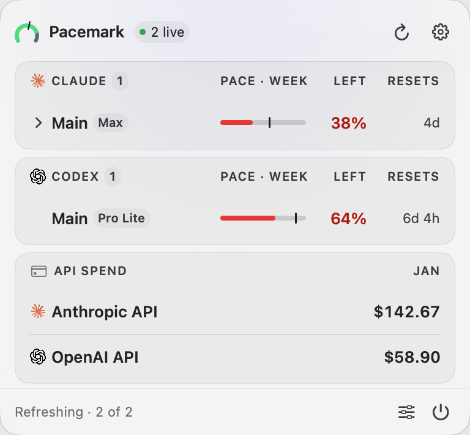
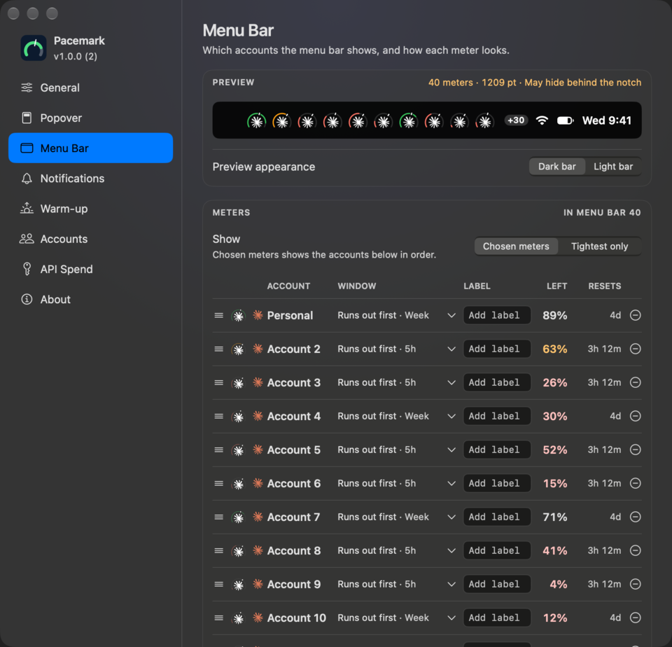

# Pacemark

Pacemark shows AI subscription usage in the Mac menu bar. Track Claude, ChatGPT/Codex, Grok, Cursor, Antigravity, GitHub Copilot and OpenCode Go. Open the popover to see each account's remaining allowance, when it resets and how your spending pace compares with the time left.




## Install

Use an Apple silicon Mac running macOS 15 or later. Download the DMG from [Pacemark releases](https://github.com/kezaer/pacemark/releases), open it and drag Pacemark into Applications. Or install with Homebrew:

```sh
brew trust kezaer/tap
brew install --cask kezaer/tap/pacemark
```

Sign in to the official CLI for each subscription you want to track, then choose your providers in **Settings › Accounts**.

## Privacy

Pacemark reads Claude usage from the official CLI's output. It never uses Claude subscription OAuth tokens or calls private Claude endpoints. Codex and Grok can read usage with their CLI's saved sign-in. Routine checks send no model prompts. Optional warm-up sends a short message and consumes quota. See [provider read paths](docs/how-it-works.md) and the [privacy policy](PRIVACY.md).

## Build from source

With Xcode 27 installed, run `swift build` and `swift test` in the checkout. To create Pacemark.app, follow the [development guide](docs/development.md). Maintainers can follow the [release guide](docs/RELEASING.md) to package the DMG.

## Credits and license

Pacemark by Nikolai Fateev is a GPL-3.0 modified version of Headroom by Kyle Zantos. See the [license](LICENSE) and [notices](NOTICE).
