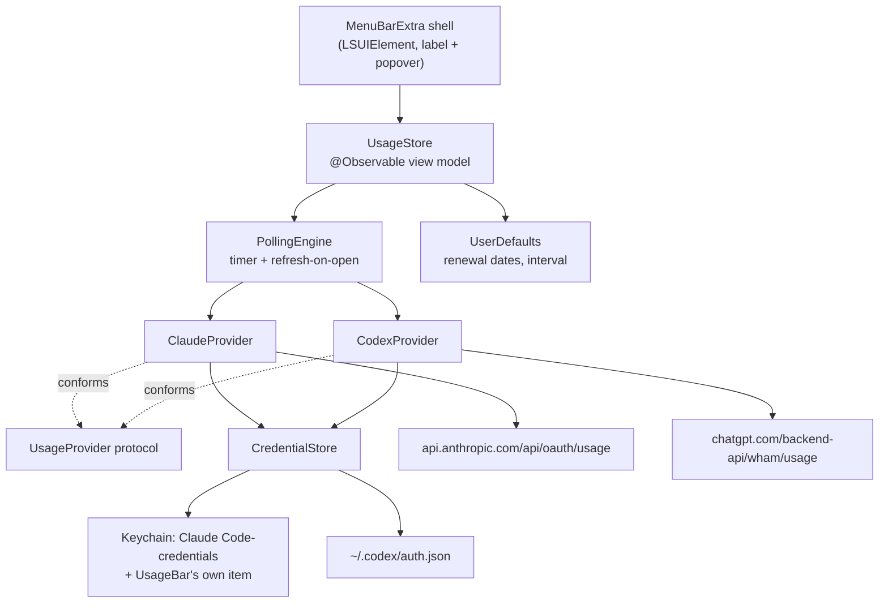
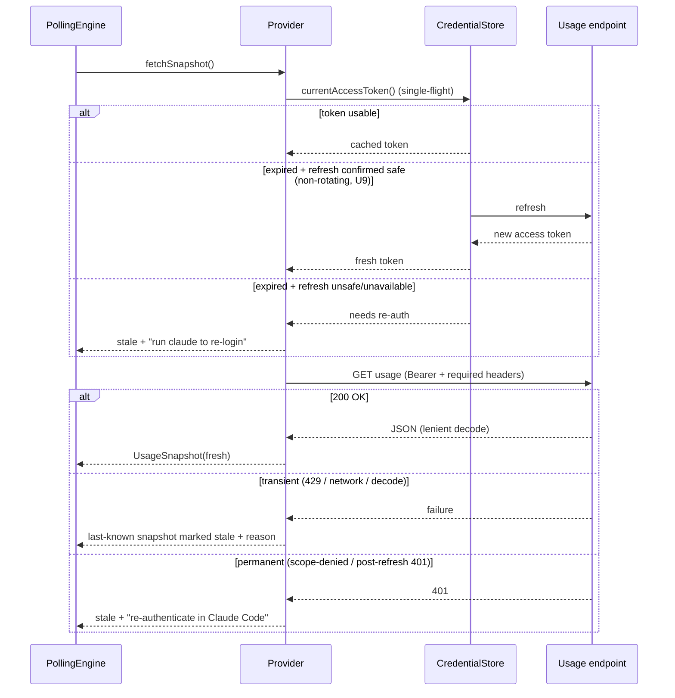

# AI Subscription Usage Menu Bar App - Plan

## Goal Capsule

- **Objective:** Ship a native macOS menu bar app (working name `UsageBar`) that shows, at a glance, how much of the user's Anthropic Claude and ChatGPT/Codex subscription usage remains for the 5-hour and weekly windows, the reset time for each window, and a manually-entered monthly renewal date per provider.
- **Authority hierarchy:** This plan → repo conventions → user preferences expressed in chat. The user's chat instruction "refined but current to macOS Tahoe components and styling" is a binding design constraint (see KTD5).
- **Execution profile:** Deep. Native Swift/SwiftUI app built from scratch, security-sensitive (reads OAuth tokens), depends on two undocumented reverse-engineered HTTP endpoints, multi-provider architecture meant to grow.
- **Stop conditions:** App builds via `xcodebuild`, launches as a menu bar item on macOS 26 (Tahoe), and displays live 5-hour and weekly usage percentages plus reset countdowns for both Claude and Codex from the user's real local credentials, with graceful degradation when an endpoint or token fails. Manual renewal dates persist and display.
- **Tail ownership:** LFG pipeline owns commit/ship. This is not a git repo yet; `ce-work`/pipeline initializes it.

---

## Product Contract

**Product Contract preservation:** No upstream brainstorm; this contract was bootstrapped by `ce-plan` from the user's request plus the mid-session design instruction.

### Summary

A small, always-available macOS menu bar utility that answers one question without opening a browser or a terminal: "how much AI subscription headroom do I have right now, and when does it reset?" It reuses the credentials the user's already-installed Claude Code and Codex CLIs maintain locally, polls each provider's usage endpoint on a timer, and renders per-provider usage in a refined Tahoe-native popover. It is built to add more subscriptions later behind a single provider abstraction.

### Problem Frame

The user pays for multiple AI subscriptions (Anthropic Claude Pro/Max, ChatGPT Pro) that meter usage across a rolling 5-hour session window and a longer weekly window. Today the only ways to see remaining headroom are running `/usage` in Claude Code or `/status` in Codex, or digging through web account pages — none of which is glanceable, and none of which shows both providers together. The user wants a single ambient surface.

### Requirements

Usage display

- R1. Show, per provider, the percentage of usage **remaining** for the 5-hour rolling window.
- R2. Show, per provider, the percentage of usage **remaining** for the weekly window.
- R3. Show the next reset time (as an absolute time and/or a countdown) for each window, sourced from the provider's response rather than computed from an assumed cadence.
- R4. Show a per-provider monthly subscription renewal date, entered manually by the user (not available from any endpoint — see KTD4).
- R5. Always show a compact, self-contained summary in the menu bar itself — the tightest-constrained live window's remaining percent plus a provider indicator (glyph/initial) identifying which provider and window it refers to — so the user gets a real glanceable signal without opening the popover. Full dual-provider, dual-window detail lives in the popover; the menu bar carries one guaranteed at-a-glance number, not an optional one.

Data acquisition

- R6. Read Claude subscription usage by reusing the local Claude Code OAuth credential and calling Anthropic's OAuth usage endpoint (see KTD1).
- R7. Read ChatGPT/Codex usage by reusing the local `~/.codex/auth.json` token and calling the Codex usage endpoint (see KTD2).
- R8. Keep tokens usable across expiry without ever invalidating the source CLI's own session, and degrade to a clear, actionable re-auth prompt when a token cannot be renewed safely (see KTD3).
- R9. Tolerate unknown/new fields and enum values in endpoint responses without crashing or blanking all data (see KTD6).

Security

- R10. Never persist a plaintext credential the app itself introduces outside the macOS Keychain, and never write logs or UI that contain raw tokens.
- R11. Do not overwrite or corrupt the credentials owned by Claude Code or Codex; treat their stores as read-mostly inputs.
- R12. Use HTTPS for all network calls; make no third-party network calls other than the two provider endpoints.

Extensibility & lifecycle

- R13. Model providers behind one abstraction so a third subscription can be added by implementing that abstraction plus a UI card, with no changes to the polling engine or shell.
- R14. Poll on a configurable interval and refresh when the popover opens; keep the menu bar current even while the popover is closed.
- R15. Offer launch-at-login and a Quit control (required because the app has no Dock presence).

### Scope Boundaries

In scope: Claude and Codex/ChatGPT providers; 5-hour + weekly windows; reset times; manual renewal dates; menu bar summary; polling; settings; launch-at-login; Tahoe-native refined UI.

Deferred to Follow-Up Work

- Additional providers (Gemini, Perplexity, Cursor, etc.) — the abstraction lands now; concrete providers come later.
- Historical usage charts / trends over time.
- Notifications/alerts at usage thresholds (e.g., "90% used"). v1 is deliberately a passive, glanceable display for *pre-task awareness* — the menu bar summary (R5) lets the user check headroom before starting. Active *mid-task interruption prevention* (threshold alerts) is a reasoned deferral, not an oversight; it's the natural next feature if passive display proves insufficient.
- Menu bar icon-only "compact mode" toggles beyond the single summary in R5.
- Distribution outside the user's own machine (notarization, Sparkle auto-update, DMG).

Outside this product's identity

- Routing inference/agent calls through subscription credentials. This app only *reads usage*; it never proxies model calls (this is the behavior Anthropic acted against — see Risks).
- Any API-key / platform billing dashboard. This is about *subscription* windows, not metered API spend.

### Sources

- steipete/CodexBar (MIT, https://github.com/steipete/CodexBar) — the closest prior art: a macOS menu bar app showing Codex + Claude session/weekly windows with reset countdowns. Its `docs/codex.md` and `docs/claude.md` document the endpoints, headers, and response field mappings for the *usage* calls. **Scope caveats confirmed by reading the files directly:** `docs/claude.md` does **not** document the OAuth refresh endpoint, `client_id`, or `grant_type`, and does **not** detail the `Claude Code-credentials` Keychain blob schema; it also states the usage endpoint requires the `user:profile` scope (a token with only `user:inference` cannot call it), and it treats direct Keychain reuse as a *bootstrap/repair fallback* behind CodexBar's own OAuth login, not a sustained refresh target. These caveats reshape KTD3 (see below). Primary implementation reference for the read path; not a source for the refresh path.
- Anthropic usage endpoint shape independently corroborated via Claude-Code-Usage-Monitor issue #202.
- Codex usage endpoint confirmed as the live `/status` data source via openai/codex issue #10869 (60s polling loop against the same URL).
- hamed-elfayome/Claude-Usage-Tracker (MIT) — native Swift/SwiftUI reference for the Claude auth modes (Keychain read + cookie fallback); its changelog (e.g. an "E3000 unauthorized" fix through v3.1.0) corroborates that Keychain-reuse auth is an ongoing operational risk, not a one-time gap.
- claude-code issue #31021 — reproduces the usage-endpoint 429 with valid credentials; closed "not planned" with no confirmed root cause (so the `User-Agent` mitigation is suspected, not proven — see KTD1).

---

## Planning Contract

### Key Technical Decisions

- KTD1. **Claude usage via the OAuth usage endpoint, reusing Claude Code's Keychain credential.** Call `GET https://api.anthropic.com/api/oauth/usage` with headers `Authorization: Bearer <access_token>`, `anthropic-beta: oauth-2025-04-20`, `Content-Type: application/json`, and a **`User-Agent: claude-code/<version>`** header. The access token is read from the login Keychain item `service = "Claude Code-credentials"`, whose value is a JSON blob containing `accessToken` / `refreshToken` / `expiresAt` (blob schema is from the Claude-Usage-Tracker precedent, not CodexBar — treat as unverified until the U9 spike confirms it). Response carries per-window objects (`five_hour`, `seven_day`, and model-scoped variants) each with a `utilization` float (0–100) and `resets_at` (ISO 8601 UTC), plus `subscriptionType`.
  - **Required scope.** The endpoint requires the token to carry the `user:profile` scope; a CLI token with only `user:inference` cannot call it and gets a **permanent** 401 that no refresh fixes (per CodexBar `docs/claude.md`). Whether the local `Claude Code-credentials` token carries `user:profile` is unconfirmed for this user — the U9 spike resolves it, and it gates whether KTD1 is viable at all. This is a distinct failure mode from an expired token (see KTD7).
  - **User-Agent (suspected, not proven).** Issue #31021 reproduces a 429 on this endpoint with *valid* credentials and was closed "not planned" with no confirmed root cause; the `User-Agent: claude-code/<version>` header is a *suspected* mitigation, not an established fix. Send it, but the U9 spike must confirm whether it actually clears the 429 (and whether the real cause is the scope issue above). Derive `<version>` from the installed `claude` CLI at runtime with a pinned static fallback string — do not hardcode a value that silently ages out as Claude Code ships new versions.
  - Rationale: this is the same data Claude Code's own `/usage` shows and needs no new login. Alternatives (KTD-alt below): claude.ai session cookie, or shelling out to the `claude` CLI.

- KTD2. **Codex/ChatGPT usage via `wham/usage`, reusing `~/.codex/auth.json`.** Call `GET https://chatgpt.com/backend-api/wham/usage` with `Authorization: Bearer <tokens.access_token>` read from `~/.codex/auth.json` (structure: `{ auth_mode, OPENAI_API_KEY, tokens: { access_token, id_token, refresh_token, account_id }, last_refresh }`). Response carries `rate_limit.primary_window` (5-hour) and `rate_limit.secondary_window` (weekly) with usage/reset fields, `additional_rate_limits[]`, and `plan_type`. This is confirmed as the literal engine behind Codex `/status` (openai/codex #10869). Reading a dotfile is filesystem-gated, not Keychain-gated — a non-sandboxed app reads it with no prompt.

- KTD3. **Token freshness — spike-gated, and never invalidate the source CLI's session.** This is the plan's highest-reversal-cost, lowest-evidence decision; it is gated on the U9 spike (below) and must not silently break Claude Code's own auth.
  - **The rotation hazard (load-bearing).** OAuth refresh tokens are commonly single-use/rotating. If `UsageBar` calls refresh with the `refreshToken` it read from `Claude Code-credentials`, the server may invalidate that token and issue a new one. Even though `UsageBar` never overwrites the `Claude Code-credentials` item, Claude Code's next self-refresh then uses a now-dead token and is forced to re-login — the exact credential corruption R11 forbids, achieved indirectly. Storage isolation alone does **not** make self-refresh safe.
  - **Default strategy (safe):** use the Claude access token read from the Keychain while it is unexpired; call the usage endpoint directly. When it has expired, do **not** blindly refresh with Claude Code's refresh token. Prefer, in order: (a) if the spike confirms the refresh token is **non-rotating**, refresh normally and cache the result in memory; (b) otherwise degrade to an actionable "run `claude` to re-login" state (KTD7) rather than risk desyncing Claude Code; (c) the claude.ai `sessionKey` cookie path (KTD-alt) is the fallback sustained-auth strategy if Keychain refresh proves unsafe or unavailable — mirroring how CodexBar itself treats direct Keychain reuse as a *bootstrap/repair fallback* behind its own OAuth login.
  - **Refresh parameters are not in the cited source.** CodexBar `docs/claude.md` does not document the token URL, `client_id`, or `grant_type`; the U9 spike must source and verify them (from observed Claude Code traffic or another citable place) before any refresh code is written. Q1 is therefore blocking for the refresh path (though not for U1–U3's read path).
  - **Token precedence.** Once `UsageBar` has successfully obtained and stored its own tokens in its **own** Keychain item, all subsequent refreshes use only that item — it re-reads `Claude Code-credentials` only on first bootstrap or when its own item is missing/invalid. It never writes back over `Claude Code-credentials` (R11).
  - **Single-flight guard.** `refreshNow()` (popover-open) can race the timer-driven poll; both call into the Claude refresh path. Guard refresh inside `CredentialStore` so concurrent callers await one in-flight refresh `Task` and share its outcome, never issuing parallel refreshes against the same (possibly single-use) refresh token.
  - **Codex** refreshes its own token when `last_refresh` is older than ~8 days and keeps `auth.json` current during use, so `UsageBar` reads it directly; on 401 it surfaces a "run `codex` to refresh" degrade state rather than reimplementing OpenAI's refresh.
  - On any refresh failure, degrade per KTD7.

- KTD4. **Renewal date is manual.** No endpoint (Anthropic or OpenAI) exposes subscription renewal/billing dates; CodexBar renders renewal dates for other providers but not for Claude/ChatGPT, confirming the field's absence. Store user-entered renewal dates in `UserDefaults` (non-secret) and display them. Do not spend effort trying to source them programmatically.

- KTD5. **macOS 26 (Tahoe) as the deployment target, with Liquid Glass / current Tahoe styling.** Per the user's binding instruction, set the deployment target to macOS 26.0 and adopt the current Tahoe design language: Liquid Glass materials for the popover surface and controls (`glassEffect` / current material APIs), concentric rounded-corner geometry, updated `MenuBarExtra` presentation, SF Symbols with the current rendering, and Tahoe's refined typography and control styles. Targeting 26.0 (rather than a lower floor) is deliberate — it is a personal tool on the user's own 26.5 machine, and it unlocks the newest components without back-compat branches. Rationale: "refined but current to Tahoe" is the design bar; matching the OS's own materials is what makes it read as native rather than a generic tinted panel. Explicitly excluded: pulsing/glowing/breathing status animations (per the user's standing global rule — no pulse artifacts).

- KTD6. **Lenient, defensive decoding is a design requirement, not a nicety.** Both endpoints are undocumented and have a track record of schema drift (CodexBar #709: a new `plan_type` value hard-broke its decoder; Anthropic's weekly-window reset cadence differs from its label). Model responses with optional fields, decode unknown enum values into an `.unknown(String)` case rather than failing, and never let one unrecognized field blank the whole snapshot. Always trust server-provided `resets_at` over any client-side assumption about window length (R3).

- KTD7. **Graceful degradation with a typed failure taxonomy.** When a provider call fails, keep and display the last-known snapshot marked stale (dimmed, with a relative "updated N min ago" and a short reason), rather than blanking the UI or crashing. Per-provider isolation: a Claude failure must not hide Codex data. Failure reasons are a **typed enum** (never free-form interpolation of a caught `Error`, `URLRequest`, or `HTTPURLResponse` — that is how tokens leak; see R10). Distinguish at minimum:
  - **Transient** (network error, 429, expired-but-refreshable token): retry on the next cycle; for an expired Claude token, attempt at most one refresh-and-retry per KTD3.
  - **Permanent — re-auth needed** (a freshly-refreshed token still 401s, or the token lacks `user:profile` scope per KTD1): do **not** loop refresh-and-retry. Surface an actionable reason — `"run claude to re-login"` for Claude (matching Codex's `"run codex to refresh"`), or `"Claude Code token lacks required scope — re-authenticate in Claude Code"` for the scope case.
  - **Decode**: lenient per KTD6; a genuinely unparseable body is a transient-style stale, not a crash.

- KTD10. **Swift 6 strict concurrency is designed in, not discovered.** New Xcode 26 projects default to Swift 6 complete concurrency checking, and the confirmed toolchain is Swift 6.3.3. U6 fetches both providers concurrently each cycle against one shared `CredentialStore` that caches and mutates tokens — a shape that will not compile unless the shared state is isolated. Therefore: `CredentialStore` is a Swift `actor` (or otherwise `Sendable` and thread-safe); `UsageProvider` conformers and `UsageSnapshot`/`UsageWindow` are `Sendable`; `UsageStore` is `@MainActor`-isolated and snapshots are published on the main actor. Deciding this up front avoids a mid-implementation compile wall.

- KTD8. **Stable code-signing identity to keep the Keychain grant persistent.** Sign with a free "Apple Development" certificate (personal team; no paid Developer Program needed), not ad-hoc `-` signing. macOS keys a Keychain item's ACL to the requesting app's code-signing Designated Requirement; ad-hoc signatures change every rebuild, so the cross-app "Always Allow" grant for `Claude Code-credentials` would be forgotten after each build. A stable Development identity anchors the DR to Team ID + bundle ID so "Always Allow" persists. The app is **non-sandboxed** (App Sandbox buys nothing for a personal tool and would block reading `~/.codex/auth.json` and the cross-app Keychain item). Notarization is not needed for a locally built, locally run app (Gatekeeper only gates quarantined downloads).

- KTD9. **Plain Xcode project, SwiftUI `App` lifecycle, `MenuBarExtra(.window)`.** A single-target Xcode project is the most `xcodebuild`-friendly and lowest-ceremony shape at this size (skip SPM-executable bundling, Tuist, XcodeGen). Use `MenuBarExtra` with `.menuBarExtraStyle(.window)` for a custom popover. Set `LSUIElement = YES` (no Dock icon). Known `MenuBarExtra` constraints to design around: the `.window` style cannot be programmatically dismissed (FB11984872) and the `.menu` style does not re-render on open (FB13683957) — so drive freshness from the polling timer into an `@Observable` view model bound to the label, not from open events.

**KTD-alt (Claude auth alternatives considered):**
- claude.ai `sessionKey` cookie → `GET https://claude.ai/api/organizations/{org_id}/usage`. Needs manual cookie extraction or an embedded webview; promoted from "fallback" to the **default sustained-auth strategy** if the U9 spike shows Keychain-token refresh is unsafe (rotating) or the token lacks `user:profile` scope.
- Shell out to the `claude` CLI and scrape `/usage` (and equivalently a CLI-backed path for Codex). Rejected as the data layer: brittle PTY/output parsing and requires the CLI on PATH. Noted because it would let the vendor CLIs absorb auth-refresh and endpoint fragility; the U9 spike checks whether `claude`/`codex` expose any non-interactive/JSON usage output that would make this cheaper than reimplementing the endpoints. If they do, revisit.

**Build vs. adopt/fork CodexBar (decision recorded).** CodexBar (MIT) already delivers much of R1–R3/R6–R9 for both providers. This plan builds fresh rather than adopting or forking it because: (1) the user's binding instruction is a native macOS-26 Tahoe / Liquid Glass app (KTD5) — CodexBar predates Tahoe styling; (2) CodexBar does not surface manual renewal dates (R4) for Claude/ChatGPT; (3) owning the code lets the provider abstraction (R13) and failure UX be exactly what this tool needs. CodexBar remains the primary *reference* for the read path. If the U9 spike shows the Claude auth path is materially harder than expected, forking CodexBar's non-UI credential/decoding layer (re-skinned for Tahoe) is the fallback rather than re-deriving it from scratch — checked as part of U9.

### Assumptions

- The user keeps Claude Code and Codex CLIs installed and logged in on this machine (confirmed present: `Claude Code-credentials` Keychain item exists; `~/.codex/auth.json` exists with a `tokens` object; `codex-cli 0.142.5`).
- Toolchain confirmed: Xcode 26.6, Swift 6.3.3, macOS 26.5.1 — sufficient for a macOS 26.0 target.
- The user has (or will create) a free Apple Development signing identity in Xcode for KTD8. If absent at build time, the app still builds/runs ad-hoc; only the Keychain-grant persistence degrades — flag this to the user rather than blocking.
- "5-hour window" and "weekly window" map to Claude's `five_hour` / `seven_day` and Codex's `primary_window` / `secondary_window` respectively.
- **Unverified until U9:** that the local `Claude Code-credentials` token carries `user:profile` scope (else the usage endpoint is unusable — KTD1); that its refresh token is non-rotating (else self-refresh desyncs Claude Code — KTD3); the exact Claude refresh parameters; and whether the `User-Agent` header actually clears the 429. The U9 spike resolves these before the Claude auth code is built.

### Sequencing

U9 (auth spike — resolves the Claude token's scope, rotation behavior, refresh parameters, and the 429/User-Agent question against real credentials) runs first and gates U3's Claude refresh code and U4. In parallel: U1 (scaffold) → U2 (model + provider protocol) and a **minimal `Preferences` surface** (poll-interval default + renewal-date storage, from U8) land early so U6 and U7 have their dependency — the full `SettingsView` UI stays in U8. Then U3 (credential access) → U4 & U5 (the two providers, parallel once U2/U3/U9 land) → U6 (polling + view model) → U7 (Tahoe UI) → U8 (settings UI + launch-at-login). U7 can begin against mock snapshots before U4/U5 are fully live.

Concretely: U9 ∥ U1 → U2 (+ minimal Preferences) → U3 → U4 ∥ U5 → U6 → U7 → U8. U9 must complete before U3's refresh code and U4.

---

## High-Level Technical Design

Component topology — the polling engine and shell depend only on the `UsageProvider` abstraction, never on a concrete provider (R13):



One poll cycle for a single provider, including token refresh and degrade (KTD3, KTD7):



---

## Output Structure

```
UsageBar/
  UsageBar.xcodeproj
  UsageBar/
    UsageBarApp.swift            # @main, MenuBarExtra shell, LSUIElement
    Models/
      UsageSnapshot.swift        # window model, %-remaining, reset, plan, staleness
      UsageProvider.swift        # provider protocol
      ProviderID.swift
    Providers/
      ClaudeProvider.swift
      CodexProvider.swift
    Credentials/
      CredentialStore.swift      # Keychain + auth.json access, redaction
      KeychainAccess.swift
    Engine/
      PollingEngine.swift
      UsageStore.swift           # @Observable view model
    UI/
      PopoverView.swift          # Tahoe/Liquid Glass popover
      ProviderCardView.swift     # per-provider card (bars, resets, renewal)
      UsageBarView.swift         # progress bar component
      SettingsView.swift
      MenuBarLabel.swift
    Settings/
      Preferences.swift          # UserDefaults-backed
      LaunchAtLogin.swift        # SMAppService wrapper
    Info.plist                   # LSUIElement = YES
  UsageBarTests/
    DecodingTests.swift
    UsageMathTests.swift
    ProviderTests.swift
    UsageStoreTests.swift
    CredentialStoreTests.swift
```

The tree is a scope declaration, not a constraint; per-unit `Files` are authoritative.

---

## Implementation Units

### U1. Project scaffold and menu bar shell

- **Goal:** A buildable, launchable macOS 26 menu bar app that shows a static SF Symbol in the menu bar and opens a placeholder Liquid Glass popover with a Quit button. No data yet.
- **Requirements:** R15 (Quit control), KTD5 (Tahoe target), KTD8 (signing/non-sandboxed), KTD9 (project shape).
- **Dependencies:** none.
- **Files:** `UsageBar.xcodeproj`, `UsageBar/UsageBarApp.swift`, `UsageBar/Info.plist`, `UsageBar/UI/PopoverView.swift` (placeholder), `UsageBar/UI/MenuBarLabel.swift`.
- **Approach:** Xcode App template, SwiftUI lifecycle, deployment target macOS 26.0. `MenuBarExtra` with `.menuBarExtraStyle(.window)`. `Info.plist` sets `LSUIElement = YES`. Configure signing to a personal Apple Development team (document the manual Xcode step in a README note); non-sandboxed (no App Sandbox entitlement). Placeholder popover uses a Liquid Glass background so the visual direction is visible from unit one.
- **Execution note:** Verification is a build/launch smoke check, not unit tests — this unit has no behavioral logic.
- **Patterns to follow:** Sarunw / nilcoalescing MenuBarExtra walkthroughs; CodexBar app structure.
- **Test scenarios:** Test expectation: none — pure scaffold/config. Smoke only: `xcodebuild` succeeds; launching shows a menu bar icon and no Dock icon; clicking opens the popover; Quit terminates.
- **Verification:** `xcodebuild -scheme UsageBar -destination 'platform=macOS' build` succeeds; manual launch shows the icon and a working Quit.

### U2. Usage domain model and provider abstraction

- **Goal:** The data types every provider produces and the protocol the engine depends on — the extensibility seam (R13).
- **Requirements:** R1, R2, R3, R9, R13, KTD6, KTD10.
- **Dependencies:** U1.
- **Files:** `UsageBar/Models/UsageSnapshot.swift`, `UsageBar/Models/UsageProvider.swift`, `UsageBar/Models/ProviderID.swift`, `UsageBarTests/UsageMathTests.swift`.
- **Approach:** `UsageSnapshot` holds a provider id, an ordered list of `UsageWindow` (kind: `.fiveHour` / `.weekly` / `.other(label)`, a `utilization` 0–100, a `resetsAt: Date`), an optional `planLabel`, a `capturedAt: Date?`, and a `freshness`. **`freshness` has three cases — `.pending` (never fetched: first launch, before any successful call), `.live`, and `.stale(reason: FailureReason)`** — so U7 can render a genuine first-run state instead of a nonsensical "updated 0 min ago" fabricated from an empty snapshot. `FailureReason` is the typed enum from KTD7 (transient / needsReauth / scopeDenied / decode). Expose `percentRemaining` = `max(0, 100 - utilization)`. `UsageWindow` reset formatting (countdown string) is a pure function. `UsageProvider` is a protocol: `var id`, `var displayName`, `func fetchSnapshot() async -> UsageSnapshot` (returns a stale/failed snapshot rather than throwing, to keep per-provider isolation — KTD7). All of `UsageSnapshot`, `UsageWindow`, `FailureReason`, and `UsageProvider` conformers are `Sendable` (KTD10). Model `planLabel` and any enum-ish field as lenient (`.unknown(String)`) per KTD6.
- **Execution note:** Implement the percent-remaining and reset-countdown math test-first — they are pure and the core correctness surface.
- **Test scenarios:**
  - `percentRemaining` for utilization 0 → 100; 100 → 0; 73.4 → 26.6; utilization >100 (over-limit) clamps to 0.
  - Reset countdown formatting for: 4h59m out, 90s out, exactly now, and a past `resetsAt` (renders "resets now"/"0m", never negative).
  - A window with `.other(label:)` kind round-trips its label.
  - A `.pending` snapshot has a nil `capturedAt` and is distinguishable from `.stale` (drives the first-run UI in U7).
- **Verification:** `UsageMathTests` pass; `UsageProvider` compiles as the sole dependency surface for the engine.

### U3. Secure credential access

- **Goal:** Read Claude's Keychain credential and Codex's `auth.json`, expose fresh access tokens, and store `UsageBar`'s own rotated tokens — all without leaking secrets (R10, R11, R12).
- **Requirements:** R6, R7, R8, R10, R11, KTD1, KTD2, KTD3, KTD8, KTD10.
- **Dependencies:** U1; the Claude refresh path additionally depends on U9 (spike must resolve refresh params/rotation/scope first).
- **Files:** `UsageBar/Credentials/CredentialStore.swift`, `UsageBar/Credentials/KeychainAccess.swift`, `UsageBarTests/CredentialStoreTests.swift`.
- **Approach:** `KeychainAccess` wraps `SecItemCopyMatching` for a `kSecClassGenericPassword` lookup by service name; reading `Claude Code-credentials` triggers the standard macOS ACL prompt on first run (expected — user picks "Always Allow"; persists given KTD8). Parse the JSON blob into `accessToken`/`refreshToken`/`expiresAt`. A separate typed reader loads `~/.codex/auth.json` (`tokens.access_token`, `refresh_token`, `account_id`, `last_refresh`). `CredentialStore` is a Swift `actor` (KTD10) exposing `claudeAccessToken() async` (returns cached if unexpired, else the spike-gated refresh/re-auth path per KTD3) and `codexAccessToken()` (direct read + expiry check). It applies the **token precedence** rule (KTD3): once it holds its own tokens, it reads only its own item, touching `Claude Code-credentials` only on bootstrap. It applies the **single-flight guard** (KTD3): concurrent callers await one in-flight refresh `Task`. When it writes `UsageBar`'s own `kSecClassGenericPassword` item, it sets `kSecAttrAccessible = kSecAttrAccessibleWhenUnlockedThisDeviceOnly` and does **not** set `kSecAttrSynchronizable` (keeps the rotated Claude refresh token device-local, never iCloud-synced). A redaction helper guarantees tokens never reach logs or `description`; failure reasons are the typed `FailureReason` (KTD7), never raw `Error`/`URLRequest`/`HTTPURLResponse` interpolation.
- **Execution note:** Inject file/Keychain/network access behind protocols so tests use fixtures; do not touch the real Keychain or real network in tests.
- **Patterns to follow:** CodexBar `docs/codex.md` for the Codex token fields; hamed-elfayome/Claude-Usage-Tracker for the Keychain read. (CodexBar `docs/claude.md` does not carry the refresh params or blob schema — those come from U9.)
- **Test scenarios:**
  - auth.json parse: valid fixture yields the four token fields; missing `tokens` yields a typed "not logged in" `FailureReason`, not a crash.
  - Claude blob parse: valid fixture yields tokens + `expiresAt`; malformed JSON yields a typed error.
  - Keychain item absent (`errSecItemNotFound`) yields a typed "not logged in / bootstrap needed" reason, distinct from the malformed-JSON case.
  - Expiry logic: an `expiresAt` in the past marks the token as needing refresh; a future one does not.
  - Token precedence: after storing its own token, `claudeAccessToken()` reads the own-item (mocked) and does not re-read `Claude Code-credentials`.
  - Single-flight: two concurrent `claudeAccessToken()` calls with an expired token trigger exactly one refresh call (assert against a counting mock).
  - Redaction: a token value passed through the logging/redaction helper never appears verbatim in output.
  - Rotated-token round-trip via a mocked Keychain writer (no real Keychain); the write sets `WhenUnlockedThisDeviceOnly` and no synchronizable flag.
- **Verification:** `CredentialStoreTests` pass with fixtures; no test reads the real Keychain, real `auth.json`, or real network.

### U4. Anthropic Claude provider

- **Goal:** Turn Claude credentials into a live `UsageSnapshot` (R6) with token refresh (R8) and graceful degrade (KTD7).
- **Requirements:** R1, R2, R3, R6, R8, R9, R12, KTD1, KTD3, KTD6, KTD7.
- **Dependencies:** U2, U3, U9 (spike resolves scope/rotation/refresh params/User-Agent before this unit's auth path is built).
- **Files:** `UsageBar/Providers/ClaudeProvider.swift`, `UsageBarTests/DecodingTests.swift` (Claude cases), `UsageBarTests/ProviderTests.swift` (Claude cases).
- **Approach:** `fetchSnapshot()` gets a token from `CredentialStore`, calls `GET https://api.anthropic.com/api/oauth/usage` with `Authorization: Bearer`, `anthropic-beta: oauth-2025-04-20`, `Content-Type: application/json`, and `User-Agent: claude-code/<version>` where `<version>` comes from the installed `claude` CLI at runtime with a pinned static fallback (KTD1), via an injected `URLSession`. The `URLSession` (or its delegate) **denies cross-host redirects / strips the Authorization header on any redirect whose host ≠ `api.anthropic.com`** so a redirected response can't leak the Bearer token (R12). Decode leniently (KTD6): map `five_hour` → `.fiveHour`, the weekly window → `.weekly`, preserve `resets_at` verbatim (KTD6/R3), carry `subscriptionType` into `planLabel`. Failure handling per KTD7's typed taxonomy: a 401 gets at most one refresh-and-retry (only if KTD3's refresh path is safe); a **still-401-after-refresh or a scope-denied response is a permanent `needsReauth`/`scopeDenied`** stale, not another retry loop; 429/network/decode are transient stale carrying prior data.
- **Execution note:** Test-first against captured JSON fixtures, including a fixture with an unrecognized window key and an unknown `subscriptionType` value to prove KTD6.
- **Patterns to follow:** CodexBar `docs/claude.md` response mapping (read path only).
- **Test scenarios:**
  - Decodes a real-shaped 200 response into windows with correct `percentRemaining` and `resetsAt`.
  - A response containing an unknown extra window key and an unknown `subscriptionType` still decodes the known windows (no total failure) — KTD6.
  - The outgoing request carries `User-Agent: claude-code/<version>` in the expected format (asserts format, not just presence — guards against a silently-empty/aged version string).
  - A stubbed cross-host redirect does not forward the Authorization header (R12).
  - 401 triggers exactly one refresh-and-retry; a second 401 degrades to a permanent `needsReauth` stale (no infinite loop).
  - A 403/401 whose body/shape indicates missing scope degrades to `scopeDenied` ("re-authenticate in Claude Code"), distinct from transient.
  - A 429 response degrades to a transient stale (dedicated regression for KTD1's failure mode).
  - A malformed/unparseable 200 body degrades to a transient decode stale, not a crash (distinct from the unknown-enum KTD6 case).
  - Network error returns a `.stale` snapshot carrying the prior data, not an empty one.
- **Verification:** Claude `DecodingTests` and `ProviderTests` pass with a mocked `URLSession` (`URLProtocol` stub); no real network in tests.

### U5. OpenAI Codex provider

- **Goal:** Turn `~/.codex/auth.json` into a live `UsageSnapshot` (R7) with staleness handling (KTD3) and graceful degrade (KTD7).
- **Requirements:** R1, R2, R3, R7, R8, R9, R12, KTD2, KTD3, KTD6, KTD7.
- **Dependencies:** U2, U3.
- **Files:** `UsageBar/Providers/CodexProvider.swift`, `UsageBarTests/DecodingTests.swift` (Codex cases), `UsageBarTests/ProviderTests.swift` (Codex cases).
- **Approach:** `fetchSnapshot()` reads `tokens.access_token`, calls `GET https://chatgpt.com/backend-api/wham/usage` with `Authorization: Bearer` via injected `URLSession`, with the same cross-host redirect denial / Authorization-stripping policy as U4 (host ≠ `chatgpt.com`) so the Bearer token can't leak on a redirect (R12). Decode leniently: `rate_limit.primary_window` → `.fiveHour`, `rate_limit.secondary_window` → `.weekly`, map `additional_rate_limits[]` to `.other(label:)` windows, carry `plan_type` into `planLabel` as a lenient value (directly guards the CodexBar #709 `plan_type` break). On 401, return a `.stale(reason: needsReauth "run codex to refresh")` snapshot rather than attempting OpenAI's refresh (KTD3).
- **Execution note:** Test-first with fixtures including an unknown `plan_type` value and an unexpected entry in `additional_rate_limits`.
- **Patterns to follow:** CodexBar `docs/codex.md`; openai/codex #10869 for the endpoint contract.
- **Test scenarios:**
  - Decodes a real-shaped 200 response into 5-hour + weekly windows with correct `percentRemaining` and reset times.
  - An unknown `plan_type` value (e.g. a new tier string) decodes into `.unknown` without failing the snapshot — KTD6/#709 regression guard.
  - `additional_rate_limits[]` entries surface as `.other` windows; an empty/absent array is fine.
  - Missing `tokens.access_token` yields a "not logged in" stale snapshot, not a crash.
  - 401 yields a stale snapshot with the "run codex" reason.
  - Network error returns a `.stale` snapshot carrying the prior data (parity with U4).
  - A stubbed cross-host redirect does not forward the Authorization header (R12).
- **Verification:** Codex `DecodingTests` and `ProviderTests` pass with a mocked `URLSession`.

### U6. Polling engine and view model

- **Goal:** Drive all providers on a configurable timer and on popover-open, feeding an `@Observable` store the UI and menu bar label bind to (R14, R5), with per-provider isolation (KTD7).
- **Requirements:** R5, R13, R14, KTD7, KTD9, KTD10.
- **Dependencies:** U2 (uses only the protocol), U4, U5, minimal `Preferences` surface (from U8, landed early per Sequencing).
- **Files:** `UsageBar/Engine/PollingEngine.swift`, `UsageBar/Engine/UsageStore.swift`, `UsageBarTests/UsageStoreTests.swift`.
- **Approach:** `PollingEngine` holds `[UsageProvider]` (concrete list injected at composition root, so the engine has no concrete dependency — R13). An async loop fires every `interval` (default 3–5 min, from `Preferences`) and also exposes `refreshNow()` called on popover open (KTD9 — because `.window` style may not re-render on open); the concurrent-refresh race between the two is handled by `CredentialStore`'s single-flight guard (KTD3). Each cycle fetches providers concurrently; `UsageStore` is `@MainActor` and snapshots are published on the main actor (KTD10). `UsageStore` computes the menu bar summary (R5): the single most-constrained live window's remaining percent **paired with a provider+window identity** (which provider, 5h vs weekly) so `MenuBarLabel` can render a self-contained indicator; a neutral glyph when all data is `.pending`/stale. A failure in one provider updates only that provider's snapshot.
- **Execution note:** Use injected providers and a controllable clock so tests can advance time without real waiting.
- **Test scenarios:**
  - With two stub providers, one cycle populates both snapshots.
  - `refreshNow()` triggers an immediate fetch off the timer cadence.
  - A provider returning a `.stale` snapshot does not clear or overwrite the other provider's live snapshot.
  - Menu bar summary picks the lowest `percentRemaining` among live windows and carries its provider+window identity; when all are `.pending`/stale it shows the neutral state.
  - Changing the interval preference reschedules the loop.
- **Verification:** `UsageStoreTests` pass with stub providers and an injected clock.

### U7. Tahoe-native popover UI

- **Goal:** A refined, current-to-Tahoe popover that renders each provider's 5-hour and weekly usage, reset countdowns, plan label, and renewal date — plus the menu bar label (R1–R5, KTD5).
- **Requirements:** R1, R2, R3, R4, R5, R13, KTD5, KTD7.
- **Dependencies:** U2 (renders snapshots; can start against mocks), U6 (live data), minimal `Preferences` surface (renewal-date values, landed early per Sequencing).
- **Files:** `UsageBar/UI/PopoverView.swift`, `UsageBar/UI/ProviderCardView.swift`, `UsageBar/UI/UsageBarView.swift`, `UsageBar/UI/MenuBarLabel.swift`.
- **Approach:** One `ProviderCardView` per provider: a header with the provider name + a static provider accent (brand glyph or color chip — **static, no animation**, so Claude vs Codex cards are distinguishable at a glance) + plan label; two `UsageBarView` progress bars (5-hour, weekly) showing percent **remaining** with the numeric value, each with its reset countdown; and the manual renewal date. Compose on a Liquid Glass surface using current Tahoe material APIs (`glassEffect` / equivalent), concentric rounded corners, SF Symbols, and Tahoe typographic and control styles for a native-not-generic feel (KTD5).
  - **Explicit per-card states (drive from `UsageSnapshot.freshness`):**
    - `.pending` (first run, before any successful fetch): a skeleton/"Waiting for first update…" treatment — **not** the dimmed stale treatment, and never a fabricated "updated 0 min ago" (KTD7 / U2's `.pending` case).
    - `.live`: full-color bars + "updated just now/N min ago".
    - `.stale(transient)`: dimmed bars + "updated N min ago" + short reason.
    - `.stale(needsReauth/scopeDenied)`: an actionable message with the exact CLI action — `"run claude to re-login"` / `"re-authenticate in Claude Code"` for Claude, matching Codex's `"run codex to refresh"`.
  - **First-run Keychain permission:** while the macOS ACL prompt for `Claude Code-credentials` is pending, the Claude card shows an "Awaiting Keychain permission…" state; if the user clicks "Don't Allow," show a distinct "Keychain access denied — grant access to show Claude usage" state with a retry affordance, not a silent permanent stale.
  - **Unset renewal date:** when no renewal date is set for a provider, the card shows "Renewal date not set" as a tappable affordance that opens Settings to that provider's date picker — so the field is discoverable without hunting through Settings.
  - **Card order:** fixed insertion order at the composition root (Claude, then Codex); a third provider appends (R13).
  - **Reset countdown:** ticks on its own lightweight UI timer (per-minute is enough) independent of the 3–5 min data poll, so it never reads as frozen; the displayed data still refreshes only on poll.
  - **Accessibility:** each `UsageBarView` sets an `accessibilityValue` stating "N percent remaining" (a custom bar is invisible to VoiceOver otherwise — silently failing R1/R2); the popover tolerates Dynamic Type without clipping.
  - `MenuBarLabel` renders the R5 summary: the tightest live window's remaining percent **plus its provider+window indicator** (from U6), so the menu bar is self-contained. Progress bars use static fills — **no pulsing/glowing/breathing animation** (user's standing rule); value transitions may use a brief, non-looping ease. Cards are a data-driven append, not a layout rewrite (R13).
- **Execution note:** Mostly view code; verify visually. Pull any non-trivial formatting (percent, countdown) from the tested pure functions in U2 rather than reimplementing in the view. Liquid Glass inside a `MenuBarExtra(.window)` popover is an untested combination — do a quick visual spike at the start of U7 to confirm `glassEffect` composites on the popover surface (or scope it to inner controls if not) before building all card states.
- **Patterns to follow:** CodexBar's per-provider card layout and provider-colored accents; Apple's current Tahoe/Liquid Glass material guidance.
- **Test scenarios:** Test expectation: none for the SwiftUI views themselves (formatting logic is covered by U2's `UsageMathTests`). Visual smoke on macOS 26 against real credentials: first launch shows the `.pending` skeleton (not "0 min ago"); both cards then show two bars, correct remaining percentages, per-minute-ticking countdowns, provider accents, and the renewal date (or the "not set" affordance); a forced Claude refresh failure shows the actionable "run claude to re-login" message; the menu bar label shows a percent with a provider indicator; VoiceOver reads each bar's percent-remaining value.
- **Verification:** Manual visual + VoiceOver check on macOS 26; formatting correctness delegated to U2 tests.

### U8. Settings, manual renewal dates, and launch-at-login

- **Goal:** Persist user preferences — poll interval, per-provider renewal dates (R4), and launch-at-login (R15) — and expose them in a settings pane.
- **Requirements:** R4, R14, R15, KTD4, KTD9.
- **Dependencies:** U1. The `Preferences` type itself (interval default + renewal-date storage) lands **early** alongside U2 per Sequencing, since U6 and U7 consume it; U8 adds `LaunchAtLogin` and the `SettingsView` UI on top.
- **Files:** `UsageBar/Settings/Preferences.swift`, `UsageBar/Settings/LaunchAtLogin.swift`, `UsageBar/UI/SettingsView.swift`.
- **Approach:** `Preferences` wraps `UserDefaults` for `pollIntervalMinutes` and a `[ProviderID: Date]` map of renewal dates (KTD4 — non-secret, so UserDefaults not Keychain). `LaunchAtLogin` wraps `SMAppService.mainApp` register/unregister with current-status reporting. `SettingsView` is reached from a **gear icon in the popover's top-right** (Tahoe convention) and also opens directly from the card's "Renewal date not set" affordance (U7); it exposes interval, a date picker per provider, and the launch-at-login toggle, in Tahoe styling consistent with U7, with a sensible keyboard focus order across its controls.
- **Test scenarios:**
  - Renewal date round-trips through `Preferences` (set → read equals set).
  - Poll interval persists and defaults sanely when unset.
  - `LaunchAtLogin` toggle reflects and updates `SMAppService` status (mock the service in tests; real registration verified by smoke).
- **Verification:** `Preferences` tests pass; smoke-check that the gear opens Settings, toggling launch-at-login registers the login item, and renewal dates display in the cards.

### U9. Claude auth spike (runs first; gates U3 refresh path and U4)

- **Goal:** Cheaply resolve the plan's highest-risk unknowns against real credentials **before** any Claude auth code is written, so U3/U4 build on confirmed behavior instead of reverse-engineering assumptions mid-implementation. Time-boxed investigation, not production code.
- **Requirements:** De-risks R6, R8, KTD1, KTD3; resolves Q1, Q4, Q6.
- **Dependencies:** none (needs only the real `Claude Code-credentials` token on this machine).
- **Files:** none shipped — findings are recorded back into KTD1/KTD3 and Open Questions of this plan (and a throwaway script may live under a scratch path, not the app target).
- **Approach:** Using the real local token (e.g. a scratch `curl`/Swift snippet), empirically answer, in order: (1) **Scope** — does `GET /api/oauth/usage` succeed with the local token, or 401 for missing `user:profile`? If it can't be called at all, KTD1 is not viable and the plan pivots to the claude.ai cookie path (KTD-alt) before U4. (2) **User-Agent** — does the call 429 without `User-Agent: claude-code/<version>` and succeed with it? Confirm or drop the header's load-bearing claim. (3) **Refresh** — capture the exact token URL, `client_id`, and `grant_type` (from observed Claude Code traffic or another citable source), and **test whether refreshing rotates the refresh token** — after a refresh, does Claude Code's own stored token still work? This decides KTD3's branch (safe self-refresh vs. degrade-to-re-login vs. cookie path). (4) **Blob schema** — confirm the `Claude Code-credentials` JSON shape (`accessToken`/`refreshToken`/`expiresAt`).
- **Execution note:** Investigation/spike — no unit tests. Do not commit real tokens or captured traffic; record only the resolved facts in the plan.
- **Test scenarios:** Test expectation: none — spike. Exit signal below.
- **Verification:** KTD1 (scope, User-Agent), KTD3 (rotation, refresh params), and Open Questions Q1/Q4 are updated with confirmed answers; the Claude auth strategy branch is chosen and recorded before U3's refresh code and U4 begin.

---

## Verification Contract

| Gate | Command / action | Applies to |
|---|---|---|
| Auth spike resolved | U9's four questions (scope, User-Agent, refresh rotation/params, blob schema) answered and recorded in KTD1/KTD3 | Gates U3 refresh path + U4 |
| Build | `xcodebuild -scheme UsageBar -destination 'platform=macOS' build` (Swift 6 complete concurrency clean — KTD10) | All units; must pass before ship |
| Unit tests | `xcodebuild -scheme UsageBar -destination 'platform=macOS' test` | U2, U3, U4, U5, U6, U8 |
| Decode robustness | DecodingTests include unknown-enum/extra-field fixtures and a malformed-body decode-error case | U4, U5 (KTD6) |
| Failure taxonomy | Tests cover transient (429/network) vs permanent (post-refresh 401 / scope-denied) vs decode; assert no infinite refresh loop | U4, U5 (KTD7) |
| Token-leak / redaction | Failure reasons are the typed `FailureReason` enum; grep U3–U6 catch blocks confirm no raw `Error`/`URLRequest`/`HTTPURLResponse` interpolation into logged or user-visible strings | U3, U4, U5, U6 (R10) |
| Redirect safety | Stubbed cross-host redirect does not forward the `Authorization` header | U4, U5 (R12) |
| No-real-secrets in tests | Credential/provider tests use fixtures + `URLProtocol` stubs; grep test target for real endpoints/Keychain calls | U3, U4, U5 |
| Transport | No `NSAppTransportSecurity` exceptions in `Info.plist`; any `URLSessionDelegate` challenge handling uses default certificate validation only | U1, U4, U5 (R12) |
| Live smoke | Launch on macOS 26; first run shows the `.pending` state (not "0 min ago"); both providers then show live 5-hour + weekly percentages and reset countdowns from real credentials; kill network → cards go stale, not blank; Claude refresh failure shows an actionable re-login message | U4, U5, U6, U7 |
| Visual + a11y smoke | Popover renders in Tahoe Liquid Glass styling; no pulsing/looping animations; VoiceOver reads each bar's percent-remaining; Dynamic Type does not clip | U7 (KTD5) |
| No-desync | After UsageBar performs a Claude token refresh, the `claude` CLI still authenticates normally (does not get logged out) | U3, U9 (KTD3, R11) |
| Signing | App built with a stable Apple Development identity; first-run Keychain "Always Allow" survives a rebuild | U1, U3 (KTD8) |

Network calls in tests must be mocked (`URLProtocol`); no test may hit `api.anthropic.com` or `chatgpt.com`, read the real Keychain, or read the real `~/.codex/auth.json`. (The U9 spike is manual investigation against real credentials — it is not part of the automated test suite and ships no code.)

---

## Definition of Done

Global:

- App builds (Swift 6 complete-concurrency clean) and unit tests pass via the Verification Contract commands.
- Launching on macOS 26 shows a menu bar item (no Dock icon), a Tahoe-styled Liquid Glass popover, and a working Quit.
- First launch shows a `.pending` first-run state (never a fabricated "updated 0 min ago"); the first-run Keychain-permission and denied-permission states are handled with a retry path.
- Both Claude and Codex cards display live 5-hour and weekly **remaining** percentages and reset countdowns from the user's real local credentials; the menu bar label shows a percent with a provider indicator.
- Manual renewal dates persist and display; an unset date shows a tappable "not set" affordance into Settings; launch-at-login toggles a real login item.
- Killing the network degrades cards to a dimmed stale state (with a typed reason), never blank or crashed; a Claude/Codex re-auth need shows an actionable "run …" message; a failure in one provider does not affect the other.
- Performing a Claude token refresh does not log the `claude` CLI out (no session desync — KTD3/R11).
- No token value ever appears in logs, UI, or error text (typed `FailureReason` only).
- VoiceOver reads each usage bar's percent-remaining; the popover tolerates Dynamic Type.
- No pulsing/glowing/breathing animations exist in the UI.
- Abandoned/experimental code from approaches that didn't pan out is removed from the diff.

Per-unit: each unit's Verification line is satisfied and its test scenarios (where the unit is feature-bearing) are covered.

---

## Risks & Dependencies

- **Undocumented endpoints, both providers.** Neither `api/oauth/usage` nor `wham/usage` is officially supported. They have broken within the last year (a 429 on the Anthropic endpoint with valid creds — #31021, closed "not planned"; CodexBar #709 `plan_type` decode break). Mitigation: the suspected `User-Agent` mitigation (KTD1, confirmed in U9), lenient decoding (KTD6), graceful degrade (KTD7), and server-provided reset times (R3). Accept that a future breakage may need a decoder patch.
- **429 root cause unconfirmed.** Issue #31021 does not establish that the `User-Agent` header is what clears the 429 — it reproduces the 429 with valid credentials and no confirmed fix. The real cause could be the `user:profile` scope gap instead. Mitigation: U9 empirically determines which mitigation actually works before U4 relies on it.
- **Semantic drift.** Anthropic's "weekly" (`seven_day`) window has been observed resetting on a ~72h cadence, not 7 days. Mitigation: never compute reset times client-side; always display the server's `resets_at`.
- **ToS / account-safety.** Anthropic acted against third-party use of subscription OAuth credentials in April 2026 (the OpenClaw ban) — reportedly targeting *routing inference calls* through subscription creds, not passive usage reads (this enforcement-scope detail is second-hand and not independently verified here). This app is explicitly read-only (Outside-scope boundary). Risk is low but non-zero; surfaced honestly so the user owns the choice. Keep the app strictly usage-reading; never proxy model calls.
- **Token refresh fragility + session desync (Claude).** The riskiest single piece: the exact refresh params are not in the cited source (CodexBar `docs/claude.md` lacks them), CodexBar treats Keychain reuse as a *bootstrap/repair fallback* not a sustained refresh target, and refreshing with Claude Code's rotating token can log Claude Code out (KTD3). Real-world Keychain-reuse trackers show recurring auth glitches (Claude-Usage-Tracker's "E3000 unauthorized" fixes through v3.1.0). Mitigation: U9 resolves rotation/params first; default to not self-refreshing unless proven safe; fall back to the claude.ai cookie path (KTD-alt) or an actionable "re-auth needed" degrade rather than silent failure or session desync.
- **Untested Tahoe combination.** `glassEffect` inside a `MenuBarExtra(.window)` popover is not a documented/demonstrated combination (Apple showed Liquid Glass mainly in window chrome/toolbars/sheets). Mitigation: the U7 visual spike confirms it composites, or scopes the material to inner controls.
- **Signing identity dependency.** Persistent Keychain grant (KTD8) needs a stable Development identity. If the user hasn't set one up, the app still works but re-prompts for Keychain access after each rebuild — an annoyance, not a blocker; document the one-time Xcode signing step.
- **Name collision (FYI).** An existing product "ClaudeUsageBar" (claudeusagebar.com) has a near-identical name and scope to this working directory (`usage-bar`). Not a functional risk; worth a rename decision before any public sharing.

---

## Open Questions

- Q1 (blocking for the Claude refresh path; resolved by U9). Exact Anthropic OAuth token-refresh parameters (token URL, client_id, grant type). CodexBar `docs/claude.md` was confirmed **not** to contain these; source them from observed Claude Code traffic or another citable place. Blocks U3's refresh code and U4, but not U1–U3's read path.
- Q4 (blocking for KTD1 viability; resolved by U9). Does the local `Claude Code-credentials` token carry `user:profile` scope (required to call `/api/oauth/usage`), or only `user:inference`? If it can't call the endpoint at all, pivot Claude to the claude.ai cookie path before U4.
- Q5 (blocking for KTD3 branch; resolved by U9). Does Anthropic's refresh endpoint rotate/invalidate the refresh token on use? Determines whether self-refresh is safe or whether UsageBar must degrade to "run `claude` to re-login" to avoid desyncing Claude Code.
- Q6 (deferred, non-blocking). Does `glassEffect` composite correctly inside a `MenuBarExtra(.window)` popover, or must the material be scoped to inner controls? Resolved by the U7 visual spike.
- Q2 (deferred, non-blocking). Final app display name (keep `UsageBar`, or rename to avoid the ClaudeUsageBar collision). Cosmetic; can be decided before ship.
- Q3 (deferred, non-blocking). Default poll interval (proposed 3–5 min to balance freshness against hitting undocumented endpoints too often). Tunable in settings regardless.
