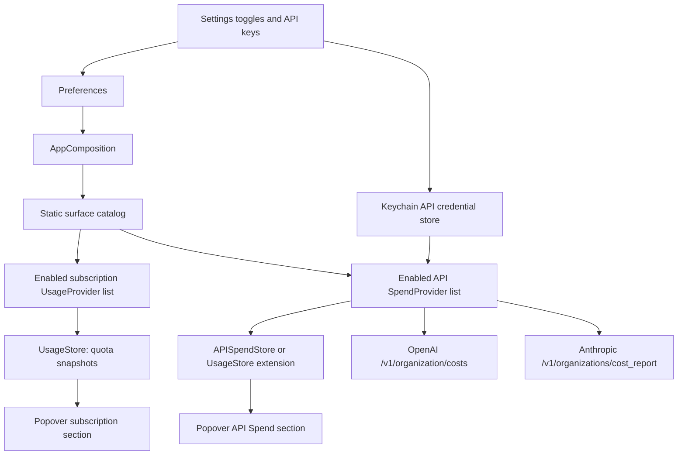

# API Cost Usage - Plan

## Goal Capsule

| Field | Value |
|---|---|
| Objective | Add optional API spend visibility for OpenAI/Codex and Anthropic/Claude alongside the existing subscription quota cards. |
| Authority | User request and project `AGENTS.md` take precedence; official provider cost-report APIs shape the integration contract. |
| Execution profile | Standard code change across HeadroomCore models/providers/credentials/preferences plus SwiftUI popover/settings. |
| Stop conditions | Stop if the only available path would reuse Claude subscription OAuth, infer dollar spend from token counts, or expose API/admin keys in UI, logs, tests, or commits. |
| Tail ownership | Implementation owns exact DTO field tolerance, UI polish, local test fixtures, and verification against mocked HTTP/Keychain seams. |

---

## Product Contract

### Summary

Headroom should optionally show API dollar spend for users who pay metered provider bills in addition to, or instead of, subscription quota windows.
The popover must separate subscription usage from API spend so a user who has both does not confuse remaining subscription capacity with billable token cost.
Settings must let users enable only the providers and surfaces they actually use.

### Problem Frame

The app currently answers "how much subscription quota do I have left?" for Claude and Codex.
That is not enough for users who also use API keys and accrue provider charges.
API spend is a different mental model: it is money over a billing period, requires admin-style credentials, and may be absent for personal subscription-only users.

### Requirements

**API spend visibility**

- R1. The popover shows API spend as a separate section from subscription usage when at least one API spend provider is enabled.
- R2. OpenAI/Codex API spend shows dollar cost from OpenAI's organization costs endpoint, not inferred token usage.
- R3. Anthropic/Claude API spend shows dollar cost from Anthropic's organization cost report endpoint, not Claude subscription quota or Claude Code `/usage`.
- R4. Spend rows show a clear period label, last-updated state, and provider-specific failure/remediation states.

**Configuration and flexibility**

- R5. Settings provide independent toggles for Claude subscription usage, Codex subscription usage, OpenAI API spend, and Anthropic API spend.
- R6. Users can configure the API spend reporting period without code changes, with a sensible current-month default.
- R7. API/admin keys are stored in Keychain and never displayed after entry.
- R8. Missing, disabled, or unauthorized API spend providers do not block subscription providers or other enabled API spend providers.

**Privacy and safety**

- R9. The app never reintroduces Claude subscription OAuth or reads Claude Code subscription credentials for API spend.
- R10. Failure surfaces use typed redacted reasons only; no raw request, response, URL with token, key, or provider error body reaches UI/log/test output.
- R11. HTTP clients block redirects for authenticated API requests.

### Acceptance Examples

- AE1. Given subscription usage and OpenAI API spend are enabled, when the popover opens, then the user sees subscription cards and a visually separate API Spend section with OpenAI dollar cost.
- AE2. Given Anthropic API spend is enabled without an admin key, when refresh runs, then the Anthropic API spend row shows an actionable "add admin key" state and Claude subscription usage continues to refresh through the CLI.
- AE3. Given both API spend providers fail with 403/401, when subscription providers succeed, then API spend rows show permission/reauth guidance while subscription quota remains live.
- AE4. Given all API spend toggles are off, when the app launches, then no API spend HTTP calls are made and the popover remains focused on subscription usage.

### Scope Boundaries

In scope: current-period cost totals, provider-level API spend rows, Keychain-backed API credentials, settings toggles, mocked tests, and a native macOS UI pass.

Deferred to Follow-Up Work:

- Budget thresholds, spend alerts, charts, per-project/API-key breakdowns, Claude Code Analytics productivity metrics, and OpenAI usage-by-model/token reporting.
- Provider-specific billing portal deep links if the app later grows a larger billing dashboard.

Outside this product's identity:

- Estimating cost from local token logs.
- Managing organization members, API keys, projects, workspaces, or spend limits.
- Reusing Claude subscription OAuth, Claude Code Keychain tokens, or spoofed Claude Code user agents for API cost data.

---

## Planning Contract

### Key Technical Decisions

- KTD1. **Model API spend separately from subscription windows.** Add an `APISpendSnapshot` family rather than stretching `UsageSnapshot`/`UsageWindow`; percent remaining and reset countdown semantics do not fit dollar cost.
- KTD2. **Use provider cost endpoints as source of truth.** OpenAI uses `GET https://api.openai.com/v1/organization/costs`; Anthropic uses `GET https://api.anthropic.com/v1/organizations/cost_report` with `anthropic-version: 2023-06-01`. This avoids inaccurate token-to-dollar math and honors negotiated/provider-side billing rules.
- KTD3. **Admin credentials are opt-in Keychain secrets.** API spend endpoints require elevated credentials, so Settings accepts and validates/stores separate OpenAI and Anthropic admin keys without coupling them to `~/.codex/auth.json` or Claude CLI state.
- KTD4. **Toggles determine active polling, not settings discoverability.** `AppComposition` and the stores build/fetch only enabled subscription and API spend providers, while Settings renders from a static surface catalog so disabled rows remain visible and can be re-enabled.
- KTD5. **Current-month is the default period, with room for later ranges.** Store an `APISpendPeriod` preference that initially supports current month and rolling 30 days; model it extensibly so later custom periods or grouped breakdowns do not change provider contracts.
- KTD6. **Spend fetching follows the existing isolation contract.** API spend providers never throw; they return pending/live/stale snapshots with typed failure reasons, and the store merges stale results per provider without blanking other surfaces.
- KTD7. **UI separates sections by meaning, not brand alone.** The popover keeps subscription cards first, then an API Spend section with compact money rows for enabled providers; if a user uses both Claude subscription and Anthropic API, they see two distinct surfaces.

### High-Level Technical Design

The diagram is the intended component shape, not a file-by-file implementation recipe.
Keep subscription polling intact and add a parallel spend pipeline only where the existing `UsageProvider` abstractions stop fitting.

### Assumptions

- OpenAI organization costs requires an Admin API key or equivalent admin credential; a regular model API key may fail with permission errors.
- Anthropic cost reporting requires an Admin API key or org-admin OAuth token; this plan implements Admin API key storage first and treats OAuth as future work unless implementation discovers a safer local pattern.
- Cost responses may contain multiple daily buckets; the app should sum `amount.value` across returned results for the selected period and preserve lowercase ISO currency.

### System-Wide Impact

This change adds a second polling surface and a second secret class.
It must preserve Swift 6 strict concurrency, test injection, and redaction guarantees while preventing optional API spend failures from making the app feel broken for subscription-only users.

### Risks & Dependencies

| Risk | Mitigation |
|---|---|
| Provider cost schemas evolve. | Decode leniently and keep fixtures focused on required fields only. |
| Admin keys have broad account access. | Store in Keychain, never echo after save, avoid logs, and block redirects. |
| Polling cost endpoints too frequently creates noise or rate limits. | Reuse the existing refresh cadence initially, but keep API spend provider list independently configurable for future backoff. |
| Dollar values can be multi-currency or absent. | Preserve currency from response; display unknown/missing amount as a typed decode stale rather than `$0.00`. |

### Sources & Research

- OpenAI API Reference: `GET /organization/costs` returns organization cost buckets with `amount.value` and `amount.currency`.
- Anthropic Claude Platform Admin API: Admin API requires admin credentials and links Usage and Cost API for organization cost reporting.
- Anthropic Cost Report API Reference: `GET /v1/organizations/cost_report`.
- Project source: `Sources/HeadroomCore/Models/UsageModels.swift`, `Sources/HeadroomCore/Engine/UsageStore.swift`, `Sources/HeadroomCore/Settings/Preferences.swift`, `Sources/HeadroomApp/UI/PopoverView.swift`, `Sources/HeadroomApp/UI/SettingsView.swift`.

---

## Implementation Units

### U1. API Spend Domain Models

- **Goal:** Add a first-class model for money-based API spend without changing subscription window semantics.
- **Requirements:** R1, R2, R3, R4, R8, R10.
- **Dependencies:** None.
- **Files:** `Sources/HeadroomCore/Models/UsageModels.swift`, `Sources/HeadroomCore/Models/UsageProvider.swift`, `Tests/HeadroomCoreTests/UsageMathTests.swift`, `Tests/HeadroomCoreTests/Mocks.swift`.
- **Approach:** Introduce spend models such as provider id, amount, currency, period, captured timestamp, and freshness. Either add a small `APISpendProvider` protocol or a generic provider protocol only if it reduces duplication; prefer a dedicated protocol if the UI and polling code read more clearly.
- **Patterns to follow:** `UsageSnapshot`, `Freshness`, `FailureReason`, and `UsageProvider` use immutable `Sendable` value types and typed failure reasons.
- **Test scenarios:** Happy path creates a live USD spend snapshot with period and captured time. Edge case preserves non-USD currency labels. Error path creates stale not-logged-in and permission states without amount. Integration scenario proves mock spend providers can be fetched without touching real network or Keychain.
- **Verification:** Model tests pass and no existing `UsageWindow.percentRemaining` behavior changes.

### U2. Keychain-Backed API Credential Store

- **Goal:** Store and retrieve separate OpenAI and Anthropic API/admin keys securely.
- **Requirements:** R5, R7, R9, R10.
- **Dependencies:** U1.
- **Files:** `Sources/HeadroomCore/Credentials/CredentialStore.swift`, `Sources/HeadroomCore/Credentials/CredentialModels.swift`, `Sources/HeadroomCore/Credentials/Redaction.swift`, `Tests/HeadroomCoreTests/CredentialStoreTests.swift`.
- **Approach:** Extend credential storage through injectable Keychain access for API keys, keeping existing Codex auth reader behavior intact. Service names should be provider-specific and app-owned. Public methods return typed `FailureReason` values and never expose raw Keychain errors to UI.
- **Execution note:** Add the Keychain seam before production calls so tests characterize every credential state without reading the real Keychain.
- **Patterns to follow:** `CredentialStore` is an actor; `CredentialError` is typed; `Redaction` centralizes token-safe handling.
- **Test scenarios:** Happy path stores and reads OpenAI and Anthropic keys through a mock keychain. Edge case overwriting a key replaces the prior value. Error path missing key returns `.notLoggedIn` with provider-specific copy. Error path malformed/keychain failure returns redacted unreadable state. Regression scenario confirms `codexAccessToken()` still reads `~/.codex/auth.json` through the existing reader.
- **Verification:** Credential tests pass and no test requires real Keychain prompts.

### U3. API Cost Providers and Decoders

- **Goal:** Fetch OpenAI and Anthropic cost totals from official cost report endpoints.
- **Requirements:** R2, R3, R4, R8, R10, R11.
- **Dependencies:** U1, U2.
- **Files:** `Sources/HeadroomCore/Providers/APISpendProviders.swift`, `Sources/HeadroomCore/Providers/UsageDTOs.swift`, `Sources/HeadroomCore/Providers/UsageHTTPClient.swift`, `Tests/HeadroomCoreTests/APISpendProviderTests.swift`, `Tests/HeadroomCoreTests/Mocks.swift`.
- **Approach:** Implement one provider per API platform using the shared redirect-blocking HTTP seam. OpenAI sends `Authorization: Bearer <OPENAI_ADMIN_KEY>` to `/v1/organization/costs` with `start_time`, `end_time`, `bucket_width=1d`, and default ungrouped results. Anthropic sends `x-api-key: <ANTHROPIC_ADMIN_KEY>` plus `anthropic-version: 2023-06-01` to `/v1/organizations/cost_report` with the equivalent date range. Decoders sum bucket result amounts and keep the first non-empty currency unless a mixed-currency response requires a typed decode stale.
- **Patterns to follow:** `CodexProvider` and `UsageWindowBuilder` already show lenient DTO decoding, typed HTTP status mapping, injected `now`, and no throwing providers.
- **Test scenarios:** Happy path OpenAI sums multiple bucket costs. Happy path Anthropic sums multiple cost rows. Edge case empty result returns `$0.00` only when the provider returns an explicitly valid empty cost set. Error path 401/403 returns permission/reauth stale. Error path 429/network returns transient stale. Decode failure never includes response body text. Integration scenario verifies redirect-blocking client receives auth headers only through the injected seam in tests.
- **Verification:** Provider tests pass with fixtures and no live HTTP calls.

### U4. Preferences, Provider Wiring, and Polling Integration

- **Goal:** Let users opt into any combination of subscription and API spend providers without hidden polling.
- **Requirements:** R1, R5, R6, R8.
- **Dependencies:** U1, U3.
- **Files:** `Sources/HeadroomCore/Settings/Preferences.swift`, `Sources/HeadroomCore/Engine/UsageStore.swift`, `Sources/HeadroomCore/Engine/PollingEngine.swift`, `Sources/HeadroomApp/HeadroomApp.swift`, `Tests/HeadroomCoreTests/PreferencesTests.swift`, `Tests/HeadroomCoreTests/UsageStoreTests.swift`.
- **Approach:** Add boolean preferences for each subscription/API surface and a period preference for API spend. Introduce a static surface catalog that Settings uses for all known surfaces, including disabled ones. Wire only enabled providers into polling in `AppComposition`, and let setting changes rebuild or update the active provider arrays before refreshing. Either extend `UsageStore` with `apiSpendSnapshots` and a second provider array, or introduce a small `APISpendStore` owned by the same app composition; choose the shape that keeps SwiftUI bindings simple and tests focused.
- **Patterns to follow:** `Preferences` uses UserDefaults keys with sensible defaults; `UsageStore.refreshAll()` fetches providers concurrently and merges stale results with continuity.
- **Test scenarios:** Default settings keep existing subscription providers enabled and API spend disabled. Enabling OpenAI API spend creates one spend provider and refreshes it. Disabling all API spend providers makes no spend fetch calls. A disabled surface remains visible in Settings and can be re-enabled in the same session. Period preference clamps or normalizes invalid persisted values. Failure in an API spend provider does not change subscription snapshots.
- **Verification:** Preferences and store tests pass; existing menu bar summary remains based on subscription windows only unless implementation deliberately adds a separate spend indicator later.

### U5. Popover API Spend Section

- **Goal:** Render API cost information in a separate, polished section that works for all enabled/provider states.
- **Requirements:** R1, R4, R8, AE1, AE2, AE3, AE4.
- **Dependencies:** U1, U4.
- **Files:** `Sources/HeadroomApp/UI/PopoverView.swift`, `Sources/HeadroomApp/UI/ProviderCardView.swift`, `Sources/HeadroomApp/UI/ProviderStyle.swift`, `Sources/HeadroomApp/UI/APISpendSectionView.swift`.
- **Approach:** Keep existing provider cards for subscription quota. Add an `API Spend` section below them only when API spend is enabled or has stored state. Rows should show provider logo/name, amount formatted as currency, period label, updated/stale state, and an action to open settings for missing credentials. Use compact controls and avoid nested cards.
- **Patterns to follow:** `ProviderCardView` explicit freshness states, static provider accents, `HoverButtonStyle`, and the standing no-pulse motion rule.
- **Test scenarios:** Manual/UI-verification scenarios: enabled live providers display cleanly with both subscription cards present. Missing credential state fits the row without wrapping awkwardly. Stale transient and permanent states are visually distinct. All API toggles off hides the section. Narrow settings/popover width does not overlap text.
- **Verification:** SwiftUI compiles and a local app run/manual screenshot confirms the section is visually separate and stable.

### U6. Settings Controls for Surfaces, Keys, and Period

- **Goal:** Give users clear controls for which usage surfaces they want and how API spend is authorized.
- **Requirements:** R5, R6, R7, R8, AE2, AE4.
- **Dependencies:** U2, U4.
- **Files:** `Sources/HeadroomApp/UI/SettingsView.swift`, `Sources/HeadroomCore/Settings/Preferences.swift`, `Tests/HeadroomCoreTests/PreferencesTests.swift`, `Tests/HeadroomCoreTests/CredentialStoreTests.swift`.
- **Approach:** Add grouped settings for subscription usage and API spend. Render controls from the static surface catalog rather than `store.providerOrder`, so disabled providers do not disappear from Settings. Subscription toggles control Claude and Codex quota providers. API spend toggles control OpenAI and Anthropic rows, with secure field/save/delete controls for admin keys and a segmented or picker-style period control. Copy should make clear that API spend uses provider admin/reporting credentials, separate from CLI login.
- **Patterns to follow:** Existing settings use compact native controls and persist through `Preferences`; keep explanatory text short and operational.
- **Test scenarios:** Toggle states persist and update provider wiring without losing disabled rows. Saving a key calls the credential store and clears the visible text field. Deleting a key removes it and puts the spend provider into missing-key state. Changing period updates future API requests. Existing poll interval, renewal dates, menu bar percentage, and launch-at-login controls still persist.
- **Verification:** Settings compiles, preferences tests pass, credential tests pass, and manual interaction does not expose saved keys.

### U7. Documentation and Deferred Follow-Up Capture

- **Goal:** Document the API spend setup and any out-of-scope issues discovered during implementation.
- **Requirements:** R7, R9, R10.
- **Dependencies:** U1-U6.
- **Files:** `README.md`, `BUGS.md`.
- **Approach:** Update README only if the implementation adds user-facing setup requirements for API admin keys. Add deferred work discovered during implementation to `BUGS.md` rather than widening this feature.
- **Patterns to follow:** Existing README/BUGS tone and project instruction to document auth/security changes proactively.
- **Test scenarios:** Test expectation: none -- documentation only.
- **Verification:** README accurately distinguishes subscription usage from API spend and does not include secrets or invented provider setup claims.

---

## Verification Contract

| Gate | Scope | Done Signal |
|---|---|---|
| `swift test` | Core model, credential, provider, preference, and store behavior | All tests pass with mocked HTTP and Keychain seams. |
| `swift build` | Swift 6 strict concurrency and app/core compile | Build completes without concurrency errors. |
| `swift run Headroom` or app bundle smoke when practical | Popover/settings behavior | Subscription cards still render and API spend section appears only when enabled. |
| Secret scan by review | Credentials/redaction | No admin keys, bearer tokens, or raw provider response bodies are committed or printed. |

---

## Definition of Done

- API spend is modeled independently from subscription usage.
- OpenAI and Anthropic API spend providers fetch cost from official cost report endpoints through injected HTTP seams.
- API spend credentials are optional, Keychain-backed, redacted, and independently removable.
- Settings toggles support subscription-only, API-only, and mixed usage.
- The popover presents subscription quota and API spend in separate sections with no visual overlap or pulsing indicators.
- Existing subscription provider behavior and tests remain intact.
- New or changed tests cover models, credential states, provider decode/status handling, preferences, and store/provider wiring.
- `swift test` and `swift build` pass.
