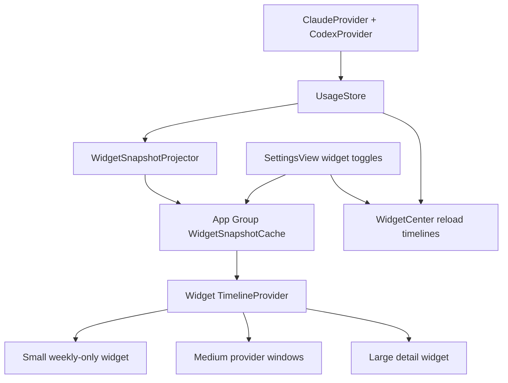
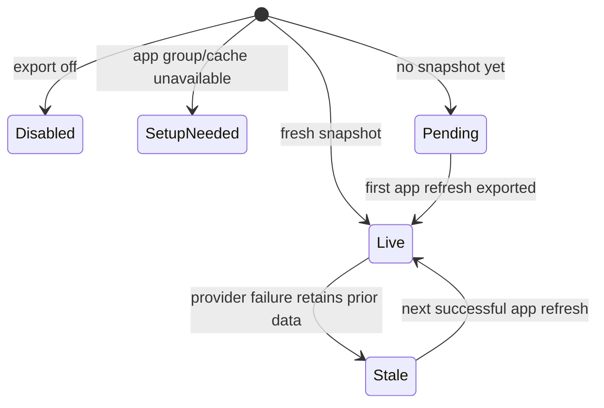

# macOS Usage Widgets - Plan

## Goal Capsule

- **Objective:** Add macOS WidgetKit widgets for Headroom so users can add glanceable Claude and Codex usage summaries from the system widget gallery, with settings-controlled widget data availability and size-appropriate detail levels.
- **Authority hierarchy:** This plan → `AGENTS.md` hard constraints → current Headroom architecture → Apple WidgetKit and HIG guidance → user request.
- **Execution profile:** Deep. This touches packaging, app-extension data sharing, shared models, settings, SwiftUI widget surfaces, and the existing refresh pipeline.
- **Stop conditions:** `swift build` and `swift test` pass; the app bundle includes a WidgetKit extension; Settings can enable/disable widget data; widgets render small, medium, and large families from cached app data; disabled, pending, live, and stale states are covered by tests or previews; manual macOS widget add smoke is documented or performed.
- **Tail ownership:** LFG owns implementation, review, commit, and PR/local shipping according to repo state.

---

## Product Contract

**Product Contract preservation:** No upstream brainstorm. This contract is bootstrapped from the user's request and current project constraints.

### Summary

Headroom will ship a bundled macOS widget extension that presents the same AI-usage headroom as the menu bar app in WidgetKit-native snapshots. Settings controls whether widget data is exported and which widget variants are populated, while the system widget gallery remains the OS-owned place where users add small, medium, and large widgets.

### Problem Frame

The menu bar app is good while the user is actively looking at the menu bar or popover, but macOS widgets are better for ambient desktop and Notification Center glanceability. WidgetKit extensions should not perform Headroom's expensive or fragile provider fetches directly: Claude polling starts a full official `claude` CLI session and must stay inside the app's existing compliant probe path. Widgets need a safe cached snapshot that is current enough to be useful and small enough to render instantly.

### Requirements

Widget availability and settings

- R1. Bundle a macOS WidgetKit extension so Headroom appears in the system widget gallery after installing or launching the app bundle.
- R2. Add Settings controls for enabling or disabling widget data export without uninstalling the app or mutating provider credentials.
- R3. When widget export is disabled, widgets render a quiet disabled state that tells the user to enable widgets in Headroom Settings.
- R4. Support small, medium, and large widget families with size-appropriate density rather than one scaled layout.

Widget content

- R5. The smallest widget shows only provider-by-provider weekly percentage left for Claude and Codex, with provider identity visible and no reset/detail clutter; it does not combine providers into a single aggregate percentage.
- R6. The medium widget shows both providers with weekly and 5-hour remaining percentages, using the same semantic health bands as the app.
- R7. The large widget adds reset context, freshness/stale state, and renewal-date context where space permits.
- R8. Widgets preserve Headroom's provider distinction, semantic severity colors, and Tahoe-native visual language without introducing pulsing or looping attention animations.

Data and privacy

- R9. Widgets read only redaction-safe cached usage summaries exported by the main app; they must not spawn `claude`, read `~/.codex/auth.json`, call provider endpoints, or access Keychain credentials.
- R10. Widget data sharing uses an App Group container when available, with a typed unavailable state when the app group is not configured or not granted.
- R11. Widget snapshots tolerate missing providers, stale data, unknown future provider IDs, and disabled export without crashing or blanking the whole widget.
- R12. After app refreshes or widget settings changes, Headroom asks WidgetKit to reload timelines so widgets update without waiting for an arbitrary future refresh.

Packaging and verification

- R13. Preserve the existing `HeadroomCore` testability and Swift 6 strict-concurrency posture.
- R14. Keep `swift build` / `swift test` useful for core and extension code; update app-bundle packaging so the widget extension is embedded for local use.
- R15. Document the signing/App Group requirement clearly because a real WidgetKit extension needs matching app and extension entitlements.

### Scope Boundaries

In scope: macOS WidgetKit extension, small/medium/large families, settings toggles, shared widget cache, app refresh integration, widget previews, tests for projection/cache/preferences behavior, and bundle-script/project support needed to install the extension locally.

#### Deferred to Follow-Up Work

- Interactive widgets, buttons, controls, deep links into specific settings panes, or in-widget refresh actions.
- Multiple independently named widget kinds per provider beyond the first configurable Headroom usage widget.
- Historical charts or sparklines in widgets.
- Threshold notifications or alerting.
- iOS/watchOS widget support.
- Distribution-grade notarization, Sparkle updates, DMG packaging, and App Store submission.

#### Outside this product's identity

- Polling Claude usage from the widget extension by direct subscription OAuth, Keychain token reuse, or provider network calls.
- Treating Settings as an installer. macOS owns widget add/remove through the widget gallery; Headroom can enable data export and render disabled states, but it cannot programmatically add widgets to the user's desktop.

### Acceptance Examples

- AE1. Given widget export is enabled and both providers have live weekly data, when the user adds the small widget, then it shows Claude weekly remaining and Codex weekly remaining as the primary content.
- AE2. Given Codex is live and Claude is permanently stale, when the user views the medium widget, then Codex remains visible and Claude shows an attention state without hiding Codex.
- AE3. Given widget export is disabled in Settings, when any widget family renders, then it shows a disabled/setup state rather than cached percentages.
- AE4. Given the main app completes a refresh, when exported widget data changes, then WidgetKit timelines are reloaded.
- AE5. Given the app group is unavailable because signing is not configured, when the widget renders, then it shows a setup state that does not expose paths, tokens, or raw errors.

---

## Planning Contract

### Key Technical Decisions

- KTD1. **Widget extension reads cached app projections, not provider sources.** The main app remains the only process that drives the official Claude CLI and Codex usage endpoint. After each `UsageStore.refreshAll()` merge, Headroom projects `UsageSnapshot` values into a small codable widget payload containing provider IDs, display names, window percentages, reset labels/times, freshness bands, renewal dates, and capture time.
- KTD2. **Use an App Group cache as the data bridge.** WidgetKit extensions and host apps are separate processes, so shared state belongs in an App Group container. Add a `WidgetSnapshotCache` / `WidgetSnapshotEnvelope` in `HeadroomCore` that writes redaction-safe JSON to an app-group `UserDefaults` suite or file. Tests use injected `UserDefaults` suites so they never depend on real entitlements.
- KTD3. **Settings toggles control export, not OS gallery availability.** Apple controls widget add/remove in macOS. Headroom's Settings should expose "Enable widgets" as an on-by-default data-sharing preference once the app can write the widget cache, plus optional family/detail toggles only if implementation confirms they add real user value. Disabled export writes an explicit disabled state and triggers timeline reloads. The gallery remains discoverable because the extension is bundled; Settings controls whether Headroom supplies data to already-added widgets.
- KTD4. **One widget kind, size-adaptive layouts.** Start with a single `HeadroomUsageWidget` supporting `.systemSmall`, `.systemMedium`, and `.systemLarge`. The family determines the default density: small = weekly-only provider-by-provider values, medium = both providers plus 5-hour/weekly bars, large = resets/freshness/renewal context. A future `AppIntentConfiguration` can add provider filters, but v1 should keep configuration light and rely on size.
- KTD5. **Widget design mirrors Headroom without copying the popover card stack.** Widgets should use `containerBackground` / system widget materials, semantic health color, compact provider marks, and Dynamic Type-friendly SwiftUI text styles. Avoid nested cards, tiny captions as primary labels, and color-only meaning; include text labels or symbols for low/stale states.
- KTD6. **Packaging needs an embedded app extension path with proof.** The current repo is SwiftPM-first and `Scripts/build-app.sh` hand-assembles `Headroom.app`. WidgetKit requires an `.appex` embedded under the app bundle with matching extension metadata and matching App Group entitlements. The first implementation path should preserve SwiftPM as the core verification surface and update the bundle script to assemble/sign the extension. If that build artifact compiles but macOS does not discover the widget in the gallery, add the smallest checked-in Xcode project required to build and embed the extension, and keep SwiftPM tests as the fast logic gate.
- KTD7. **Timeline policy is cache-driven and conservative.** The widget timeline provider reads the cache and emits a current entry plus a refresh-after date based on the payload's freshness/reset context. The app calls `WidgetCenter.shared.reloadAllTimelines()` after cache writes and settings changes; the extension never starts a provider poll.
- KTD8. **No new secret storage.** Widget payloads contain percentages, labels, timestamps, and typed display states only. Failure reasons use the existing `FailureReason.message` redaction discipline or a widget-specific safe enum.

### High-Level Technical Design

Widget data flow:

Widget render states:

### Assumptions

- The widget extension can share `HeadroomCore` models or a widget-specific projection module without importing `HeadroomApp`.
- The local app can use an App Group identifier such as `group.com.kylezantos.headroom` once signed with an Apple Development identity. If not signed, tests still pass and widgets show setup-needed.
- macOS widget families for this product should start with small, medium, and large; extra-large or accessory families are deferred unless implementation confirms they are appropriate and supported for this target.
- The existing brand SVG resources may not be available inside the extension bundle; v1 can use provider colors and SF Symbols in widgets to avoid duplicated image resource plumbing.

### System-Wide Impact

This feature adds a second UI surface that must stay consistent with the menu bar app while accepting WidgetKit's process and timeline boundaries. The core data model gains a redaction-safe export shape; `UsageStore` gains a post-refresh integration point; Settings gains widget controls; packaging gains extension and entitlement concerns. The Claude compliance constraint becomes more important because a widget extension must never become a shortcut around the official CLI probe.

### Risks & Dependencies

- **Widget packaging risk:** SwiftPM alone may not produce a fully recognized `.appex` on macOS. Mitigate by making widget-gallery discovery a required smoke gate and by allowing a checked-in Xcode project only after the script-built extension fails that gate.
- **App Group signing risk:** Without matching app and extension entitlements, sharing returns unavailable. Mitigate with typed setup state, tests with injected suites, and README guidance.
- **Staleness risk:** Widgets can look live after the app stops refreshing. Mitigate by exporting `capturedAt`, showing freshness labels in larger layouts, and using conservative timeline dates.
- **Tiny-layout risk:** The small widget can become unreadable if it tries to show all windows. Mitigate by making weekly-only overall provider values the hard small-family requirement.
- **Settings expectation risk:** Users may expect the Settings toggle to install or remove widgets. Mitigate with concise Settings copy and README language that separates data export from the OS-owned add/remove flow.

### Sources & Research

- Current code: `Sources/HeadroomCore/Engine/UsageStore.swift`, `Sources/HeadroomCore/Models/UsageModels.swift`, `Sources/HeadroomCore/Settings/Preferences.swift`, `Sources/HeadroomApp/UI/ProviderCardView.swift`, `Sources/HeadroomApp/UI/SettingsView.swift`, and `Scripts/build-app.sh`.
- Project constraint: `AGENTS.md` requires Claude usage to remain on the official `claude` CLI `/usage` PTY probe path.
- Apple Developer: WidgetKit documentation for widget extensions, timelines, supported families, and `WidgetCenter` timeline reloads.
- Apple Developer: App Groups documentation for sharing data between an app and its extension.
- Apple Human Interface Guidelines: widgets should be glanceable, relevant, personal, and size-appropriate rather than miniature app windows.
- SwiftUI Pro checklist: keep widget views split into focused `View` files, avoid color-only meaning, prefer Dynamic Type text styles, and keep business logic out of SwiftUI bodies.

---

## Implementation Units

### U1. Widget cache model and projection

- **Goal:** Add a redaction-safe, codable widget data model and projection layer from `UsageSnapshot` / `Preferences`.
- **Requirements:** R5, R6, R7, R9, R11, R13; covers AE1, AE2, AE3, AE5.
- **Dependencies:** none.
- **Files:** `Sources/HeadroomCore/Widgets/WidgetSnapshotModels.swift`, `Sources/HeadroomCore/Widgets/WidgetSnapshotProjector.swift`, `Tests/HeadroomCoreTests/WidgetSnapshotProjectorTests.swift`.
- **Approach:** Define a compact `WidgetSnapshotEnvelope` with export status, captured time, provider summaries, window summaries, severity, and safe display reason. Project from existing snapshots without carrying raw provider errors, tokens, paths, HTTP responses, or CLI output. Include helpers for weekly provider summaries so the small widget does not re-derive business rules in SwiftUI or accidentally aggregate incomparable provider windows.
- **Patterns to follow:** `UsageSnapshot` and `FailureReason` typed-state style; `UsageStore.menuBarSummary` for "pick useful glanceable data" logic.
- **Test scenarios:** Live Claude+Codex weekly windows project into two provider summaries with percent remaining; one missing weekly window leaves that provider marked unavailable while the other provider still renders; permanent Claude stale with prior windows preserves percentages and safe attention state; disabled export produces a disabled envelope with no provider data; unknown provider IDs round-trip without decode failure.
- **Verification:** Widget projector tests pass and no provider credential/source types are imported by widget model files.

### U2. App Group widget snapshot cache

- **Goal:** Persist and read widget envelopes through an injectable App Group cache with typed unavailable/empty/disabled outcomes.
- **Requirements:** R2, R3, R9, R10, R11, R15; covers AE3 and AE5.
- **Dependencies:** U1.
- **Files:** `Sources/HeadroomCore/Widgets/WidgetSnapshotCache.swift`, `Tests/HeadroomCoreTests/WidgetSnapshotCacheTests.swift`.
- **Approach:** Build a small cache around injected `UserDefaults` or a suite provider. Production uses the app group suite name; tests use isolated suites. Return typed results for unavailable suite, no snapshot, decode failure, disabled, and live payload. Keep the JSON schema lenient enough for added fields.
- **Patterns to follow:** `Preferences` injection style and `CredentialStore` redaction discipline.
- **Test scenarios:** A live envelope writes and reads back; disabled envelope writes and reads back; corrupt JSON returns a safe decode state; unavailable suite returns setup-needed without throwing; writing a new envelope replaces old data without leaving stale enabled state.
- **Verification:** Cache tests pass using only temporary defaults suites.

### U3. Preferences and Settings controls for widgets

- **Goal:** Add Settings UI and preferences for widget export enablement and optional family/detail availability.
- **Requirements:** R2, R3, R4, R12, R15; covers AE3 and AE4.
- **Dependencies:** U2.
- **Files:** `Sources/HeadroomCore/Settings/Preferences.swift`, `Sources/HeadroomApp/UI/SettingsView.swift`, `Sources/HeadroomApp/UI/WidgetSettingsSection.swift`, `Tests/HeadroomCoreTests/PreferencesTests.swift`.
- **Approach:** Add widget preferences with widget export enabled by default when the app group cache is available, plus a user-facing toggle to pause export. Settings should explain the OS boundary briefly in UI copy: enable Headroom widget data here, add/remove widgets in macOS. On changes, update the cache state and request timeline reloads from the app target.
- **Patterns to follow:** Existing renewal-date and menu-bar percentage preference tests; SwiftUI Pro guidance to extract the settings section into its own `View`.
- **Test scenarios:** Widget export defaults to enabled when cache sharing is available; toggling export persists; disabled export writes disabled cache state; any family/detail preference values persist and unknown stored values fall back safely.
- **Verification:** Preferences tests pass; Settings remains accessible with toggles and no inline credential behavior.

### U4. UsageStore widget export and timeline reload integration

- **Goal:** Export widget snapshots after refreshes and reload WidgetKit timelines when exported data changes.
- **Requirements:** R9, R11, R12, R13; covers AE2 and AE4.
- **Dependencies:** U1, U2, U3.
- **Files:** `Sources/HeadroomCore/Engine/UsageStore.swift`, `Sources/HeadroomCore/Widgets/WidgetSnapshotExporting.swift`, `Sources/HeadroomApp/HeadroomApp.swift`, `Tests/HeadroomCoreTests/UsageStoreTests.swift`, `Tests/HeadroomCoreTests/WidgetSnapshotExporterTests.swift`.
- **Approach:** Introduce a tiny `WidgetSnapshotExporting` seam so `UsageStore` can publish snapshots to an injected exporter without importing WidgetKit. The app target provides an exporter that writes the App Group cache and calls a WidgetKit reload adapter. Coalesce reloads by only reloading when the exported envelope changes materially.
- **Patterns to follow:** `UsageStore` provider injection and merge continuity; `PollingEngine` callback style.
- **Test scenarios:** A refresh writes an envelope containing both providers; a transient stale result preserves prior provider data in the exported envelope; disabled export writes disabled state; unchanged refresh does not spam reload calls; one provider failure does not prevent the other provider from exporting.
- **Verification:** Store/exporter tests pass under `@MainActor`; no WidgetKit import leaks into `HeadroomCore`.

### U5. Widget extension scaffold and packaging

- **Goal:** Add the WidgetKit extension target/bundle and update local app packaging so macOS can discover Headroom widgets.
- **Requirements:** R1, R10, R14, R15.
- **Dependencies:** U2.
- **Files:** `Package.swift`, `Sources/HeadroomWidgets/HeadroomWidgets.swift`, `Sources/HeadroomWidgets/Info.plist`, `Sources/HeadroomWidgets/HeadroomWidgets.entitlements`, `Sources/HeadroomApp/HeadroomApp.entitlements`, `Scripts/build-app.sh`, `README.md`.
- **Approach:** Add a widget extension entry point that imports WidgetKit, SwiftUI, and `HeadroomCore`. Update packaging to embed `HeadroomWidgets.appex` under `Headroom.app/Contents/PlugIns` with WidgetKit extension metadata and matching App Group entitlements. Prove the script-built extension in the widget gallery before adding project files; if it is not discoverable, add the smallest checked-in Xcode project needed to build and embed the app extension while preserving SwiftPM tests.
- **Execution note:** This unit needs a build and manual/widget-gallery smoke proof because unit tests cannot prove system registration.
- **Patterns to follow:** Existing `Scripts/build-app.sh` app assembly and README finalization notes.
- **Test scenarios:** Test expectation: none for bundle registration; this is packaging/config. Smoke scenarios: app builds; app bundle contains the `.appex`; codesign step applies entitlements when available; macOS widget gallery can discover Headroom after opening the app.
- **Verification:** `swift build` succeeds; `./Scripts/build-app.sh` produces `Headroom.app` with embedded widget extension; manual smoke is performed or the exact blocker is recorded.

### U6. Timeline provider and widget state mapping

- **Goal:** Implement the WidgetKit timeline provider that reads cache states and produces entries for disabled, setup-needed, pending, live, and stale widgets.
- **Requirements:** R3, R7, R9, R10, R11, R12; covers AE2, AE3, AE5.
- **Dependencies:** U2, U5.
- **Files:** `Sources/HeadroomWidgets/HeadroomWidgetEntry.swift`, `Sources/HeadroomWidgets/HeadroomTimelineProvider.swift`, `Sources/HeadroomWidgets/WidgetPreviewFixtures.swift`, `Tests/HeadroomCoreTests/WidgetTimelineMappingTests.swift`.
- **Approach:** Keep timeline mapping deterministic and mostly pure so tests can validate it outside the extension runtime. The provider reads the cache, maps it to a widget entry, and schedules a conservative next refresh. Larger layouts display `capturedAt`/stale state; small layout avoids timestamp clutter.
- **Patterns to follow:** `Countdown` label style where applicable, but avoid live timers in widgets because WidgetKit owns refresh cadence.
- **Test scenarios:** Live cache maps to live entry; disabled cache maps to disabled entry; unavailable suite maps to setup-needed entry; stale provider keeps prior percentage and attention marker; next refresh date is after now and does not depend on spawning provider work.
- **Verification:** Mapping tests pass; extension code has no `ClaudeUsageCLIProbe`, `CodexProvider`, `CredentialStore`, or network client imports.

### U7. Small, medium, and large widget SwiftUI views

- **Goal:** Build polished, size-specific SwiftUI widget layouts aligned with Headroom's existing visual language.
- **Requirements:** R4, R5, R6, R7, R8; covers AE1, AE2, AE3.
- **Dependencies:** U6.
- **Files:** `Sources/HeadroomWidgets/Views/HeadroomSmallWidgetView.swift`, `Sources/HeadroomWidgets/Views/HeadroomMediumWidgetView.swift`, `Sources/HeadroomWidgets/Views/HeadroomLargeWidgetView.swift`, `Sources/HeadroomWidgets/Views/WidgetProviderRow.swift`, `Sources/HeadroomWidgets/Views/WidgetUsageMeter.swift`, `Sources/HeadroomWidgets/Views/WidgetStatusView.swift`, `Sources/HeadroomWidgets/WidgetProviderStyle.swift`.
- **Approach:** Use `@Environment(\.widgetFamily)` to select a dedicated view per family. Small shows weekly remaining for Claude and Codex only. Medium shows provider rows with weekly and 5-hour meters. Large adds reset/freshness/renewal text and more generous spacing. Use semantic colors plus labels/icons so status is not color-only. Keep each view file focused; avoid heavy computed `some View` helpers in body.
- **Patterns to follow:** `ProviderStyle`, `UsageBarView`, `ProviderCardView` visual language; SwiftUI Pro view extraction/accessibility guidance; Apple HIG widget glanceability.
- **Test scenarios:** Preview fixtures cover disabled, pending, live, mixed stale/live, and low/critical severity states for every family. Visual/manual checks verify text does not clip at default and larger Dynamic Type sizes where WidgetKit allows.
- **Verification:** `swift build` succeeds; previews compile; manual screenshot or widget-gallery smoke confirms no overlapping text and no pulse animations.

### U8. Documentation and operational notes

- **Goal:** Update docs for widget installation, App Group signing, settings behavior, and known limits.
- **Requirements:** R1, R2, R12, R14, R15.
- **Dependencies:** U5, U7.
- **Files:** `README.md`, `BUGS.md` if implementation reveals deferred packaging/signing issues.
- **Approach:** Document that Headroom widgets appear in macOS widget gallery after the bundled app is installed/launched, that Settings controls data export rather than OS add/remove, and that matching App Group entitlements require stable signing. Keep the Claude compliance note intact.
- **Patterns to follow:** README's current concise build/test/finalization sections.
- **Test scenarios:** Test expectation: none -- docs only.
- **Verification:** README accurately matches the final build path and does not claim widgets are available if manual smoke failed.

---

## Verification Contract

| Gate | Applies to | Done signal |
|---|---|---|
| `swift test` | U1, U2, U3, U4, U6 | New and existing HeadroomCore tests pass, including widget projection/cache/export mapping. |
| `swift build` | U5, U6, U7 | HeadroomCore, Headroom app, and widget extension code compile under Swift 6 strict concurrency. |
| `./Scripts/build-app.sh` | U5, U7 | Local `Headroom.app` is assembled with the widget extension embedded, or the blocker is recorded with exact output. |
| Manual macOS widget smoke | U5, U7 | Headroom appears in the macOS widget gallery from the built app; small/medium/large widgets can be added; disabled/live/stale states render without clipped or overlapping UI. If this fails because signing/App Group setup is unavailable, the exact blocker and next step are documented before shipping. |
| Design/accessibility review | U7 | Widgets are glanceable by size, use text/symbols in addition to color, avoid pulsing UI, and match the existing Headroom tone. |

---

## Definition of Done

- Widget export is disabled/enabled from Settings and persists.
- Widget extension reads only the app-group cache and never touches provider credentials, provider endpoints, or the Claude CLI.
- Small widget shows weekly remaining for Claude and Codex as the primary content.
- Medium and large widgets progressively add 5-hour, reset, freshness, and renewal context without becoming miniature popovers.
- App refreshes and widget setting changes request WidgetKit timeline reloads.
- All new core logic has focused tests; packaging and widget registration have smoke evidence or a documented blocker.
- Existing menu bar app behavior, Claude CLI compliance, and provider failure isolation are preserved.
- Dead-end packaging experiments or unused widget prototypes are removed before shipping.
