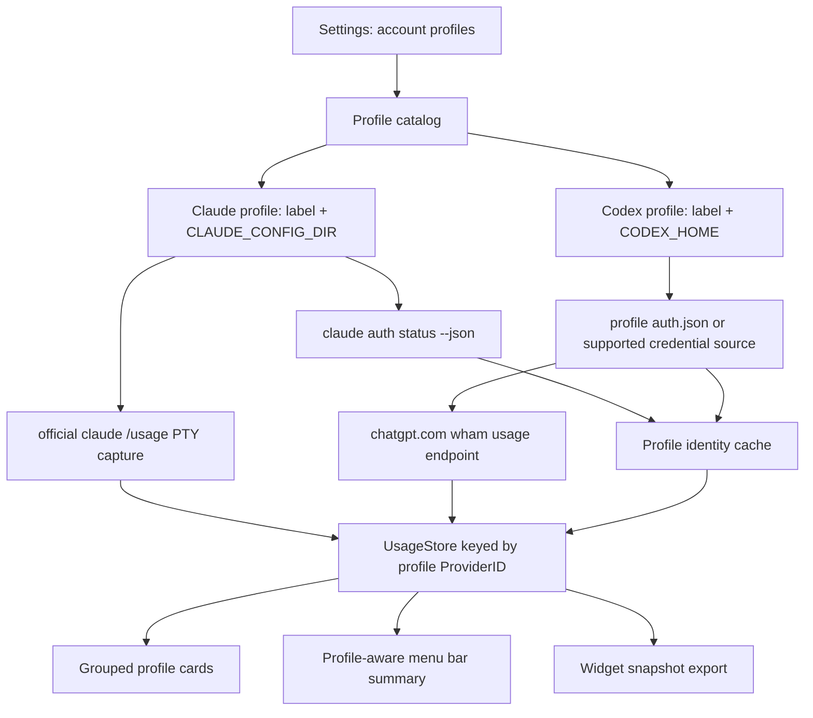

# Multi-Account Profiles - Plan

> Implemented for the 1.1 candidate and superseded by
> `2026-07-20-001-fix-provider-setup-multi-account-release-stabilization-plan.md` for final
> stabilization and release proof. Shipped implementation uses editable user labels rather
> than provider email identity, Headroom-owned config homes rather than arbitrary paths, no
> per-account disable switch, primary-only menu bar/widget/iPhone projections, and removal of
> the selected additional local CLI sign-in. Claude probes are serialized; Codex/network work
> remains concurrent.

## Goal Capsule

| Field | Value |
|---|---|
| Objective | Add explicit account profiles so Headroom can show multiple Claude and Codex subscription accounts side by side. |
| Release posture | Deferred behind 1.0. The 1.0 scope remains single-profile, tightly functional, and ready for public release from the website. |
| Authority | User request, project `AGENTS.md`, provider compliance boundaries, and current macOS 26/Tahoe distribution assumptions. |
| Execution profile | Standard, security-sensitive feature spanning provider identity, credentials/profile paths, polling, Settings, popover rendering, widgets, and release docs. |
| Stop conditions | Stop if the only available path would read/reuse Claude subscription OAuth tokens directly, mutate active CLI auth state silently, expose tokens/emails unnecessarily, or turn this into 1.0 release work. |
| Tail ownership | Implementation owns exact provider status parsing, fixture shape, UI copy, and manual validation against real local profile directories. |

---

## Product Contract

### Summary

Headroom 1.1 should let users track multiple separate Claude and Codex subscription accounts by adding explicit local account profiles. Each profile should poll through the provider's supported local client/auth boundary, display a safe account label such as email when available, and remain clearly separate from the 1.0 public release scope.

### Problem Frame

Some users maintain more than one paid AI subscription under different accounts, such as personal and work Claude or ChatGPT/Codex accounts. Headroom currently models one Claude subscription and one Codex subscription, which is enough for 1.0 but cannot show whether a second account has remaining headroom without manually switching CLI auth state outside the app.

### Requirements

**Release boundary**

- R1. Multi-account support is planned as a 1.1 candidate and must not block 1.0 release readiness.
- R2. 1.0 release documentation may mention single-profile support as a current limitation, but 1.0 does not need account-profile UI or provider refactors.

**Account profiles**

- R3. Users can add multiple Claude and Codex subscription profiles, each with a user-visible label and provider family.
- R4. Profiles display an account identity when available, preferring provider-reported email and falling back to a user label or safe account id fragment.
- R5. Each profile has an independent pending/live/stale state, renewal date, enabled state, and last-updated timestamp.
- R6. Deleting or disabling one profile never deletes provider credentials, mutates other profiles, or changes the user's default CLI account.

**Provider boundaries**

- R7. Claude profiles use the official `claude` CLI as the request authority, with per-profile environment such as `CLAUDE_CONFIG_DIR`; Headroom only captures status/usage output.
- R8. Codex profiles use profile-scoped Codex auth homes such as `CODEX_HOME` where file-based credentials are available, or degrade clearly when credentials are stored in an unsupported OS credential-store mode.
- R9. The feature does not reintroduce direct Claude subscription OAuth calls, spoofed Claude Code user agents, or third-party routing of model calls through subscription credentials.

**User experience**

- R10. The popover groups profiles by provider family while preserving per-account cards/rows so users can compare accounts quickly.
- R11. Menu bar summary and fill source can target either the lowest enabled weekly balance or one explicit account profile.
- R12. Settings make profile setup understandable without requiring users to understand every environment variable up front.

**Privacy, safety, and reliability**

- R13. Profile paths and account identifiers are stored locally as preferences or bookmarks, not transmitted.
- R14. Failure copy is typed and redacted; raw tokens, auth JSON, provider status payloads, and full email addresses are never logged.
- R15. Tests use fixtures and injected seams; they never touch real `~/.claude*`, `~/.codex*`, Keychain, network, or PTY processes.

### Acceptance Examples

- AE1. Given a user adds Claude Personal and Claude Work profiles, when refresh runs, then Headroom shows two Claude account surfaces with separate 5-hour/weekly windows and account labels.
- AE2. Given a Codex profile points at `~/.codex-work`, when the profile's auth file includes an email identity, then the card shows that email or a privacy-preserving variant and fetches usage using that profile only.
- AE3. Given one Claude profile fails to capture `/usage`, when another profile succeeds, then the failed profile is stale and the successful profile remains live.
- AE4. Given a user deletes a profile from Headroom, when they later run `claude` or `codex` in Terminal, then their external CLI auth state is unchanged.
- AE5. Given no multi-account profiles are configured after upgrading from 1.0, when Headroom launches, then the existing default Claude and Codex providers behave as before.

### Scope Boundaries

In scope for 1.1: explicit local profile configuration, multiple subscription quota profiles for Claude and Codex, safe account labels, per-profile polling, menu bar source updates, Settings/profile management, widget/cache compatibility, and tests.

Out of scope:

- 1.0 implementation or release gating.
- Automatic discovery of every possible account on disk without user confirmation.
- Account rotation, failover, or "use the next account when one runs out."
- Creating, logging into, or purchasing provider subscriptions from Headroom.
- Managing API spend multi-org profiles unless a later API-spend plan explicitly extends this profile model.
- Any direct Claude subscription OAuth implementation or any model-call proxy behavior.

### Deferred to Follow-Up Work

- Profile import helpers for third-party account switchers, if a common convention stabilizes.
- Per-profile quota alerts or threshold notifications.
- Cloud sync of profile configuration across Macs.
- Workspace/team identity decoration beyond email/label/account id.

---

## Context & Research

### Relevant Code and Patterns

- `Sources/HeadroomCore/Models/ProviderID.swift` is already an open struct, which can represent profile-scoped ids such as `claude:personal` without changing a closed enum.
- `Sources/HeadroomCore/Models/UsageModels.swift` currently stores subscription snapshots by `ProviderID` and uses static `UsageSurface` and `MenuBarFillSource` enums that assume one Claude and one Codex provider.
- `Sources/HeadroomCore/Providers/ClaudeUsageCLIProbe.swift` already launches the official `claude` CLI in a PTY and captures `/usage`; it needs profile-specific environment support before multiple Claude accounts can be polled safely.
- `Sources/HeadroomCore/Credentials/CodexAuthReader.swift` currently reads one hard-coded `~/.codex/auth.json`; it needs a profile-scoped auth home or credential-source abstraction.
- `Sources/HeadroomCore/Engine/UsageStore.swift` already supports multiple `UsageProvider` instances, but helper methods map all non-Claude providers to Codex and several settings paths assume only two provider ids.
- `Sources/HeadroomApp/UI/SettingsView.swift`, `Sources/HeadroomApp/UI/ProviderStyle.swift`, and widget style code use static Claude/Codex cases that need provider-family styling instead of exact id styling.

### Institutional Learnings

- No `docs/solutions/` learnings exist yet in this worktree.
- `BUGS.md` captures deferred reliability items around fixed polling cadence, parser drift, and live probe coverage; multi-profile polling should not worsen these by spawning too many concurrent Claude sessions.

### External References

- Claude Code environment variables: `CLAUDE_CONFIG_DIR` overrides the configuration directory and is documented as useful for running multiple accounts side by side: https://code.claude.com/docs/en/env-vars
- Claude Code CLI reference: `claude auth status` shows authentication status as JSON, which is the safest first place to identify a signed-in account: https://code.claude.com/docs/en/cli-reference
- Claude Code legal/compliance: subscription OAuth credentials are intended for native Anthropic apps and third-party products must not route Claude.ai login credentials for users: https://code.claude.com/docs/en/legal-and-compliance
- Codex auth docs: Codex caches credentials under `CODEX_HOME` when file storage is used and may use an OS credential store depending on config: https://developers.openai.com/codex/auth
- OpenAI Codex auth storage source: current auth storage includes account identity fields such as `account_id`, `email`, and `plan_type` in newer agent identity records: https://github.com/openai/codex/blob/main/codex-rs/login/src/auth/storage.rs
- Apple App Sandbox docs: a future sandboxed distribution would need explicit user-selected file access or bookmarks for external profile paths: https://developer.apple.com/documentation/security/app-sandbox
- Apple user-selected file entitlement docs: sandboxed apps need user-selected file permissions to read outside the container: https://developer.apple.com/documentation/bundleresources/entitlements/com.apple.security.files.user-selected.read-only

---

## Key Technical Decisions

- KTD1. **Profiles are explicit app records, not discovered global state.** Users add profiles intentionally, with a label and provider family. This avoids surprising file-system scans and keeps 1.1 understandable.
- KTD2. **Separate provider family from provider instance.** A profile needs both stable instance identity (`ProviderID`) and family identity (`Claude` or `Codex`) so styling, logos, setup copy, and auth behavior do not depend on exact ids.
- KTD3. **Default profiles preserve 1.0 behavior.** On upgrade, Headroom should synthesize or migrate to one default Claude profile and one default Codex profile so existing users see no regression.
- KTD4. **Claude account profiles run the official CLI with profile environment.** Headroom should set `CLAUDE_CONFIG_DIR` for a configured Claude profile and keep the current PTY `/usage` capture path. Account identity should come from `claude auth status --json` or the rendered official UI when available, never from raw subscription OAuth parsing.
- KTD5. **Codex account profiles are scoped by auth home first.** A Codex profile points to a `CODEX_HOME`-style directory and reads `auth.json` from there when file-based storage is configured. Unsupported keyring-only setups should produce an actionable stale/setup state rather than guessing.
- KTD6. **Path configuration must be safe for future sandboxing.** The 1.1 app may remain non-sandboxed for website distribution, but the model should store profile paths in a way that can later carry security-scoped bookmarks or app-managed profile dirs without another schema reset.
- KTD7. **Menu bar source becomes profile-aware.** The current `MenuBarFillSource` enum should evolve into a profile id preference plus a "lowest enabled weekly balance" mode, preserving the existing none/static option.
- KTD8. **Polling should avoid a Claude process storm.** Multiple Claude profiles mean multiple full CLI launches. Implementation should either bound concurrent Claude probes or sequence them within a refresh cycle while still allowing Codex/network providers to run concurrently.
- KTD9. **Privacy defaults should show useful but restrained identity.** Store and display account email only when provider status/auth data already exposes it through supported surfaces. Consider masking in compact UI and always let users override with a manual label.

---

## Open Questions

### Resolved During Planning

- Should this be part of 1.0? No. It is a 1.1 candidate; 1.0 remains focused on a single-profile public release.
- Should Headroom auto-switch or rotate accounts? No. The feature is display/monitoring only, not usage orchestration.
- Can Claude support multiple profiles without violating the project constraint? Yes, by running the official CLI with `CLAUDE_CONFIG_DIR` and reading its output/status rather than directly using subscription OAuth credentials.

### Deferred to Implementation

- Exact `claude auth status --json` fields to parse: verify against the installed Claude Code version and fixture the observed payload.
- Exact Codex identity source priority: determine whether current `auth.json` on this machine exposes email via `agent_identity`, token claims, or only `account_id`.
- Sandbox/bookmark implementation timing: if 1.1 remains website-only and non-sandboxed, bookmarks can be model-ready but not fully required.
- Whether profile setup should create app-managed directories or only point to user-created `~/.claude-*` / `~/.codex-*` dirs.

---

## High-Level Technical Design

> This illustrates the intended approach and is directional guidance for review, not implementation specification. The implementing agent should treat it as context, not code to reproduce.

The implementation should keep provider-specific account setup at the edges and make the rest of the app consume profile-scoped `UsageProvider` instances with family metadata.

---

## Implementation Units

### U1. Profile Domain Model and Persistence

**Goal:** Add persistent account-profile records that can represent multiple Claude and Codex subscription accounts without changing the current provider protocol first.

**Requirements:** R1, R3, R4, R5, R6, R13, AE5.

**Dependencies:** None.

**Files:**
- Modify: `Sources/HeadroomCore/Models/ProviderID.swift`
- Modify: `Sources/HeadroomCore/Models/UsageModels.swift`
- Modify: `Sources/HeadroomCore/Settings/Preferences.swift`
- Test: `Tests/HeadroomCoreTests/PreferencesTests.swift`
- Test: `Tests/HeadroomCoreTests/UsageStoreTests.swift`

**Approach:**
- Introduce an account profile model with stable id, provider family, user label, optional email/account id, enabled state, optional profile path/bookmark placeholder, and renewal date linkage.
- Store profiles in `Preferences` as non-secret local configuration.
- Preserve migration/default behavior by representing existing `.claude` and `.codex` as default profiles when no explicit profile catalog exists.
- Keep secrets out of this model; it should store paths/labels/ids only.

**Patterns to follow:**
- `Preferences` already stores non-secret settings in UserDefaults.
- `ProviderID` is already an open struct and should remain stable/codable.
- `UsageSnapshot.pending(for:)` establishes how provider ids enter the store.

**Test scenarios:**
- Happy path: no stored profiles returns one enabled default Claude profile and one enabled default Codex profile.
- Happy path: stored personal/work profiles round-trip through preferences with stable ids and labels.
- Edge case: duplicate labels are allowed but duplicate ids are rejected or normalized.
- Edge case: deleting a profile removes only Headroom configuration and leaves other profiles intact.
- Error path: malformed persisted profile data falls back to defaults or a safe empty state without crashing launch.

**Verification:**
- Preference tests cover profile persistence and default migration; existing single-profile store tests continue to pass.

### U2. Provider Family Metadata and UI Styling

**Goal:** Make UI and widget styling depend on provider family rather than exact `ProviderID` equality.

**Requirements:** R3, R4, R10, R14, AE1, AE5.

**Dependencies:** U1.

**Files:**
- Modify: `Sources/HeadroomCore/Models/UsageModels.swift`
- Modify: `Sources/HeadroomApp/UI/ProviderStyle.swift`
- Modify: `Sources/HeadroomApp/UI/ProviderLogoView.swift`
- Modify: `Sources/HeadroomWidgets/WidgetProviderStyle.swift`
- Test: `Tests/HeadroomCoreTests/WidgetSnapshotProjectorTests.swift`

**Approach:**
- Add provider-family information to profiles or display metadata so `claude:work` still receives Claude branding and `codex:personal` still receives Codex branding.
- Avoid brittle string-prefix styling scattered through SwiftUI; centralize family lookup near profile/display metadata.
- Update widget projection to carry enough family/display metadata for future multi-profile rendering without exposing secrets.

**Patterns to follow:**
- `ProviderStyle` currently maps `.claude` and `.codex` to static icons, colors, and symbols.
- `WidgetSnapshotProjector` keeps widget data compact and redacted.

**Test scenarios:**
- Happy path: two Claude profile ids both resolve to Claude icon/accent metadata.
- Happy path: one Codex profile id resolves to Codex metadata while preserving its custom display name.
- Edge case: unknown family/id falls back to neutral styling without crashing.
- Integration: widget projection includes distinct display names for multiple profiles and does not collapse them by family.

**Verification:**
- Existing popover/widget styling still works for default profiles; multiple profile ids render with expected family identity.

### U3. Claude Profile Probe Support

**Goal:** Poll multiple Claude accounts through the official `claude` CLI using profile-specific environment and account-status capture.

**Requirements:** R4, R5, R7, R9, R14, R15, AE1, AE3, AE4.

**Dependencies:** U1, U2.

**Files:**
- Modify: `Sources/HeadroomCore/Providers/ClaudeProvider.swift`
- Modify: `Sources/HeadroomCore/Providers/ClaudeUsageCLIProbe.swift`
- Modify: `Sources/HeadroomCore/Providers/ClaudeUsageParser.swift`
- Test: `Tests/HeadroomCoreTests/ClaudeProviderTests.swift`
- Test: `Tests/HeadroomCoreTests/ClaudeUsageParserTests.swift`
- Test: `Tests/HeadroomCoreTests/Mocks.swift`

**Approach:**
- Extend the Claude usage source to accept a profile environment, especially `CLAUDE_CONFIG_DIR`, while preserving current login-shell PATH resolution and PTY teardown behavior.
- Add a separate injectable status source for `claude auth status --json` or equivalent supported status output so profile identity can be captured without entering raw credentials.
- Ensure a failed status lookup does not block usage polling; identity enrichment is best effort.
- Bound or sequence concurrent Claude probes so a user with several profiles does not launch many heavyweight CLI sessions at once.

**Execution note:** Add characterization tests around the current default Claude probe behavior before adding profile environment injection.

**Patterns to follow:**
- `ClaudeUsageCLIProbe` emphasizes hard deadlines, guaranteed process-group kill, quiet-period capture, login-shell PATH resolution, and off-main-actor blocking work.
- `ClaudeProvider` never throws and returns typed stale snapshots.

**Test scenarios:**
- Happy path: default Claude profile behaves exactly like current 1.0 provider when no config dir is set.
- Happy path: profile-specific source receives `CLAUDE_CONFIG_DIR` and returns a live snapshot keyed to that profile id.
- Happy path: status source supplies email and the provider attaches it to profile/display metadata without exposing raw JSON.
- Edge case: missing email falls back to user label.
- Error path: one profile status command fails but usage capture succeeds.
- Error path: one profile usage capture fails and another profile remains live.
- Regression: PTY teardown and timeout behavior remain covered through mocks or focused unit seams.

**Verification:**
- Claude provider tests pass with fixtures; no test spawns the real CLI.

### U4. Codex Profile Credential Reader

**Goal:** Support multiple Codex profiles through profile-scoped `CODEX_HOME` auth readers and safe identity extraction.

**Requirements:** R4, R5, R6, R8, R14, R15, AE2, AE4, AE5.

**Dependencies:** U1, U2.

**Files:**
- Modify: `Sources/HeadroomCore/Credentials/CodexAuthReader.swift`
- Modify: `Sources/HeadroomCore/Credentials/CredentialStore.swift`
- Modify: `Sources/HeadroomCore/Providers/CodexProvider.swift`
- Modify: `Sources/HeadroomCore/Providers/UsageDTOs.swift`
- Test: `Tests/HeadroomCoreTests/CredentialStoreTests.swift`
- Test: `Tests/HeadroomCoreTests/CodexProviderTests.swift`

**Approach:**
- Change `CodexAuthFileReader` from one hard-coded path to an injectable `CODEX_HOME` or auth-file URL, preserving the default `~/.codex/auth.json` behavior.
- Extend `CodexAuthBlob.parse` to capture safe identity fields when present, including `tokens.account_id` and newer `agent_identity.email`/`plan_type` records if available.
- Make keyring-only or missing-file profiles return an actionable typed stale/setup state rather than attempting unsupported credential-store reads.
- Keep token handling redacted and avoid logging auth blob contents.

**Patterns to follow:**
- Current `CodexAuthBlob` decodes only the fields needed for usage and tolerates optional refresh/account fields.
- `CodexProvider` uses injected `CredentialStore`, injected HTTP, and typed stale outcomes.

**Test scenarios:**
- Happy path: default reader reads `~/.codex/auth.json` equivalent fixture exactly as before.
- Happy path: profile reader reads `CODEX_HOME/auth.json` fixture and returns the right access token and account id.
- Happy path: fixture with `agent_identity.email` returns display identity without exposing tokens.
- Edge case: fixture without email uses account id or manual label.
- Error path: missing auth file returns `notLoggedIn` for only that profile.
- Error path: malformed auth file returns unreadable/malformed stale state with no raw JSON.
- Regression: existing Codex usage DTO decode still parses five-hour and weekly windows.

**Verification:**
- Credential and Codex provider tests pass with profile fixtures and no real file-system auth reads.

### U5. Profile-Aware Store, Polling, and Menu Bar Summary

**Goal:** Make polling and summary logic operate over an arbitrary enabled profile list while preserving current single-profile behavior.

**Requirements:** R5, R10, R11, R14, R15, AE1, AE3, AE5.

**Dependencies:** U1, U2, U3, U4.

**Files:**
- Modify: `Sources/HeadroomCore/Engine/UsageStore.swift`
- Modify: `Sources/HeadroomCore/Engine/PollingEngine.swift`
- Modify: `Sources/HeadroomCore/Settings/Preferences.swift`
- Modify: `Sources/HeadroomApp/HeadroomApp.swift`
- Test: `Tests/HeadroomCoreTests/UsageStoreTests.swift`
- Test: `Tests/HeadroomCoreTests/PreferencesTests.swift`

**Approach:**
- Build subscription providers from the profile catalog rather than a static two-provider list.
- Replace static `subscriptionSurface(for:)` assumptions with profile-enabled checks.
- Evolve menu bar fill/summary preference to support static fill, lowest enabled weekly balance, and explicit profile id.
- Preserve continuity merging by profile id so stale/liveness never bleeds across accounts.
- Consider bounded Claude probe concurrency as part of provider orchestration if U3 does not own it fully.

**Patterns to follow:**
- `UsageStore.refreshAll()` already fetches providers concurrently and merges stale results per id.
- `MenuBarSummary` already decouples neutral/pending/live/stale attention states.

**Test scenarios:**
- Happy path: three enabled profiles produce three pending snapshots on init and three live snapshots after refresh.
- Happy path: lowest-weekly menu bar source picks the most constrained enabled profile.
- Happy path: explicit profile menu bar source tracks only that profile.
- Edge case: disabling a profile removes it from provider order but preserves stored profile configuration.
- Edge case: deleting the selected menu bar profile falls back to static or lowest-enabled behavior.
- Error path: one stale permanent profile sets attention while live profiles still produce summary data.
- Regression: default 1.0 Claude/Codex configuration yields the same provider order and menu summary behavior as before.

**Verification:**
- UsageStore tests pass for default and multi-profile cases; no existing menu bar behavior regresses for single-profile users.

### U6. Profile Management Settings

**Goal:** Add Settings UI for creating, labeling, enabling, disabling, and deleting account profiles.

**Requirements:** R3, R4, R5, R6, R10, R12, R13, R14, AE2, AE4, AE5.

**Dependencies:** U1, U2, U5.

**Files:**
- Modify: `Sources/HeadroomApp/UI/SettingsView.swift`
- Create: `Sources/HeadroomApp/UI/AccountProfilesSettingsView.swift`
- Modify: `Sources/HeadroomApp/UI/ProviderStyle.swift`
- Test: `Tests/HeadroomCoreTests/PreferencesTests.swift`

**Approach:**
- Add a compact Account Profiles settings section separate from API spend and general preferences.
- Let users choose provider family, set a label, and select or type the relevant profile directory path.
- Show current identity/status when available, with redacted failure states when setup is incomplete.
- Deleting a Headroom profile should be clearly framed as removing it from Headroom only, not logging out of provider CLIs.
- Avoid making the first 1.1 version an account setup wizard; keep it explicit and operational.

**Patterns to follow:**
- Existing `SettingsView` uses grouped native controls and short helper copy.
- `RenewalDateField` already shows compact per-provider settings without bloating the window.

**Test scenarios:**
- Manual/UI scenario: adding Claude Personal and Codex Work profiles fits within the settings window without clipping.
- Manual/UI scenario: disabled profile remains visible and can be re-enabled.
- Manual/UI scenario: delete confirmation copy makes clear credentials are not removed.
- Edge case: profile path missing or inaccessible shows a setup/stale state rather than crashing.
- Regression: existing poll interval, launch-at-login, API spend, widget, and renewal-date controls remain accessible.

**Verification:**
- SwiftUI compiles; manual settings smoke confirms profile management is usable and does not expose tokens.

### U7. Popover and Widget Multi-Profile Rendering

**Goal:** Render multiple account profiles in the popover and widget cache without losing the glanceable Headroom experience.

**Requirements:** R4, R5, R10, R11, R14, AE1, AE3, AE5.

**Dependencies:** U2, U5, U6.

**Files:**
- Modify: `Sources/HeadroomApp/UI/PopoverView.swift`
- Modify: `Sources/HeadroomApp/UI/ProviderCardView.swift`
- Modify: `Sources/HeadroomApp/UI/MenuBarLabel.swift`
- Modify: `Sources/HeadroomCore/Widgets/WidgetSnapshotProjector.swift`
- Modify: `Sources/HeadroomWidgets/HeadroomWidgets.swift`
- Test: `Tests/HeadroomCoreTests/WidgetSnapshotProjectorTests.swift`

**Approach:**
- Group cards by provider family or use account-labeled repeated cards depending on what feels clearer with two to four profiles.
- Include account label/email in each card header while keeping plan label and reset windows readable.
- Update widget snapshots to preserve distinct profile rows and choose reasonable limits for small widget sizes.
- Keep the menu bar label compact and avoid trying to display multiple identities in the menu bar itself.

**Patterns to follow:**
- `ProviderCardView` renders explicit pending/live/stale states.
- `PopoverView` already composes cards from `store.providerOrder`.
- Widget projection favors compact redacted envelopes over direct credential reads.

**Test scenarios:**
- Happy path: two Claude and one Codex profile render as distinct popover cards/rows.
- Happy path: stale profile appears dimmed while live profiles remain readable.
- Edge case: long email/manual labels truncate or wrap professionally without overlapping controls.
- Edge case: widget small size chooses a bounded summary rather than cramming every profile.
- Regression: one Claude and one Codex default profile still match 1.0 visual hierarchy.

**Verification:**
- Widget projection tests pass; manual desktop and widget screenshots confirm no overlapping UI.

### U8. 1.0 Boundary, Release Docs, and Upgrade Notes

**Goal:** Keep 1.0 release readiness separate while documenting how 1.1 multi-account profiles change setup and expectations.

**Requirements:** R1, R2, R6, R9, R13, R14.

**Dependencies:** U1-U7.

**Files:**
- Modify: `README.md`
- Modify: `BUGS.md`
- Modify: `docs/plans/2026-07-03-002-feat-multi-account-profiles-plan.md` if implementation discovers material scope changes.

**Approach:**
- For 1.0, document that public release supports the user's active/default Claude and Codex accounts.
- For 1.1, document profile setup examples such as `CLAUDE_CONFIG_DIR=~/.claude-work` and `CODEX_HOME=~/.codex-work`, while warning users not to share/copy auth files casually.
- Keep the Claude compliance warning prominent: official CLI only for subscription usage; no direct OAuth resurrection.
- Add deferred follow-ups discovered during implementation to `BUGS.md` rather than slipping them into the 1.1 diff.

**Patterns to follow:**
- `README.md` already documents commands, macOS 26 requirements, widget signing, and live verification expectations.
- `BUGS.md` is the project's place for non-blocking deferred items.

**Test scenarios:**
- Test expectation: none for docs-only edits.
- Review scenario: README distinguishes 1.0 single-profile release behavior from 1.1 profile setup without confusing users.

**Verification:**
- Docs are accurate after implementation and do not describe unreleased 1.1 behavior as part of 1.0.

---

## System-Wide Impact

- **Interaction graph:** Profile catalog feeds provider construction, store snapshot keys, popover card ordering, settings rows, menu bar summary, and widget export.
- **Error propagation:** Provider/profile failures must remain isolated and typed; identity lookup failures should not erase live usage data.
- **State lifecycle risks:** Profile ids need to stay stable across label/path edits so snapshots, renewal dates, widget entries, and menu bar source preferences do not drift.
- **API surface parity:** `UsageSurface` and `MenuBarFillSource` are currently static; any replacement must preserve Codable preference migration from 1.0.
- **Integration coverage:** Tests should cover migration/default profiles, multiple profiles with mixed freshness, and widget projection with repeated provider families.
- **Unchanged invariants:** Claude usage remains official-CLI-derived; Codex usage remains endpoint-derived from local Codex auth; API spend remains separate from subscription quota.

---

## Risks & Dependencies

| Risk | Mitigation |
|---|---|
| Claude profile auth behavior differs on macOS because credentials are in Keychain even when `CLAUDE_CONFIG_DIR` changes. | Start U3 with a real-profile spike and fixture observed `claude auth status --json`; degrade clearly if side-by-side auth is not actually separable on the target version. |
| Codex users may configure keyring storage instead of file-based `auth.json`. | Detect missing/unsupported credential source and show setup guidance; do not attempt to scrape OS keyrings in 1.1 unless an official/local pattern is verified. |
| Multiple Claude profiles make polling slow or CPU-heavy. | Bound Claude probe concurrency and keep the existing minimum poll interval; consider per-profile backoff if repeated failures occur. |
| Email display creates privacy risk in screenshots. | Allow manual labels, consider masking compact email display, and avoid writing full emails to logs. |
| Profile model refactor destabilizes 1.0 behavior. | Defer implementation until after 1.0 release, preserve default-profile migration, and add regression tests around current single-profile behavior. |
| Future sandboxing changes path access. | Model profile paths so security-scoped bookmarks or app-managed dirs can be added without another profile schema rewrite. |

---

## Documentation / Operational Notes

- Do not market multi-account support as a 1.0 capability.
- If shipped in 1.1 from the website, include a setup note that users create/login their provider profiles outside Headroom first, then point Headroom at those local profile homes.
- Keep provider compliance language plain: Headroom observes official clients/status outputs; it does not become a third-party subscription client.
- If implementation proves a provider cannot support independent accounts reliably on macOS, revise this plan before continuing rather than patching around it.

---

## Sources & References

- Related code: `Sources/HeadroomCore/Models/ProviderID.swift`
- Related code: `Sources/HeadroomCore/Models/UsageModels.swift`
- Related code: `Sources/HeadroomCore/Providers/ClaudeUsageCLIProbe.swift`
- Related code: `Sources/HeadroomCore/Credentials/CodexAuthReader.swift`
- Related code: `Sources/HeadroomCore/Engine/UsageStore.swift`
- Related code: `Sources/HeadroomApp/UI/SettingsView.swift`
- Related docs: `README.md`
- Related docs: `BUGS.md`
- External docs: [Claude Code environment variables](https://code.claude.com/docs/en/env-vars)
- External docs: [Claude Code CLI reference](https://code.claude.com/docs/en/cli-reference)
- External docs: [Claude Code legal and compliance](https://code.claude.com/docs/en/legal-and-compliance)
- External docs: [Codex authentication](https://developers.openai.com/codex/auth)
- External source: [OpenAI Codex auth storage](https://github.com/openai/codex/blob/main/codex-rs/login/src/auth/storage.rs)
- External docs: [Apple App Sandbox](https://developer.apple.com/documentation/security/app-sandbox)
- External docs: [Apple user-selected file entitlement](https://developer.apple.com/documentation/bundleresources/entitlements/com.apple.security.files.user-selected.read-only)
