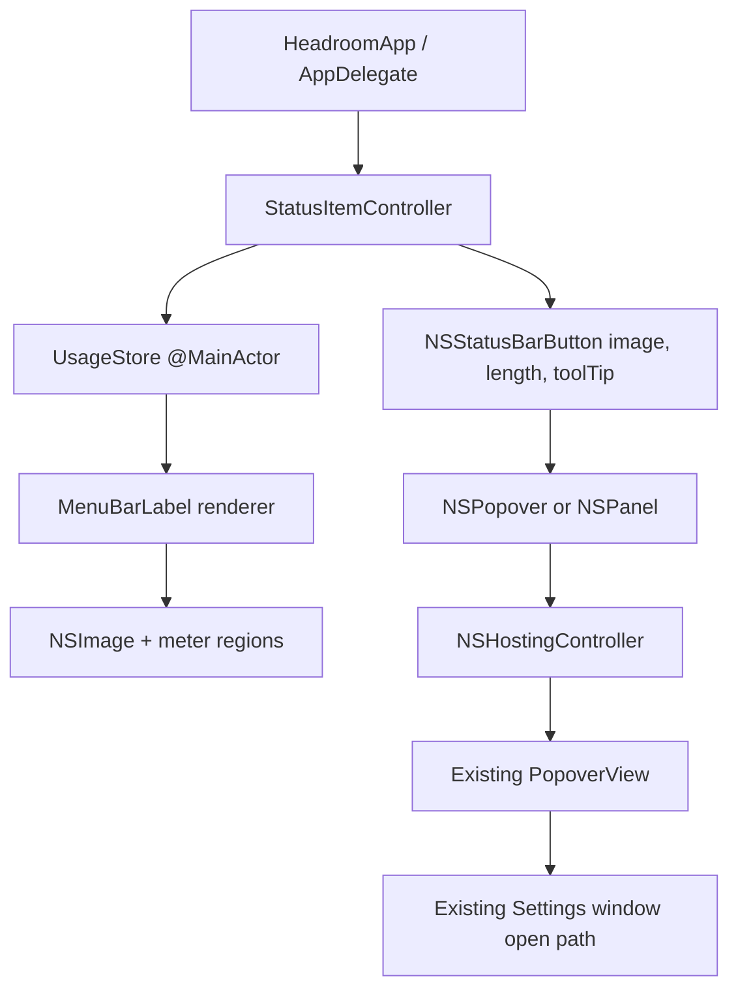

## Goal Capsule

| Field | Value |
|---|---|
| Objective | Replace the SwiftUI `MenuBarExtra` shell with an AppKit `NSStatusItem` host so Headroom can show native hover tooltips for the menu bar meter while keeping the existing visual treatment nearly unchanged. |
| Authority | User request: delayed release slightly and wants the menu bar hover behavior if the app still looks good and almost completely native. Existing Headroom constraints remain binding, especially no Claude subscription OAuth and no pulsing UI. |
| Execution profile | Standard refactor touching app lifecycle, menu bar hosting, and visual smoke verification. |
| Stop conditions | Stop if the AppKit host cannot preserve click-to-open behavior, outside-click dismissal, settings-window focus, or the current menu bar image quality without large unrelated rewrites. |
| Tail ownership | Implementation must leave the local app rebuilt and relaunched for visual inspection; release/notarization happens after the user accepts the visual result. |

---

## Product Contract

### Summary

Headroom should still behave like a native macOS menu bar utility, but hovering over the menu bar status area should identify what the user is looking at, especially in `Both` mode where Claude and Codex meters appear side by side.

### Problem Frame

The current SwiftUI `MenuBarExtra` implementation renders the menu bar image correctly but does not reliably surface `.help(...)` as a tooltip on the actual system menu bar item.
Apple documents tooltip customization on AppKit `NSStatusItem.button`, while SwiftUI `MenuBarExtra` does not expose the backing status item.
The release can absorb a focused shell refactor if it preserves the native look and keeps the existing SwiftUI product UI intact.

### Requirements

- R1. The menu bar item renders the same meter image produced by the existing `MenuBarLabel` / `VesselGlyph` path, including `Both` mode, severity colors, percentage visibility, and the `8pt` icon-only meter gap.
- R2. Hovering over the menu bar item shows a native macOS tooltip that identifies the represented provider usage; in `Both` mode the tooltip includes Claude and Codex details.
- R3. If technically practical without private APIs or fragile event hacks, hovering over a specific pill in `Both` mode should identify that pill; otherwise the whole status item tooltip is acceptable for 1.0.
- R4. Clicking the status item opens and closes the same Headroom usage surface with nearly native macOS placement, dismissal, and visual treatment.
- R5. Opening Settings from the popover still dismisses the transient popover and brings the Settings window forward on the active screen.
- R6. The app still starts polling exactly once, keeps the accessory app behavior, and does not introduce Dock/app-switcher presence.
- R7. The refactor must not change provider fetching, credential handling, usage math, widgets, Sparkle, signing configuration, or packaging behavior.
- R8. Aesthetic quality, smoothness, and detail parity are release-blocking: the menu bar item, popover surface, transitions, dismissal, settings handoff, refresh state, quit action, and hover behavior must feel at least as polished and native as the current implementation.

### Acceptance Examples

- AE1. Given `Menu bar fill` is set to `Both` and percentages are hidden, when the app launches, then the menu bar shows two compact vessel pills with the accepted tight spacing and no extra provider text.
- AE2. Given the menu bar shows both providers, when the cursor pauses over the status item, then macOS shows a tooltip such as `Claude weekly, 78% remaining; Codex weekly, 5% remaining`.
- AE3. Given the popover is open, when the user clicks the gear or an `Add date` action that opens Settings, then the popover closes and the Settings window becomes key on the active display.
- AE4. Given the user clicks outside the usage popover, presses Escape, or clicks the status item again, then the transient usage surface dismisses without leaving a stuck floating window.
- AE5. Given the user compares the pre-refactor and post-refactor app in normal use, then the only intended visible difference is that hover tooltip behavior now works; spacing, colors, popover sizing, glass treatment, settings flow, refresh state, and quit behavior remain equivalent.

### Scope Boundaries

- This plan does not add provider identity badges, provider-color rails, or user-configurable pill spacing.
- This plan does not implement multi-account subscription profiles; that remains deferred to the 1.1 plan.
- This plan does not alter the popover card content, usage refresh cadence, provider parsing, widget UI, DMG packaging, Sparkle update behavior, or notarization scripts.
- This plan avoids private API access to SwiftUI's backing `NSStatusItem`; it owns the menu bar shell through supported AppKit APIs.

---

## Planning Contract

### Key Technical Decisions

- KTD1. **Own the status item with AppKit instead of introspecting `MenuBarExtra`.** Use `NSStatusBar.system.statusItem(withLength:)` and `NSStatusItem.button` because Apple documents the button as the customization point for image, action, and `toolTip`; avoid private SwiftUI internals.
- KTD2. **Keep SwiftUI for app content.** Host the existing `PopoverView` in `NSHostingController` from an AppKit popover or panel so the product surface remains visually familiar and implementation stays scoped to shell behavior.
- KTD3. **Start with whole-item tooltip, then evaluate per-pill zones.** A whole status item tooltip is the supported baseline. Per-pill hover can be added only if it can be implemented with public AppKit tracking/tooltip rects without making click handling brittle.
- KTD4. **Make rendering data explicit.** Extend the menu bar renderer enough to return image size and optional meter hit regions, so AppKit can set status item length and tooltip regions from the same geometry used to draw the image.
- KTD5. **Preserve lifecycle semantics.** Move polling startup and status image updates into a small coordinator while keeping `UsageStore` as the single source of truth.

### High-Level Technical Design

The shell coordinator owns only status-item presentation and transient popover lifecycle.
The existing `UsageStore` still owns polling, preferences, snapshots, menu bar meter selection, and widget export.
The existing `PopoverView` remains the SwiftUI content inside the AppKit host, with a small dismissal abstraction replacing the current `WindowAccessor` dependency where necessary.

### Assumptions

- AppKit `NSStatusItem.button.toolTip` works on macOS Tahoe for whole-status-item hover, matching Apple's documented API.
- A visual match within normal AppKit differences is acceptable; exact `MenuBarExtra(.window)` animation parity is not required.
- Per-pill tooltip regions may be constrained by `NSStatusBarButton`; if reliable per-region tooltips are not available, the whole item tooltip satisfies the 1.0 release requirement.

### Sources & Research

- Apple Developer Documentation, `NSStatusItem.button`: Apple identifies the status item button as the customization point for image, action, and tooltip.
- Apple Developer Documentation, `NSStatusItem`: AppKit creates and manages status items in the system menu bar.
- Apple Developer Documentation, `MenuBarExtra`: SwiftUI provides a menu bar extra scene, but the public API does not expose the backing `NSStatusItem`.
- Existing code: `Sources/HeadroomApp/HeadroomApp.swift` currently uses `MenuBarExtra(.window)` and contains settings-window activation logic that must be preserved.
- Existing code: `Sources/HeadroomApp/UI/MenuBarLabel.swift` already renders the accepted menu bar meter as a non-template `NSImage`.
- Existing code: `Sources/HeadroomApp/UI/PopoverView.swift` keeps the usage content isolated enough to host from AppKit.

---

## Implementation Units

### U1. Extract Menu Bar Rendering Metadata

- **Goal:** Make the existing menu bar renderer usable by an AppKit status item, including image size and tooltip/hit-region metadata.
- **Requirements:** R1, R2, R3
- **Dependencies:** None
- **Files:**
  - Modify: `Sources/HeadroomApp/UI/MenuBarLabel.swift`
  - Test: manual/visual; no existing app-view unit test target covers `NSImage` drawing geometry.
- **Approach:** Keep the accepted drawing constants and image output. Add a render-result value that includes the `NSImage`, total width, accessibility/tooltip text, and optional meter rects keyed by provider where feasible. Keep a SwiftUI `MenuBarLabel` wrapper if useful for preview or fallback, but do not depend on `.help(...)` for menu bar tooltip behavior.
- **Patterns to follow:** Existing `MenuBarLabelImage.render(...)` and `VesselGlyph.menuBarImage(...)` keep all menu bar visuals in one code path.
- **Test scenarios:**
  - Rendering with one meter and percentage visible produces one image and tooltip text for that provider.
  - Rendering `Both` with percentages hidden preserves the `8pt` icon-only gap and produces tooltip content for both providers.
  - Rendering neutral or needs-attention states keeps the existing warning/neutral accessible text.
- **Verification:** `swift build` passes; visual preview shows the same accepted menu bar image before and after host refactor.

### U2. Add AppKit Status Item Controller

- **Goal:** Introduce an AppKit coordinator that owns `NSStatusItem`, status image updates, native tooltip, and click handling.
- **Requirements:** R1, R2, R3, R6
- **Dependencies:** U1
- **Files:**
  - Create: `Sources/HeadroomApp/StatusItemController.swift`
  - Modify: `Sources/HeadroomApp/HeadroomApp.swift`
- **Approach:** Create a `@MainActor` controller that receives the `UsageStore`, a settings-open closure, and the existing `SoftwareUpdateController` if needed by hosted settings/popover content. Configure a variable-length status item, set `button.image`, `button.toolTip`, `button.target`, and `button.action`, and update these whenever store-observed values change. Use public AppKit APIs only. Start with a whole-item tooltip; add per-region tooltip support only if AppKit supports it cleanly.
- **Patterns to follow:** `AppDelegate.applicationDidFinishLaunching` already owns accessory app activation and startup hooks; `HeadroomApp.openSettings()` owns active-screen settings placement and should remain the canonical settings path.
- **Test scenarios:**
  - App launch creates one status item and starts `UsageStore.start()` once.
  - Store meter changes update the button image/length and tooltip without creating duplicate status items.
  - Clicking the status item toggles the transient usage surface.
- **Verification:** `swift build`, `swift test`, and a debug app launch show one Headroom menu bar item and no Dock icon.

### U3. Host Existing Popover Content from AppKit

- **Goal:** Replace `MenuBarExtra(.window)` popover presentation with an AppKit transient host that still displays `PopoverView` nearly identically.
- **Requirements:** R4, R5
- **Dependencies:** U2
- **Files:**
  - Modify: `Sources/HeadroomApp/StatusItemController.swift`
  - Modify: `Sources/HeadroomApp/UI/PopoverView.swift`
  - Modify: `Sources/HeadroomApp/HeadroomApp.swift`
- **Approach:** Prefer `NSPopover` first because it is native, transient, and anchored to the status item. If `NSPopover` visually regresses the Tahoe/Liquid Glass treatment or dismissal, use a lightweight `NSPanel` anchored below the status button and close it on outside click/Escape. Keep `PopoverView` content and sizing intact; replace its current `WindowAccessor`-based dismissal with an injected close action if the AppKit host can close directly.
- **Patterns to follow:** Existing `PopoverView.openSettingsDismissingPopover()` encodes the intended behavior: transient usage surface closes before Settings opens.
- **Test scenarios:**
  - Clicking status item opens the usage surface aligned to the status item.
  - Clicking status item again closes the usage surface.
  - Clicking outside or pressing Escape dismisses the usage surface.
  - Gear/Add-date path closes the usage surface and opens Settings in front.
- **Verification:** Manual desktop QA on the local debug app confirms placement, dismissal, keyboard focus, and native visual quality.

### U4. Preserve Settings Window and App Lifecycle

- **Goal:** Keep the existing settings window, accessory activation policy, polling startup, and window placement behavior after removing the `MenuBarExtra` scene.
- **Requirements:** R5, R6, R7
- **Dependencies:** U2, U3
- **Files:**
  - Modify: `Sources/HeadroomApp/HeadroomApp.swift`
  - Modify: `Sources/HeadroomApp/StatusItemController.swift`
- **Approach:** Present the existing `SettingsView` from a small AppKit settings presenter so the AppKit status item can open it without depending on SwiftUI `openWindow`. Preserve hidden-titlebar styling, accessory activation, active-screen placement, and the Settings `Done` close path.
- **Patterns to follow:** Preserve the previous settings behavior: activate the accessory app, make Settings key, and center it on the screen under the cursor without yanking an already-visible window.
- **Test scenarios:**
  - Settings opens from the popover and remains focusable in accessory-app mode.
  - Closing Settings and reopening from the menu bar works.
  - Launching via `open Headroom.app` starts polling and shows the status item without a Dock icon.
- **Verification:** Debug app launch, settings open/close/reopen smoke, and process check confirm the worktree app is running.

### U5. Verification, Visual QA, and Cleanup

- **Goal:** Prove the refactor is release-worthy and remove stale `MenuBarExtra` assumptions/comments.
- **Requirements:** R1, R2, R4, R7, R8
- **Dependencies:** U1, U2, U3, U4
- **Files:**
  - Modify as needed: `Sources/HeadroomApp/UI/MenuBarLabel.swift`
  - Modify as needed: `Sources/HeadroomApp/UI/VesselGlyph.swift`
  - Modify as needed: `Sources/HeadroomApp/UI/PopoverView.swift`
  - Test: existing unit suites under `Tests/HeadroomCoreTests/`
- **Approach:** Run compile and unit tests, rebuild the `.app`, relaunch it, and visually verify both percentage-on and percentage-off `Both` states. Update comments that still claim `MenuBarExtra` is the host. Keep `scratchpad/menu-bar-alignment-preview.html` as the local ignored design artifact for 1.1 identifier research.
- **Patterns to follow:** Existing `./Scripts/build-app.sh debug` local build flow and current menu bar preference defaults used for visual preview.
- **Test scenarios:**
  - `swift build` passes under Swift 6 strict concurrency.
  - `swift test` passes existing 95-test core suite.
  - Debug app build succeeds and is code-signed for local launch.
  - Manual hover over the menu bar status item shows the tooltip text.
  - Manual interaction pass confirms the refactor did not degrade visual polish, click responsiveness, settings handoff, refresh state, quit action, or dismissal smoothness.
- **Verification:** Build/test output is recorded in the final implementation summary; user can inspect the relaunched local app.

---

## Verification Contract

| Gate | Applies To | Done Signal |
|---|---|---|
| `swift build` | U1-U4 | App and core targets compile cleanly after the AppKit shell refactor. |
| `swift test` | U2-U5 | Existing core behavior, preferences, and menu bar meter data tests remain green. |
| `./Scripts/build-app.sh debug` | U3-U5 | Local `Headroom.app` bundle builds and signs successfully. |
| Manual menu bar QA | U2-U5 | Status item appears once, hover tooltip appears, click toggles usage surface, outside/Escape dismissal works, Settings opens in front, no Dock icon appears. |
| Visual and interaction comparison | U1, U3, U5 | Menu bar pills, popover content, glass surface, sizing, transitions, refresh/quit controls, Settings handoff, and dismissal feel nearly identical to the accepted SwiftUI-hosted version, with tooltip support as the only intended functional addition. |

---

## Definition of Done

- The SwiftUI `MenuBarExtra` scene is removed or bypassed for shipped menu bar hosting.
- The menu bar item is owned by supported AppKit `NSStatusItem` APIs.
- The status item displays the accepted meter image and shows a native tooltip on hover.
- The existing SwiftUI usage surface remains visually native and functionally equivalent.
- Aesthetic quality, smooth interaction, and detailed feature parity are preserved; any visible regression is fixed before release work resumes.
- Settings, Quit, Refresh, polling startup, widgets, provider fetching, and preferences continue to work.
- Build/test/debug-app verification gates pass.
- Abandoned host experiments or stale comments are removed from the diff.
