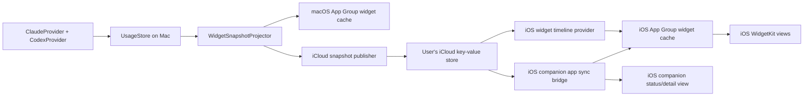
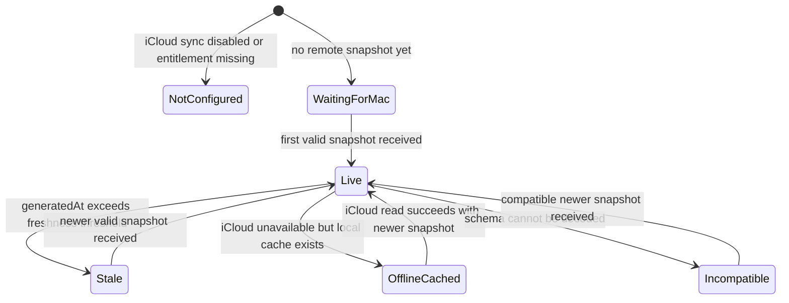

# iOS Companion Widget via iCloud Sync - Plan

## Summary

Add an iOS companion app and WidgetKit extension that display Headroom's latest redaction-safe usage snapshot on the user's iPhone, with the Mac app remaining the only process that fetches Claude/Codex usage. Cross-device transport uses the user's iCloud key-value store, not a Headroom-hosted service.

---

## Problem Frame

Headroom is useful on the Mac where agents are running, but the user may be away from that Mac while long-running agent work consumes Claude or Codex windows. The next version should make that same glanceable headroom available on iPhone without introducing hosted infrastructure, third-party accounts, or any cloud-side provider credential handling.

---

## Requirements

- R1. The Mac app remains the only surface that fetches provider usage; the iOS app and widget never spawn `claude`, read `~/.codex/auth.json`, use provider credentials, or call provider usage endpoints.
- R2. The synced payload contains only the existing redaction-safe widget snapshot data: provider labels, window percentages, reset labels/times, freshness state, renewal dates, schema version, and generated timestamp.
- R3. Cross-device sync uses Apple iCloud owned by the user, with no Headroom-hosted backend, accounts, relay service, or server-side storage.
- R4. iCloud sync is controlled by an explicit Mac setting separate from local macOS widget sharing.
- R5. The iPhone companion app can show the latest received snapshot, sync/freshness status, and setup states for no iCloud data, sync disabled, stale data, or incompatible schema.
- R6. The iOS WidgetKit extension supports size-appropriate iPhone widgets that mirror the current macOS widget information density where the platform family allows.
- R7. The iOS widget uses local cached data whenever iCloud is unavailable, slow, or offline; it must not blank a previously valid snapshot just because sync is temporarily unavailable.
- R8. Widget refresh expectations are honest: the UI shows when the snapshot was generated/received and does not imply real-time updates that WidgetKit cannot guarantee.
- R9. Shared core logic remains testable under Swift 6 strict concurrency, with network/iCloud/platform dependencies behind injectable seams.
- R10. Entitlements, bundle identifiers, signing, README guidance, and privacy copy are updated so the Mac app, iOS app, and iOS widget can share the same iCloud key-value store identity.

---

## Scope Boundaries

- No hosted Headroom relay, accounts, QR pairing service, push server, or server-side storage.
- No provider credentials, raw CLI output, request metadata, keychain secrets, auth files, or filesystem paths in iCloud.
- No iOS-side provider fetching, even as a fallback.
- No cross-user/team sharing, shared dashboards, or historical usage charts.
- No Live Activities, watchOS widgets, notifications, alerts, or threshold automation in 1.0.
- No guarantee that iOS widgets update instantly after a Mac refresh; WidgetKit and iCloud delivery remain system-scheduled.
- No API spend sync in 1.0 unless the existing widget snapshot model is intentionally expanded in a separate product decision.

### Deferred to Follow-Up Work

- Push-style widget freshness via APNs or WidgetKit push notifications: requires server/APNs plumbing and conflicts with the current no-hosting direction.
- Lock Screen/accessory widget families: useful later, but 1.0 should first prove Home Screen/Today View usage visibility.
- Multi-Mac source selection and conflict UI: 1.0 can use newest-valid snapshot wins and expose the source timestamp rather than building device management.
- App Store product polish beyond required privacy strings/screenshots: defer marketing/onboarding depth until the sync path works end-to-end.

---

## Context & Research

### Relevant Code and Patterns

- `Sources/HeadroomCore/Widgets/WidgetSnapshotModels.swift` already defines a small codable, redaction-safe `WidgetSnapshotEnvelope` intended for WidgetKit.
- `Sources/HeadroomCore/Widgets/WidgetSnapshotProjector.swift` already converts richer provider snapshots into display-ready widget payloads without credentials or raw provider details.
- `Sources/HeadroomCore/Widgets/WidgetSnapshotCache.swift` already provides an app-extension-safe local cache pattern for widget reads, including unavailable/empty/corrupt states.
- `Sources/HeadroomCore/Engine/UsageStore.swift` already exports widget snapshots after subscription refreshes and settings changes through the `WidgetSnapshotExporting` seam.
- `Sources/HeadroomWidgets` already contains size-specific widget SwiftUI views that can be reused or adapted for iOS once the target/platform constraints are split cleanly.
- `project.yml` and `Scripts/build-app.sh` are the current packaging authority for the Xcode app bundle and embedded macOS widget extension.
- `AGENTS.md` prohibits Claude subscription OAuth and requires the official `claude` CLI `/usage` PTY probe to remain the compliant Claude source.

### Institutional Learnings

- No `docs/solutions/` learnings are present in this worktree yet.
- The prior macOS widget plan in `docs/plans/2026-07-03-001-feat-macos-widgets-plan.md` established the main reusable principle: widgets consume redaction-safe cached projections and never fetch providers directly.

### External References

- Apple iCloud key-value storage is designed for small preferences/app-state values shared across a user's devices, requires entitlements, supports change notifications, and has a 1 MB per-user quota with a 1024-key limit: https://developer.apple.com/library/archive/documentation/General/Conceptual/iCloudDesignGuide/Chapters/DesigningForKey-ValueDataIniCloud.html
- Apple iCloud fundamentals describe iCloud as OS-managed transfer/storage, entitlement-based access, and common key-value storage across apps by sharing the `com.apple.developer.ubiquity-kvstore-identifier`: https://developer.apple.com/library/archive/documentation/General/Conceptual/iCloudDesignGuide/Chapters/iCloudFundametals.html
- Apple WidgetKit docs define widgets as glanceable app content updated by timelines; WidgetCenter can reload timelines when app state changes, but WidgetKit owns the energy-efficient update cadence: https://developer.apple.com/documentation/widgetkit

---

## Key Technical Decisions

- Use iCloud key-value storage, not CloudKit database records, for 1.0. The payload is one latest snapshot, comfortably below Apple's quota, and the product does not need queries, sharing, history, or server-like CloudKit modeling.
- Reuse `WidgetSnapshotEnvelope` as the core synced data contract. If transport metadata is needed, wrap it in a small sync envelope rather than creating a second usage model that can drift from local widgets.
- Keep local App Group cache as the widget read path on iOS. iCloud updates should hydrate a local cache; WidgetKit views should render from that cache so they tolerate offline mode and slow iCloud propagation.
- Make iCloud phone sync opt-in and separate from local widget export. Local widgets are same-device display; iCloud sync moves data across devices and deserves a clearer privacy boundary.
- Use newest-valid snapshot wins for 1.0. If multiple Macs publish, the iPhone displays the snapshot with the newest generated/published timestamp and surfaces timestamp/source context rather than asking the user to manage devices.
- Treat iCloud and WidgetKit freshness as eventually consistent. The Mac publishes after refresh; the iPhone app/extension reads when the system gives it execution; the UI shows generated/received age so stale data is understandable.
- Share the same iCloud key-value store identifier across the macOS app, iOS companion app, and iOS widget extension. This is an entitlement/signing task and must be proven on real devices.
- Preserve SwiftPM as the fast core verification surface where possible, but accept that the multi-platform app/widget product will be proven through Xcode/xcodegen packaging and device smoke tests.

---

## Open Questions

### Resolved During Planning

- Hosted relay versus iCloud: resolved to iCloud because the user does not want hosting, accounts, or infrastructure dependencies.
- API choice for 1.0 sync: resolved to iCloud key-value storage because the data is one small latest snapshot and does not need CloudKit record modeling.
- Provider fetching on iOS: resolved as prohibited; the Mac app remains the only provider-fetching process.

### Deferred to Implementation

- Exact minimum iOS deployment target: align with Xcode 26/project constraints during target creation, likely iOS 26 for symmetry with the current macOS 26 posture.
- Whether the iOS widget extension can reliably read iCloud key-value storage directly in all desired lifecycle states: implement behind a seam and fall back to iOS app-hydrated App Group cache if extension reads are unreliable.
- Exact entitlement values after signing/provisioning: verify in Xcode against the Apple Developer account and generated provisioning profiles.
- Final iOS widget family list: start with Home Screen/Today families that compile cleanly, then add accessory families only if the first pass is stable.

---

## Output Structure

This is the expected shape for new source areas; exact file names may adjust during implementation if the platform target setup suggests a cleaner split.

```text
Sources/
  HeadroomCore/
    Sync/
      iCloudSnapshotSync.swift
      SyncedWidgetSnapshotModels.swift
  HeadroomIOS/
    HeadroomIOSApp.swift
    Views/
      IOSCompanionView.swift
      IOSSyncStatusView.swift
    HeadroomIOS.entitlements
  HeadroomIOSWidgets/
    HeadroomIOSWidgets.swift
    HeadroomIOSTimelineProvider.swift
    HeadroomIOSWidgetEntry.swift
    Views/
      IOSWidgetStatusView.swift
    HeadroomIOSWidgets.entitlements
Tests/
  HeadroomCoreTests/
    iCloudSnapshotSyncTests.swift
    SyncedWidgetSnapshotModelsTests.swift
```

---

## High-Level Technical Design

> *This illustrates the intended approach and is directional guidance for review, not implementation specification. The implementing agent should treat it as context, not code to reproduce.*





---

## Implementation Units

### U1. Shared iCloud Sync Contract and Codec

**Goal:** Define the cross-device sync envelope and serialization rules around the existing widget-safe snapshot.

**Requirements:** R1, R2, R7, R9

**Dependencies:** None

**Files:**
- Create: `Sources/HeadroomCore/Sync/SyncedWidgetSnapshotModels.swift`
- Test: `Tests/HeadroomCoreTests/SyncedWidgetSnapshotModelsTests.swift`
- Modify: `Package.swift`

**Approach:**
- Wrap `WidgetSnapshotEnvelope` only if needed for sync metadata such as schema version, published timestamp, source platform, and monotonic conflict comparison.
- Keep the synced data property-list-compatible for `NSUbiquitousKeyValueStore`, either as `Data` under one key or as a small dictionary containing encoded snapshot data plus metadata.
- Add decode outcomes that distinguish absent data, incompatible schema, corrupt payload, and valid snapshot so UI states are typed rather than stringly.
- Keep all failure details redaction-safe and never include provider credentials, raw CLI output, auth file paths, HTTP headers, or request/response bodies.

**Execution note:** Implement the model and codec test-first because this is the durable cross-version contract between macOS and iOS.

**Patterns to follow:**
- `Sources/HeadroomCore/Widgets/WidgetSnapshotModels.swift`
- `Sources/HeadroomCore/Widgets/WidgetSnapshotCache.swift`
- `Tests/HeadroomCoreTests/WidgetSnapshotCacheTests.swift`

**Test scenarios:**
- Happy path: a live `WidgetSnapshotEnvelope` encodes and decodes with identical provider/window/freshness values.
- Happy path: a disabled snapshot encodes and decodes without provider data.
- Edge case: an unknown future provider ID and unknown window kind round-trip without dropping the provider.
- Error path: invalid encoded data returns a corrupt/incompatible outcome without throwing raw errors.
- Error path: a future unsupported schema returns an incompatible state that preserves no unsafe payload details.
- Privacy path: encoded payload contains no known token/auth-file/path fixture strings when given normal widget snapshot inputs.

**Verification:**
- The sync model tests pass.
- The sync model imports no provider, credential, HTTP, or CLI probe types.

### U2. iCloud Snapshot Store Abstraction

**Goal:** Add an injectable core abstraction for publishing and reading the latest widget snapshot through iCloud key-value storage.

**Requirements:** R3, R7, R8, R9, R10

**Dependencies:** U1

**Files:**
- Create: `Sources/HeadroomCore/Sync/iCloudSnapshotSync.swift`
- Test: `Tests/HeadroomCoreTests/iCloudSnapshotSyncTests.swift`
- Modify: `Package.swift`

**Approach:**
- Define a small protocol seam for a key-value sync store so unit tests use an in-memory double instead of real iCloud.
- Production uses `NSUbiquitousKeyValueStore` only in Apple-platform builds where the framework is available.
- Expose read, publish, synchronize, and change-observation behaviors at a level that app targets can call without importing widget/provider internals.
- Treat iCloud failures as typed sync states. The app/widget should display setup or cached states, not raw platform errors.
- Apply newest-valid-wins conflict logic based on generated/published timestamps so repeated Mac publishes and multi-device writes are deterministic.

**Execution note:** Keep the production `NSUbiquitousKeyValueStore` adapter thin and put conflict/state behavior in pure testable code.

**Patterns to follow:**
- `Sources/HeadroomCore/Widgets/WidgetSnapshotExporter.swift`
- `Sources/HeadroomCore/Settings/Preferences.swift`
- `Tests/HeadroomCoreTests/Mocks.swift`

**Test scenarios:**
- Happy path: publishing a valid snapshot writes one key and a subsequent read returns it.
- Happy path: reading after `synchronize` returns the newest valid local or remote snapshot.
- Edge case: older remote data does not replace a newer local cached snapshot.
- Edge case: equal timestamps resolve deterministically without oscillation.
- Error path: unavailable iCloud store returns a setup/unavailable state.
- Error path: quota/corrupt/incompatible states are mapped to safe typed outcomes.
- Integration: a simulated external-change notification causes the sync bridge to re-read and emit/update the current snapshot.

**Verification:**
- Sync tests pass without touching real iCloud.
- `HeadroomCore` still builds for the package's supported platforms under strict concurrency.

### U3. Mac Publisher Integration and Settings

**Goal:** Let the Mac app publish the latest widget-safe snapshot to iCloud when the user explicitly enables phone sync.

**Requirements:** R1, R2, R3, R4, R8, R10

**Dependencies:** U1, U2

**Files:**
- Modify: `Sources/HeadroomCore/Settings/Preferences.swift`
- Modify: `Sources/HeadroomCore/Engine/UsageStore.swift`
- Modify: `Sources/HeadroomApp/HeadroomApp.swift`
- Modify: `Sources/HeadroomApp/UI/SettingsView.swift`
- Modify: `Sources/HeadroomApp/UI/WidgetSettingsSection.swift`
- Modify: `Sources/HeadroomApp/HeadroomApp.entitlements`
- Test: `Tests/HeadroomCoreTests/PreferencesTests.swift`
- Test: `Tests/HeadroomCoreTests/UsageStoreTests.swift`

**Approach:**
- Add a separate `syncToIPhoneEnabled` preference that defaults off. This makes cross-device sync an explicit privacy choice rather than a side effect of enabling local widgets.
- Extend `UsageStore` with an optional sync publisher seam alongside the existing local widget exporter. Both consume the same projected snapshot; neither fetches providers directly.
- Publish after successful subscription refreshes and after relevant settings changes, while preserving existing local widget export behavior.
- Settings should describe the boundary plainly: local widgets stay on this Mac; iPhone sync sends a redaction-safe usage snapshot through the user's iCloud.
- Add iCloud entitlement keys required for key-value storage and common store identity; keep the app's existing Claude/Codex credential access behavior unchanged.

**Patterns to follow:**
- `UsageStore`'s current `widgetExporter` seam
- `Preferences.widgetsEnabled`
- `WidgetSettingsSection` copy style
- Existing entitlement handling in `Sources/HeadroomApp/HeadroomApp.entitlements`

**Test scenarios:**
- Happy path: iPhone sync defaults disabled and persists when toggled on/off.
- Happy path: with sync enabled, a refresh publishes the same provider/window values as local widget export.
- Edge case: with sync disabled, refreshes do not publish to iCloud but still update local macOS widgets when local widgets are enabled.
- Edge case: disabling a provider removes it from future synced snapshots without affecting other providers.
- Error path: iCloud publish failure does not fail `refreshAll()` or mark provider snapshots stale.
- Integration: toggling sync on publishes the current snapshot if one exists; toggling sync off publishes a disabled/cleared state or stops publishing according to the resolved sync contract.

**Verification:**
- Store and preference tests pass.
- The Mac app still does not import or instantiate any iOS widget target code.
- Settings exposes local widget sharing and iPhone sync as separate controls.

### U4. iOS Companion App Shell and Local Cache

**Goal:** Add a minimal iOS companion app that reads iCloud sync state, hydrates a local App Group cache, and presents the latest usage status.

**Requirements:** R5, R7, R8, R9, R10

**Dependencies:** U1, U2

**Files:**
- Create: `Sources/HeadroomIOS/HeadroomIOSApp.swift`
- Create: `Sources/HeadroomIOS/Views/IOSCompanionView.swift`
- Create: `Sources/HeadroomIOS/Views/IOSSyncStatusView.swift`
- Create: `Sources/HeadroomIOS/HeadroomIOS.entitlements`
- Modify: `project.yml`
- Modify: `Package.swift`
- Test: `Tests/HeadroomCoreTests/iCloudSnapshotSyncTests.swift`

**Approach:**
- Keep the iOS app intentionally narrow: it is a companion/status surface, not a second Headroom provider client.
- On launch/foreground, synchronize the iCloud key-value store, validate the snapshot, write the valid result to an iOS App Group cache, and request widget timeline reloads.
- Observe external iCloud changes while the app is alive and update the local cache/widget when new valid snapshots arrive.
- Present setup states for iCloud unavailable, no Mac snapshot yet, Mac sync disabled, incompatible schema, and stale data.
- Reuse existing widget presentation components where platform constraints allow; add iOS-specific wrappers only for app navigation/status.

**Patterns to follow:**
- `Sources/HeadroomWidgets/Views/HeadroomWidgetView.swift`
- `Sources/HeadroomCore/Widgets/WidgetSnapshotCache.swift`
- `Sources/HeadroomApp/UI/ProviderCardView.swift` for information hierarchy, not card nesting

**Test scenarios:**
- Test expectation: most app-shell rendering is verified by previews/device smoke; core sync/cache behavior is covered in U1/U2.
- Happy path smoke: with a valid synced snapshot available, launching the iOS app shows Claude/Codex weekly and 5-hour values.
- Edge case smoke: with no synced snapshot, the app shows a setup/waiting state rather than empty content.
- Error path smoke: with corrupt or incompatible synced data, the app shows a safe incompatible-data state and keeps any prior valid local cache.
- Integration smoke: receiving a new valid iCloud snapshot updates local cache and requests widget reload.

**Verification:**
- The iOS app target builds in Xcode.
- The iOS app has no code path that reads provider credentials, launches CLI processes, or calls provider usage endpoints.

### U5. iOS Widget Extension and Timeline Mapping

**Goal:** Add an iOS WidgetKit extension that renders the synced snapshot from local/iCloud-backed cache with honest freshness states.

**Requirements:** R5, R6, R7, R8, R9, R10

**Dependencies:** U1, U2, U4

**Files:**
- Create: `Sources/HeadroomIOSWidgets/HeadroomIOSWidgets.swift`
- Create: `Sources/HeadroomIOSWidgets/HeadroomIOSTimelineProvider.swift`
- Create: `Sources/HeadroomIOSWidgets/HeadroomIOSWidgetEntry.swift`
- Create: `Sources/HeadroomIOSWidgets/Views/IOSWidgetStatusView.swift`
- Create: `Sources/HeadroomIOSWidgets/HeadroomIOSWidgets.entitlements`
- Test: `Tests/HeadroomCoreTests/IOSWidgetTimelineMappingTests.swift`
- Modify: `Sources/HeadroomWidgets/Views/HeadroomWidgetView.swift`
- Modify: `Sources/HeadroomWidgets/Views/HeadroomSmallWidgetView.swift`
- Modify: `Sources/HeadroomWidgets/Views/HeadroomMediumWidgetView.swift`
- Modify: `Sources/HeadroomWidgets/Views/HeadroomLargeWidgetView.swift`
- Modify: `project.yml`
- Test: `Tests/HeadroomCoreTests/iCloudSnapshotSyncTests.swift`

**Approach:**
- Prefer sharing existing size-specific widget views across macOS and iOS, guarded by platform availability only where necessary.
- The iOS timeline provider should first render the last valid App Group cache and opportunistically synchronize/read iCloud if extension lifecycle and entitlements allow it.
- Map sync/cache outcomes to typed widget states: setup needed, waiting for Mac, disabled, stale cached, incompatible, and content.
- Use conservative timeline policies. The widget should refresh around expected usage/reset changes where possible, but not fight WidgetKit's budget.
- Include generated/received freshness labels in medium/large widgets; keep the small widget focused on weekly remaining.

**Patterns to follow:**
- `Sources/HeadroomWidgets/HeadroomTimelineProvider.swift`
- `Sources/HeadroomWidgets/HeadroomWidgetEntry.swift`
- `Sources/HeadroomWidgets/Views/*`

**Test scenarios:**
- Happy path: live cached snapshot maps to content entry for small/medium/large families.
- Happy path: disabled synced state maps to a quiet disabled widget.
- Edge case: no local cache and no remote snapshot maps to waiting/setup, not blank content.
- Edge case: stale cached snapshot remains renderable and includes age/freshness context where space permits.
- Error path: corrupt/incompatible local cache does not crash timeline mapping.
- Integration smoke: adding the iOS widget on device displays the Mac-published snapshot after iCloud sync completes.

**Verification:**
- The iOS widget target builds and embeds in the iOS app.
- Widget views render without clipped or overlapping text in supported families.
- The widget extension has no provider, credential, HTTP usage-client, or CLI probe imports.

### U6. Multi-Platform Packaging, Entitlements, and Signing

**Goal:** Update project generation/build configuration so macOS, macOS widgets, iOS app, and iOS widgets are buildable with the right capabilities.

**Requirements:** R3, R6, R9, R10

**Dependencies:** U1, U2, U4, U5

**Files:**
- Modify: `project.yml`
- Modify: `Package.swift`
- Modify: `Scripts/build-app.sh`
- Modify: `Sources/HeadroomApp/HeadroomApp.entitlements`
- Modify: `Sources/HeadroomWidgets/HeadroomWidgets.entitlements`
- Create: `Sources/HeadroomIOS/HeadroomIOS.entitlements`
- Create: `Sources/HeadroomIOSWidgets/HeadroomIOSWidgets.entitlements`

**Approach:**
- Add iOS application and iOS app-extension targets to `project.yml`, with bundle identifiers under the same team/app family.
- Configure shared App Group entitlements for iOS app/widget local cache and shared iCloud key-value entitlements for cross-device sync.
- Keep the existing macOS build script focused on producing `Headroom.app`; add iOS build guidance or a separate script only if local verification needs it.
- Preserve SwiftPM usefulness for shared core/tests by adding platform declarations that support both macOS and iOS.
- Verify generated Xcode project settings rather than hand-editing `Headroom.xcodeproj` as the source of truth.

**Patterns to follow:**
- Current `project.yml` target definitions
- Current macOS app/widget entitlement files
- `Scripts/build-app.sh` xcodegen-first workflow

**Test scenarios:**
- Test expectation: none for entitlement plumbing in unit tests; verification is build/signing/device smoke.
- Packaging smoke: xcodegen regenerates a project containing all four app/extension targets.
- Packaging smoke: macOS app bundle still builds with embedded macOS widget extension.
- Packaging smoke: iOS app builds with embedded iOS widget extension for a simulator or device destination.
- Entitlement smoke: built products contain expected App Group and iCloud key-value entitlements.

**Verification:**
- `swift build` and `swift test` continue to work for shared code.
- Xcode build succeeds for macOS and iOS targets.
- Real-device signing blockers are documented with exact missing capability/profile information if they cannot be resolved locally.

### U7. Documentation, Privacy Copy, and Manual Verification

**Goal:** Document the 1.0 iPhone sync behavior, privacy guarantees, setup requirements, and verification path.

**Requirements:** R1, R2, R3, R4, R8, R10

**Dependencies:** U3, U4, U5, U6

**Files:**
- Modify: `README.md`
- Modify: `BUGS.md`
- Modify: `docs/plans/2026-07-04-002-feat-ios-companion-widget-icloud-plan.md` if implementation discovers plan-level corrections

**Approach:**
- README should explain that iPhone sync uses the user's iCloud, not Headroom servers; only redaction-safe usage snapshots are synced.
- Settings/UI copy should make setup understandable: enable sync on Mac, install/open the iOS companion, add the iOS widget.
- Document platform limits honestly: iCloud and WidgetKit are eventually consistent, and widgets may show a generated/received age rather than immediate updates.
- Add any known follow-up bugs discovered during implementation to `BUGS.md` rather than broadening the 1.0 scope.
- Capture manual verification evidence for Mac publish, iOS app receive, iOS widget render, disabled sync, stale/offline cache, and entitlement failure/setup states.

**Patterns to follow:**
- README's existing "How it gets the data" and "Widgets" sections
- `BUGS.md` deferred-item style

**Test scenarios:**
- Test expectation: none for prose-only documentation; manual verification covers the documented setup.
- Manual: with iCloud sync enabled on Mac, iOS app receives and displays a latest snapshot.
- Manual: with the iOS widget added, the widget eventually displays the same latest snapshot or a stale-cached state with age.
- Manual: with Mac iCloud sync disabled, iOS surfaces the disabled/waiting state without showing provider credentials or raw errors.
- Manual: with the iPhone offline, the widget keeps the last valid local cache and marks age/freshness appropriately.

**Verification:**
- README accurately matches implemented settings and entitlements.
- Any unresolved 1.0 blockers are listed in `BUGS.md` with reproduction/setup context.

---

## System-Wide Impact

- **Interaction graph:** `UsageStore` gains a second post-projection export path: local macOS widgets and iCloud phone sync both consume the same redaction-safe snapshot.
- **Error propagation:** Provider fetch failures remain provider snapshot freshness states; iCloud sync failures are separate sync states and must not mutate provider freshness.
- **State lifecycle risks:** There are now three relevant states: latest provider snapshot on Mac, latest published iCloud snapshot, and latest local iOS widget cache. The plan keeps these explicit to avoid blanking useful data during transient sync failures.
- **API surface parity:** The sync contract becomes a cross-version API between macOS 1.0 and iOS 1.0; schema versioning and unknown-provider tolerance are required.
- **Integration coverage:** Unit tests can prove projection/codec/conflict logic; real-device smoke is required to prove entitlements, iCloud propagation, and WidgetKit rendering.
- **Unchanged invariants:** Claude usage remains compliant through the official CLI PTY probe; Codex subscription usage remains Mac-side; widgets and iOS surfaces remain display-only consumers.

---

## Risks & Dependencies

| Risk | Likelihood | Impact | Mitigation |
|------|------------|--------|------------|
| iCloud key-value propagation is delayed or unavailable | Medium | Medium | Show generated/received age, keep local cache, and avoid real-time claims. |
| WidgetKit does not execute often enough to feel current | Medium | Medium | Refresh timelines after iOS app sync, use conservative timeline policy, and make stale states visible. |
| Entitlements/provisioning block local or notarized builds | Medium | High | Add entitlement work as a dedicated unit and require real-device/build proof before calling 1.0 ready. |
| iOS widget extension cannot reliably read iCloud directly | Medium | Medium | Make the extension prefer local App Group cache and let the iOS app hydrate cache; direct extension iCloud read is opportunistic, not required for rendering cached data. |
| Accidentally syncing sensitive data | Low | High | Reuse `WidgetSnapshotEnvelope`, add privacy tests/fixtures, and keep provider/credential modules out of sync/widget targets. |
| Multiple Macs publish conflicting snapshots | Low | Low | Use newest-valid-wins for 1.0 and defer multi-source UI unless actual usage demands it. |
| Platform split makes shared widget views messy | Medium | Medium | Share pure SwiftUI views where clean; fork only thin platform wrappers when availability/layout differs. |

---

## Alternative Approaches Considered

- Hosted relay service: rejected because the user explicitly does not want to host infrastructure or carry account/auth/server obligations.
- CloudKit database records: deferred because 1.0 needs only one latest small snapshot, not records, sharing, queries, history, or server-side conflict modeling.
- Local network/private pairing: rejected for 1.0 because it does not reliably solve "away from the Mac" without VPN/Tailscale-style setup friction.
- iOS-side provider fetching: rejected because it violates Headroom's current architecture and the Claude compliance constraint.

---

## Success Metrics

- A user can enable iPhone sync on the Mac, open the iOS companion app, add the iOS widget, and see the latest Mac-published Claude/Codex usage without configuring a Headroom account or server.
- The synced payload is small, schema-versioned, and contains no credentials/raw provider data.
- The iOS widget remains useful when temporarily offline by showing the last valid snapshot with age/freshness context.
- `swift build`, `swift test`, and Xcode builds for the macOS/iOS app-widget targets succeed, or any signing-only blocker is documented precisely.

---

## Documentation / Operational Notes

- README needs a new iPhone sync section that differentiates local macOS widgets, iCloud phone sync, and unsupported hosted relay behavior.
- App privacy copy should disclose iCloud sync of usage-summary data but make clear no provider credentials or raw usage-source data are synced.
- Settings copy should avoid implying Apple iCloud is optional for this no-hosting path; if iCloud is disabled, the iPhone companion cannot receive remote Mac snapshots.
- Because no Headroom service exists, there is no server monitoring or incident response path; support guidance is local/iCloud troubleshooting.

---

## Sources & References

- Related plan: `docs/plans/2026-07-03-001-feat-macos-widgets-plan.md`
- Related code: `Sources/HeadroomCore/Widgets/WidgetSnapshotModels.swift`
- Related code: `Sources/HeadroomCore/Widgets/WidgetSnapshotProjector.swift`
- Related code: `Sources/HeadroomCore/Widgets/WidgetSnapshotCache.swift`
- Related code: `Sources/HeadroomCore/Engine/UsageStore.swift`
- Related code: `Sources/HeadroomWidgets`
- Related config: `project.yml`
- Related config: `Scripts/build-app.sh`
- Apple iCloud key-value storage: https://developer.apple.com/library/archive/documentation/General/Conceptual/iCloudDesignGuide/Chapters/DesigningForKey-ValueDataIniCloud.html
- Apple iCloud fundamentals and shared key-value identifiers: https://developer.apple.com/library/archive/documentation/General/Conceptual/iCloudDesignGuide/Chapters/iCloudFundametals.html
- Apple WidgetKit: https://developer.apple.com/documentation/widgetkit
