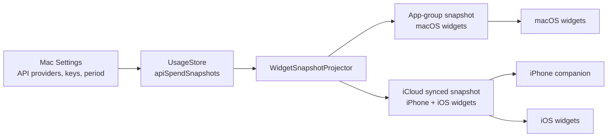

# feat: Mirror API Spend to iOS and Widgets

## Summary

Extend the existing widget/iPhone snapshot export so API spend totals fetched on the Mac are visible on the iPhone companion app and medium/large widgets. The Mac remains the source of truth for credentials, enabled providers, spend period, and polling; iOS and widgets only render the redaction-safe snapshot they receive.

---

## Problem Frame

API spend is currently fetched and displayed in the Mac app, but the widget/iPhone snapshot contract only exports subscription usage windows. That makes iOS and widgets incomplete mirrors: they can show Claude/Codex quota but cannot show the dollar spend that the Mac already knows.

---

## Requirements

- R1. Export redaction-safe API spend summaries from the Mac into the existing app-group and iCloud snapshot pipeline.
- R2. Preserve the Mac as the only configuration surface for API spend providers, keys, spend period, and refresh behavior.
- R3. Render API spend in the iOS companion app when present, including live amount, period, freshness, and setup/stale states.
- R4. Render API spend in widgets where space supports it without degrading the current quota-first glanceability.
- R5. Keep snapshot decoding compatible across app versions so old snapshots do not break new clients and new snapshots do not break old clients.
- R6. Add coverage for projection, sync round-trip, export timing, and formatting/fallback behavior.

---

## Scope Boundaries

- Do not add API key entry, spend period selection, provider enablement, or polling controls to iOS.
- Do not make iOS fetch API spend directly from OpenAI or Anthropic.
- Do not combine Anthropic and OpenAI spend into a cross-provider total; currencies and provider semantics stay separate.
- Do not put API spend on the smallest widget family unless implementation proves a non-crowded layout exists without displacing weekly usage.
- Do not change subscription usage polling or Claude CLI usage behavior.

### Deferred to Follow-Up Work

- Local iOS display toggles for hiding/showing API spend independently of the Mac export: defer unless TestFlight feedback says the mirrored spend is too noisy.
- Spending thresholds, budgets, or alerts: separate product feature; this plan only mirrors the amount already fetched.

---

## Context & Research

### Relevant Code and Patterns

- `Sources/HeadroomCore/Models/UsageModels.swift` already defines `APISpendSnapshot`, `APISpendPeriod`, and the money-specific provider model separately from quota windows.
- `Sources/HeadroomCore/Engine/UsageStore.swift` stores `apiSpendSnapshots` separately from subscription `snapshots`, fetches them in `refreshAPISpend()`, and already uses continuity for stale spend data.
- `Sources/HeadroomCore/Widgets/WidgetSnapshotModels.swift` is the redaction-safe snapshot contract used by macOS widgets, iOS widgets, and iPhone mirror sync.
- `Sources/HeadroomCore/Widgets/WidgetSnapshotProjector.swift` currently projects only subscription usage windows into `WidgetProviderSummary`.
- `Sources/HeadroomCore/Sync/SyncedWidgetSnapshotModels.swift` wraps the widget snapshot for iCloud; schema compatibility and secret-safety tests already live in `Tests/HeadroomCoreTests/SyncedWidgetSnapshotModelsTests.swift`.
- `Sources/HeadroomApp/UI/APISpendSectionView.swift` contains the existing Mac popover presentation for amount, freshness, period, stale, and setup states.
- `Sources/HeadroomIOS/Views/ProviderTileView.swift`, `Sources/HeadroomIOS/Views/MirrorView.swift`, and `Sources/HeadroomIOS/Views/SettingsSheetView.swift` are the current iPhone mirror surfaces.
- `Sources/HeadroomWidgets/Views/HeadroomMediumWidgetView.swift`, `Sources/HeadroomWidgets/Views/HeadroomLargeWidgetView.swift`, and `Sources/HeadroomIOSWidgets/Views/HeadroomIOSWidgetView.swift` are the widget renderers that should receive compact spend rows.

### Institutional Learnings

- No `docs/solutions/` learning exists for this exact snapshot-contract extension. Existing code comments emphasize redaction safety and typed failure reasons; keep that principle central.

### External References

- Not used. The codebase has direct local patterns for API spend fetching, snapshot export, and widget/iOS rendering.

---

## Key Technical Decisions

- Keep API spend as a separate top-level snapshot list, not as fake `WidgetWindowSummary` entries: API spend is money over a period, not a resettable quota window with percent remaining.
- Use an additive compatible snapshot change when possible: old clients ignore unknown API spend fields, and new clients decode old snapshots with an empty spend list. Only bump schema if implementation cannot safely default missing spend data.
- Export only display-safe spend fields: provider id, display name, amount, currency, period label, captured timestamp, and typed freshness. Never export API keys, request URLs, headers, raw provider payloads, or endpoint metadata.
- Preserve Mac control authority: iOS and widgets render what the Mac exports; they do not change enabled API surfaces or trigger provider network calls.
- Show API spend in medium/large widgets and the iPhone app; keep small widgets quota-first unless a compact design falls out naturally during implementation.
- Trigger widget/iPhone export after API spend refreshes and API spend surface changes, so mirrored spend does not wait for a subscription poll to become visible.

---

## Open Questions

### Resolved During Planning

- Should iOS control API spend settings? No. The Mac remains the source of truth; iOS mirrors.
- Should API spend be modeled as usage windows? No. It is a separate money summary with no percent remaining.
- Should this block the next build? Yes. The user called it important for iOS and widgets, and another build is already expected.

### Deferred to Implementation

- Exact compact widget layout for medium widgets: choose the least crowded presentation after seeing actual SwiftUI previews or widget rendering.
- Whether the snapshot field can stay schema version 1 with custom/default decoding: prefer compatibility, but verify in implementation against the existing `Codable` model constraints.

---

## High-Level Technical Design

> *This illustrates the intended approach and is directional guidance for review, not implementation specification. The implementing agent should treat it as context, not code to reproduce.*



The snapshot should carry subscription quota summaries and API spend summaries side by side:

```text
WidgetSnapshotEnvelope
  status
  generatedAt
  providers              // existing quota summaries
  apiSpendProviders      // new money summaries, display-safe only
```

---

## Implementation Units

### U1. Add API Spend to the Snapshot Contract

**Goal:** Extend the redaction-safe widget snapshot model with API spend summaries that can round-trip through app-group cache and iCloud sync.

**Requirements:** R1, R5, R6

**Dependencies:** None

**Files:**
- Modify: `Sources/HeadroomCore/Widgets/WidgetSnapshotModels.swift`
- Modify: `Sources/HeadroomCore/Sync/SyncedWidgetSnapshotModels.swift`
- Test: `Tests/HeadroomCoreTests/SyncedWidgetSnapshotModelsTests.swift`
- Test: `Tests/HeadroomCoreTests/WidgetSnapshotProjectorTests.swift`

**Approach:**
- Add a `WidgetAPISpendSummary` model with provider id, display name, optional amount, optional currency, period label, optional captured date, and widget freshness.
- Add an `apiSpendProviders` collection to `WidgetSnapshotEnvelope`.
- Prefer additive backwards compatibility: missing `apiSpendProviders` decodes as `[]`; unknown future fields remain ignored by older clients.
- Keep secret-safety guarantees explicit in tests by extending the existing encoded-payload checks.

**Execution note:** Implement model/projection behavior test-first because this is a shared contract surface.

**Patterns to follow:**
- `WidgetProviderSummary` and `WidgetWindowSummary` in `Sources/HeadroomCore/Widgets/WidgetSnapshotModels.swift`
- `SyncedWidgetSnapshotModelsTests.encodedPayloadContainsNoKnownSecretStrings`

**Test scenarios:**
- Happy path: encoding and decoding a snapshot with live OpenAI and Anthropic spend preserves amount, currency, period label, captured date, and freshness.
- Edge case: decoding a legacy snapshot with no API spend field produces an empty `apiSpendProviders` list rather than `.incompatibleSchema`.
- Error path: stale spend summaries round-trip with redacted message and `needsAttention` derived from typed freshness.
- Security: encoded synced payload does not contain known secret markers such as `Authorization`, `x-api-key`, token names, local paths, or raw endpoint URLs.

**Verification:**
- Existing sync/cache tests still pass, and new tests prove legacy/new snapshot compatibility.

---

### U2. Project API Spend and Export It on Spend Changes

**Goal:** Include current API spend snapshots in exported widget/iPhone snapshots and ensure refreshes/toggles publish updated spend state.

**Requirements:** R1, R2, R5, R6

**Dependencies:** U1

**Files:**
- Modify: `Sources/HeadroomCore/Widgets/WidgetSnapshotProjector.swift`
- Modify: `Sources/HeadroomCore/Engine/UsageStore.swift`
- Test: `Tests/HeadroomCoreTests/WidgetSnapshotProjectorTests.swift`
- Test: `Tests/HeadroomCoreTests/UsageStoreTests.swift`
- Test: `Tests/HeadroomCoreTests/Mocks.swift`

**Approach:**
- Extend `WidgetSnapshotProjector.project` to accept API spend snapshots and API spend provider order.
- Project only enabled API spend providers, using `UsageStore.apiSpendProviderOrder` as the ordering source.
- After `refreshAPISpend()` merges new values, export both widget and phone-sync snapshots so widgets/iOS update from spend-only refreshes.
- When API spend surfaces are toggled, ensure the exported snapshot reflects pending/removed spend promptly through the existing `refreshAPISpendNow()` path.

**Execution note:** Characterize current export counts before modifying `UsageStore` export timing so the change does not accidentally duplicate subscription-only exports.

**Patterns to follow:**
- Existing `WidgetSnapshotProjector.project(...)` provider projection flow
- `UsageStore.refreshSubscriptions()` export timing
- `SpyWidgetExporter` and `CountingSpendProvider` in `Tests/HeadroomCoreTests/Mocks.swift`

**Test scenarios:**
- Happy path: enabled Anthropic/OpenAI API spend snapshots project into `WidgetSnapshotEnvelope.apiSpendProviders` in provider order.
- Edge case: disabled API spend surfaces are omitted from exported spend summaries while subscription providers remain unchanged.
- Error path: stale API spend with a previous amount preserves the last amount and stale freshness in the exported snapshot.
- Integration: `UsageStore.refreshAPISpendOnly()` writes an updated widget export and phone-sync export without requiring a subscription refresh.
- Integration: changing the API spend period then refreshing exports summaries with the new period label.

**Verification:**
- Widget snapshots contain API spend after spend refreshes, and subscription-only snapshots still project exactly as before.

---

### U3. Render API Spend in the iPhone Companion App

**Goal:** Show mirrored API spend on the iPhone app when the Mac exports it, using the existing iOS design language and clear source-of-truth copy.

**Requirements:** R2, R3, R6

**Dependencies:** U1, U2

**Files:**
- Modify: `Sources/HeadroomIOS/Views/MirrorView.swift`
- Modify: `Sources/HeadroomIOS/Views/SettingsSheetView.swift`
- Create or modify: `Sources/HeadroomIOS/Views/APISpendMirrorView.swift`
- Modify: `Sources/HeadroomIOS/DesignSystem/HeadroomTheme.swift` if needed for shared spend styling

**Approach:**
- Add an `API Spend` section below subscription provider tiles in `MirrorView` when `envelope.apiSpendProviders` is non-empty.
- Reuse the Mac popover semantics: provider mark, display name, period label, amount, updated/stale/setup state.
- For pending/missing key states, use mirror-appropriate copy such as "Managed on Mac" or "Needs setup on Mac" rather than an iOS action button.
- In iOS Settings, keep the existing "Managed on Mac" message; optionally add one line clarifying API spend setup also stays on Mac.

**Patterns to follow:**
- `Sources/HeadroomApp/UI/APISpendSectionView.swift`
- `Sources/HeadroomIOS/Views/ProviderTileView.swift`
- `Sources/HeadroomIOS/Views/SettingsSheetView.swift`

**Test scenarios:**
- Test expectation: no unit test for SwiftUI layout unless an existing view-inspection pattern appears during implementation; rely on manual preview/device verification for visual layout.
- Manual happy path: iPhone mirror with live OpenAI and Anthropic spend shows both amounts, currencies, and the selected period.
- Manual edge case: iPhone mirror with no API spend exported omits the section entirely.
- Manual error path: stale or setup-needed API spend shows redaction-safe message and does not present credential controls.

**Verification:**
- The iOS mirror displays API spend from the synced snapshot and still makes clear that setup/management happens on Mac.

---

### U4. Render API Spend in macOS and iOS Widgets

**Goal:** Make API spend visible in widget families where it fits, without crowding or weakening the current quota-first widget purpose.

**Requirements:** R4, R6

**Dependencies:** U1, U2

**Files:**
- Modify: `Sources/HeadroomWidgets/Views/HeadroomMediumWidgetView.swift`
- Modify: `Sources/HeadroomWidgets/Views/HeadroomLargeWidgetView.swift`
- Create or modify: `Sources/HeadroomWidgets/Views/WidgetAPISpendView.swift`
- Modify: `Sources/HeadroomIOSWidgets/Views/HeadroomIOSWidgetView.swift`
- Modify: `Sources/HeadroomWidgets/Views/HeadroomWidgetPreviews.swift`
- Modify: `Sources/HeadroomIOS/DesignSystem/CompanionPreviewSeed.swift` or relevant preview seed if used by iOS/widget previews

**Approach:**
- Add a compact `API Spend` row/strip to medium widgets when spend summaries exist.
- Add a clearer multi-row `API Spend` panel/section to large widgets.
- Keep small widgets focused on weekly quota unless implementation reveals a clean layout that does not displace current information.
- Use provider display names ("Anthropic API", "OpenAI API") and formatted currency amounts; show period label in large widgets and omit or abbreviate it in medium widgets if space is tight.
- Preserve stale/setup states with compact text and attention styling, not buttons.

**Patterns to follow:**
- `WidgetUsageMeter`, `WidgetProviderWeeklyLine`, and `WidgetProviderStyle` in `Sources/HeadroomWidgets/Views/`
- `IOSWidgetUsageMeter`, `IOSWidgetStyle`, and `largeProviderTile` in `Sources/HeadroomIOSWidgets/Views/HeadroomIOSWidgetView.swift`
- Existing previews that seed provider quota data

**Test scenarios:**
- Test expectation: widget layout is primarily visual; use previews/manual screenshots rather than core unit tests unless helper formatting logic moves into `HeadroomCore`.
- Manual happy path: medium and large macOS widgets show API spend when summaries are present.
- Manual happy path: medium and large iOS widgets show API spend when summaries are present.
- Manual edge case: widgets with no spend summaries remain visually unchanged.
- Manual error path: setup-needed spend does not show a fake dollar amount and points back to Mac setup.

**Verification:**
- Widget screenshots/previews show no text overlap in light and dark appearances for one and two API spend providers.

---

### U5. Share Currency Formatting and State Copy

**Goal:** Avoid divergent amount/status formatting between Mac, iOS, and widget surfaces.

**Requirements:** R3, R4, R6

**Dependencies:** U1

**Files:**
- Modify: `Sources/HeadroomCore/Models/UsageModels.swift` or create `Sources/HeadroomCore/Widgets/APISpendPresentation.swift`
- Modify: `Sources/HeadroomApp/UI/APISpendSectionView.swift`
- Modify: `Sources/HeadroomIOS/Views/APISpendMirrorView.swift`
- Modify: `Sources/HeadroomWidgets/Views/WidgetAPISpendView.swift`
- Modify: `Sources/HeadroomIOSWidgets/Views/HeadroomIOSWidgetView.swift`
- Test: `Tests/HeadroomCoreTests/UsageMathTests.swift` or a new `Tests/HeadroomCoreTests/APISpendPresentationTests.swift`

**Approach:**
- Move reusable amount formatting and state-label decisions into a small HeadroomCore helper if implementation finds duplication across three or more surfaces.
- Keep UI-specific typography/coloring in the views; only share plain strings and formatting rules.
- Format known currencies with two decimals; provide a stable fallback for unknown or missing currency.

**Patterns to follow:**
- `APISpendSectionView.format(amount:currency:)`
- `MirrorPresentation` as a presentation-helper precedent for shared strings without SwiftUI dependency

**Test scenarios:**
- Happy path: USD amount `12.3` formats as `$12.30`.
- Edge case: unknown currency code formats with a safe code-prefixed fallback.
- Edge case: nil amount/currency returns no amount string and lets surfaces show setup/pending copy.
- Error path: stale snapshot with prior amount formats the amount while allowing stale copy to dim or annotate it.

**Verification:**
- Mac, iOS, and widget surfaces use consistent amount strings for the same snapshot.

---

### U6. Release Verification and Build Handoff

**Goal:** Verify the feature end-to-end and prepare the next TestFlight/App Store build from the correct base.

**Requirements:** R1, R2, R3, R4, R5, R6

**Dependencies:** U1, U2, U3, U4, U5

**Files:**
- Modify: `README.md` if the user-facing iPhone/widget mirror behavior needs release documentation
- Test: `Tests/HeadroomCoreTests/WidgetSnapshotProjectorTests.swift`
- Test: `Tests/HeadroomCoreTests/UsageStoreTests.swift`
- Test: `Tests/HeadroomCoreTests/SyncedWidgetSnapshotModelsTests.swift`

**Approach:**
- Run the focused core tests covering projection, sync, and store export timing.
- Run the broader Swift test suite.
- Build/archive from the latest intended release base, not the stale detached worktree.
- Manually verify the iOS app and widgets with a fixture or live synced snapshot that includes API spend.
- Upload a new build after verification; the current correct uploaded build is `1.0 (6)`, so implementation will need the next build number.

**Patterns to follow:**
- Current release verification flow used for `HeadroomIOS` archives.
- Existing App Store Connect/TestFlight upload path using Xcode archive/export.

**Test scenarios:**
- Integration: full test suite passes after schema/model changes.
- Manual integration: Mac fetches API spend, exports snapshot, iPhone app displays it after sync.
- Manual integration: iOS widgets display spend after WidgetKit timeline reload or normal refresh.
- Manual regression: disabling iPhone sync still hides iOS mirror data as before.

**Verification:**
- A fresh build is uploaded only after tests pass and the app/widget UI has been manually checked for the new spend summaries.

---

## System-Wide Impact

- **Interaction graph:** Mac Settings controls API keys, API spend surfaces, and period; `UsageStore` fetches spend; `WidgetSnapshotProjector` emits a display-safe snapshot; app-group cache and iCloud sync deliver it to widgets/iOS.
- **Error propagation:** API spend failures remain typed `FailureReason` values projected into widget freshness. Stale summaries may preserve prior amounts, but must never expose raw errors.
- **State lifecycle risks:** Spend-only refreshes currently do not export widget/iPhone snapshots; this plan must add that export point without duplicating excessive exports during full refresh.
- **API surface parity:** macOS widgets, iOS widgets, and iPhone mirror should all consume the same snapshot field. Mac popover can keep reading `UsageStore` directly.
- **Integration coverage:** Store export timing and synced payload compatibility need tests because UI-only checks would miss stale snapshot contracts.
- **Unchanged invariants:** API keys stay in Keychain on Mac only; iOS does not fetch provider APIs; subscription windows remain the primary quota model.

---

## Risks & Dependencies

| Risk | Mitigation |
|------|------------|
| Snapshot compatibility breaks existing iOS widgets or mirrors | Prefer additive decode-default behavior and test legacy payloads |
| API spend data is sensitive financial data | Export only display-ready amounts and typed status; extend secret-safety tests |
| Widgets become crowded | Limit spend to medium/large families and use compact rows |
| API spend changes do not reach widgets until next subscription poll | Export snapshots after `refreshAPISpend()` and spend surface changes |
| Build uploaded from wrong worktree again | Release unit requires verifying `HEAD` and build settings before archive |

---

## Documentation / Operational Notes

- Update release notes/App Store version notes to mention iPhone and widgets can now mirror API spend if the feature lands in the next submitted build.
- Update README only if it currently documents iPhone/widget mirror scope in a way that would become inaccurate.
- No privacy manifest change is expected because the app is not collecting new data categories; it is displaying existing user-configured spend data locally/synced through the user's iCloud. Verify during implementation.

---

## Sources & References

- Related plan: `docs/plans/2026-07-03-001-feat-api-cost-usage-plan.md`
- Related plan: `docs/plans/2026-07-04-002-feat-ios-companion-widget-icloud-plan.md`
- Related plan: `docs/plans/2026-07-06-001-feat-widget-design-unification-plan.md`
- Related code: `Sources/HeadroomCore/Widgets/WidgetSnapshotModels.swift`
- Related code: `Sources/HeadroomCore/Widgets/WidgetSnapshotProjector.swift`
- Related code: `Sources/HeadroomCore/Engine/UsageStore.swift`
- Related code: `Sources/HeadroomApp/UI/APISpendSectionView.swift`
- Related tests: `Tests/HeadroomCoreTests/WidgetSnapshotProjectorTests.swift`
- Related tests: `Tests/HeadroomCoreTests/UsageStoreTests.swift`
- Related tests: `Tests/HeadroomCoreTests/SyncedWidgetSnapshotModelsTests.swift`
