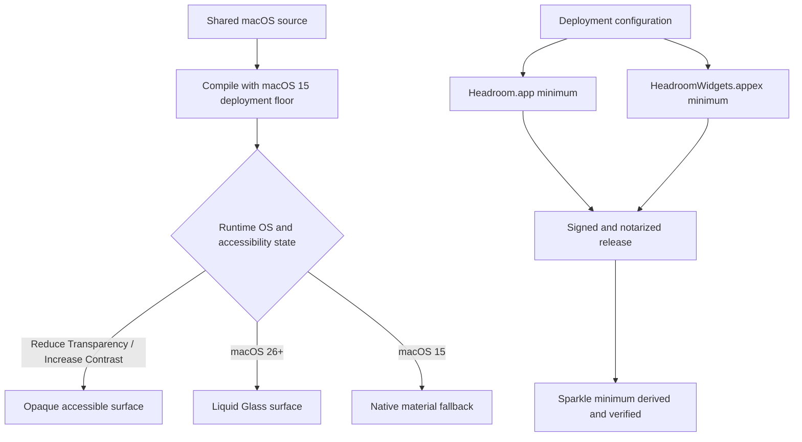

# feat: Support macOS Sequoia on Apple silicon

## Summary

Lower Headroom's macOS deployment floor from macOS 26 to macOS 15 while preserving the
Liquid Glass presentation on Tahoe. Add an intentional material fallback on Sequoia, align
the host app, widget, Swift package, and Sparkle metadata, and require runtime proof on both
operating-system generations before advertising compatibility.

---

## Problem Frame

Headroom currently declares macOS 26 throughout its build and release pipeline even though
nearly all of its app, provider, settings, and WidgetKit implementation already uses APIs
available on macOS 15 or earlier. The one confirmed macOS 26-only source dependency is the
popover shell's `glassEffect`. As a result, Apple-silicon users who remain on Sequoia cannot
install the app even though the underlying product architecture does not require Tahoe.

Compatibility must include the shipped bundle and update path, not only successful source
compilation. A host app that claims macOS 15 while its embedded widget or Sparkle appcast
still requires macOS 26 would be an incomplete and misleading release.

---

## Requirements

- R1. The macOS app must build and launch on Apple-silicon Macs running macOS 15 Sequoia.
- R2. The same macOS source and release line must continue to run on macOS 26 Tahoe without
  removing or visually regressing its Liquid Glass popover surface.
- R3. On Sequoia, the popover must use an intentional native material surface with the same
  shape, content hierarchy, interaction behavior, light/dark support, and accessibility
  accommodations as the Tahoe presentation.
- R4. The Swift package, generated Xcode app target, embedded macOS widget extension, built
  bundle metadata, and Sparkle update metadata must consistently express macOS 15 as the
  minimum supported operating system.
- R5. Core product behavior must remain unchanged on both supported macOS generations:
  Claude CLI probing, Codex usage fetching, API-spend rows, refresh/polling, Settings,
  launch-at-login, menu-bar presentation, widget cache export, and widget rendering.
- R6. The iOS app and iOS widget deployment target and behavior must remain unchanged.
- R7. This work must not add, validate, or advertise Intel support. Existing architecture
  settings should not be broadened as part of the compatibility change.
- R8. Compatibility claims require recorded build-artifact checks plus runtime smoke evidence
  from both macOS 15 and macOS 26; compilation on Tahoe alone is insufficient.

---

## Scope Boundaries

- Supporting Intel/x86_64 Macs or deliberately producing a universal binary.
- Supporting macOS 14 Sonoma or earlier, even where individual APIs would permit it.
- Recreating Tahoe's Liquid Glass appearance pixel-for-pixel on Sequoia.
- Redesigning the popover, Settings, menu-bar meters, or widgets.
- Changing Claude/Codex provider architecture, credentials, polling behavior, or the
  load-bearing official-CLI Claude usage path.
- Changing the iOS 26 deployment floor or iPhone companion/widget behavior.
- Adding CI infrastructure solely for this change; real or virtual Sequoia runtime evidence
  remains the release gate.
- Treating an incidental x86_64 slice, if the current build system emits one, as tested or
  supported Intel compatibility.

---

## Context & Research

### Relevant Code and Patterns

- `Sources/HeadroomApp/UI/PopoverView.swift` already centralizes the outer popover rendering
  in `PopoverSurfaceModifier`. It also contains the existing reduce-transparency and
  increase-contrast opaque fallback, making it the narrowest compatibility boundary.
- `Sources/HeadroomApp/PopoverRenderHarness.swift` renders the real popover and Settings
  surfaces in light and dark appearances and is the existing visual-evidence path.
- `Package.swift` declares the SwiftPM macOS and iOS floors independently in one platform
  list; only the macOS value should change.
- `project.yml` is the authority used by XcodeGen for the host app and embedded macOS widget
  targets. It currently repeats the macOS floor in both the project deployment target and
  host Info.plist settings.
- `Sources/HeadroomWidgets/Info.plist` is a checked-in extension plist and currently hardcodes
  a separate macOS 26 minimum.
- `Scripts/build-app.sh` owns local app/widget assembly and already validates bundle,
  provisioning, and signing invariants after XcodeGen builds.
- `Scripts/release-app.sh` owns Developer ID archive/export, notarization, Sparkle signing,
  and the timeout fallback appcast. The fallback appcast currently hardcodes macOS 26.
- `Sources/HeadroomCore/Settings/LaunchAtLogin.swift` uses `SMAppService`, supported since
  macOS 13. `MenuBarExtra(.window)` is also supported since macOS 13, WidgetKit's used
  `containerBackground` API since macOS 14, and the used content transitions since macOS 13.
  These sit below the selected macOS 15 floor.
- `docs/plans/2026-07-02-001-feat-ai-usage-menu-bar-app-plan.md` records the original
  Tahoe-only choice as a deliberate way to avoid compatibility branches. This plan changes
  that decision only at the presentation and deployment boundaries; it does not undo the
  original native-Tahoe design goal.

### Institutional Learnings

- There are no compatibility-specific entries under `docs/solutions/`.
- Existing release history shows that widget provisioning, Developer ID export, DMG
  creation, and Sparkle publication are tightly coupled. Compatibility metadata must be
  checked in the assembled and exported products rather than inferred from source config.

### External References

- [Apple: `glassEffect(_:in:)`](https://developer.apple.com/documentation/swiftui/view/glasseffect%28_%3Ain%3A%29)
  documents the Liquid Glass modifier; the installed macOS 26 SDK marks it macOS 26+.
- [Apple: `MenuBarExtra`](https://developer.apple.com/documentation/swiftui/menubarextra)
  documents the menu-bar scene and window style used by Headroom.
- [Apple: `containerBackground(for:alignment:content:)`](https://developer.apple.com/documentation/SwiftUI/View/containerBackground%28for%3Aalignment%3Acontent%3A%29)
  documents the widget background API; the installed SDK marks it macOS 14+.
- [Apple: `SMAppService`](https://developer.apple.com/documentation/servicemanagement/smappservice)
  documents launch-item registration on macOS 13 and later.
- [Anthropic: Set up Claude Code](https://docs.anthropic.com/en/docs/claude-code/getting-started)
  lists Claude Code support beginning well before Sequoia, so the official CLI path does not
  impose a macOS 26 floor; the installed CLI still remains part of runtime smoke.
- [Sparkle: Publishing an update](https://sparkle-project.org/documentation/publishing/)
  documents `sparkle:minimumSystemVersion`, recommends a three-component version, and
  explains filtering incompatible updates.
- [Sparkle: Documentation](https://sparkle-project.org/documentation/) confirms the current
  Sparkle line and DMG update format support operating systems older than Sequoia, so
  Sparkle itself does not impose a macOS 26 floor.

---

## Key Technical Decisions

- **Use macOS 15 as the deployment floor, not the oldest technically possible API floor.**
  This matches the requested Sequoia scope and avoids expanding testing to Sonoma merely
  because most current APIs happen to support it.
- **Keep the compatibility branch at `PopoverSurfaceModifier`.** The modifier is already the
  single owner of the popover shell and accessibility fallbacks. A narrow availability check
  there avoids scattering OS checks through cards, controls, or provider views.
- **Render regular native material on Sequoia and Liquid Glass on Tahoe.** The legacy branch
  should preserve the same rounded geometry and add a restrained separator edge where
  needed for definition. Reduce Transparency or Increase Contrast continues to win over
  both decorative branches and produce the current opaque surface.
- **Compile against the current Xcode 26 SDK while deploying to macOS 15.** Availability
  checks preserve newer behavior while the lowered deployment target makes the compiler
  identify any additional unguarded post-Sequoia APIs missed by static inspection.
- **Treat XcodeGen deployment settings as the bundled-product authority.** The checked-in
  widget plist should consume the target deployment value rather than keep an independent
  literal where build-setting expansion is supported. SwiftPM retains its separate macOS
  platform declaration because it is a distinct build surface.
- **Derive release fallback metadata from the built product.** The minimal Sparkle appcast
  fallback should not carry another manually synchronized minimum-version literal. It should
  read the verified exported app's minimum and serialize Sparkle's required three-component
  form, failing safely if that value is absent or inconsistent.
- **Do not introduce an OS-version abstraction into HeadroomCore.** The only behavioral
  difference is SwiftUI presentation selected by platform availability; moving that into the
  provider/domain layer would add test seams without testing the actual framework behavior.
- **Do not change architecture settings.** This plan proves Apple-silicon Sequoia support.
  Binary architecture inspection verifies the required arm64 slice but does not turn Intel
  into an implicit compatibility promise.

---

## Open Questions

### Resolved During Planning

- **Does Sequoia require provider or engine changes?** No. Static API inventory found the
  macOS 26 dependency in presentation, while the provider, polling, launch-at-login, and
  widget APIs used by the product are already available by macOS 15.
- **Should Sequoia replace Liquid Glass everywhere?** No. The same source retains the Tahoe
  branch and adds a Sequoia material branch at the existing surface modifier.
- **Should this include Intel?** No. The user explicitly selected Sequoia on Apple silicon.
- **Should the iOS floor also move?** No. The macOS and iOS platform declarations remain
  independent and iOS stays at 26.

### Deferred to Implementation

- **Where will macOS 15 runtime smoke run?** Use an available physical Apple-silicon Mac or
  Apple-silicon macOS 15 virtual machine. If neither is available, implementation may reach
  compile-complete status but R8 remains blocked and compatibility must not be advertised.
- **Does the regular-material fallback need a separator stroke in both appearances?** Start
  with the existing shape and semantic separator treatment, then finalize the stroke's
  presence from macOS 15 light/dark captures. This is visual tuning within the confirmed
  fallback design, not an architectural decision.
- **Does Sparkle's normal `generate_appcast` path emit the expected minimum from the exported
  bundle in this release setup?** Inspect the generated artifact during implementation. The
  fallback path must be correct independently, and the final release validation must reject
  disagreement between either path and the bundle.

---

## High-Level Technical Design

> *This illustrates the intended approach and is directional guidance for review, not
> implementation specification. The implementing agent should treat it as context, not code
> to reproduce.*

---

## Implementation Units

### U1. Add the Sequoia popover surface path

**Goal:** Make the real popover render safely and intentionally on macOS 15 while retaining
the current Tahoe and accessibility presentations.

**Requirements:** R1, R2, R3, R5

**Dependencies:** None

**Files:**

- Modify: `Sources/HeadroomApp/UI/PopoverView.swift`
- Modify: `Sources/HeadroomApp/PopoverRenderHarness.swift`

**Approach:**

- Put the macOS availability split inside the existing `PopoverSurfaceModifier`.
- Preserve the current priority of accessibility preferences: opaque semantic background
  for Reduce Transparency or Increase Contrast, regardless of OS version.
- Keep `glassEffect` behind a macOS 26 availability boundary.
- Give macOS 15 a rounded regular-material background with semantic edge treatment tuned
  against real light and dark renders.
- Keep the host window transparency configuration and all popover content/layout unchanged.
- Update render-harness descriptions and output expectations so captures accurately describe
  the OS-selected material instead of assuming every render is Liquid Glass.

**Patterns to follow:**

- Existing accessibility branch and rounded shape in
  `Sources/HeadroomApp/UI/PopoverView.swift`.
- Existing real-compositor capture path in
  `Sources/HeadroomApp/PopoverRenderHarness.swift`.
- Existing semantic colors/materials rather than hardcoded appearance-specific fills.

**Test scenarios:**

- Happy path: launch on macOS 15 in light appearance and open the menu-bar popover; content
  renders on a defined rounded material surface with no transparent hole or double backdrop.
- Happy path: launch the same source build on macOS 26; the popover continues to use Liquid
  Glass with the current geometry and content spacing.
- Appearance: capture connected and onboarding popovers on macOS 15 in light and dark modes;
  text, tiles, controls, and shell remain legible without unintended halos or muddy layering.
- Accessibility: enable Reduce Transparency on macOS 15 and macOS 26; both use the opaque
  semantic fallback rather than material or glass.
- Accessibility: enable Increase Contrast on macOS 15 and macOS 26; both retain a visible
  semantic separator edge and readable controls.
- Interaction: on macOS 15, Settings opens and dismisses the transient popover exactly as it
  does on Tahoe; refresh, Quit, hover, and onboarding controls remain operational.

**Verification:**

- A macOS-15-targeted build has no unguarded reference to `glassEffect`.
- Visual captures exist for macOS 15 and macOS 26 in both appearances, with any accepted
  platform-native differences documented rather than treated as regressions.
- The popover interaction flow and accessibility overrides behave the same on both systems.

---

### U2. Lower and align macOS deployment metadata

**Goal:** Make every compile and bundle surface that participates in the macOS product declare
macOS 15 while leaving iOS and architecture scope unchanged.

**Requirements:** R1, R4, R6, R7

**Dependencies:** U1

**Files:**

- Modify: `Package.swift`
- Modify: `project.yml`
- Modify: `Sources/HeadroomWidgets/Info.plist`

**Approach:**

- Lower only the Swift package's macOS platform declaration to 15; retain iOS 26.
- Lower XcodeGen's macOS deployment target to 15 for all macOS targets; retain iOS 26.
- Remove avoidable drift between the Xcode deployment target and explicit host/widget
  minimum-version metadata. Prefer target build-setting expansion for the checked-in widget
  plist where it survives XcodeGen and archive/export correctly.
- Do not add or broaden `ARCHS`, `VALID_ARCHS`, or architecture exclusions. Verify the arm64
  requirement from the product rather than changing architecture policy.

**Patterns to follow:**

- `project.yml` as the checked-in source for generated Xcode project settings.
- Existing build-setting substitutions already used by
  `Sources/HeadroomWidgets/Info.plist` for bundle and app-group values.

**Test scenarios:**

- Happy path: SwiftPM resolves and compiles all macOS products with a macOS 15 deployment
  target while retaining the iOS 26 declaration.
- Integration: XcodeGen produces host and macOS widget targets whose effective deployment
  targets are both macOS 15.
- Artifact: the assembled host app and embedded widget plists both report a macOS 15 minimum.
- Artifact: the host executable and widget executable load-command minimums do not exceed
  macOS 15, and both contain an arm64 slice.
- Guardrail: generated iOS app and iOS widget build settings still report iOS 26.
- Error path: if host and widget minimum versions disagree, bundle validation fails instead
  of producing an apparently compatible app with an unusable extension.

**Verification:**

- SwiftPM and Xcode app/widget builds compile cleanly under Swift 6 strict concurrency with
  the lower macOS target.
- The assembled product reports a coherent macOS 15 minimum at target, plist, and executable
  levels, and the iOS target remains unchanged.

---

### U3. Make packaging and Sparkle compatibility-safe

**Goal:** Ensure local and public release artifacts preserve the macOS 15 floor through
assembly, Developer ID export, notarization, and both Sparkle appcast-generation paths.

**Requirements:** R4, R7, R8

**Dependencies:** U2

**Files:**

- Modify: `Scripts/build-app.sh`
- Modify: `Scripts/release-app.sh`

**Approach:**

- Extend existing post-assembly validation to check the host and embedded widget's resolved
  minimum OS values and required arm64 slices.
- Validate the exported Developer ID product again because archive/export can differ from
  the unsigned local product.
- Replace the fallback appcast's macOS 26 literal with a value derived from the verified
  exported app, normalized to Sparkle's three-component version format.
- After either normal or fallback appcast generation, validate that the newest item does not
  require a newer OS than the shipped bundle and identifies macOS 15 as supported.
- Preserve existing signing, App Group provisioning, hardened runtime, notarization, DMG,
  and EdDSA behavior; compatibility validation should fail closed without weakening those
  gates.

**Patterns to follow:**

- Existing `validate_provisioning_profiles`, signing verification, and exported-product
  validation functions in the build/release scripts.
- Existing fallback appcast generation in `Scripts/release-app.sh`.
- Sparkle's documented three-component `minimumSystemVersion` format.

**Test scenarios:**

- Happy path: a local debug/release assembly passes when host and widget both declare macOS
  15 and contain arm64 executables.
- Error path: intentionally inconsistent host/widget minimums are detected before signing or
  publication completes.
- Normal appcast path: Sparkle's generator produces an item accepted by the compatibility
  validation and eligible on macOS 15.
- Fallback appcast path: when normal generation times out, the minimal signed appcast derives
  macOS 15 from the exported app rather than restoring a stale hardcoded value.
- Error path: missing, malformed, or newer-than-expected minimum metadata aborts publication
  with a clear nonzero script failure and no claim of a ready release artifact.
- Architecture boundary: validation requires arm64 but does not infer or print an Intel
  support claim from any incidental x86_64 slice.
- Integration: a notarized DMG installs on Apple-silicon Sequoia and the installed app can
  query a test appcast without being filtered out by its OS minimum.

**Verification:**

- Both local and exported bundles pass deployment/architecture inspection.
- Normal and fallback appcasts agree with the exported app's macOS 15 floor.
- Existing signature, notarization, stapling, App Group, and Sparkle signature checks remain
  intact.

---

### U4. Prove runtime parity and document the support contract

**Goal:** Complete the compatibility claim with cross-version runtime evidence and accurate
developer/user documentation.

**Requirements:** R2, R3, R5, R6, R7, R8

**Dependencies:** U1, U2, U3

**Files:**

- Modify: `README.md`
- Verify: `Sources/HeadroomCore/Providers/ClaudeUsageCLIProbe.swift`
- Verify: `Sources/HeadroomCore/Providers/CodexProvider.swift`
- Verify: `Sources/HeadroomCore/Settings/LaunchAtLogin.swift`
- Verify: `Sources/HeadroomWidgets/HeadroomWidgets.swift`
- Verify: `Sources/HeadroomWidgets/Views/HeadroomWidgetView.swift`

**Approach:**

- Update prerequisites and architecture descriptions to say macOS 15+ on Apple silicon,
  explain that Tahoe gets Liquid Glass while Sequoia gets a native material surface, and
  avoid any Intel claim.
- Retain Xcode 26 / Swift 6.3 as the development toolchain requirement; runtime support and
  build-tool requirements are separate concepts.
- Run the same signed build through a compact acceptance matrix on macOS 15 and macOS 26.
- Exercise the official Claude CLI probe rather than changing or bypassing it, and use a
  logged-in Codex environment for the live provider smoke.
- Verify the widget through the OS widget gallery and App Group cache path; successful host
  launch alone does not prove extension compatibility.
- Record exact blockers if a provider account, provisioning profile, or macOS 15 environment
  is unavailable. Do not convert an unrun runtime check into a success claim.

**Patterns to follow:**

- Existing build and diagnostic commands documented in `README.md`.
- Existing redaction and typed-failure rules for any provider smoke output.
- Existing widget setup/fallback behavior; widgets never fetch provider data directly.

**Test scenarios:**

- macOS 15 app shell: install the signed app, confirm menu-bar-only activation, open/close the
  popover and Settings, switch appearance, refresh, and quit without crashes or missing UI.
- macOS 26 app shell: repeat the same flow and confirm Liquid Glass remains active.
- Provider integration on both systems: Claude returns parsed `/usage` windows through the
  official CLI PTY path and Codex returns or safely stales through its existing provider;
  no credential or raw error appears in UI/log output.
- Settings integration on both systems: polling preferences persist, appearance changes
  repaint both windows, and launch-at-login can register/unregister through `SMAppService`.
- Widget integration on both systems: Headroom appears in the gallery, all supported sizes
  render cached live/stale/disabled states, and the extension does not fail due to a higher
  deployment target.
- Update integration on macOS 15: an installed compatibility build sees a newer compatible
  signed test item, downloads it, validates it, and relaunches successfully.
- Regression: the iOS app/widget project still builds at iOS 26 and the Mac-to-iPhone snapshot
  schema is unchanged.
- Accessibility and appearance: light, dark, Reduce Transparency, and Increase Contrast are
  inspected on both macOS versions without clipping, unreadable text, or looping pulse motion.

**Verification:**

- A completed acceptance record distinguishes automated build/test results, macOS 15 runtime
  evidence, macOS 26 runtime evidence, and any skipped external-account checks.
- `README.md` states the supported runtime floor and Apple-silicon scope accurately.
- The app is not described or released as Sequoia-compatible until every non-account-specific
  R8 gate has run successfully.

---

## System-Wide Impact

- **Interaction graph:** The only runtime branch is at the popover shell. Provider fetches,
  `UsageStore`, Settings, menu-bar label rendering, widget export, and phone sync continue
  through their existing paths.
- **Error propagation:** OS availability selection does not create a new error channel.
  Build/release metadata mismatches stop packaging; provider failures continue to use typed
  stale snapshots and redacted messages.
- **State lifecycle risks:** There is no data migration or persistent-state format change.
  UserDefaults, App Group cache, iCloud snapshot schema, and Sparkle keys remain unchanged.
- **API surface parity:** The macOS app and macOS widget share the lowered floor. iOS targets
  remain at 26 and shared source must continue to compile in both platform contexts.
- **Integration coverage:** Unit tests protect core behavior but cannot prove framework
  rendering, widget discovery, login-item registration, notarized installation, or Sparkle
  eligibility on Sequoia. Those require built-product and runtime evidence.
- **Unchanged invariants:** Claude usage remains sourced only by driving the official `claude`
  CLI; widgets remain read-only consumers of redaction-safe cache data; credentials and
  provider APIs are untouched; signing/notarization security gates are not weakened.

---

## Risks & Dependencies

| Risk | Mitigation |
|------|------------|
| A second post-Sequoia API is missed by static inspection | Lower the actual deployment target early so both SwiftPM and Xcode compilers expose every unguarded availability violation before packaging work proceeds. |
| Material fallback looks washed out or creates a double surface in `MenuBarExtra(.window)` | Keep the branch at the existing shell modifier and inspect real macOS 15 compositor captures in light/dark before accepting the styling. |
| Host claims macOS 15 but widget remains macOS 26 | Resolve both from the Xcode deployment authority where possible and inspect both bundle plists and executable load commands after assembly/export. |
| Normal and fallback Sparkle appcasts disagree | Derive fallback metadata from the exported app and validate either generated result before publication. |
| No macOS 15 environment is available | Treat Sequoia runtime validation as an explicit release blocker; use an Apple-silicon physical Mac or VM rather than substituting Tahoe compile results. |
| Provider smoke is blocked by account login or CLI setup | Separate account-specific evidence from platform gates, report the exact blocker, and never modify the compliant Claude CLI path to make the smoke easier. |
| Existing release security checks regress during script edits | Preserve Developer ID, App Group provisioning, hardened runtime, notarization, stapling, and Sparkle EdDSA checks; run compatibility validation in addition to them. |
| Intel support is inferred from a universal artifact | Require and document only arm64, avoid Intel wording, and do not count an incidental x86_64 slice as tested behavior. |

---

## Phased Delivery

### Phase 1: Compile-compatible source and metadata

- Complete U1 and U2 so the app and widget compile with macOS 15 as the real deployment floor.
- Run existing unit coverage to establish that the compatibility branch did not alter core
  provider, cache, settings, or sync behavior.

### Phase 2: Distribution integrity

- Complete U3 and inspect local plus exported artifacts before attempting a public release.
- Exercise both the normal and fallback appcast paths without publishing incompatible output.

### Phase 3: Cross-version acceptance

- Complete U4 on macOS 15 and macOS 26.
- Publish or advertise the lower floor only after the runtime and update-path gates pass.

---

## Documentation / Operational Notes

- Update `README.md` because runtime requirements and the popover architecture materially
  change. No provider/API/schema documentation changes are required.
- A release that implements this plan must update the hosted appcast and downloadable DMG
  together; changing only the website copy would leave Sparkle eligibility inconsistent.
- Retain the current Xcode 26 development requirement. Running on Sequoia does not imply that
  contributors can build Headroom with Xcode 15 or older SDKs.
- Capture Sequoia/Tahoe screenshots as verification evidence, not a new marketing redesign.
- Do not add a compatibility note to `docs/solutions/` unless implementation uncovers a
  non-obvious framework or packaging failure worth preserving as a durable learning.

---

## Sources & References

- Related product plan: `docs/plans/2026-07-02-001-feat-ai-usage-menu-bar-app-plan.md`
- Popover availability boundary: `Sources/HeadroomApp/UI/PopoverView.swift`
- Visual verification harness: `Sources/HeadroomApp/PopoverRenderHarness.swift`
- Build configuration: `Package.swift`, `project.yml`,
  `Sources/HeadroomWidgets/Info.plist`
- Packaging and update path: `Scripts/build-app.sh`, `Scripts/release-app.sh`
- [Apple SwiftUI Liquid Glass documentation](https://developer.apple.com/documentation/swiftui/view/glasseffect%28_%3Ain%3A%29)
- [Apple MenuBarExtra documentation](https://developer.apple.com/documentation/swiftui/menubarextra)
- [Apple ServiceManagement documentation](https://developer.apple.com/documentation/servicemanagement/smappservice)
- [Anthropic Claude Code setup and system requirements](https://docs.anthropic.com/en/docs/claude-code/getting-started)
- [Sparkle update publishing documentation](https://sparkle-project.org/documentation/publishing/)
