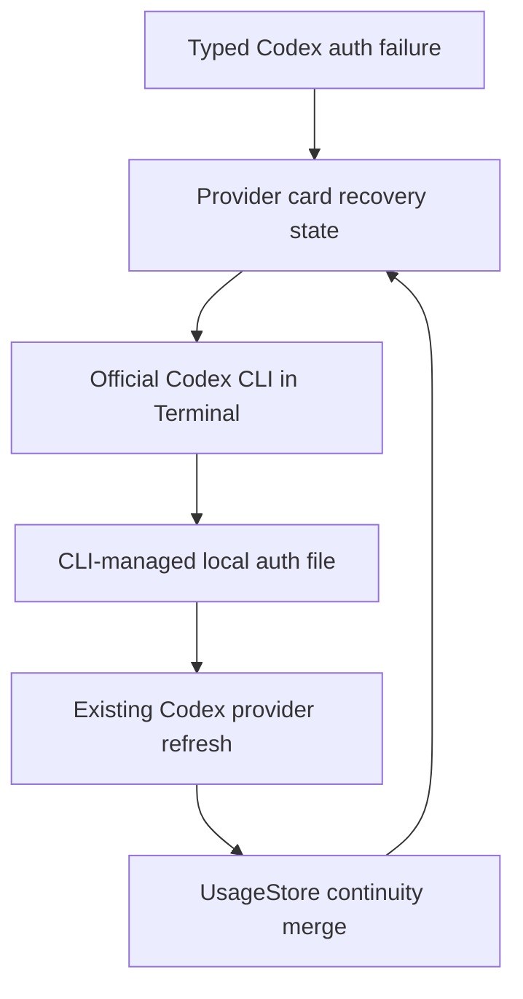

# feat: Add guided Codex connection recovery

## Summary

Extend Headroom's existing Claude setup experience into a provider-aware connection
lifecycle for Codex. Missing and expired Codex sessions will present a branded, guided
Terminal action that delegates sign-in to the official Codex CLI, then refreshes Headroom
until usage becomes live again.

| State | User experience | Exit condition |
|---|---|---|
| Connect | Explain the local CLI handoff and offer one primary Codex action | The user opens Terminal |
| Waiting | Keep the recovery action visible, offer an immediate check, and retry quietly | Codex usage refresh succeeds |
| Connected | Return to the normal usage card with a short confirmation | Confirmation settles |

---

## Problem Frame

Headroom already knows when Codex credentials are absent or rejected, but permanent Codex
failures currently collapse into an error message plus a copy-only shell command. That asks
first-run and returning users to understand the failure, copy a command, open Terminal, and
remember to refresh Headroom themselves. Claude's trust-required state already solves the
same handoff class with a calm guided card, an executable Terminal script, visible waiting
feedback, and automatic retries.

Codex authentication remains an external CLI responsibility. Headroom reads the resulting
local auth file for usage requests, but it must not collect passwords, tokens, browser
callbacks, or OAuth grants itself.

---

## Assumptions

*This plan was authored inside the LFG pipeline without synchronous scope confirmation. The
items below are explicit implementation bets for downstream review.*

- The guided Codex action appears only when the subscription provider reports a permanent
  missing-session or reauthentication failure; a persistent connection button in Settings
  is not part of this change.
- The current installed Codex CLI contract, `codex login`, is the executable handoff. The
  app does not attempt to support historical login flags unless implementation proves the
  current subcommand unavailable in a supported CLI.
- Codex can reuse the Claude setup flow's session-local waiting and connected payoff pattern,
  while retaining Codex-specific copy, colors, timing, and command details.
- Automatic retries are best-effort convenience. Manual check and reopen actions remain
  available because browser-based sign-in can take longer than a fixed retry window.

---

## Requirements

- R1. When Codex has no local session, its provider card must present a branded guided
  connection experience instead of a warning plus copy-only command.
- R2. When Codex returns an unauthorized or other permanent reauthentication failure, the
  same surface must present a reconnect variant without discarding last-known usage windows.
- R3. The primary action must open a Terminal window and run the official Codex CLI login
  command after resolving its executable through the user's login-shell PATH (including
  NVM/asdf/mise-style installs), without Headroom reading or handling sign-in secrets.
- R4. The Terminal handoff must explain what is happening, fail clearly when the Codex CLI
  is unavailable, and keep a manual copyable command as a fallback.
- R5. After Terminal opens, Headroom must show a waiting state with immediate check and
  reopen actions, retry usage automatically, and stop pending retries when Codex becomes live.
- R6. A successful connection or reconnection must return to the normal Codex usage card and
  show the existing short-lived connected payoff without adding looping or pulsing motion.
- R7. Codex setup styling must use the existing Codex brand identity, work in light and dark
  appearances, support Reduce Motion, and retain complete accessibility labels and hit areas.
- R8. Claude's trust setup, provider polling isolation, auth-file reader, redirect blocking,
  API-spend credentials, and iOS/widget behavior must remain unchanged.
- R9. The recovery contract, state classification, and generated visual states must have
  regression coverage sufficient to distinguish connect, reconnect, waiting, live, and
  non-auth failure behavior.

---

## Scope Boundaries

- Headroom will not implement an OpenAI OAuth client, receive a browser callback, refresh a
  Codex token, or write `~/.codex/auth.json`.
- This does not install or update the Codex CLI, change which account is selected, log the
  user out, or revoke existing credentials.
- This does not redesign normal live/stale provider cards, Settings subscription toggles,
  API-spend key management, widgets, or the iPhone companion.
- Transient network, decoding, and rate-limit failures remain stale-data states and do not
  launch the connection flow.
- The feature does not add background filesystem watchers or a long-lived Terminal process
  bridge; existing polling remains the source of truth for connection success.

### Deferred to Follow-Up Work

- Persistent proactive reconnect actions in Settings: consider only if users need account
  switching or recovery before Headroom detects a permanent provider failure.
- Shared setup flows for Claude's non-trust login failure: keep the existing Claude behavior
  stable in this change and evaluate broader provider setup unification separately.

---

## Context & Research

### Relevant Code and Patterns

- `Sources/HeadroomApp/UI/ClaudeSetupViews.swift` owns the established Terminal script,
  connect/waiting cards, manual command disclosure, retry schedule, and accessible button
  styling that Codex should extend rather than replace.
- `Sources/HeadroomApp/UI/ProviderCardView.swift` is the single presentation boundary for
  pending, live, transient stale, permanent stale, and Claude trust setup states. It also owns
  the connected payoff and stale-window continuity presentation.
- `Sources/HeadroomCore/Credentials/CredentialStore.swift` maps an absent or unreadable Codex
  auth file into a typed permanent failure without exposing the underlying error.
- `Sources/HeadroomCore/Providers/CodexProvider.swift` maps HTTP 401 to a typed
  reauthentication failure and already preserves provider isolation.
- `Sources/HeadroomApp/PopoverRenderHarness.swift` is the existing real-view light/dark
  evidence path for connect, waiting, and connected presentation states.
- `Tests/HeadroomCoreTests/CredentialStoreTests.swift`,
  `Tests/HeadroomCoreTests/CodexProviderTests.swift`, and
  `Tests/HeadroomCoreTests/UsageStoreTests.swift` establish fixture-only coverage for missing
  credentials, unauthorized responses, and permanent-failure attention behavior.

### Institutional Learnings

- No files currently exist under `docs/solutions/`; there is no prior Codex login-flow
  learning to carry forward.

### External References

- The locally installed Codex CLI 0.142.5 documents `codex login` as the current login
  subcommand and `codex login status` as the read-only status check.
- [OpenAI: Codex CLI and Sign in with ChatGPT](https://help.openai.com/en/articles/11381614-api-codex-cli-and-sign-in-with-chatgpt)
  confirms that sign-in is initiated by the official CLI, continues through ChatGPT, and
  stores credentials locally. Its older flag spelling is not used over the installed CLI's
  current command contract.
- [OpenAI: Using Codex with your ChatGPT plan](https://help.openai.com/en/articles/11369540-using-codex-with-your-chatgpt-plan)
  identifies the Codex CLI as an official client for ChatGPT account sign-in.

---

## Key Technical Decisions

- **Classify Codex connection recovery in HeadroomCore:** The distinction between a first
  connection, a reconnection, and a non-auth failure is product behavior rather than view
  layout. A small pure derivation from the typed snapshot keeps `ProviderCardView` declarative
  and gives the state boundary direct unit coverage.
- **Delegate authentication through an executable `.command` handoff:** Reuse the proven
  Claude mechanism while resolving `codex` through the user's login shell before writing the
  script. This covers Finder launches and version-manager installs such as the NVM-hosted CLI
  used in the development environment. The absolute executable path is shell-quoted and the
  generated script contains only static guidance plus the allowlisted `login` argument, never
  credential material.
- **Share the setup lifecycle, not provider copy:** Extract only the connect/waiting/connected
  mechanics and reusable presentation pieces needed by both providers. Claude retains its
  trust-specific instructions and workspace behavior; Codex supplies its own command, brand
  treatment, guidance, and retry cadence.
- **Treat live usage as the only success signal:** Headroom does not infer completion from the
  Terminal window closing or the auth file appearing. The normal Codex provider fetch must
  return a live snapshot before retries stop and the connected payoff appears.
- **Preserve stale windows during reconnect:** The guided recovery replaces the permanent
  failure treatment but does not erase continuity data already merged by `UsageStore`.

---

## Open Questions

### Resolved During Planning

- **Which command should Headroom execute?** `codex login`, verified from the installed Codex
  CLI 0.142.5. This is more authoritative for the shipped environment than an older help
  article that still presents a legacy flag.
- **Should Headroom authenticate directly?** No. The official CLI owns browser sign-in and
  local credential storage; Headroom only triggers the CLI and polls its existing provider.
- **Should transient Codex failures show setup?** No. Only typed permanent credential failures
  enter the guided flow.
- **Should the flow be available permanently in Settings?** Not in this iteration. The provider
  card appears exactly when action is required and avoids adding account-management behavior.

### Deferred to Implementation

- **Exact Codex retry delays:** Tune against the real browser sign-in flow while preserving a
  bounded schedule and immediate manual check. The lifecycle and cancellation requirements
  are fixed; exact seconds are execution-time polish.
- **Shared-file boundary:** Implementation may retain Claude-specific types and add a compact
  Codex sibling or extract a shared provider setup view if the real diff proves the shared
  shape substantial. Behavior and tests govern the choice, not abstraction for its own sake.

---

## High-Level Technical Design

> *This illustrates the intended approach and is directional guidance for review, not
> implementation specification. The implementing agent should treat it as context, not code
> to reproduce.*

```mermaid
stateDiagram-v2
    [*] --> Normal
    Normal --> Connect: Auth file absent
    Normal --> Reconnect: Permanent auth failure
    Connect --> Waiting: Open Terminal
    Reconnect --> Waiting: Open Terminal
    Waiting --> Waiting: Retry or check now
    Waiting --> Normal: Live Codex snapshot
    Waiting --> Connect: Relaunch; missing credentials
    Waiting --> Reconnect: Relaunch; rejected credentials
    Normal --> Normal: Transient failure or live refresh
```

---

## Implementation Units

### U1. Define the Codex connection recovery contract

**Goal:** Make the correct login command and connect-versus-reconnect state a single,
testable Core contract consumed by providers and UI.

**Requirements:** R1, R2, R3, R8, R9

**Dependencies:** None

**Files:**
- Modify: `Sources/HeadroomCore/Credentials/CodexAuthReader.swift`
- Modify: `Sources/HeadroomCore/Credentials/CredentialStore.swift`
- Modify: `Sources/HeadroomCore/Providers/CodexProvider.swift`
- Create or modify: `Sources/HeadroomCore/Providers/CLIExecutableResolver.swift`
- Modify: `Sources/HeadroomCore/Providers/ClaudeUsageCLIProbe.swift`
- Modify: `Sources/HeadroomCore/Models/UsageModels.swift`
- Test: `Tests/HeadroomCoreTests/CredentialStoreTests.swift`
- Test: `Tests/HeadroomCoreTests/CodexProviderTests.swift`
- Create: `Tests/HeadroomCoreTests/CodexConnectionTests.swift`

**Approach:**
- Establish one Core-owned current Codex login command so provider messages, recovery UI,
  clipboard fallback, and Terminal execution cannot drift.
- Extract the existing Claude login-shell executable lookup into a small reusable resolver and
  use it for both `claude` and `codex`. Preserve common-location fallbacks while allowing the
  resolved absolute path to live under version-manager directories.
- Derive a Codex connection action only for `.notLoggedIn`, `.needsReauth`, and any future
  credential-scope failure explicitly determined to be recoverable by CLI login.
- Distinguish initial connect from reconnect using the typed failure category rather than
  matching user-facing strings. Leave transient and decoding failures outside the flow.
- Keep all messages redaction-safe and continue returning stale snapshots rather than throws.

**Execution note:** Add the state-classification tests before wiring the view so every UI
branch is backed by an explicit domain case.

**Patterns to follow:**
- Typed failure construction and equality assertions in
  `Tests/HeadroomCoreTests/CodexProviderTests.swift`.
- Pure snapshot derivations in `Sources/HeadroomCore/Models/UsageModels.swift`.

**Test scenarios:**
- Happy path: an absent Codex credential produces the initial connection action and references
  the current login command.
- Happy path: an HTTP 401 produces the reconnect action and references the same command.
- Edge case: a permanent reconnect snapshot with last-known windows preserves those windows
  while exposing the reconnect action.
- Error path: unreadable credential data remains redacted and routes to an actionable
  connection state without surfacing parser or filesystem details.
- Exclusion: pending, live, transient, and decode snapshots produce no connection action.
- Exclusion: equivalent Claude and unknown-provider snapshots do not produce a Codex action.
- Resolution: a fixture login-shell result can select Homebrew, `~/.local/bin`, and NVM-style
  executable paths; missing or non-executable results fail closed.

**Verification:**
- Core tests prove every typed Codex freshness state maps to exactly one expected connection
  outcome, and the user-facing recovery command is consistent across missing and expired auth.

---

### U2. Add the Codex Terminal setup session and branded views

**Goal:** Recreate the Claude setup flow's guided Terminal handoff for Codex without handling
authentication inside Headroom.

**Requirements:** R3, R4, R5, R7, R8

**Dependencies:** U1

**Files:**
- Modify: `Sources/HeadroomApp/UI/ClaudeSetupViews.swift`
- Modify or create: `Sources/HeadroomApp/UI/ProviderSetupViews.swift`
- Modify: `Sources/HeadroomApp/UI/ProviderStyle.swift`
- Test: `Tests/HeadroomCoreTests/CodexConnectionTests.swift`

**Approach:**
- Reuse the `.command` file pattern with a Core-resolved absolute executable path, executable
  presence check, static guidance, and an `exec` handoff to the official Codex login command.
- Shell-quote the resolved path before inserting it into the script. Do not compose a `-c`
  command from provider output or other runtime text.
- Build Terminal content only from allowlisted Core command tokens and static app copy. Do not
  interpolate environment values, auth-file fields, provider responses, or caught errors.
- Maintain provider-scoped session state and retry tasks so Claude and Codex setup cannot
  cancel or overwrite each other when both require attention. Validate this in the deterministic
  render harness and app-level smoke path; the Core-only tests cover command and classification.
- Give Codex connect and waiting views the existing layout hierarchy and interaction grammar,
  but derive the primary action and accent treatment from Codex brand tokens.
- Keep the manual command disclosure, copy affordance, immediate check, reopen action, reduced
  motion behavior, keyboard behavior, help text, and VoiceOver labels.
- On script creation or open failure, copy the command as the safe fallback without claiming
  Terminal opened successfully.

**Patterns to follow:**
- Script creation, shell quoting, PATH bootstrap, and retry cancellation in
  `Sources/HeadroomApp/UI/ClaudeSetupViews.swift`.
- Codex accent and accessible text colors in `Sources/HeadroomApp/UI/ProviderStyle.swift` and
  `Sources/HeadroomCore/Models/BrandColorValues.swift`.

**Test scenarios:**
- Happy path: Codex setup configuration resolves to the `codex` executable with the `login`
  action and contains no credential value, auth-file content, or provider endpoint.
- Edge case: the dual-provider render fixture and app smoke keep Claude and Codex waiting state
  independent when both require attention.
- Error path: missing Codex CLI produces actionable Terminal guidance and a nonzero exit without
  silently running a different command.
- Error path: failure to create or open the script leaves the manual command available for copy.
- Accessibility: primary, check, reopen, disclosure, and copy controls expose descriptive labels
  and remain usable with Reduce Motion.

**Verification:**
- The generated Terminal window visibly runs the official Codex login flow, and source review
  confirms no secret or auth-file data enters the script, pasteboard, log, or UI.

---

### U3. Integrate connect, reconnect, waiting, and payoff states

**Goal:** Replace permanent Codex error recovery with the guided lifecycle while preserving
normal provider cards and stale-data continuity.

**Requirements:** R1, R2, R5, R6, R7, R8, R9

**Dependencies:** U1, U2

**Files:**
- Modify: `Sources/HeadroomApp/UI/ProviderCardView.swift`
- Modify: `Sources/HeadroomApp/PopoverRenderHarness.swift`
- Test: `Tests/HeadroomCoreTests/UsageStoreTests.swift`

**Approach:**
- Route only the Core-derived Codex connection action into the new connect or reconnect card.
- After the setup action opens, replace that card with waiting feedback bound to Codex's own
  session state and normal `UsageStore.refreshNow()` entry point.
- When the Codex snapshot becomes live, cancel only Codex retry tasks, clear its session state
  after the existing short connected payoff, and return to standard bars.
- For reconnect, render the recovery card first and retain any prior windows as dimmed bars
  beneath it in the same provider tile. Initial connect has no continuity bars.
- Extend the render harness with deterministic Codex connect, reconnect, waiting, and connected
  fixtures in both appearances. Preserve the existing Claude render matrix.

**Patterns to follow:**
- Claude trust setup routing and connected payoff in
  `Sources/HeadroomApp/UI/ProviderCardView.swift`.
- Demo provider fixtures and real compositor capture in
  `Sources/HeadroomApp/PopoverRenderHarness.swift`.

**Test scenarios:**
- Happy path: missing Codex auth renders the initial connection action rather than generic
  actionable-command recovery.
- Happy path: unauthorized Codex with preserved windows renders reconnect guidance and retains
  stale window continuity.
- Integration: opening setup moves only the Codex card to waiting and schedules normal store
  refreshes; a live Codex response stops retries and shows the connected payoff once.
- Edge case: both Claude trust and Codex login are required in the same snapshot set; each card
  maintains independent state and actions.
- Exclusion: transient Codex failure continues to show the normal stale pill and dimmed bars.
- Appearance: connect, reconnect, waiting, and connected fixtures remain legible in light and
  dark mode with Codex's brand accent and no idle pulse animation.

**Verification:**
- The real popover demonstrates every Codex connection state in both appearances, and existing
  Claude setup captures remain behaviorally unchanged.

---

### U4. Document and smoke-test the connection lifecycle

**Goal:** Make the supported recovery behavior clear and verify the real CLI handoff without
turning implementation diagnostics into credential-bearing logs.

**Requirements:** R3, R4, R7, R8, R9

**Dependencies:** U1, U2, U3

**Files:**
- Modify: `README.md`
- Modify: `AGENTS.md`
- Modify: `BUGS.md` only for newly discovered out-of-scope issues
- Test: `Tests/HeadroomCoreTests/CredentialStoreTests.swift`
- Test: `Tests/HeadroomCoreTests/CodexProviderTests.swift`
- Test: `Tests/HeadroomCoreTests/UsageStoreTests.swift`

**Approach:**
- Replace copy-only Codex recovery guidance with the new guided flow description while retaining
  the auth-file and official-client architecture explanation.
- Document that Headroom launches `codex login` but never receives credentials or owns logout,
  account selection, revocation, or token refresh.
- Exercise the missing-auth and expired-session paths with fixture data, then run one real login
  handoff smoke without capturing Terminal or browser content that may contain account details.
- Verify the same app still builds and renders on the supported macOS deployment floor; do not
  change widget or iOS documentation for a Mac-only recovery feature.

**Patterns to follow:**
- Privacy and provider-path explanations in `README.md` and the Claude OAuth hard constraint in
  `AGENTS.md`.
- Typed, mocked provider tests that never touch live credentials or network state.

**Test scenarios:**
- Integration: with `~/.codex/auth.json` unavailable to the test fixture, Headroom shows connect,
  opens the login command, and recovers after the fixture starts returning a live snapshot.
- Integration: a fixture 401 after prior live data shows reconnect, retains stale windows, and
  returns to live after a successful refresh.
- Error path: a missing Codex executable yields clear Terminal guidance and leaves Headroom
  stable with manual recovery available.
- Regression: full unit suite, macOS app build, render harness, and existing Claude live probe
  remain green; no test or diagnostic reads or prints real Codex auth content.

**Verification:**
- Documentation, automated checks, visual captures, and the redaction-safe real handoff all
  describe the same connect/reconnect lifecycle and exact current CLI command.

---

## System-Wide Impact

- **Interaction graph:** `CredentialStore` and `CodexProvider` produce typed failures;
  `UsageStore` preserves continuity; `ProviderCardView` selects the recovery state; the setup
  session opens Terminal and requests normal store refreshes until the provider becomes live.
- **Error propagation:** Script-launch problems stay local to the setup action and fall back to
  copyable guidance. Authentication and HTTP failures remain typed `FailureReason` values with
  no interpolated caught errors.
- **State lifecycle risks:** Retry tasks must be provider-scoped, bounded, cancelable, and cleared
  after success so a recovered Codex session does not keep refreshing or inherit Claude state.
- **API surface parity:** The normal manual Refresh action and provider polling path remain the
  only data refresh API. Widgets and iPhone surfaces receive the same redaction-safe snapshot
  projection and do not gain setup actions.
- **Integration coverage:** Unit tests prove classification; render fixtures prove view states;
  a redaction-safe real Terminal handoff proves the AppKit-to-CLI boundary.
- **Unchanged invariants:** Headroom never writes Codex credentials, never follows usage endpoint
  redirects, never reintroduces Claude subscription OAuth, and never moves credential work into
  the widget or iOS targets.

---

## Risks & Dependencies

| Risk | Mitigation |
|---|---|
| Codex CLI command syntax changes | Keep one Core-owned command contract, verify against the installed CLI during release work, and fail visibly rather than guessing another login path |
| Browser sign-in takes longer than retries | Keep the waiting card stable with check-now and reopen actions after automatic retries are exhausted |
| Both providers need setup simultaneously | Scope session timestamps and retry tasks by provider; test the dual-failure fixture |
| Generated Terminal script exposes account data | Generate only allowlisted static instructions and Core command tokens, overwrite the script on each open, and never read auth content, provider responses, environment secrets, or caught errors into the script or logs |
| Refactor regresses Claude trust onboarding | Preserve Claude-specific configuration and its render matrix; compare captures before shipping |
| Finder launch cannot find an NVM/asdf/mise CLI | Resolve `codex` through the user's login shell, validate the absolute path is executable, shell-quote it in the generated script, and retain explicit common-location fallbacks |

---

## Documentation / Operational Notes

- Treat the installed CLI help as the release-time source of truth for the command contract;
  official web guidance may lag the current subcommand spelling.
- Do not capture or attach screenshots of the real sign-in browser or Terminal output if they
  contain email, organization, device codes, or account selection.
- This feature can merge independently of a live account switch as long as mocked state coverage,
  script inspection, and a redaction-safe open-to-login smoke succeed.

---

## Sources & References

- Related code: `Sources/HeadroomApp/UI/ClaudeSetupViews.swift`
- Related code: `Sources/HeadroomApp/UI/ProviderCardView.swift`
- Related code: `Sources/HeadroomCore/Providers/CodexProvider.swift`
- Related tests: `Tests/HeadroomCoreTests/CodexProviderTests.swift`
- External: [OpenAI Codex CLI and Sign in with ChatGPT](https://help.openai.com/en/articles/11381614-api-codex-cli-and-sign-in-with-chatgpt)
- External: [Using Codex with your ChatGPT plan](https://help.openai.com/en/articles/11369540-using-codex-with-your-chatgpt-plan)
