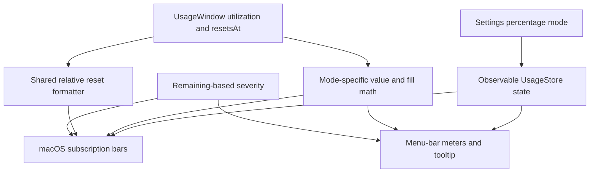

# Usage Percentage and Reset Display - Plan

## Goal Capsule

- **Objective:** Let macOS users choose whether subscription usage is presented as percentage left or percentage used, while showing provider-independent relative reset durations.
- **Authority:** The user's requested behavior and wording win; existing Headroom preference, usage-model, accessibility, and macOS compatibility patterns constrain the implementation.
- **Execution profile:** Extend existing core presentation math and preference seams, then wire the observable choice through the macOS popover, menu bar, Settings, and render harness.
- **Stop conditions:** Do not alter provider fetching, Claude's official-CLI path, iOS/widget snapshot contracts, API-spend presentation, or the macOS 15/Tahoe surface branch.
- **Tail ownership:** LFG owns implementation, verification, review, shipping, and CI after this plan returns to the pipeline.

---

## Product Contract

### Summary

Add a persisted macOS setting that switches subscription usage between complementary "left" and "used" presentations everywhere the app shows that percentage. Replace provider-specific reset wording in the macOS subscription bars with one compact relative duration derived from each window's reset timestamp.

### Problem Frame

Headroom currently hardcodes percentage remaining throughout the macOS popover and menu bar. Users who think in provider-style utilization cannot switch to percentage used, and changing only the number would leave labels, accessibility text, meter direction, menu-bar tooltip copy, and Settings help out of agreement.

Reset presentation is also provider-dependent. Claude's verbatim labels can be absolute dates or clock times while Codex uses Headroom's relative countdown, so equivalent windows do not scan consistently and Claude labels can consume more horizontal space.

### Requirements

#### Percentage presentation

- R1. Settings must persist a user-selectable subscription percentage mode with "left" as the default and "used" as the alternative.
- R2. Switching the mode must update the macOS popover percentage, adjacent word, meter fill direction, accessibility value, menu-bar percentage, menu-bar vessel fill, tooltip, and Settings preview without requiring an app restart or data refresh.
- R3. "Left" mode must present the clamped complement of utilization, while "used" mode must present clamped utilization; both must round with the app's existing integer-percentage convention.
- R4. Usage severity and low-balance warnings must remain based on percentage remaining in both modes, so changing presentation does not change the underlying health meaning.

#### Reset presentation

- R5. Claude and Codex subscription bars must both show reset timing as a compact relative duration derived from `resetsAt`, never provider-specific absolute reset copy.
- R6. Durations of at least one day must use day-and-hour units such as `3d 4h`; shorter durations retain compact hour-and-minute or minute forms, and elapsed deadlines read `Resets now`.
- R7. Reset countdowns must continue updating from the existing minute timeline without polling either provider more often.

#### Platform compatibility

- R8. The feature must use the same shared macOS content views on macOS 15 Sequoia and macOS 26 Tahoe, preserving the native-material and Liquid Glass shell behavior already selected by availability.
- R9. Existing iOS, macOS widget, iOS widget, provider parsing, credential, and API-spend behavior must remain unchanged.

### Acceptance Examples

- AE1. Given a window with 73.4% utilization, when mode is "left," the UI shows `27% left`; when mode changes to "used," it shows `73% used` and reverses the corresponding meter fraction without changing severity.
- AE2. Given a Claude window whose source label says `Resets Jul 13 at 10am` and whose reset timestamp is 3 days 4 hours away, the macOS bar shows `Resets in 3d 4h`.
- AE3. Given equivalent Claude and Codex reset timestamps, both macOS bars render identical reset wording.
- AE4. Given a saved "used" preference, relaunching Headroom restores used-mode popover and menu-bar presentation on both Sequoia and Tahoe.

### Scope Boundaries

- Do not remove `UsageWindow.resetLabel`; it remains provider data used by diagnostics and existing widget/phone snapshot contracts.
- Do not change Claude parsing or replace the official CLI-driven usage source.
- Do not add the percentage preference to macOS widgets, the iPhone companion, or iOS widgets in this change.
- Do not redesign the Settings window or the popover beyond the control and copy changes needed for the new mode.
- Do not add new OS-availability branches; shared content must continue compiling at the macOS 15 deployment floor.

---

## Planning Contract

### Key Technical Decisions

- KTD1. Model the choice as a core `UsagePercentageMode` raw-value enum rather than a view-local Boolean. The enum gives Preferences a stable persisted value and gives popover/menu-bar presentation one source for value, fraction, and terminology.
- KTD2. Clamp both used and remaining values to `0...100` before rounding. Provider over-limit values must never produce negative remaining percentages or fills beyond their bounds.
- KTD3. Flip the visual meter fraction with the selected percentage mode, but keep `UsageSeverity` based on `percentRemaining`. This makes the displayed number and fill agree without changing Headroom's depletion warning thresholds.
- KTD4. Normalize only the macOS subscription presentation, not provider data. `Countdown` owns the relative reset sentence built from `resetsAt`; Claude's source label remains stored for unaffected consumers.
- KTD5. Keep the choice in `UsageStore` as observable state initialized from `Preferences`. Settings writes through the store so the popover and menu bar repaint immediately and persistence stays testable.
- KTD6. Pass the mode into the existing shared macOS content views rather than branching on operating-system version. The Sequoia/Tahoe distinction remains solely in the popover shell.

### Assumptions

- The requested toggle governs the macOS app's subscription usage surfaces, including the optional menu-bar percentage, but not widgets or the iPhone companion.
- "Days hours" means the established compact duration grammar (`3d 4h`), with smaller units retained when a window is less than one day so five-hour limits remain informative.
- The default remains "left" to preserve current behavior and Headroom's existing product framing for users who never change the setting.

### High-Level Technical Design

The preference changes presentation only. Provider snapshots continue to carry canonical utilization, reset timestamps, and optional source labels.

---

## Implementation Units

### U1. Add percentage-mode math and normalized reset formatting

- **Goal:** Provide pure, testable core APIs for complementary percentage presentation and provider-independent reset sentences.
- **Requirements:** R3-R7; AE1-AE3.
- **Dependencies:** None.
- **Files:**
  - Modify `Sources/HeadroomCore/Models/UsageModels.swift`.
  - Modify `Sources/HeadroomCore/Models/Countdown.swift`.
  - Modify `Tests/HeadroomCoreTests/UsageMathTests.swift`.
- **Approach:** Add a persisted-value-friendly mode enum that derives a clamped percentage, bounded fraction, and human term from `UsageWindow`. Add a reset presentation helper that produces the complete `Resets in ...` or `Resets now` sentence from `resetsAt`, using the existing countdown unit grammar and intentionally ignoring `resetLabel`.
- **Patterns to follow:** Keep calculations in `HeadroomCore`, retain `UsageSeverity` as the remaining-based single source of truth, and use injected `now` values in tests.
- **Test scenarios:**
  - Covers AE1. For 73.4% utilization, remaining mode returns the complementary rounded display and fraction while used mode returns the utilization display and fraction.
  - Boundary values below 0 and above 100 clamp both modes and fractions to valid bounds.
  - Covers AE2. A reset 3 days 4 hours away renders `Resets in 3d 4h` even when the source window also carries an absolute Claude reset label.
  - Short resets render hours/minutes or minutes; due and past resets render `Resets now` without duplicated wording.
  - Covers AE3. Windows from different providers with equal `resetsAt` values yield equal reset text.
- **Verification:** Core tests prove mode complementarity, bounds, labels, fractions, duration units, and elapsed behavior without network or CLI access.

### U2. Persist and observe the percentage mode

- **Goal:** Make the selected mode durable and immediately observable by every macOS app presentation surface.
- **Requirements:** R1-R4; AE4.
- **Dependencies:** U1.
- **Files:**
  - Modify `Sources/HeadroomCore/Settings/Preferences.swift`.
  - Modify `Sources/HeadroomCore/Engine/UsageStore.swift`.
  - Modify `Tests/HeadroomCoreTests/PreferencesTests.swift`.
  - Modify `Tests/HeadroomCoreTests/UsageStoreTests.swift`.
- **Approach:** Store the enum raw value in UserDefaults with a remaining-mode fallback for missing or unknown values. Initialize an observable store property from Preferences, expose a setter that persists and updates it, and use the property when constructing menu-bar summary text, fill fractions, and details.
- **Patterns to follow:** Mirror the existing `AppearancePreference` and menu-bar preference implementations; avoid direct UserDefaults reads from SwiftUI views.
- **Test scenarios:**
  - A fresh preference suite defaults to remaining mode.
  - Used mode persists and restores; an unknown raw value safely falls back to remaining.
  - Changing the store mode writes Preferences and recomputes menu-bar summary text and fill without mutating snapshots.
  - Menu-bar severity remains identical between modes for the same window.
  - Both-provider menu-bar mode applies the selected presentation consistently to Claude and Codex meters.
- **Verification:** Preference and store tests demonstrate persistence, live state changes, menu-bar math, and unchanged remaining-based severity.

### U3. Wire Settings, popover copy, accessibility, and compatibility evidence

- **Goal:** Expose the control and render coherent left/used and reset wording across the supported macOS UI.
- **Requirements:** R1-R9; AE1-AE4.
- **Dependencies:** U1, U2.
- **Files:**
  - Modify `Sources/HeadroomApp/UI/SettingsView.swift`.
  - Modify `Sources/HeadroomApp/UI/PopoverView.swift`.
  - Modify `Sources/HeadroomApp/UI/ProviderCardView.swift`.
  - Modify `Sources/HeadroomApp/UI/UsageBarView.swift`.
  - Modify `Sources/HeadroomApp/UI/MenuBarLabel.swift`.
  - Modify `Sources/HeadroomApp/HeadroomApp.swift`.
  - Modify `Sources/HeadroomApp/PopoverRenderHarness.swift` if fixture preferences need explicit mode coverage.
- **Approach:** Add a compact Settings control in Subscription Usage and bind it through `UsageStore`. Thread the mode into subscription bars, replacing hardcoded percentage, fraction, `left`, accessibility, and reset-label decisions with the core presentation APIs. Update menu-bar tooltip wording and Settings preview/help copy so they describe the selected mode. Preserve current layouts by allowing `left` and `used` to occupy the same trailing label slot.
- **Patterns to follow:** Use the existing settings tile/control grammar, `TimelineView`-supplied `now`, numeric content transitions, Reduce Motion behavior, and shared popover content inside the existing Sequoia/Tahoe shells.
- **Test scenarios:**
  - Covers AE1. Toggle from left to used while the popover is open; value, word, bar fraction, and VoiceOver value update together.
  - Toggle while menu-bar percentage is enabled; label, vessel fill, tooltip wording, and Settings preview update immediately.
  - Covers AE2-AE3. Connected Claude and Codex cards show compact relative reset sentences rather than provider-specific absolute labels.
  - Covers AE4. Relaunch with used mode saved and verify the initial popover/menu-bar state is used mode.
  - Render light and dark popover/Settings fixtures with both short and long percentage terms; no clipping or baseline drift occurs.
  - Build with the macOS 15 deployment floor and exercise the same interactions on Sequoia native material and Tahoe Liquid Glass; no new availability branch or missing control appears.
- **Verification:** The app builds at the current macOS 15 floor, automated render capture succeeds, and manual macOS checks confirm live switching, consistent reset copy, accessibility wording, and shell parity.

---

## Verification Contract

| Gate | Applies to | Expected evidence |
|---|---|---|
| `swift test` | U1-U3 | Core percentage, countdown, Preferences, and UsageStore tests pass. |
| `swift build` | U1-U3 | Swift 6 strict-concurrency build succeeds at the package's macOS 15 floor. |
| Popover render harness | U3 | Light/dark connected and Settings captures render without clipping after both terminology choices are exercised. |
| macOS 15 runtime smoke | U3 | Native-material popover, Settings control, menu-bar label, and live switching work on Apple silicon Sequoia. |
| macOS 26 runtime smoke | U3 | The same content works inside Tahoe Liquid Glass with matching behavior and accessibility semantics. |

---

## Definition of Done

- U1 core mode math and reset text are provider-independent, bounded, and fully unit-tested.
- U2 the preference defaults safely, persists, restores, and updates menu-bar presentation through observable store state.
- U3 every macOS app percentage surface uses coherent value, term, fill, tooltip, and accessibility copy, while reset labels use compact relative durations.
- Existing iOS/widget contracts, provider fetching, Claude CLI behavior, severity thresholds, and API-spend presentation remain unchanged.
- `swift test` and `swift build` pass with their real output recorded.
- Render and runtime evidence cover light/dark plus Sequoia native material and Tahoe Liquid Glass, or any unavailable OS runtime is reported as an explicit verification blocker rather than claimed complete.
- Abandoned implementation experiments and dead code are removed before shipping.
