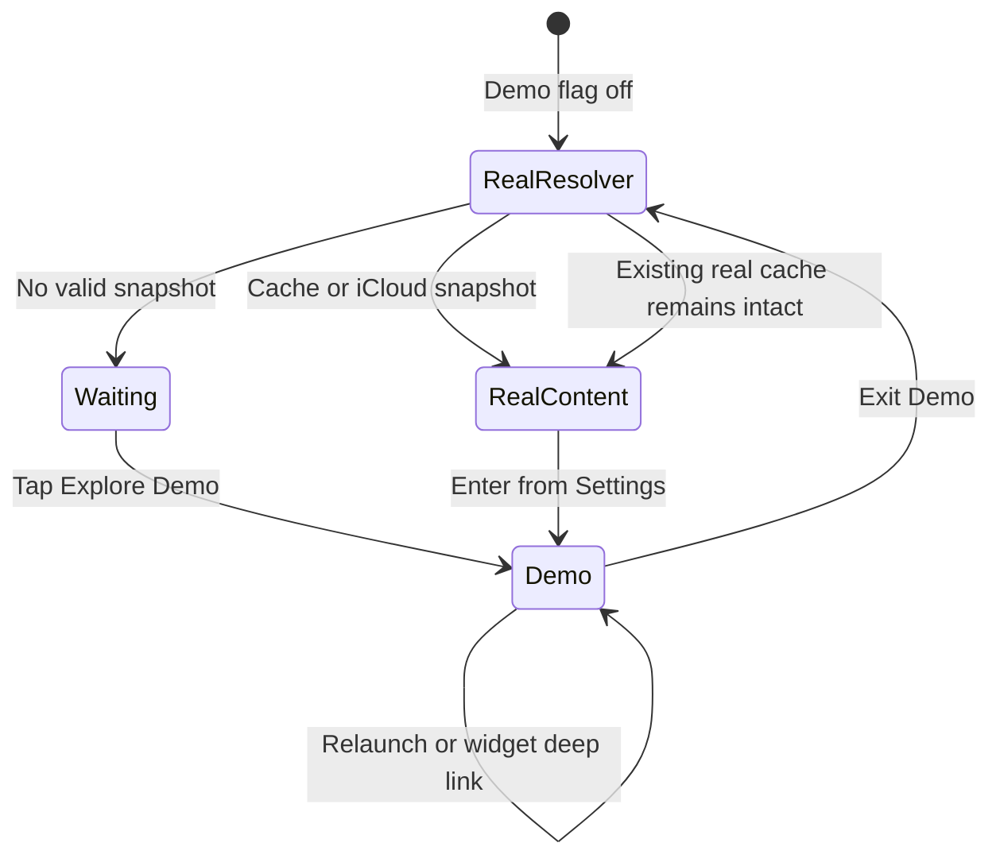
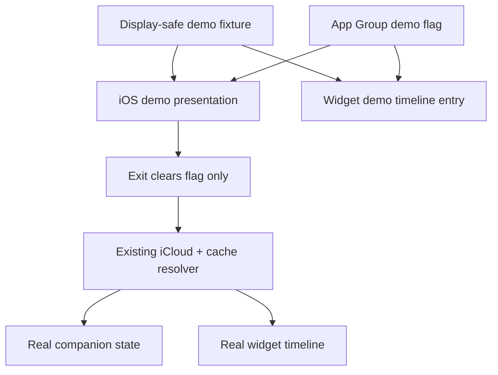
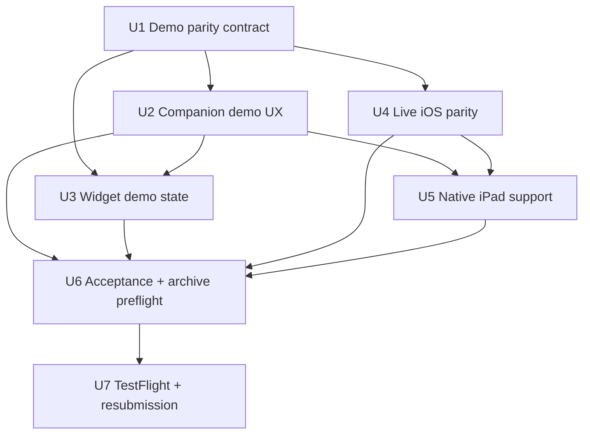
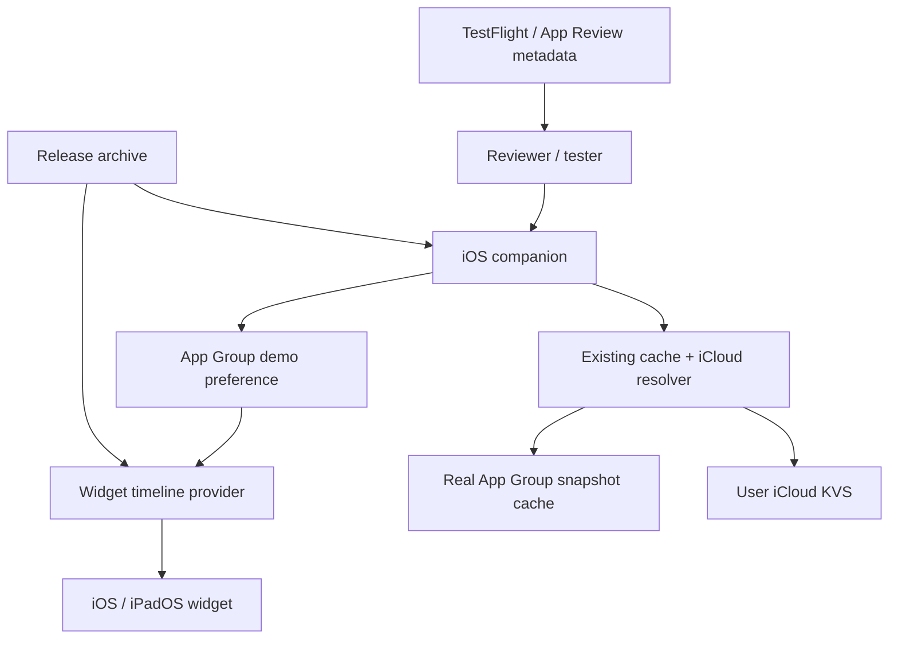

# feat: Add iOS demo mode and App Review readiness

## Summary

Turn the existing hidden screenshot fixture into a clearly labeled, user-entered demo experience that App Review can exercise without a Mac or external account. At the same time, close the identified iOS/macOS parity gaps, make the companion and widgets native iPad targets, and harden the TestFlight/App Review release path for the next iOS 1.0 build.

---

## Problem Frame

Apple reviewed iOS version 1.0 (14) on an iPad Air 11-inch (M3) and stopped under Guideline 2.1(a) because a clean install only shows “Waiting for Mac.” The app does not actually require a GitHub or Headroom account; it is a read-only companion that needs a Mac-published iCloud snapshot. That architecture leaves App Review unable to reach the connected UI, API Spend, settings, or installed widget without reproducing the developer’s Mac environment.

The repo already has representative data behind the non-discoverable `--demo` launch argument, but that path is for screenshot automation, is not available to App Review, omits newer Fable/API Spend content on iOS, and does not provide an installed widget demo. The submitted target is also iPhone-only (`TARGETED_DEVICE_FAMILY: 1`), so Apple evaluated it in iPhone compatibility mode on iPad rather than as a native iPad app.

---

## Requirements

- R1. A reviewer on a clean install can enter a full, read-only demo from the first screen without credentials, a Mac, iCloud data, special launch arguments, or hidden gestures.
- R2. Demo mode is unmistakably labeled, survives relaunch long enough to exercise the widget extension, provides an obvious exit, and returns to the actual sync state on exit.
- R3. Demo mode never fetches providers, publishes to iCloud, overwrites the real App Group snapshot cache, exposes credentials, or mutates existing sync/settings data beyond its own dedicated demo flag.
- R4. The demo shows the full current reviewable feature set: Claude and Codex, 5-hour and weekly limits, Claude’s extra weekly/Fable limit, plan/freshness/reset context, API Spend, appearance settings, and small/medium/large widgets.
- R5. The production companion renders every display-safe window retained by `WidgetSnapshotProjector`, including Claude Fable and enabled Codex extra counters, and adopts the current macOS API Spend row hierarchy.
- R6. Desktop-only behavior stays desktop-only: provider connection/recovery, CLI execution, credential management, API keys, refresh interval, menu-bar window selection, and provider fetching remain managed on Mac.
- R7. The iOS app and widget extension support iPhone and iPad natively; the app is responsive on compact and regular widths, including Apple’s reported iPad Air 11-inch review class.
- R8. Existing real-data states remain intact: live, stale, waiting, sync paused, iCloud unavailable, corrupt data, incompatible schema, offline cached data, and widget deep-link refresh.
- R9. Automated and manual acceptance coverage proves the review flow, demo isolation, iPhone/iPad layouts, light/dark appearance, accessibility text, reduced motion, widget families, and return to real state.
- R10. The next archive has a unique build number above the current repository value, matching host/extension versions, correct iPhone+iPad device families, production iCloud/App Group entitlements, privacy manifests, and export-compliance metadata.
- R11. TestFlight information, App Review Notes, and the response to submission `3472c833-11a3-4815-82d0-816b291dab60` give exact demo instructions and clearly state that sign-in is not required.
- R12. A processed TestFlight build passes a clean-install acceptance run before it is assigned to broader external testers or resubmitted to App Review.

---

## Scope Boundaries

- No iOS-side Claude/Codex fetching, provider OAuth, auth-file access, API-key entry, or hosted Headroom account/service.
- No resurrection of Claude subscription OAuth or Keychain-token reuse.
- No shared demo username/password; Apple explicitly accepted a demonstration mode in its July 15 message.
- No broad macOS redesign. macOS changes are limited to shared demo/parity contracts if required to keep fixtures aligned.
- No change to the redaction-safe iCloud snapshot schema solely to mark demo content; demo is device-local presentation state.
- No Lock Screen widgets, Live Activities, controls, watchOS, history, notifications, or threshold alerts.
- No iPad-only extra-large widget in this pass. The existing small, medium, and large families become available on iPad; extra-large remains a separately designed follow-up.
- No invitation of an unspecified tester roster. This plan prepares and approves the build/group; Kyle can add the intended people or provide a roster/public-link decision afterward.

### Deferred to Follow-Up Work

- iPad `systemExtraLarge` widget: design and verify as its own family instead of stretching the large layout implicitly.
- Automated App Store Connect metadata mutation: continue with paste-ready checked-in copy unless authenticated API/browser automation is deliberately authorized during execution.

---

## Context & Research

### Relevant Code and Patterns

- `Sources/HeadroomIOS/Views/IOSCompanionView.swift` owns the real first-launch state machine. It currently short-circuits only when `--demo` or the DEBUG preview seed is present.
- `Sources/HeadroomCore/Widgets/DemoScreenshotData.swift` is compiled into the iOS app/widget slice and is the appropriate display-safe fixture, but it currently lacks Fable and API Spend and has no parity tests.
- `Sources/HeadroomCore/DemoFixture.swift` already carries the current macOS hero scenario (Claude 72/38/54, Codex 91/64, and both API Spend providers).
- `Sources/HeadroomCore/Sync/IOSWidgetTimelineMapping.swift` centralizes cache/iCloud state resolution and already has strong newest-valid-wins coverage.
- `Sources/HeadroomIOSWidgets/HeadroomIOSTimelineProvider.swift` reads iCloud plus App Group cache and can select a device-local demo state before touching either source.
- `Sources/HeadroomIOSWidgets/Views/HeadroomIOSWidgetView.swift` already handles small/medium/large, deep links, dynamic type limits, full-color/accented rendering, and shared design tokens.
- `Sources/HeadroomIOS/Views/ProviderTileView.swift` currently loops over `subscriptionWindows`, which intentionally excludes retained `.other` windows such as Claude’s “Weekly (Fable).”
- `Sources/HeadroomIOS/Views/APISpendMirrorView.swift` still renders a per-row live “Updated” line; the current macOS `APISpendSectionView` moved period context inline and reserves the status line for non-live states.
- `project.yml` is the Xcode project authority. Both iOS targets currently declare `TARGETED_DEVICE_FAMILY: 1`; host and extension are 1.0 (20).
- `Scripts/release-ios-testflight.sh` already archives, exports, and optionally uploads with App Store Connect credentials. `Scripts/ExportOptions-TestFlight.plist` already selects production iCloud and App Store Connect distribution.
- `docs/release/appstore-listing.md` contains the listing and review copy but still tells reviewers that the waiting screen is the intended endpoint and references builds 12/13.

### Institutional Learnings

- `docs/solutions/codex-window-kind-mislabel.md` establishes that iOS must render the windows the provider actually returns; it must not infer missing 5-hour/weekly rows from slot position or synthesize absent limits.
- The July 8 widget parity handoff records that iCloud/App Group entitlements and physical-device widget identity are release-critical. Demo work must not overwrite the cache used to diagnose real sync.
- `PRODUCT.md` requires Claude and Codex to remain peer surfaces across Mac and iPhone and prioritizes glanceability, shared decisions, accessibility, and explicit stale/attention states.

### External References

- Apple App Review Guideline 2.1(a) requires full review access and permits a built-in demo mode in lieu of a demo account when it exhibits full functionality: https://developer.apple.com/app-store/review/guidelines/
- Apple’s App Review information guidance says special settings and test instructions belong in Review Notes; sign-in credentials are required only when the app actually requires login: https://developer.apple.com/help/app-store-connect/reference/app-information/platform-version-information
- Apple documents external TestFlight groups, “What to Test,” Beta App Review, and the first-build review requirement: https://developer.apple.com/help/app-store-connect/test-a-beta-version/invite-external-testers
- Apple identifies uploaded builds by bundle ID, version, and unique build string: https://developer.apple.com/help/app-store-connect/manage-builds/upload-builds/
- Apple’s build-setting reference maps targeted device family 1 to iPhone and 2 to iPad: https://developer.apple.com/documentation/xcode/build-settings-reference
- WidgetKit supports small/medium/large on iPhone and iPad; extra-large is an optional iPad family: https://developer.apple.com/documentation/widgetkit/widgetfamily
- Apple requires iPad screenshots when the app runs on iPad; the current accepted 13-inch sizes can scale down to smaller iPad classes: https://developer.apple.com/help/app-store-connect/reference/app-information/screenshot-specifications/

---

## Key Technical Decisions

| Decision | Rationale |
|---|---|
| Ship a visible production demo entry, not reviewer-only credentials or a secret gesture | The product has no Headroom account and Apple explicitly requested a demo account or demonstration mode. A visible “Explore Demo” action is reliable for review and useful to prospective users. |
| Store only the demo-enabled flag in the App Group | The app and extension need one durable signal across processes. The representative snapshot is static code; writing it into the real snapshot cache would risk masking or destroying genuine synced data. |
| Represent demo as typed local display state, not a new iCloud schema field | Demo is a device-local presentation choice and must never sync back to the Mac or change cross-version payload compatibility. |
| Keep `--demo` as a non-persistent automation override | Screenshot tooling can share the same fixture without leaving installed apps/widgets stuck in production demo mode. |
| Make demo precedence explicit and reversible | While enabled, demo wins before cache/iCloud reads. Disabling it clears only the flag, reloads the known widget kind once, and re-runs the existing real-state resolver. |
| Let `WidgetSnapshotProjector` remain the window filter authority | The companion should render all windows that survive projection. This adds Fable/allowed extras without duplicating provider-specific rules in SwiftUI. |
| Add native iPad support to both host and extension | Apple already reviews the binary on iPad. Native support removes compatibility-mode ambiguity and makes the same demo/widget instructions valid on the reported review device. |
| Preserve remaining-percentage semantics on iOS | The companion’s contract and listing consistently say “percentage remaining.” macOS menu-bar selection and display-mode preferences are desktop controls, not missing iOS functionality. |
| Gate resubmission on TestFlight acceptance, not merely a successful archive | The rejected path is a clean-install product flow. Only the processed distribution build proves signing, entitlements, app/extension embedding, and reviewer-visible behavior together. |

---

## Open Questions

### Resolved During Planning

- Demo account versus demonstration mode: use a built-in demonstration mode; the app has no account service and Apple’s message explicitly allows it.
- Whether demo should overwrite the shared snapshot: no. Persist a separate App Group flag and synthesize the display state in memory.
- Whether iPad compatibility mode is sufficient: no. The next app and extension target both device families 1 and 2 and receive explicit iPad layout verification.
- Whether every macOS setting belongs on iOS: no. Mirror display-safe usage/spend state; leave provider setup, credentials, refresh, and menu-bar choices managed on Mac.
- Whether to add the iPad extra-large widget now: defer it; standard families provide complete existing functionality without inventing a new design during review remediation.

### Deferred to Implementation

- Exact next build string: use the next App Store Connect-available value above the repo’s current 20 because another upload could consume 21 before execution.
- Exact regular-width column breakpoint and maximum content width: settle from iPad Air 11-inch simulator/device inspection while keeping the plan’s one-column compact/two-column regular behavior.
- Whether App Store Connect changes can be applied through authenticated automation in the execution environment: prepare checked-in paste-ready text regardless; use automation only if valid authentication is available and authorized.

---

## High-Level Technical Design

> *This illustrates the intended approach and is directional guidance for review, not implementation specification. The implementing agent should treat it as context, not code to reproduce.*

---

## Implementation Units

### U1. Establish the Current Demo and Parity Contract

**Goal:** Make one display-safe iOS fixture cover every current reviewable data type and prevent it from drifting silently from the macOS demo scenario again.

**Requirements:** R3, R4, R5, R9

**Dependencies:** None

**Files:**
- Modify: `Sources/HeadroomCore/Widgets/DemoScreenshotData.swift`
- Modify: `Tests/HeadroomCoreTests/DemoFixtureTests.swift`
- Create: `Tests/HeadroomCoreTests/DemoScenarioParityTests.swift`
- Test: `Tests/HeadroomCoreTests/WidgetSnapshotProjectorTests.swift`

**Approach:**
- Bring `DemoScreenshotData.envelope` up to the current scenario: Claude 5-hour/weekly/Fable, Codex returned windows, both live API Spend summaries, plan labels, reset context, freshness, and current density decisions.
- Add semantic parity coverage between the macOS `DemoFixture` projected through `WidgetSnapshotProjector` and the iOS display-safe envelope. Normalize volatile timestamps/reset instants in the assertion instead of weakening value/label/window coverage.
- Keep the fixture redaction-safe and independent of credentials, provider DTOs, CLI output, and network clients.
- Preserve `--demo` for existing screenshot automation, backed by this updated fixture on iOS.

**Execution note:** Implement the fixture contract and failing parity assertions before changing demo activation behavior.

**Patterns to follow:**
- `Sources/HeadroomCore/DemoFixture.swift`
- `Tests/HeadroomCoreTests/DemoFixtureTests.swift`
- `Tests/HeadroomCoreTests/WidgetSnapshotProjectorTests.swift`

**Test scenarios:**
- Happy path: the iOS envelope contains Claude and Codex in the expected order, with the current five-hour/weekly values and Claude Fable at 54% remaining.
- Happy path: both API Spend providers, amounts, currencies, period labels, freshness, and ordering match the projected macOS demo scenario.
- Edge case: semantic parity ignores generated timestamps while still failing on a missing provider, window, API Spend row, plan label, or changed percentage.
- Error/privacy path: the encoded fixture contains none of the token, auth-file, API-key, filesystem-path, or raw-response sentinel strings used by redaction tests.
- Integration: projecting `DemoFixture` with API surfaces enabled produces the same reviewable data categories as `DemoScreenshotData.envelope`.

**Verification:**
- The iOS fixture visibly exercises every data-bearing section that a connected real snapshot can display.
- Future demo changes fail a focused parity test instead of drifting between Mac, app, and widget screenshots.

---

### U2. Add an Isolated Companion Demo Lifecycle

**Goal:** Give clean-install users and App Review a one-tap, persistent, clearly labeled demo that can be exited without disturbing real synced content.

**Requirements:** R1, R2, R3, R7, R8

**Dependencies:** U1

**Files:**
- Create: `Sources/HeadroomCore/Widgets/CompanionDemoMode.swift`
- Modify: `Sources/HeadroomCore/Sync/IOSWidgetTimelineMapping.swift`
- Modify: `Sources/HeadroomIOS/Views/IOSCompanionView.swift`
- Modify: `Sources/HeadroomIOS/Views/StatusScreen.swift`
- Modify: `Sources/HeadroomIOS/Views/MirrorView.swift`
- Modify: `Sources/HeadroomIOS/Views/SettingsSheetView.swift`
- Create: `Sources/HeadroomIOS/Views/DemoModeBanner.swift`
- Create: `Tests/HeadroomCoreTests/CompanionDemoModeTests.swift`
- Test: `Tests/HeadroomCoreTests/IOSWidgetTimelineMappingTests.swift`

**Approach:**
- Add an injectable demo-mode preference backed by the existing App Group suite in production and an in-memory/defaults double in tests.
- Extend the typed iOS display resolution with an explicit demo state/origin. Demo takes precedence before any cache/iCloud read; the production resolver remains unchanged when demo is off.
- Add “Explore Demo” to all states where review would otherwise stop (waiting, iCloud unavailable, paused, corrupt, incompatible), plus an entry in Settings so connected users can inspect it too.
- Add persistent, non-alarming “Demo data” treatment in the content screen and Settings, with a single obvious “Exit Demo” action.
- On exit, clear only the demo preference, request one widget-kind reload, and refresh through the existing cache/iCloud path. Do not clear or rewrite real cached data.
- Keep the command-line `--demo` override non-persistent so screenshot automation does not alter the installed demo preference.

**Patterns to follow:**
- Typed state resolution in `Sources/HeadroomCore/Sync/IOSWidgetTimelineMapping.swift`
- Injectable defaults seams in `Sources/HeadroomCore/Settings/Preferences.swift`
- Existing status-screen state routing in `Sources/HeadroomIOS/Views/IOSCompanionView.swift`
- Existing appearance and sync sections in `Sources/HeadroomIOS/Views/SettingsSheetView.swift`

**Test scenarios:**
- Happy path: a missing cache/iCloud state with demo enabled resolves to the full demo envelope and reports demo origin.
- Happy path: a valid real snapshot with demo enabled still displays demo while preserving the real snapshot untouched for later.
- Happy path: disabling demo immediately resolves back to the newest real cache/iCloud snapshot.
- Edge case: the demo preference survives app relaunch and defaults off when absent or unreadable.
- Edge case: repeated enable/disable requests are idempotent and do not generate duplicate state transitions.
- Error path: an unavailable App Group preference store still allows a session-only app demo and reports that the widget may not follow, without exposing a raw error.
- Integration: entering demo from every non-content status reaches Usage; exiting from Settings returns to the exact prior actionable status.
- Privacy path: demo entry/exit performs no iCloud publish, provider fetch, cache write, credential read, or real preference reset.

**Verification:**
- A reviewer can discover and enter demo without reading Review Notes, while the notes can still give exact one-tap instructions.
- Demo and real state never become ambiguous or destructive.

---

### U3. Drive the Installed Widget from Demo State Safely

**Goal:** Let App Review add and inspect all existing widget sizes while demo is enabled, without using or replacing the real synced snapshot.

**Requirements:** R2, R3, R4, R8, R9

**Dependencies:** U1, U2

**Files:**
- Create: `Sources/HeadroomCore/Widgets/HeadroomIOSWidgetConfiguration.swift`
- Modify: `Sources/HeadroomIOSWidgets/HeadroomIOSWidgetEntry.swift`
- Modify: `Sources/HeadroomIOSWidgets/HeadroomIOSTimelineProvider.swift`
- Modify: `Sources/HeadroomIOSWidgets/Views/HeadroomIOSWidgetView.swift`
- Modify: `Sources/HeadroomIOSWidgets/HeadroomIOSWidgets.swift`
- Modify: `Sources/HeadroomIOS/Views/IOSCompanionView.swift`
- Test: `Tests/HeadroomCoreTests/CompanionDemoModeTests.swift`
- Test: `Tests/HeadroomCoreTests/IOSWidgetTimelineMappingTests.swift`

**Approach:**
- Share the existing widget kind as a small constant so the app reloads only Headroom’s iOS usage widget when demo state changes.
- Have placeholder/preview continue returning representative content synchronously. For real snapshots/timelines, read the App Group demo flag first and emit the typed demo entry without touching iCloud or cache.
- Precompute demo versus real state in the timeline provider/entry; keep widget views limited to rendering.
- Mark demo content visibly in every supported family without compromising the percentage hierarchy or relying on color alone.
- Reload the timeline only when the demo flag changes, preserving the existing 15-minute real-content timeline policy and refresh budget.
- Keep the single `headroom://usage` widget URL so tapping a demo widget opens the app in the same demo state.

**Patterns to follow:**
- Shared App Group cache access in `Sources/HeadroomCore/Widgets/WidgetSnapshotCache.swift`
- Timeline resolution in `Sources/HeadroomIOSWidgets/HeadroomIOSTimelineProvider.swift`
- Shared UI and accessibility in `Sources/HeadroomWidgetSharedUI/HeadroomWidgetSharedUI.swift`
- One whole-widget deep link in `Sources/HeadroomIOSWidgets/Views/HeadroomIOSWidgetView.swift`

**Test scenarios:**
- Happy path: demo enabled causes placeholder-independent snapshot/timeline resolution to return the demo envelope for small, medium, and large families.
- Happy path: the demo entry includes Claude, Codex, Fable context where the family supports it, and API Spend where the current family supports it.
- Edge case: enabling demo while a real cache exists does not change the cache bytes or iCloud envelope.
- Edge case: disabling demo returns the next timeline to the newest real cache/iCloud state.
- Edge case: widget deep-link launch preserves demo until the reviewer explicitly exits.
- Error path: missing App Group access falls back to the existing real widget resolution instead of crashing or fabricating a persistent demo state.
- Accessibility: every family exposes “Demo data” in its accessible description in addition to the visual label.
- Integration: one app-side state transition reloads the configured widget kind; repeated refreshes while the mode is unchanged do not burn reloads.

**Verification:**
- A widget added after entering demo shows representative content without opening the Mac app.
- Exiting demo restores the pre-existing real/waiting widget state on the next reload.

---

### U4. Close the Identified Companion Parity Gaps

**Goal:** Make the live iOS mirror reflect current display-safe macOS data and hierarchy without importing desktop-only controls.

**Requirements:** R4, R5, R6, R8

**Dependencies:** U1

**Files:**
- Modify: `Sources/HeadroomCore/Widgets/WidgetSnapshotModels.swift`
- Modify: `Sources/HeadroomCore/Widgets/APISpendPresentation.swift`
- Modify: `Sources/HeadroomIOS/Views/ProviderTileView.swift`
- Modify: `Sources/HeadroomIOS/Views/APISpendMirrorView.swift`
- Test: `Tests/HeadroomCoreTests/WidgetSnapshotProjectorTests.swift`
- Test: `Tests/HeadroomCoreTests/APISpendPresentationTests.swift`
- Test: `Tests/HeadroomCoreTests/MirrorPresentationTests.swift`

**Approach:**
- Give the companion a display-window collection that includes every window intentionally retained by the projector, rather than only `.fiveHour` and `.weekly` subscription windows.
- Render Claude Fable and any enabled Codex extra counter with the existing label/reset/percentage/severity recipe. Do not synthesize missing standard windows.
- Match the current macOS API Spend hierarchy: period context inline with provider identity, no redundant per-row “Updated” subline for live values, and retained pending/stale/setup guidance for non-live values.
- Keep “managed on Mac” behavior for actionable credential/setup states; iOS remains read-only.
- Continue using shared brand/severity values and `MirrorPresentation` for reset/freshness behavior.

**Execution note:** Add characterization assertions for the current projected window set before changing the companion loop.

**Patterns to follow:**
- Window filtering in `Sources/HeadroomCore/Widgets/WidgetSnapshotProjector.swift`
- Current macOS row semantics in `Sources/HeadroomApp/UI/APISpendSectionView.swift`
- The provider-duration lesson in `docs/solutions/codex-window-kind-mislabel.md`

**Test scenarios:**
- Happy path: a projected Claude snapshot with 5-hour, weekly, and Weekly (Fable) exposes all three to the companion in source order.
- Happy path: a projected Codex snapshot containing only a self-described weekly window renders one weekly row and does not invent a 5-hour row.
- Edge case: an enabled Codex extra counter survives to the companion; the same counter is absent when the Mac setting excludes it.
- Edge case: provider content with no windows still renders its freshness/setup treatment without crashing or creating placeholders.
- Happy path: live API Spend presents amount and period with no per-row updated status.
- Error path: pending, transient stale, and permanent setup-needed API Spend retain distinct redaction-safe status copy and no iOS credential action.
- Accessibility: extra window and API Spend rows expose provider, label, amount/percentage, and state without depending on color.

**Verification:**
- The companion demo and real synced state show the same data categories as the current macOS popover, subject only to explicit desktop-only exclusions.

---

### U5. Make the Companion and Widgets Native on iPad

**Goal:** Replace iPhone compatibility mode with an intentional universal app/widget experience that is comfortable on Apple’s reported review device.

**Requirements:** R7, R8, R9

**Dependencies:** U2, U4

**Files:**
- Modify: `project.yml`
- Regenerate: `Headroom.xcodeproj/project.pbxproj`
- Modify: `Sources/HeadroomIOS/Views/MirrorView.swift`
- Modify: `Sources/HeadroomIOS/Views/StatusScreen.swift`
- Modify: `Sources/HeadroomIOS/Views/SettingsSheetView.swift`
- Modify if needed after family rendering: `Sources/HeadroomIOSWidgets/Views/HeadroomIOSWidgetView.swift`
- Create: `Tests/HeadroomIOSUITests/ResponsiveLayoutUITests.swift`
- Create: `Tests/HeadroomIOSUITests/DemoModeUITests.swift`

**Approach:**
- Set both `HeadroomIOS` and `HeadroomIOSWidgets` to target device families 1 and 2; keep the checked-in project generated from `project.yml`.
- Preserve the proven single-column composition on compact width. On regular-width iPad, constrain the reading measure and use a balanced two-column provider layout, with API Spend and freshness remaining visually subordinate.
- Center status/demo entry content at a readable maximum width instead of stretching it across the iPad canvas.
- Keep Settings native to the platform’s sheet/form presentation and verify both portrait and landscape.
- Offer the existing small/medium/large widget families on iPad. Adapt only where actual iPad family dimensions expose clipping; do not silently map `systemExtraLarge` to the large view.
- Add an iOS UI-test target generated by XcodeGen so the same clean-install flow runs on named iPhone and iPad simulator destinations.

**Patterns to follow:**
- Existing adaptive SwiftUI layouts and native navigation in `Sources/HeadroomIOS/Views/MirrorView.swift`
- Widget family switching in `Sources/HeadroomIOSWidgets/Views/HeadroomIOSWidgetView.swift`
- Shared widget content margins and flexible sizing; avoid device-specific fixed frames.

**Test scenarios:**
- Happy path: clean install on iPad Air 11-inch enters demo and displays Claude, Codex, Fable, and API Spend without compatibility chrome.
- Happy path: compact iPhone remains one column; regular-width iPad presents balanced columns with a readable maximum width.
- Edge case: one enabled provider uses the available regular-width content area without leaving an empty column.
- Edge case: split view/narrow regular-width transitions do not clip percentages, plan pills, reset labels, toolbar actions, or demo controls.
- Appearance: demo and all status states render in light/dark on iPhone and iPad.
- Accessibility: largest supported Dynamic Type, VoiceOver order, Reduce Motion, and button labels remain usable on both device classes.
- Widget integration: small/medium/large add successfully on iPad, render demo content, deep-link to the app, and return to the correct real state after exit.
- Orientation: iPad portrait and landscape keep content readable and settings dismissible.

**Verification:**
- The built app’s device-family metadata includes iPhone and iPad for both host and extension.
- The reported iPad Air review class can exercise the same full flow as iPhone.

---

### U6. Automate Review-Critical Acceptance and Archive Preflight

**Goal:** Catch the exact distribution/review failures before upload and make the next iOS build reproducibly TestFlight-ready.

**Requirements:** R9, R10, R12

**Dependencies:** U2, U3, U4, U5

**Files:**
- Modify: `project.yml`
- Regenerate: `Headroom.xcodeproj/project.pbxproj`
- Modify: `Tests/HeadroomIOSUITests/DemoModeUITests.swift`
- Modify: `Tests/HeadroomIOSUITests/ResponsiveLayoutUITests.swift`
- Modify: `Sources/HeadroomIOS/DesignSystem/CompanionPreviewSeed.swift`
- Create: `Scripts/verify-ios-release.sh`
- Modify: `Scripts/release-ios-testflight.sh`
- Modify if validation reveals a mismatch: `Scripts/ExportOptions-TestFlight.plist`
- Modify if validation reveals a mismatch: `Sources/HeadroomIOS/Info.plist`
- Modify if validation reveals a mismatch: `Sources/HeadroomIOSWidgets/Info.plist`

**Approach:**
- Add UI acceptance coverage for clean launch → Explore Demo → full Usage/API Spend → Settings → exit → original waiting state, using accessibility identifiers only where semantic labels are insufficient.
- Extend the existing DEBUG-only preview seed into a deterministic UI-test seam for empty, real-content, and stale/setup starting states. Keep it compiled out of Release so the public demo path itself is what Release verification exercises.
- Run the same critical flow on a representative iPhone and iPad Air 11-inch simulator.
- Add an archive preflight that inspects the exported/archived host and embedded extension for matching marketing/build versions, unique next build, device families 1+2, expected bundle IDs, production iCloud/App Group entitlements, privacy manifests, embedded widget extension, and non-exempt-encryption declaration.
- Establish build-number uniqueness from App Store Connect when upload credentials are available; otherwise require an explicitly supplied last-uploaded baseline and stop rather than inferring availability from git history alone.
- Make the existing release script call the preflight before upload and stop on any mismatch. Keep credentials external to the repo and redact their paths/identifiers from normal output.
- Verify Release configuration includes the production demo entry; do not depend on DEBUG preview code or launch arguments.

**Execution note:** Treat the clean-install UI test and archive inspection as release-blocking characterization of the rejected build path.

**Patterns to follow:**
- Existing strict shell failure posture in `Scripts/release-ios-testflight.sh`
- Existing production iCloud export setting in `Scripts/ExportOptions-TestFlight.plist`
- Privacy manifest declarations in `Sources/HeadroomIOS/PrivacyInfo.xcprivacy` and `Sources/HeadroomIOSWidgets/PrivacyInfo.xcprivacy`

**Test scenarios:**
- UI happy path: a fresh app with empty cache/iCloud reaches all demo sections in one tap and exits back to Waiting for Mac.
- UI persistence: terminate/relaunch during demo and confirm the app/widget stay in labeled demo until exit.
- UI isolation: seed a real cache, enter/exit demo, and confirm the same real generated timestamp/content returns.
- UI deep link: open `headroom://usage` from demo and real states and confirm the correct state refreshes.
- Archive happy path: a valid archive reports matching host/extension versions, both device families, expected entitlements, privacy manifests, extension embedding, and export compliance.
- Build identity: a candidate build at or below the last App Store Connect upload is rejected before archive/upload; a higher matching host/extension build proceeds.
- Archive error path: a fixture/copy with mismatched extension build, iPhone-only metadata, missing production iCloud entitlement, or missing privacy manifest fails preflight with a precise non-secret message.
- Release error path: absent or partial App Store Connect credentials stops before upload and never prints secret material.

**Verification:**
- Core tests, iOS simulator builds, iOS UI tests on both device classes, and archive preflight all pass against the same Release source revision.
- The upload script cannot report success when the archive would reproduce the rejected access path or packaging drift.

---

### U7. Ship Through TestFlight and Resubmit with Exact Reviewer Guidance

**Goal:** Deliver the verified build to broader TestFlight testing and give App Review a deterministic path through all functionality.

**Requirements:** R10, R11, R12

**Dependencies:** U6

**Files:**
- Modify: `docs/release/appstore-listing.md`
- Create: `docs/release/ios-app-review-testflight.md`
- Modify: `Scripts/capture-demo-screenshots.sh`
- Modify: `README.md`

**Approach:**
- Update the stale submission log and App Review Notes with the July 15 rejection, the selected new build, and exact reviewer steps: launch, tap Explore Demo, inspect Usage/API Spend/Settings, add any Headroom widget size, and exit from Settings.
- State plainly that the app has no login and that “Sign-in required” should remain off; the demo is representative local data and never contacts provider or Headroom servers.
- Include paste-ready reply text tied to the submission ID and Apple’s explicit acceptance of a demonstration mode.
- Extend the existing repeatable screenshot flow to capture the native iPad demo at an App Store-accepted 13-inch size, then add at least one accurate iPad screenshot to the now-required iPad media set before resubmission.
- Update TestFlight “What to Test” to cover demo entry/exit, real Mac→iCloud sync, stale/offline behavior, all widget sizes, iPhone/iPad layouts, and feedback expectations.
- Increment the iOS host and widget extension together to the next available build above 20, upload through the existing authenticated release path, wait for processing, and assign first to an internal group.
- Perform a clean TestFlight install after deleting prior development/App Store copies. Verify demo on iPhone and iPad class, then verify a real Mac-published snapshot and the installed widget on a physical device.
- After the internal acceptance gate, assign the same build to the intended external group, submit for Beta App Review if required, and enable broader invitations only after approval.
- Keep the previously accepted TestFlight build available until the new build passes the clean-install gate; do not strand existing testers during remediation.
- Select that processed build for iOS 1.0, paste the updated Review Notes, reply in the unresolved App Review thread, and resubmit. Record the final build/status in the release doc.

**Patterns to follow:**
- Existing release copy structure in `docs/release/appstore-listing.md`
- Existing archive/upload path in `Scripts/release-ios-testflight.sh`
- Apple’s separation between internal testing, external Beta App Review, and App Store Review.

**Test scenarios:**
- Operational happy path: a new tester with no Mac can install from TestFlight and exercise all display functionality through demo.
- Operational integration: a tester with Headroom on Mac can exit demo and receive a real iCloud snapshot without reinstalling.
- App Review rehearsal: a clean iPad-class install follows the pasted instructions verbatim and reaches the app plus widget demo without credentials.
- Metadata check: Review Notes, TestFlight “What to Test,” contact information, privacy URL, support URL, export compliance, and sign-in-required state match the binary.
- Product-page assets: the iPhone screenshots remain accurate and the required native iPad screenshot set uses accepted dimensions, no alpha channel, and the same labeled demo data as the reviewed binary.
- Failure path: if processing, signing, Beta App Review, or the clean-install acceptance gate fails, do not invite the broader group or resubmit; record the failure and return to the relevant unit.

**Verification:**
- The chosen TestFlight build is installed and accepted on a clean device before expansion.
- App Review can follow the submitted notes without external coordination or access to Kyle’s accounts.

---

## System-Wide Impact

- **Interaction graph:** App demo entry changes one App Group preference and reloads one widget kind. Real cache/iCloud resolution remains a parallel path selected only when demo is off.
- **Error propagation:** Demo preference failures map to safe local fallback behavior; real sync failures keep their existing typed status screens. Release preflight failures stop before upload.
- **State lifecycle risks:** Persisted demo could otherwise mask real content; explicit labeling, an obvious exit, typed demo origin, and preservation tests prevent that. The real cache is never cleared or replaced.
- **API surface parity:** The shared `WidgetSnapshotEnvelope` remains the cross-device contract. The companion expands its rendering of already-retained windows; no provider or credential API is introduced on iOS.
- **Integration coverage:** Unit tests prove fixture/state isolation; UI tests prove app entry/exit; simulator/device checks prove layout and WidgetKit; archive inspection proves distribution metadata; TestFlight proves the processed build.
- **Unchanged invariants:** Mac is still the only provider-fetching process. iOS and widgets remain read-only. iCloud carries only redaction-safe summaries. WidgetKit controls refresh cadence outside explicit mode-change reloads.

---

## Dependencies / Prerequisites

- An App Store Connect account/API key or authenticated Xcode account capable of signing and uploading `com.kylezantos.headroom.ios` and its widget extension.
- Production App Group and iCloud KVS capabilities remain configured for both bundle IDs.
- An available iPhone/iOS 26 physical device for TestFlight and real iCloud/widget acceptance.
- An iPad Air 11-inch simulator; a physical iPad/TestFlight tester is preferred before App Store resubmission and becomes the fallback evidence if no local iPad is available.
- The intended external tester roster or public-link decision is not required to build/approve the beta, but is required before invitations are sent.

---

## Risk Analysis & Mitigation

| Risk | Likelihood | Impact | Mitigation |
|---|---:|---:|---|
| Demo data is mistaken for live usage | Medium | High | Persistent “Demo data” treatment in app/widget, explicit Settings state, and clear exit. |
| Demo overwrites or masks real synced content after exit | Medium | High | Separate App Group flag; no cache writes; preservation and exit-to-real tests. |
| Reviewer cannot make the widget show demo data | Medium | High | Persist flag across processes, read it first in timeline provider, reload the exact kind, rehearse from clean TestFlight install. |
| Universal target introduces iPad clipping or poor stretched layout | Medium | Medium | Compact/regular layouts, constrained measure, iPad Air portrait/landscape UI tests, standard-family widget verification. |
| Demo fixture drifts from macOS again | Medium | Medium | Semantic parity test between projected macOS fixture and iOS fixture. |
| Extra provider windows overflow cards/widgets | Medium | Medium | Companion scrolls all retained windows; compact widgets keep current family-specific summaries; test longest labels and missing-window cases. |
| App/extension signing or entitlement drift survives local builds | Medium | High | Inspect the actual archive and processed TestFlight build, not only simulator products. |
| Build number is already consumed | Low | Medium | Resolve the next available App Store Connect build at execution time and keep host/extension synchronized. |
| External Beta App Review repeats the access rejection | Low | High | Use the same demo instructions in “What to Test,” rehearse them on the distribution build, and submit only after the internal gate. |

---

## Success Metrics

- A clean iPhone or iPad install reaches representative connected content in one visible tap.
- Demo content includes both providers, Fable, API Spend, settings, and all existing widget sizes.
- Entering/exiting demo changes zero bytes in the real snapshot cache and performs no provider/iCloud write.
- iPhone and iPad UI acceptance tests pass in light/dark; widget and deep-link smoke passes on the processed TestFlight build.
- The archive contains matching host/extension versions, both device families, expected entitlements/privacy manifests, and the embedded widget extension.
- External testers can begin testing without needing Kyle’s Mac/account setup.
- App Review can complete feature verification using only the submitted instructions and binary.

---

## Alternative Approaches Considered

- **Provide Kyle’s iCloud/provider credentials:** rejected because the app has no Headroom account, provider credentials must never be shared, and the review environment still would not have the Mac publisher.
- **Create a hosted demo account/backend:** rejected because it contradicts the no-account/no-server architecture and adds privacy/security infrastructure solely for review.
- **Keep `--demo` and explain a launch argument:** rejected because App Review cannot reliably launch the App Store binary with custom arguments and Apple requested an accessible demo experience.
- **Write the demo envelope into the real widget cache:** rejected because it could overwrite genuine synced state and create difficult-to-diagnose persistence after review/testing.
- **Remain iPhone-only:** rejected because Apple already uses an iPad review device and native iPad support removes compatibility-mode ambiguity with modest, bounded layout work.
- **Add `systemExtraLarge` immediately:** deferred because it requires a deliberate new layout and is not necessary to expose the existing widget functionality on iPad.

---

## Documentation / Operational Notes

- `docs/release/appstore-listing.md` is the paste-ready source for App Store listing and App Review Notes; it must no longer frame Waiting for Mac as sufficient for review.
- `docs/release/ios-app-review-testflight.md` should become the durable runbook for build selection, demo rehearsal, TestFlight groups, clean-install checks, reviewer reply, and resubmission status.
- `README.md` should describe the companion as iPhone/iPad and distinguish the public demo mode from the `--demo` screenshot automation flag.
- The privacy policy remains accurate if implementation follows this plan: demo data is bundled/static and the App Group flag is device-local. Revisit it only if execution introduces collection, telemetry, or network behavior (which is out of scope).
- App Review’s July 15 message is sufficient prior approval for the built-in demo-mode route described by Guideline 2.1(a); preserve the message/submission ID in the runbook.

---

## Sources & References

- Product direction: `PRODUCT.md`
- Repo constraints and architecture: `AGENTS.md`
- Original iOS sync plan: `docs/plans/2026-07-04-002-feat-ios-companion-widget-icloud-plan.md`
- Original iOS mirror plan: `docs/plans/2026-07-04-004-feat-ios-companion-mirror-ui-plan.md`
- API Spend mirror plan: `docs/plans/2026-07-07-001-feat-api-spend-mirror-widgets-plan.md`
- Widget parity handoff: `docs/plans/2026-07-08-004-widget-card-parity-handoff.md`
- Codex window classification learning: `docs/solutions/codex-window-kind-mislabel.md`
- Existing release metadata: `docs/release/appstore-listing.md`
- Apple App Review Guidelines: https://developer.apple.com/app-store/review/guidelines/
- Apple App Review information fields: https://developer.apple.com/help/app-store-connect/reference/app-information/platform-version-information
- Apple TestFlight external testing: https://developer.apple.com/help/app-store-connect/test-a-beta-version/invite-external-testers
- Apple build uploads: https://developer.apple.com/help/app-store-connect/manage-builds/upload-builds/
- Apple targeted device families: https://developer.apple.com/documentation/xcode/build-settings-reference
- Apple WidgetFamily: https://developer.apple.com/documentation/widgetkit/widgetfamily
- Apple screenshot specifications: https://developer.apple.com/help/app-store-connect/reference/app-information/screenshot-specifications/
