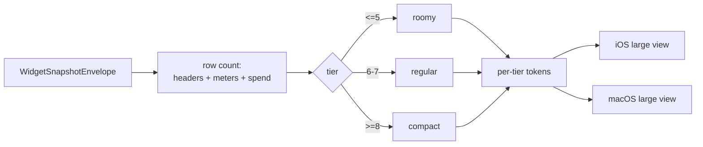

# Large Widget Adaptive Visual Design - Plan

## Goal Capsule

Make the large widget (iOS + macOS mirror) look deliberately designed at every content permutation a real user can have, by extending the existing `LargeWidgetDensity` tier into a full per-tier design-token set (type scale, bar height, spacing) and applying it in both large views. The tile is fixed-size; the content is not — the design must adapt, not just the gaps.

Authority: this plan > session conversation > implementer preference. The apple-design principles cited in KTD rationale are the design authority for visual judgment calls.

Stop conditions: stop and surface rather than guess if (a) a change would require touching the companion app (`Sources/HeadroomIOS/`), (b) the shared meter change would visibly alter the small or medium widget families, or (c) a permutation cannot fit even at the compact tier without truncating data.

Execution: units are dispatched to gpt subagents one at a time by the session orchestrator, verified between units.

---

## Product Contract

### Summary

The large widget currently looks tuned for exactly one content mix (2 providers × 2 meters + API spend). Real users vary on provider count, 5-hour window presence, API spend, transient sub-limit chips, and attention states. This plan makes each density tier an intentional design: light content scales the design up (hero treatment), the current mix stays as the calibrated regular tier, and heavy content steps down gracefully — with every tunable centralized in `HeadroomCore` and testable.

### Problem Frame

A fixed 360pt-class tile with variable content means hand-tuned constants are always wrong for someone. The session that produced the density substrate proved this: every constant tuned for the demo mix broke when the mix was imagined differently. The existing `LargeWidgetDensity` tier only varies spacing floors and a prominence flag; type and bar sizes are still fixed at the regular tier's values, so roomy content reads sparse rather than intentional, and compact content would crowd.

### Requirements

Adaptive appearance:

- R1. Every content permutation renders with symmetric vertical rhythm — equal flexible gaps at the top edge, between sections, and bottom edge (already structural; must remain true after this work).
- R2. Light content (roomy tier, e.g. one provider) scales the design up — larger glance percent, thicker bars, larger provider header — so the tile reads as a deliberate hero layout, not a small layout floating in space.
- R3. Heavy content (compact tier — reached with real data when Claude renders weekly + 5h + Fable and Codex regains its 5-hour gate) steps type and spacing down so everything fits without truncation, crowding, or dropped rows.
- R10. Extra weekly sub-limits (Fable) render as full meter rows in the large family, mirroring the popover's every-window-is-a-row treatment; the large-family header chip is removed.
- R4. The regular tier (current demo mix: 2 providers × 2 meters + spend) keeps the calibrated look shipped in this session — 17pt glance percent, 6pt bars, 13pt titles.

Architecture:

- R5. Every visual tunable that varies by tier flows through `LargeWidgetDensity` in `HeadroomCore` with unit tests; the two platform views contain no tier-conditional literals.
- R6. iOS and macOS large views stay mirrored — same structure, same density consumption, platform-appropriate style typealiases only.

Verification and hygiene:

- R7. Each permutation can be posed on the iOS simulator on demand via debug-only demo fixture variants (no companion-app UI; selected via the app-group defaults from the command line).
- R8. The dead provider-card modifier code (`HeadroomWidgetLargeProviderCardModifier` and its wrappers) is removed.
- R9. A swiftui-pro review pass over the changed widget code comes back clean or its findings are resolved.

### Scope Boundaries

- Companion app (`Sources/HeadroomIOS/`) is untouched.
- Small and medium widget families keep their current appearance; the shared meter change must be additive for them.
- Full-color rendering mode is the design target; vibrant (desktop de-emphasized) and accented modes get a regression spot-check only, no design tuning.

Deferred to follow-up work:

- macOS on-device widget verification (Sequoia/Tahoe live desktop captures) — the headless render harness covers layout; live material fidelity is a later pass.
- Any future third provider: the tier math already accounts for row count, but brand styling for a new provider is separate work.

---

## Planning Contract

### Key Technical Decisions

- KTD-A. **Meter sizing becomes a three-step style, not a boolean.** The shared `HeadroomWidgetUsageMeter`'s `prominent: Bool` cannot express hero/regular/dense. Replace it (for the large-family call sites) with a style value derived from the density tier; the small/medium call sites keep their existing behavior unchanged. Rationale: apple-design — hierarchy is built from weight + size + leading as a set; a bool only toggles between two of the three needed states.
- KTD-B. **All tier tokens live in `LargeWidgetDensity` as plain `Double`/enum values** (no SwiftUI imports in core); the views map tokens to `Font`/`CGFloat`. Rationale: repo convention — everything testable lives in HeadroomCore; fonts as semantic steps keeps Dynamic Type behavior.
- KTD-C. **Demo permutation variants are selected by an app-group defaults key** read only when demo mode is already enabled (`CompanionDemoModeStore` pattern), with fixtures defined next to `DemoScreenshotData`. No companion UI; `xcrun simctl` writes the key. Rationale: keeps the constraint that demo content never enters the real snapshot path, and keeps the companion app untouched.
- KTD-D. **The equal-flexible-gap structure is the layout invariant**; tiers change token values only, never the structure. Rationale: symmetry-by-construction survived every content mix in this session; per-tier structural forks would reintroduce hand-tuning.
- KTD-E. **Tier thresholds stay row-count based** (rows = provider headers + rendered meters + spend strip): ≤5 roomy, 6–7 regular, ≥8 compact. Rendered meters = subscription windows (weekly, 5h when present) **plus extra weekly sub-limit windows** (KTD-H). Current reality (Jul 2026): Codex has no 5-hour gate and Claude Max carries a permanent Fable weekly sub-limit, so the everyday mix is Claude 3 meters + Codex 1 meter + spend = 7 rows (regular); if OpenAI re-enables the 5-hour gate the same real data reaches 8 rows and the compact tier — no synthetic providers needed.
- KTD-H. **Extra weekly sub-limits (e.g. "Weekly (Fable)") render as full meter rows in the large family, mirroring the popover** — the popover renders every projector-retained window as a row (`MirrorPresentation.windows`), and Fable becoming a permanent Max fixture makes a header chip too small a home for it. The header chip is removed from the large family (the `limitingExtraWeeklyWindow` model API stays for other consumers). Extra rows render after the weekly/5h meters in each provider section.
- KTD-F. **macOS converges on iOS's conditional 5-hour row.** The macOS large view currently renders a dimmed placeholder meter when the 5-hour window is absent; iOS drops the row. The conditional behavior wins: rendered rows then equal the tier math's counted rows on both platforms, and a dimmed "--" row carries no information while breaking roomy-tier symmetry.
- KTD-G. **The spend strip, freshness footer, sub-limit chips, and attention badges are intentionally fixed-size at every tier.** The spend strip is shared with the medium family (tier tokens would fork its appearance across families), and a quiet fixed footer under a hero header strengthens hierarchy — subordinate elements staying small is what makes the hero read as a hero.

### High-Level Technical Design

Density resolution flow:

Per-tier token targets (directional; final values are tuned against renders in U5):

| Token | roomy | regular | compact |
|---|---|---|---|
| Glance percent font | title3 bold (~20pt) | headline bold (~17pt) | subheadline bold (~15pt) |
| Window title font | subheadline (~15pt) | footnote (~13pt) | caption (~12pt) |
| Provider header font | headline (~17pt) | subheadline semibold (~15pt) | subheadline semibold (~15pt) |
| Provider icon size | 24pt | 20pt | 18pt |
| Bar height | 8pt | 6pt | 5pt |
| Gap floor | 14pt | 11pt | 8pt |
| Header spacing | 9pt | 8pt | 6pt |
| Meter spacing | 12pt | 11pt | 8pt |
| Spend strip / footer / chips / badges | fixed | fixed | fixed |

### Assumptions

- The iOS widget target requires manual pbxproj registration for new HeadroomCore files (explicit file references, `objectVersion 77` without synchronized groups) — every new core file must be added to the same three targets as `APISpendPresentation.swift`.
- The permutation matrix that matters visually is: providers {1, 2} × per-provider meters {weekly-only, weekly+5h} × spend {on, off} × chip {present, absent} × attention {none, one provider} — collapsed to six representative demo fixtures (see U2) rather than the full cross product, because several axes are visually independent.

---

## Implementation Units

### U1. Extend LargeWidgetDensity into the full token set

**Goal:** `LargeWidgetDensity` carries every per-tier visual token from the HTD table, adding a meter-size step the views can map to fonts. `usesProminentMeters` remains as a derived compatibility accessor (the views reference it today) and is deleted in U4 after U3 migrates the views — this keeps every intermediate unit state buildable.

**Requirements:** R2, R3, R4, R5.

**Dependencies:** none.

**Files:** `Sources/HeadroomCore/Widgets/LargeWidgetDensity.swift`, `Tests/HeadroomCoreTests/LargeWidgetDensityTests.swift`.

**Approach:** Add token accessors per the HTD table (`Double` for point values; a small nested enum such as `MeterScale: hero/standard/dense` for the type steps so core stays SwiftUI-free). Keep the existing threshold logic and envelope initializer unchanged. Preserve the existing 8 tests; extend rather than rewrite.

**Test scenarios:**
- Each tier returns the HTD table's values for every token (one assertion block per tier).
- Token monotonicity: bar height, icon size, and gap floor strictly decrease from roomy → regular → compact.
- The meter scale maps roomy→hero, regular→standard, compact→dense.
- Existing threshold and envelope-derivation tests still pass unmodified.

**Verification:** `swift test` green; no SwiftUI import in the core file.

### U2. Demo fixture variants for permutation posing

**Goal:** Six named demo fixtures selectable at runtime on the sim, so every representative permutation can be screenshotted.

**Requirements:** R7.

**Dependencies:** none.

**Files:** `Sources/HeadroomCore/Widgets/DemoScreenshotData.swift`, `Sources/HeadroomCore/Sync/CompanionDemoModeStore.swift` (or a sibling store following its pattern), `Sources/HeadroomIOSWidgets/HeadroomIOSTimelineProvider.swift`, new `Tests/HeadroomCoreTests/` coverage, plus pbxproj registration for any new core file.

**Approach:** Define fixtures (axes: providers / meters per provider / spend / chip / attention → expected tier):

Fixtures model the real content states (Jul 2026 reality: Codex has no 5-hour gate; Claude Max carries a permanent Fable weekly row):

| Fixture | Claude meters | Codex meters | Spend | Attention | Rows | Tier |
|---|---|---|---|---|---|---|
| `full` | weekly+5h+Fable | weekly | on | none | 7 | regular (current reality) |
| `noSpend` | weekly+5h+Fable | weekly | off | none | 6 | regular |
| `claudeOnly` | weekly+5h+Fable | — | on | none | 5 | roomy (upper boundary) |
| `claudeOnlyNoSpend` | weekly+5h+Fable | — | off | none | 4 | roomy floor |
| `codexFiveHourReturns` | weekly+5h+Fable | weekly+5h | on | none | 8 | compact (realistic future) |
| `attention` | weekly+5h+Fable | weekly | on | Codex stale | 7 | regular | A `companionDemoVariant` string key in the app-group defaults selects the fixture; unknown or absent values fall back to `full`. The timeline provider resolves the variant only inside the existing demo-mode branch. Posing mechanism (session-verified): write the key directly to the app-group container plist (`xcrun simctl get_app_container <sim> com.kylezantos.headroom.ios group.com.kylezantos.headroom` → `Library/Preferences/group.com.kylezantos.headroom.plist` via `defaults write`), then relaunch and terminate the companion app — its appear path calls `reloadAllTimelines`, so the widget re-reads the key. A bare user-domain `defaults write` does not reach the group container, and no CLI-only reload trigger exists.

**Test scenarios:**
- Variant key round-trips through the store; unknown value falls back to `full`.
- Each fixture resolves to its intended tier via `LargeWidgetDensity(envelope:)` (heavy → compact, singleProviderNoSpend → roomy, full → regular).
- Demo fixtures never write to the real snapshot cache (existing invariant — assert the resolution path stays read-only).

**Verification:** `swift test` green; on the sim, writing the variant key to the group-container plist and relaunching the companion visibly changes the posed data.

### U3. Apply tier tokens in both large views

**Goal:** Both large views consume the full token set; roomy renders the hero treatment, compact the dense one; no tier-conditional literals remain in view code.

**Requirements:** R1, R2, R3, R4, R6.

**Dependencies:** U1.

**Files:** `Sources/HeadroomWidgetSharedUI/HeadroomWidgetSharedUI.swift`, `Sources/HeadroomIOSWidgets/Views/HeadroomIOSWidgetView.swift`, `Sources/HeadroomWidgets/Views/HeadroomLargeWidgetView.swift`.

**Approach:** Give `HeadroomWidgetUsageMeter` a large-family initializer accepting the meter scale (hero/standard/dense) while keeping the existing `compact:`/`prominent:` parameters working unchanged for small/medium call sites (KTD-A). The meter scale must carry bar height through to `HeadroomWidgetUsageBar`, not just fonts. Views map density tokens to fonts/sizes in one small mapping extension per platform (or one shared mapping in `HeadroomWidgetSharedUI`). Keep the equal-flexible-gap structure byte-identical (KTD-D). Converge the macOS view on iOS's conditional 5-hour row per KTD-F (drop the dimmed placeholder when the window is absent). Spend strip, chips, and badges stay fixed-size per KTD-G.

**Test scenarios:** Test expectation: none — view-layer wiring; behavior is covered by U1's token tests and U5's visual verification. The small/medium regression check is visual (U5).

**Verification:** `swift build` + full `swift test` green; iOS xcodebuild succeeds; a regular-tier sim screenshot is pixel-identical (or intentionally identical) to the current calibrated look.

### U4. Remove dead provider-card modifier

**Goal:** Delete `HeadroomWidgetLargeProviderCardModifier`, `headroomWidgetLargeProviderCard()`, and the macOS `largeProviderCard()` wrapper, plus any now-unused card color accessors.

**Requirements:** R8.

**Dependencies:** U3 (confirm nothing re-adopted them).

**Files:** `Sources/HeadroomWidgetSharedUI/HeadroomWidgetSharedUI.swift`, `Sources/HeadroomWidgets/WidgetProviderStyle.swift`.

**Approach:** Remove the modifier and wrappers; keep `HeadroomWidgetStyle` card color accessors only if another surface still references them (grep first — the container background may share them).

**Test scenarios:** Test expectation: none — pure deletion; compile is the proof.

**Verification:** `swift build` green with zero references remaining (`grep -r largeProviderCard` empty).

### U5. Permutation sweep, tuning, and review

**Goal:** Every representative permutation screenshotted on the sim, rhythm verified by pixel measurement, token values tuned where renders disagree with the HTD targets, and a swiftui-pro review resolved.

**Requirements:** R1, R2, R3, R9.

**Dependencies:** U2, U3.

**Files:** screenshots and measurement scripts in the session scratchpad (not committed); token adjustments land in `Sources/HeadroomCore/Widgets/LargeWidgetDensity.swift` + tests.

**Approach:** For each fixture: pose via the U2 mechanism → screenshot → measure gap equality (the session's pixel-measurement approach: bar centers and hairline positions from column scans). Judge each render against apple-design hierarchy with the checkable roomy rule: hero token sizes measurably present (percent ≥ hero step, bars ≥ 8pt) AND no flexible gap exceeding ~18% of tile height — if a gap exceeds that, scale tokens up rather than accepting the void. Also run a macOS headless-render pass of all fixtures (swiftc + ImageRenderer recipe from prior widget work — iOS views cannot be rendered headlessly, which is why live-sim posing exists for the judged output). Tune token values in core (with test updates) where a render fails these rules. Finish with the swiftui-pro skill over the changed files; apply or explicitly defer its findings.

**Test scenarios:**
- Measured gap deviation across each screenshot ≤ 2pt between any two flexible gaps.
- Roomy render: glance percent measurably larger than regular's (type step verified in pixels).
- Compact render: no truncated labels, no bar under 5pt, all rows present.

**Verification:** screenshot set covers all six fixtures; measurements recorded; swiftui-pro findings resolved or deferred with reasons; final `swift build` + `swift test` green.

---

## Verification Contract

- `swift build` — package (macOS views + core) compiles clean under Swift 6 strict concurrency.
- `swift test` — full suite green (238 + new tests); no existing test modified except where a token value intentionally changed.
- `xcodebuild -project Headroom.xcodeproj -scheme HeadroomIOS -destination 'platform=iOS Simulator,id=<booted>' build` — iOS app + widget extension build.
- Sim permutation sweep per U5 with pixel-measured gap symmetry (≤ 2pt deviation).
- macOS headless-render pass of all fixtures (layout only; live material fidelity deferred per scope).
- Dynamic Type check: the `heavy` (compact) fixture renders without truncation at the widget's xxLarge cap (`simctl ui <sim> content-size` or Accessibility Inspector).
- Small/medium widget spot-check screenshots — unchanged appearance.
- Vibrant/accented rendering spot-check — no regression (functional branches only, per scope).

## Definition of Done

- All six representative permutations render balanced and intentional on the iOS sim, verified by screenshot + measurement.
- Regular tier is visually unchanged from the session's calibrated look.
- All tunables live in `LargeWidgetDensity`; view code has no tier-conditional literals.
- Dead card-modifier code is gone.
- swiftui-pro review findings resolved or explicitly deferred.
- No abandoned experimental code remains in the diff; both platforms mirrored.
