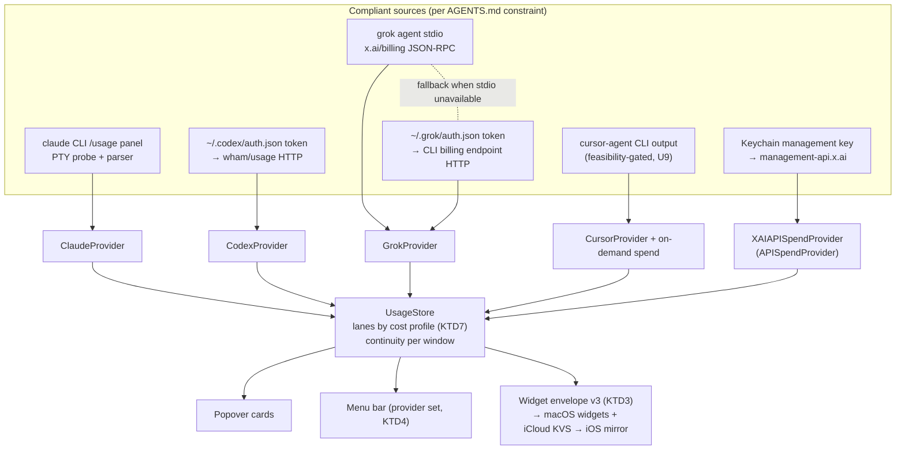
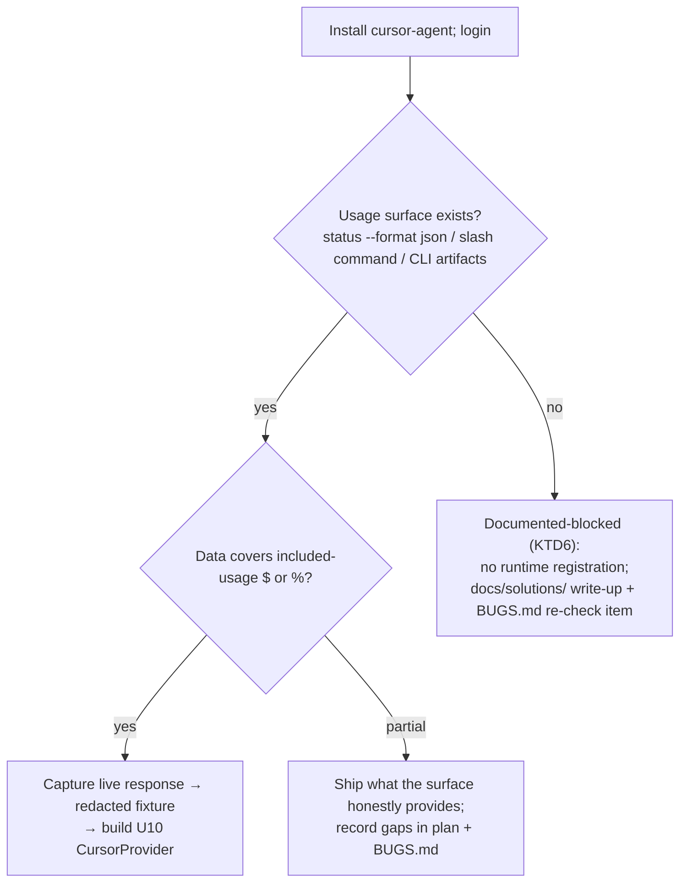

# Grok and Cursor Providers - Plan

## Goal Capsule

- **Objective:** Add Grok (xAI) and Cursor as Headroom usage providers with functional parity to the Claude/Codex model — compliant usage sources, typed failures, multi-account where the vendor CLI supports it, polling, popover cards, and widget/iOS-mirror data. Grok carries two surfaces: subscription pool usage and xAI API credit spend. Cursor is feasibility-gated on a verification spike.
- **Authority:** This plan's Requirements and KTDs govern scope. AGENTS.md's compliance constraint (official client makes the request; Headroom only reads its output or CLI-managed artifacts) overrides any implementation convenience. Repo conventions (AGENTS.md) override this plan on style and testing mechanics.
- **Stop conditions:** Stop and surface to the user if (a) the Cursor spike (U9) finds no compliant usage surface — take the documented-blocked branch, do not build a workaround; (b) both Grok billing transports fail live verification (U5); (c) any path would require session-token reuse, cookie scraping, or reading another app's private storage.
- **Execution profile:** Capture-first for both new parsers — no DTO or fixture is written before a live capture exists (U5/U9 precede U6/U10). Existing 2-provider installs must be behavior-identical by default (R9).
- **Tail ownership:** Executor owns build/test green and the Verification Contract gates. Release packaging, TestFlight, and the Phase-2 density design pass are out of scope.

---

## Product Contract

### Summary

Extend Headroom's provider abstraction from two providers to four. Phase 1 (this plan) is functionality: Grok subscription usage read through the official `grok` CLI's billing surface, xAI API credit spend read through the documented Management API, and Cursor plan usage read through the official `cursor-agent` CLI if — and only if — a verification spike proves a compliant surface exists. The multi-provider *design* pass (menu bar, widget, and popover density when 3–4 services are connected) is deliberately deferred to a follow-up phase.

### Problem Frame

Headroom shows remaining subscription headroom for Claude and Codex. Kyle also uses Grok and Cursor, and some users consume Grok via prepaid xAI API credits rather than a subscription. The provider abstraction was built for this (`ProviderID` is an open struct, annotated for a third provider), but the app has never actually absorbed one: dozens of `default:` arms and `[.claude, .codex]` literals fail silently rather than loudly, and several core surfaces (window kinds, menu bar sources, widget projection) structurally assume the Claude/Codex window shapes. Adding two providers is therefore two problems: building the providers, and making the app honestly provider-count-agnostic where it currently only pretends to be.

### Requirements

**Grok subscription**

- R1. Grok appears as a usage provider: a popover card with its credit-pool window (percent used, period reset time), typed setup/failure states, and freshness provenance, sourced only from the official `grok` CLI's billing surface or CLI-managed artifacts.
- R2. Grok sign-in is a Terminal handoff to official `grok login` via the account-scoped setup coordinator; Headroom never owns the browser callback, token refresh, or auth-file writes.
- R3. Grok supports up to 5 accounts with env-based isolation (`GROK_HOME`), verified the same way as Claude/Codex: a fresh config home must report not-logged-in, never fall back to the default login.
- R4. Grok's window reflects the vendor's actual shape — one percent-of-pool window with a genuine RFC-3339 period end as `resetsAt` — not a synthesized 5-hour/weekly pair. Unknown or missing rows are never invented.

**xAI API spend**

- R5. An xAI API spend row parallels the existing Anthropic/OpenAI rows: management key entered in Settings, stored in Keychain, spend/balance fetched from the documented `management-api.x.ai` endpoints, rendered in the popover API section and spend widgets. (session-settled: user-directed — added alongside subscription usage because some users consume Grok via API credits.)

**Cursor**

- R6. Cursor ships only through a compliant surface: the official `cursor-agent` CLI's output or CLI-managed artifacts. A verification spike decides feasibility before any provider code is written.
- R7. If feasible, Cursor shows its monthly included-usage meter (dollars consumed of included pool, billing-cycle reset) and, when present, an on-demand spend row against the user's hard limit.
- R8. The known non-compliant paths are prohibited and recorded as such: `WorkosCursorSessionToken` cookie reuse, reading the IDE's `state.vscdb` SQLite token, and calls to private `cursor.com/api/*` dashboard endpoints. Cursor's ToS bans scraping/extraction; this is the same class of constraint as the Claude OAuth ban.

**Cross-cutting**

- R9. Existing installs are unchanged by default on upgrade: new provider surfaces default OFF, the menu bar shows exactly what it showed before, and the 2-provider widget layout is preserved when only 2 providers are enabled.
- R10. New provider data reaches macOS widgets and the iOS mirror with correct per-window freshness provenance (`.live`/`.stale`/`.unavailable`). A not-yet-updated iPhone keeps rendering Claude/Codex live; new-provider rows may degrade to a labeled generic window there, but never take down the whole mirror or fail to decode.
- R11. All failures are typed `FailureReason`/`ProviderSetupOutcome` values with recovery copy; no interpolated errors, tokens, or PII anywhere, including generated Terminal scripts.
- R12. Every silent-failure switch site in the inventory (KTD9) is resolved — no new provider may render another provider's copy, read another provider's toggle, or vanish from a surface without a typed state.

### Scope Boundaries

**Deferred to Follow-Up Work (Phase 2 — multi-provider design pass)**

- Menu bar selection/density UX for 3–4 providers (which meters show, truncation, ~240pt width problem). Phase 1 makes the data path generic and keeps new providers out of the menu bar by default.
- Widget visual design for 3–4 providers: medium-widget column design, a considered `LargeWidgetDensity` tier system, compact spend-strip wrapping. Phase 1 ships functional-but-plain rendering.
- Popover density/hierarchy for 4 cards (the 640pt scroll cap already degrades gracefully).
- Setup-card quartet redesign (`ClaudeConnectCard`/`CodexConnectCard`/waiting/manual-command copies). Phase 1 generalizes only the switch sites new providers actually hit.
- Exponential backoff for failing providers (existing debt in BUGS.md, amplified at 4 providers — priced but not paid here).
- Per-provider polling intervals.

**Outside this product's identity**

- Minting tokens, owning OAuth callbacks, spoofing official clients, or reading other apps' private credential stores — for any provider, ever.
- Team/Enterprise admin surfaces (Cursor Admin API is Enterprise-only; xAI team management beyond what spend reading needs).

---

## Planning Contract

### Key Technical Decisions

- KTD1. **Grok transport: `grok agent stdio` JSON-RPC `x.ai/billing` primary, HTTP bearer fallback.** The stdio path has the official client make the request (strongest compliance posture, structured JSON, no PTY parsing). It is reportedly disabled in some CLI versions (`-32601`), so the fallback is HTTP GET to the CLI's own billing endpoint (`cli-chat-proxy.grok.com/v1/billing`) with the bearer from `~/.grok/auth.json` — the exact Codex precedent (CLI-managed token, no vendor prohibition found; xAI open-sourced the CLI and ships the billing method). U5's live capture locks the order; the provider keeps both behind one source protocol so a mid-life CLI change flips transports without a rewrite.
- KTD2. **New surfaces default OFF for existing users.** `Preferences.isSurfaceEnabled` currently defaults to `surface.isSubscription`, which would switch Grok ON for every install on update day. Replace with per-surface defaults: Claude/Codex subscription stay default-ON, every new surface defaults OFF. Enabling is one switch in Settings. (Governs R9.)
- KTD3. **New self-describing window kind in-app; additive wire representation for widgets — no schema bump.** Grok's pool and Cursor's included-usage are period windows, not 5-hour/weekly. Add one `WindowKind` case for a billing-period window (label + genuine `resetsAt`), classified from source fields per the `CodexWindowClassifier` learning — never from slot position or label sniffing. On the widget wire, do NOT add a `WidgetWindowKind` case: the enum uses synthesized Codable, so a new case is a hard decode break, and the iOS mirror's `.incompatibleSchema` state is whole-envelope — a v3 bump would blank Claude/Codex on every not-yet-updated iPhone, not just the new row. Instead encode the period window as `WidgetWindowKind.other(label)` (already v2-decodable) plus an additive optional period discriminator on the window summary read with `decodeIfPresent` — the same additive precedent the API-spend fields used. New consumers reconstruct the period kind; old phones render a labeled generic row and keep Claude/Codex live. Independently, harden the synced decode path as a robustness win: pre-decode a header-only struct that reads just the inner `snapshot.schemaVersion` and check `supports(schemaVersion:)` before decoding the full tree (today the full decode runs first — the version field lives on the inner envelope, so the check as previously conceived had nothing to read). `WidgetSnapshotProjector.widgetKind` stops dropping `.other` windows via the "weekly" label sniff, and `WidgetWindowKind.isSubscriptionWindow` treats period windows as subscription windows so they never land in the Spark-counter lane. (Governs R4, R10.)
- KTD4. **`MenuBarFillSource` becomes auto-or-provider-set; menu bar data path goes window-kind-generic; new providers excluded by default.** Today's `.none` is not "nothing" — it is the shipped default "auto" mode (one pill showing the tightest window across all providers), so the migration must preserve it: model the preference as `auto | providers(Set<ProviderID>)`, migrating `none`→auto, `claude`→{claude}, `codex`→{codex}, `both`→{claude, codex} (a plain `none`→{} migration would put "—" in every default install's menu bar — the exact R9 break this KTD exists to prevent). Render order always derives from `providerOrder.filter { set.contains($0) }`, never from `Set` iteration (per-process seeding would reorder pills between launches); persist as a sorted array. The single-selection Settings `Picker` cannot express a set — replace it with a checkmark menu / per-provider toggles plus an Auto item, and give `menuBarPreviewKey` a deterministic sorted join so the settle animation doesn't misfire. On the data path: `ResolvedMenuBarWindow.source` is typed to the closed weekly/5h `MenuBarWindowSource` and feeds two user-visible strings — carry the resolved `WindowKind`/label instead, keep `MenuBarWindowSource` as a preference-only type, hide the per-provider "Preferred window" row for providers with neither 5h nor weekly, and let `menuBarWindow(for:)` fall back to the provider's best available window so an enabled Grok never renders a permanent "—" or a false "data unavailable" hint. Which providers *should* occupy the menu bar at 4 services is Phase 2. (Governs R9.)
- KTD5. **`APISpendSnapshot` gains an explicit semantic kind: period-spend vs balance.** xAI prepaid credits are a remaining balance; the existing model is a period cost, and rendering a balance through `periodLabel` would read as inverted spend. A small typed kind lets presentation label and direction correctly ("$42.10 remaining" vs "$12.30 · July"), and Cursor on-demand spend uses the existing period-spend kind unchanged. `addCreditsURL` gains an xAI case (console.x.ai). Constraint to record: `apiSpendSnapshots` is keyed `[ProviderID: APISpendSnapshot]` — one spend row per provider by construction — and `apiSpendDisplayNames` is built with trapping `Dictionary(uniqueKeysWithValues:)` one line below a deliberately non-trapping sibling; U1 makes it non-trapping, and U10 must not design a second Cursor spend row into that cap. (Governs R5, R7.)
- KTD6. **Cursor is feasibility-gated; the blocked branch registers nothing.** If U9 finds no compliant usage surface, Cursor does not become a runtime provider: no card, no Settings row, no permanent menu-bar warning the user can't clear. The findings land in `docs/solutions/` and a BUGS.md follow-up (re-check when `cursor-agent` gains a usage surface). Building a visible "unsupported by design" state needs new `FailureReason`/recovery-action plumbing that isn't worth paying for a provider that may become feasible next CLI release. (Governs R6, R8.)
- KTD7. **Polling lane assignment moves from `id == .claude` to a lane identity declared on `UsageProvider`, fixed at composition time.** The declaration is `concurrent | serial(laneID)` with a protocol-extension default of concurrent (existing providers, mocks, and tests compile untouched — same pattern as the defaulted `accountID`). Each serial lane is keyed (`claude-cli`, `grok-cli`, …) so five Grok accounts serialize with each other but never queue behind a 20–30s Claude session — a two-valued serial/concurrent flag would put them in one bucket. The lane is NOT mutable at runtime: providers are immutable Sendable structs, and the current two-read lane partition means a mid-cycle flip can drop a provider from both lanes, starving the refresh iterator and killing polling until relaunch. Transport availability is resolved once at composition (`AppComposition`); when Grok's stdio transport is even possible, declare the worst-case serial lane — being wrong serializes a few HTTP calls, whereas the reverse error is a concurrent PTY process storm. While here, `refreshSubscriptions` partitions once from a single read and derives its expected-yield count from the partition, removing the silently-dropped-provider hazard class.
- KTD8. **Multi-account: Grok full parity via `GROK_HOME`; xAI spend and Cursor single-account.** Grok's CLI supports an env config-home exactly like `CODEX_HOME`, so Grok slots into the existing account registry (max 5) with isolation verified per R3. Spend providers are single-account by existing construction (Keychain key per `APIKeyProvider`). Cursor ships single-account (built-in `.primary`) unless U9 proves an env-home isolation mechanism; the registry handles single-account providers gracefully today.
- KTD9. **The silent-failure switch-site inventory is a tracked deliverable, not a side effect.** `ProviderID` is an open struct — adding a provider produces zero compile errors, so every miss ships silently. The inventory (Appendix A) enumerates every known site with severity; U1/U2 burn it down and U12's tests pin the generic behavior. Newly found sites get added to the inventory, not fixed ad hoc.
- KTD10. **`UsageSurface` stays a closed enum, grown to eight cases — not derived from `ProviderID` + kind.** Its exhaustive switches are the only compile-enforced provider check in the stack (`ProviderID` is deliberately open), so the enum is the mechanism KTD9 depends on, not a cost it pays. The existing rawValues are frozen wire identifiers that a derived pair cannot reproduce (`anthropicAPI` maps to `.claude`, `openAIAPI` to `.codex` — a `"\(raw).api"` scheme silently resets every install's stored toggles), and `CaseIterable` is load-bearing for both `UsageStore.init` and Settings' disabled-surface rendering. New case names follow the brand-of-the-thing convention and freeze once shipped; a frozen-rawValue test pins the full set (additions allowed, edits never). KTD2's per-surface default lives on the enum as one more exhaustive switch, not inside `Preferences`. The Cursor cases are added unconditionally even though KTD6's blocked branch registers no provider — they default OFF and post-U2 Settings rows are registry-driven, so an unregistered Cursor renders no row; the two decisions do not conflict.

### High-Level Technical Design

Provider/transport topology after this plan:

Cursor feasibility gate (U9):

### Sequencing

Stage A (U1–U4) makes the app provider-count-agnostic and is provider-independent — it can land before any new provider exists and must not change visible behavior for 2-provider installs. Stage B (U5–U8) is Grok; U5's capture gates U6. Stage C (U9–U10) is Cursor; U9 gates U10 entirely. Stage D (U11–U12) closes identity, fixtures, and the test inventory. U5 and U9 need Kyle at the keyboard once each (CLI install + login) — schedule them early so captures exist when the DTO work starts.

---

## Implementation Units

> **Phase-one merge checkpoint — 2026-08-01:** U1–U7 are implemented. U8 is implemented
> and covered by automated tests; its real-management-key acceptance remains open. U9
> selected the feasible branch after a live authenticated Cursor Agent capture. U10's
> provider, official `/usage` PTY probe, monthly meter, typed setup flow, single-account
> cap, and on-demand parser are implemented and exercised against the live CLI. The
> intentionally deferred tail is: U10's hard-limit presentation and remaining app-integration coverage, U11 brand
> identity/copy, U12 fixtures/parity/switch sweep, xAI real-key acceptance, and final
> four-provider visual QA. New provider surfaces remain disabled by default, so this
> checkpoint preserves existing-install behavior while the tail continues separately.

> **Grok verification — 2026-08-01:** U5 is complete against authenticated Grok Build
> `0.2.118`. Its `grok agent stdio` server returns JSON-RPC `-32601` for `x.ai/billing`,
> so KTD1 resolves to ACP-first with the CLI billing HTTP fallback for this release.
> The fallback returned a typed weekly period from `2026-07-28T10:27:26.251601+00:00`
> through `2026-08-04T10:27:26.251601+00:00`; proto3 omitted the zero-valued
> `creditUsagePercent`, while typed period metadata and zero-valued cent objects made
> the result a known 0% used rather than malformed data. Production browser login uses
> an ephemeral loopback port and device auth uses no callback listener, so Grok login
> sessions do not need Codex's fixed-port exclusion slot. A fresh `GROK_HOME` reported
> unauthenticated without falling back to the built-in account. The permanent
> `--probe-grok` command reported the same weekly window via `http`; the redacted
> capture is `Tests/HeadroomCoreTests/Fixtures/grok-billing.json`. U6–U7 are implemented
> and covered by focused provider, routing, handoff, setup, storage, and polling-lane
> tests. The source model requires a genuine period end; if it is absent, Headroom
> fails safe to a transient stale snapshot because `UsageWindow.resetsAt` is
> intentionally non-optional and inventing a reset would violate R4.

> **Cursor verification — 2026-08-01:** U9 is complete against authenticated Cursor
> Agent `2026.07.23-e383d2b` on a Pro+ account. `status --format json` supplies only
> authentication state and `about --format json` supplies the plan tier; neither exposes
> usage. The official interactive `/usage` panel exposes the monthly included percentage,
> a month/day reset label, and on-demand state/spend without sending a model request, so
> KTD6 resolves to branch A. `--probe-cursor` captured and parsed the live panel. The
> redacted fixture is `Tests/HeadroomCoreTests/Fixtures/cursor-usage.txt`; the durable
> feasibility record is `docs/solutions/cursor-agent-usage-feasibility.md`. The panel
> omits reset-time precision, so Headroom preserves its label verbatim and conservatively
> expires continuity at the end of the displayed UTC day.
>
> **Merge blocker after review hardening — RESOLVED 2026-08-01:** the prompt allowlist
> requires the normal `Ask (shift+tab to cycle)` input surface and an actively selected
> `→ /usage` autocomplete row before sending a single Enter. Env-gated marker diagnostics
> on the production `--probe-cursor` run isolated the miss: **boot classification passed**;
> the failure was the autocomplete gate. The live TUI renders the selected row as
> `→  /usage` (arrow + several spaces), while `isUsageAutocompleteSelected` required the
> exact single-space literal `"→ /usage"`, so it fell through to `.unknownUI`. Fixed by
> matching `/→\s+\/usage(?:\s|$)/` — still requires the arrow-selected `/usage` row as a
> whole token (so a renamed/absent command or `/usages` can never authorize the Enter),
> only tolerant of whitespace count; the allowlist is not weakened. The temporary
> diagnostics were removed. Shipping-path `swift run Headroom --probe-cursor` now returns
> a live parsed snapshot (Pro+, Monthly 0% used, resets Sep 1, on-demand disabled);
> `swift test` (395) and `HeadroomAppTests` (8) green. PR #90 is unblocked.

| U-ID | Title | Key files | Depends on |
|---|---|---|---|
| U1 | Core surface mapping + registry plumbing | `Sources/HeadroomCore/Models/UsageModels.swift`, `Engine/UsageStore.swift`, `Settings/Preferences.swift` | — |
| U2 | App-layer registry, Settings iteration, menu bar set migration | `Sources/HeadroomApp/HeadroomApp.swift`, `UI/SettingsView.swift`, `UI/AccountsSettingsTile.swift` | U1 |
| U3 | Billing-period window kind + continuity | `Sources/HeadroomCore/Models/UsageModels.swift`, `Engine/UsageContinuityCache.swift`, `Widgets/WidgetSnapshotProjector.swift` | — |
| U4 | Widget wire compatibility + N-provider functional rendering | `Sources/HeadroomCore/Widgets/*`, `Sources/HeadroomWidgets/Views/*`, `Sources/HeadroomIOSWidgets/*` | U3 |
| U5 | Grok verification spike + `--probe-grok` | `Sources/HeadroomApp/HeadroomApp.swift` (probe entry), new probe support | — (needs user login) |
| U6 | GrokProvider: source, DTO, parser, setup outcomes | `Sources/HeadroomCore/Providers/Grok*` (new), `Models/ProviderSetup.swift` | U1, U3, U5 |
| U7 | Grok accounts, sign-in handoff, polling lane | `Providers/ProviderAccountConfiguration.swift`, `Providers/AccountStorage.swift`, `Engine/SetupSessionCoordinator.swift`, `Engine/UsageStore.swift`, `HeadroomApp/UI/SetupSessions.swift` | U2, U6 |
| U8 | xAI API spend provider + spend-kind model change | `Providers/APISpendProviders.swift`, `Models/UsageModels.swift`, `Credentials/CredentialModels.swift`, `Widgets/APISpendPresentation.swift` | U1, U2 |
| U9 | Cursor feasibility spike + `--probe-cursor` | probe entry + `docs/solutions/` write-up | — (needs user login) |
| U10 | CursorProvider (branch A of U9 only) | `Sources/HeadroomCore/Providers/Cursor*` (new) | U1, U3, U8, U9 |
| U11 | Brand identity + copy sweep | `UI/ProviderStyle.swift`, `Models/BrandColorValues.swift`, `HeadroomWidgetSharedUI`, `HeadroomIOS/DesignSystem/ProviderLogoView.swift`, brand assets | U6 (U10 if built) |
| U12 | Demo fixtures, parity tests, switch-site regression sweep | `DemoFixture.swift`, `Widgets/DemoScreenshotData.swift`, `HeadroomIOS/DesignSystem/CompanionPreviewSeed.swift`, test files | U6–U11 |

### U1. Core surface mapping + registry plumbing

- **Goal:** HeadroomCore stops assuming two providers: surfaces, ordering, and eligibility all derive from real mappings instead of Claude-or-Codex ternaries.
- **Requirements:** R9, R12 (KTD2, KTD9).
- **Files:** `Sources/HeadroomCore/Models/UsageModels.swift`, `Sources/HeadroomCore/Engine/UsageStore.swift`, `Sources/HeadroomCore/Settings/Preferences.swift`, `Tests/HeadroomCoreTests/UsageStoreTests.swift`, `Tests/HeadroomCoreTests/PreferencesTests.swift`.
- **Approach:**
  1. Add `UsageSurface` cases for the new providers (`grokSubscription`, `xaiAPI`, `cursorSubscription`, `cursorAPI`) — the three exhaustive switches break the build and get real arms.
  2. Replace `UsageStore.subscriptionSurface(for:)`/`apiSurface(for:)` ternaries with total mappings (unknown provider → nil, provider excluded — never mapped to another provider's surface).
  3. Per-surface defaults live on `UsageSurface` (`isEnabledByDefault`, one more exhaustive switch per KTD10); `Preferences.isSurfaceEnabled` reads it instead of `isSubscription` (KTD2).
  4. `menuBarMeters`' `[.claude, .codex]` literal becomes `providerOrder`-driven.
  5. `shouldSkipOnTimer`/`isNeverSignedIn` stops hardcoding two outcome cases — drive it from a property on `ProviderSetupOutcome` (e.g., never-signed-in classification) so new providers' equivalents back off identically.
  6. `apiSpendDisplayNames` switches from trapping `Dictionary(uniqueKeysWithValues:)` to the non-trapping `uniquingKeysWith:` its sibling one line up already uses (KTD5 cap).
- **Patterns to follow:** typed `FailureReason` discipline; existing `Preferences` per-provider key namespacing by `ProviderID.raw`.
- **Test scenarios:**
  - Fresh defaults: Claude/Codex subscription surfaces enabled, Grok/Cursor/xAI surfaces disabled with no stored keys.
  - Upgrade simulation: defaults suite with only legacy Claude/Codex keys stored → new surfaces read disabled; stored explicit values still win.
  - Frozen rawValues: assert the exact `UsageSurface.allCases.map(\.rawValue)` set (additions allowed, edits never — rawValues are persisted key suffixes per KTD10).
  - `subscriptionSurface(for: ProviderID("grok"))` returns the Grok surface; an unknown provider ID maps to nil and is excluded from `providerOrder` rather than inheriting Codex's toggle.
  - A never-signed-in Grok extra account is probe-skipped on the same 4th-cycle cadence as Claude/Codex.
- **Verification:** `swift test`; existing 2-provider `UsageStoreTests` pass unmodified except where they pinned the ternary behavior.

### U2. App-layer registry, Settings iteration, menu bar set migration

- **Goal:** Provider composition, Settings rows, and the menu bar preference iterate over a provider registry instead of enumerating Claude and Codex.
- **Requirements:** R9, R12 (KTD4, KTD9).
- **Files:** `Sources/HeadroomApp/HeadroomApp.swift`, `Sources/HeadroomApp/UI/SettingsView.swift`, `Sources/HeadroomApp/UI/AccountsSettingsTile.swift`, `Sources/HeadroomCore/Models/UsageModels.swift` (`MenuBarFillSource`), `Sources/HeadroomCore/Settings/Preferences.swift`, `Tests/HeadroomCoreTests/PreferencesTests.swift`, `Tests/HeadroomAppTests/AccountsSettingsInteractionTests.swift`.
- **Approach:**
  1. One provider registry (ordered `[ProviderID]` plus per-provider factory) in `AppComposition`; `HeadroomApp.provider(for:)`'s `default: UnavailableAccountProvider` arm remains only for genuinely unknown IDs.
  2. `AccountsSettingsTile.providerIDs` and its duplicate `subscriptionSurface` ternary route through U1's mappings.
  3. `SettingsView`: named `@State` pairs (`claudeMenuBarWindowSource`/`codexMenuBarWindowSource`, API-key fields) become provider-keyed dictionaries; window rows, surface rows, and API rows render by iteration; the hidden width-reservation label list covers every provider.
  4. `MenuBarFillSource` → auto-or-provider-set per KTD4: rawValue migration (`none`→auto, `both`→{claude, codex}), sorted-array persistence, render order via `providerOrder.filter`, the Picker replaced with a checkmark menu/toggles + Auto item, `menuBarPreviewKey` given a deterministic sorted join, and the "Both shows Claude and Codex side by side." help copy rewritten.
  5. `ResolvedMenuBarWindow` carries the resolved `WindowKind`/label (KTD4); `MenuBarWindowSource` stays preference-only; the per-provider "Preferred window" row hides for providers with neither 5h nor weekly windows; `menuBarWindow(for:)` falls back to best-available window.
- **Patterns to follow:** `Preferences` rawValue persistence contract; existing `menuBarWindowRow`/`surfaceSwitchRow` helpers (already parameterized — only call sites change).
- **Test scenarios:**
  - Migration: stored `"none"` → auto (menu bar still shows the tightest-window pill, NOT "—" — this is the shipped default and the R9 regression guard); stored `"both"` → {claude, codex}; stored `"claude"` → {claude}; missing key → auto.
  - Round-trip: a 3-provider set persists sorted and reloads; removing a provider from the registry drops it from the set on read without crashing; pill order matches `providerOrder` across relaunches.
  - Menu bar summary with Grok enabled and a billing-period-only snapshot shows a percentage with the period label, not "—", and Settings shows no false "data unavailable" hint for it.
  - Accounts tile shows a Grok section gated on the *Grok* surface toggle (regression against the wrong-toggle bug).
- **Verification:** `swift test` + `xcodebuild -scheme HeadroomAppTests test`; manual: Settings renders identically for a 2-provider install (screenshot diff against `main`).

### U3. Billing-period window kind + continuity

- **Goal:** A period/pool window is a first-class `WindowKind` with correct continuity lifetimes and widget projection — no label sniffing, no synthesized windows.
- **Requirements:** R4, R10 (KTD3).
- **Files:** `Sources/HeadroomCore/Models/UsageModels.swift`, `Sources/HeadroomCore/Engine/UsageContinuityCache.swift`, `Sources/HeadroomCore/Widgets/WidgetSnapshotProjector.swift`, `Tests/HeadroomCoreTests/UsageStoreTests.swift`, `Tests/HeadroomCoreTests/WidgetSnapshotProjectorTests.swift` (or nearest existing projector coverage).
- **Approach:**
  1. Add a billing-period `WindowKind` case carrying a display label; classification comes from source fields (period type/duration), falling back to `.other` — mirror `CodexWindowClassifier`.
  2. `UsageContinuityPolicy.fallbackLifetime` gets a case for period windows scaled to the period (a monthly pool must not tombstone after 24h).
  3. `continuityExpiryDate`'s near-zero-delta sentinel rescue stays Claude-only; new-provider windows must carry genuine `resetsAt` (enforced by U6/U10 tests), and a period window with `resetsAt` in the past transitions `.stale` → `.unavailable` on the existing policy path.
  4. `WidgetSnapshotProjector.widgetKind` maps the new kind explicitly and stops depending on labels containing "weekly"; the Claude-Fable `extraWeeklyWindows` lane is unaffected; `isSubscriptionWindow` includes the period kind (KTD3) so it never lands in the Spark-counter lane.
  5. `UsageStore.weeklyFirst`'s `rank(_:)` switch gains the period arm with a decided popover position: period windows rank with weekly (primary meter first), ahead of 5-hour and `.other`.
- **Patterns to follow:** `docs/solutions/codex-window-kind-mislabel.md` (self-describing classification, honest `.other`); `docs/solutions/logic-errors/claude-partial-usage-window-freshness.md` (per-window lifecycle; never advance observation timestamps).
- **Test scenarios:**
  - Classification: weekly-period source field → period kind with weekly label; monthly → monthly label; unknown duration → `.other`, never force-fit.
  - Continuity lifecycle for a monthly window: live capture → provider failure → retained `.stale` with original observation time at day 2 (not tombstoned at 24h) → `.unavailable` after period end → removed after bounded fallback lifetime → fresh capture returns `.live`.
  - Projection: a billing-period window survives to `WidgetProviderSummary` for a non-Codex provider; an `.other` window without "weekly" in its label no longer vanishes.
  - Relaunch restore: cached period window with genuine future `resetsAt` restores without immediate expiry.
- **Verification:** `swift test` — the continuity suite spans the full lifecycle per the freshness learning.

### U4. Widget wire compatibility + N-provider functional rendering

- **Goal:** Period windows cross the widget wire additively (no schema bump, old iPhones keep Claude/Codex live), and every widget family renders 1–4 providers functionally (plain is fine; pretty is Phase 2).
- **Requirements:** R9, R10 (KTD3).
- **Files:** `Sources/HeadroomCore/Widgets/WidgetSnapshotModels.swift`, `Sources/HeadroomCore/Sync/SyncedWidgetSnapshotModels.swift`, `Sources/HeadroomCore/Sync/IOSWidgetTimelineMapping.swift`, `Sources/HeadroomCore/Widgets/LargeWidgetDensity.swift`, `Sources/HeadroomWidgets/Views/HeadroomMediumWidgetView.swift`, `Sources/HeadroomWidgets/Views/WidgetProviderWeeklyLine.swift`, `Sources/HeadroomWidgetSharedUI/HeadroomWidgetSharedUI.swift`, `Sources/HeadroomIOSWidgets/HeadroomIOSWidgets.swift` (`HeadroomIOSWidgetView`), `Tests/HeadroomCoreTests/SyncedWidgetSnapshotModelsTests.swift`, `Tests/HeadroomCoreTests/LargeWidgetDensityTests.swift`.
- **Approach:**
  1. Wire representation per KTD3: period windows encode as `WidgetWindowKind.other(label)` plus an additive optional discriminator (`decodeIfPresent`); `schemaVersion` stays 2. New readers reconstruct the period kind; v2 readers see a labeled generic window.
  2. Robustness (independent of the wire choice): `SyncedWidgetSnapshotCodec.decode` pre-decodes a header-only struct for the inner `snapshot.schemaVersion` and checks `supports(schemaVersion:)` before full-tree decode. Note in code that the local macOS `WidgetSnapshotCache` path has no `supports` gate — the two read paths have different contracts by design.
  3. Rendering surfaces that key on `weeklyWindow`/`kind == .weekly` learn the period kind or they render Grok as a permanent "—": `WidgetProviderWeeklyLine` (macOS small), `HeadroomIOSWidgetView`'s per-provider line, and `WidgetSnapshotEnvelope.weeklyProviders`' filter.
  4. `HeadroomMediumWidgetView`'s `providers.count == 2` guard becomes count-driven layout rules (borrow the per-index rules iOS medium already uses); 2-provider rendering stays pixel-identical; `MediumProviderColumn` renders whatever windows the provider actually has instead of hardcoding `window(.weekly)`/`window(.fiveHour)`.
  5. `LargeWidgetDensity` gains one more tier or an explicit truncation rule for >7 rows, pinned by tests.
- **Patterns to follow:** additive-decode precedent (`decodeIfPresent … ?? []` — the API-spend fields); the schema-bump rule from the freshness learning (bump only when older consumers could *misread* — a labeled generic window is honest degradation, not misreading).
- **Test scenarios:**
  - Wire skew: an envelope carrying a period window decodes under a simulated v2 reader (discriminator ignored) as `.other(label)` — no decode failure; new reader reconstructs the period kind; freshness provenance preserved both ways.
  - Header pre-decode: a malformed-inner-payload envelope with an unsupported version produces the unsupported state, not a decode error.
  - Rendering: a period-only provider shows label + percent (not "—") in small, medium, and iOS lines; 2 providers → current layout (assertions unchanged); 3 and 4 providers → all render, no divider crash.
  - Density: 4 providers × 2 windows + 3 spend rows resolves to a defined tier/truncation, pinned.
  - iOS mirror end-to-end: projector → synced envelope → iOS timeline mapping preserves the period window and its freshness.
- **Verification:** `swift test`; headless widget render (memory recipe: swiftc-compile widget views + ImageRenderer) to eyeball 3- and 4-provider medium/large tiles.

### U5. Grok verification spike + `--probe-grok`

- **Goal:** Every load-bearing external claim about Grok is verified against the live CLI before DTO work; a permanent diagnostic exists like `--probe-claude`.
- **Requirements:** R1, R4 (KTD1). Gates U6.
- **Files:** `Sources/HeadroomApp/HeadroomApp.swift` (probe dispatch at the entry point, alongside `--probe-claude`), new `Sources/HeadroomCore/Providers/GrokProbe` support as needed, `Tests/HeadroomCoreTests/Fixtures/grok-billing.json` (redacted capture).
- **Approach:**
  1. Kyle installs the official CLI and runs `grok login` (user action — schedule first).
  2. Probe, in order: `grok agent stdio` → `x.ai/billing` (works? `-32601`?); the CLI's HTTP billing endpoint with the auth.json bearer; record which fields arrive (`creditUsagePercent`, `currentPeriod{type,start,end}`, `subscriptionTier`, deprecated cent fields).
  3. Verify: period bounds are genuine RFC-3339 (not zero-delta); period type per tier (weekly/monthly); whether `grok login` binds a fixed callback port (concurrent-login implications for U7); fresh `GROK_HOME` reports not-logged-in with no fallback to the default account.
  4. `--probe-grok` prints parsed windows + transport used, redacting all identity/token material; save a redacted capture as the U6 fixture.
- **Test scenarios:** Test expectation: none — diagnostic/verification unit; its output is the fixture and a decision record updating KTD1/KTD7/KTD8 arms in this plan.
- **Verification:** `swift run Headroom --probe-grok` prints live windows; fixture file exists and is traceable to the capture date; the four verification questions above have recorded answers.

### U6. GrokProvider: source, DTO, parser, setup outcomes

- **Goal:** A `GrokProvider` with the Codex construction template (injected source/HTTP/now seams) returning honest snapshots from the verified transport.
- **Requirements:** R1, R4, R11 (KTD1, KTD3).
- **Files:** new `Sources/HeadroomCore/Providers/GrokProvider.swift`, `GrokUsageSource.swift` (protocol + stdio + HTTP implementations), `GrokDTOs.swift`; `Sources/HeadroomCore/Models/ProviderSetup.swift` (new outcome cases + recovery copy); `Tests/HeadroomCoreTests/GrokProviderTests.swift`, `Tests/HeadroomCoreTests/Mocks.swift` (MockGrokSource).
- **Approach:**
  1. Source protocol seam (like `ClaudeUsageSource`) with two conforming transports per KTD1; provider is transport-agnostic.
  2. DTO decodes preferred fields first (`creditUsagePercent` + `currentPeriod`), deprecated cent-based fields as fallback; both paths produce one billing-period window with genuine `resetsAt` = period end; `subscriptionTier` becomes card subtitle material.
  3. Never throw — map to `.stale(for:)`: CLI missing → install outcome; not logged in → login outcome; stdio method absent → transparent transport fallback, not a user-facing failure; malformed/empty → transient stale (fail safe, source-volatility learning).
  4. `ProviderSetupOutcome` additions carry recovery copy and correct `isPermanent`; the never-signed-in classification from U1 covers the Grok login-required case.
- **Patterns to follow:** `CodexProvider` ladder (status → decode → outcome); `FlexibleAmountDTO` tolerance posture; ICU `\x1B` rule is inapplicable (no ANSI) but no-PII redaction discipline applies to logs and errors.
- **Test scenarios:**
  - Fixture decode (live-capture fixture): one period window, correct percent, `resetsAt` == period end, tier string surfaced.
  - Deprecated-fields-only fixture (preferred fields absent) → same window from cent math; both present → preferred wins.
  - Missing `currentPeriod` end → no invented `resetsAt`; window ships without reset label rather than a sentinel date (continuity rescue is Claude-only).
  - stdio returns `-32601` → HTTP fallback engages within the same fetch; both transports down → transient stale, prior snapshot retained with original observation times.
  - Not-logged-in and CLI-missing map to their typed outcomes with recovery presentation; no raw error text in any snapshot.
  - Exhausted pool (100% used) renders 0% remaining, not an error.
- **Verification:** `swift test`; `swift run Headroom --probe-grok` against the live account matches the card in a debug run.

### U7. Grok accounts, sign-in handoff, polling lane

- **Goal:** Grok participates in multi-account (registry, isolated config homes, Terminal sign-in) and polls on the right lane.
- **Requirements:** R2, R3 (KTD7, KTD8).
- **Files:** `Sources/HeadroomCore/Providers/ProviderAccountConfiguration.swift`, `Sources/HeadroomCore/Providers/AccountStorage.swift`, `Sources/HeadroomCore/Engine/SetupSessionCoordinator.swift`, `Sources/HeadroomCore/Engine/UsageStore.swift` (lanes), `Sources/HeadroomApp/UI/SetupSessions.swift`, `Tests/HeadroomCoreTests/ProductionProviderConfigurationTests.swift`, `Tests/HeadroomCoreTests/UsageStoreTests.swift`.
- **Approach:**
  1. `ProviderAccountConfiguration` gains the Grok config-home field (`GROK_HOME`); `AccountStorage.ensureDirectories` creates Grok subdirs; extra accounts get Headroom-owned homes under Application Support like Codex.
  2. `SetupSessions.prepareHandoff` gains the Grok arm (`grok login` with `GROK_HOME` exported); `failureMessage` and `copyManualCommand` generalize off the Claude/Codex ternary/default so Grok gets its own copy and a working manual-command fallback; no auth contents or errors in generated scripts (R11).
  3. Generalize `SetupSessionCoordinator`'s single-login slot (`activeCodexLogin`/`blockedByCodexLogin`) to a per-provider slot — assume `grok login` binds a fixed port unless U5 proved otherwise.
  4. `refreshSubscriptions` lanes key off the source cost profile per KTD7: Grok-stdio accounts run serially in a Grok lane; HTTP fallback runs concurrent.
- **Patterns to follow:** Codex account plumbing end-to-end; the AGENTS.md per-account isolation gotcha (env override is load-bearing — never dropped).
- **Test scenarios:**
  - Configuration: extra Grok account's environment carries its own `GROK_HOME`; primary account carries none (reads `~/.grok`).
  - Two Grok accounts + one Claude account: Grok probes run serially with each other, concurrently with Claude's lane (extend the existing lane-overlap test shape).
  - Concurrent `grok login` for two accounts: second is blocked/queued by the per-provider slot.
  - Handoff script for Grok never contains token or auth-file content (string assertion, mirroring Codex's).
  - Account removal deletes the Grok config home.
- **Verification:** `swift test`; manual acceptance (required, from R3): fresh `GROK_HOME` probe reports not-logged-in — run once against the real CLI and record in the PR.

### U8. xAI API spend provider + spend-kind model change

- **Goal:** An xAI spend/balance row with the management key entered in Settings, rendered correctly as balance or period spend everywhere spend renders today.
- **Requirements:** R5, R11 (KTD5).
- **Files:** `Sources/HeadroomCore/Providers/APISpendProviders.swift` (new provider alongside the two existing), `Sources/HeadroomCore/Models/UsageModels.swift` (`APISpendSnapshot` kind), `Sources/HeadroomCore/Credentials/CredentialModels.swift` (`APIKeyProvider` case), `Sources/HeadroomCore/Widgets/APISpendPresentation.swift`, `Sources/HeadroomApp/UI/SettingsView.swift` (row via U2 iteration), `Tests/HeadroomCoreTests/APISpendProviderTests.swift` (extend existing spend tests).
- **Approach:**
  1. `APIKeyProvider` gains the xAI management-key case (Keychain service string, display name "xAI API"); `SettingsView.clearField` exhaustive switch follows.
  2. Provider: `id = ProviderID.grok` (spend reuses the subscription ProviderID, per Anthropic/OpenAI precedent), GET-only endpoints — prepaid balance and invoice preview; team_id discovered via the management API's team listing on first fetch and cached in-memory (a wrong/multi-team account maps to a typed scope outcome, not a guess).
  3. `APISpendSnapshot` kind per KTD5; presentation renders balance ("remaining") vs period spend distinctly in popover and widget strips; `addCreditsURL` → console.x.ai.
  4. Status ladder mirrors existing spend providers: 401 → `.needsReauth`, 403 → `.scopeDenied`, else generic failure.
- **Patterns to follow:** `AnthropicAPISpendProvider` (near-identical shape); `FlexibleAmountDTO`/`CostAccumulator` for tolerant amount parsing; GET-only `UsageFetching` (do not extend to POST — the usage time-series endpoint is out of scope).
- **Test scenarios:**
  - Prepaid fixture → balance-kind snapshot, correct amount/currency; rendered label reads as remaining, not period spend.
  - Postpaid/invoice-preview fixture → period-spend snapshot with period label.
  - Team discovery: single team → cached id reused on next fetch; zero teams or list failure → typed failure, no retry storm within a cycle.
  - 401/403 map to `.needsReauth`/`.scopeDenied`; mixed-currency data → nil total (CostAccumulator contract).
  - Existing Anthropic/OpenAI rows render byte-identical (kind defaults to period-spend).
- **Verification:** `swift test`; manual: real management key end-to-end in Settings → popover row appears; scope-name assumptions from research validated against the real console key (recorded in PR).

### U9. Cursor feasibility spike + `--probe-cursor`

- **Goal:** A recorded, evidence-based go/no-go on Cursor per KTD6 — resolved by probing the official CLI, not by research alone.
- **Requirements:** R6, R8. Gates U10.
- **Files:** probe entry alongside `--probe-grok`; `docs/solutions/cursor-usage-feasibility.md` (findings, either branch); `BUGS.md` (re-check follow-up on the blocked branch).
- **Approach:**
  1. Kyle installs `cursor-agent` and logs in (user action).
  2. Probe every official surface: `cursor-agent status`/`whoami --format json`, `/usage` and `/about` slash commands (conflicting sources — this is the deciding fact), any usage fields in `~/.cursor/cli-config.json` or other CLI-managed artifacts. The prohibited paths (R8) are not probed.
  3. Branch A (usage surface exists): capture live output → redacted fixture; record data shape (included $ consumed/total, on-demand spend, cycle reset date) and whether an env-home isolation mechanism exists (KTD8 arm).
  4. Branch B (no surface): write the solutions doc with evidence, add the BUGS.md re-check item, U10 does not execute, and the plan's Definition of Done adjusts per that branch.
- **Test scenarios:** Test expectation: none — diagnostic/verification unit producing a fixture (branch A) or a decision record (branch B).
- **Verification:** Probe output recorded; one branch explicitly chosen with evidence; on branch B, `docs/solutions/` + `BUGS.md` entries exist.

### U10. CursorProvider (branch A only)

- **Goal:** Cursor card with the monthly included-usage meter and, when present, an on-demand spend row — from the CLI surface U9 verified.
- **Requirements:** R7, R11 (KTD3, KTD5, KTD6).
- **Files:** new `Sources/HeadroomCore/Providers/CursorProvider.swift` + source/DTO files shaped by U9's findings; `Tests/HeadroomCoreTests/CursorProviderTests.swift`; `Tests/HeadroomCoreTests/Fixtures/cursor-usage.json` (redacted capture).
- **Approach:**
  1. Source protocol seam like Grok's; transport is whatever U9 verified (headless CLI invocation with JSON output expected; a PTY panel parse is the fallback shape if that's what exists — reuse the Claude probe's robustness patterns if so, including its serial-lane cost profile per KTD7).
  2. Included usage → one billing-period window (percent of included $, `resetsAt` = cycle end); on-demand spend → `APISpendSnapshot` period-spend kind with `id = ProviderID.cursor`.
  3. Single-account unless U9 proved env-home isolation (KTD8); never-throw discipline and typed outcomes as in U6.
- **Patterns to follow:** U6's provider shape; capture-first fixture rule; `CodexWindowClassifier`-style classification of whatever period fields the CLI provides.
- **Test scenarios:**
  - Fixture decode → period window with correct percent and cycle-end `resetsAt`; on-demand row present only when the account has on-demand enabled.
  - Included pool exhausted → 0% remaining + on-demand row still renders.
  - CLI missing / logged out / malformed output → typed outcomes, prior snapshot retained.
  - Hard-limit reached state (if the surface expresses it) → shown verbatim, not synthesized.
- **Verification:** `swift test`; `--probe-cursor` matches the card in a debug run.

### U11. Brand identity + copy sweep

- **Goal:** Grok (and Cursor, if built) stop rendering as grey dashed circles, and no user-visible string claims the app is Claude+Codex-only.
- **Requirements:** R12.
- **Files:** `Sources/HeadroomApp/UI/ProviderStyle.swift`, `Sources/HeadroomCore/Models/BrandColorValues.swift`, `Sources/HeadroomWidgetSharedUI/HeadroomWidgetSharedUI.swift`, `Sources/HeadroomIOS/DesignSystem/ProviderLogoView.swift`, `Sources/HeadroomSharedResources/BrandIcons.xcassets/`, `Sources/HeadroomApp/Resources/BrandIcons/`, widget description strings in `Sources/HeadroomWidgets/HeadroomWidgets.swift` + `Sources/HeadroomIOSWidgets/HeadroomIOSWidgets.swift`, `SettingsView` "Both shows…" copy, `Tests/HeadroomCoreTests/BrandColorValuesTests.swift`.
- **Approach:** Add per-provider SVG assets (both asset pipelines), accent/text-accent/optical-scale values, SF Symbol fallbacks (macOS and the divergent iOS map), and sweep the provider-enumerating copy strings found in the inventory. Functional identity only — Phase 2 owns visual density.
- **Test scenarios:**
  - Brand color values pinned for new providers (extend the exact-RGB test).
  - No `default:` grey-identity arm is hit for a registered provider (unit test iterating the registry through `ProviderStyle`/widget style lookups).
- **Verification:** `swift test`; visual spot-check of popover card, Settings row, and one widget per family in demo mode.

### U12. Demo fixtures, parity tests, switch-site regression sweep

- **Goal:** The three demo fixture sets, the demo store wiring, and every test the inventory says will break are updated so the suite pins N-provider behavior instead of 2-provider literals.
- **Requirements:** R9, R12 (KTD9).
- **Files:** `Sources/HeadroomCore/DemoFixture.swift`, `Sources/HeadroomCore/Widgets/DemoScreenshotData.swift`, `Sources/HeadroomIOS/DesignSystem/CompanionPreviewSeed.swift`, `Sources/HeadroomApp/HeadroomApp.swift` (demo stores + display-name ternaries), `Sources/HeadroomApp/PopoverRenderHarness.swift`; test files: `DemoScenarioParityTests`, `DemoScreenshotDataVariantsTests`, `DemoFixtureTests`, `PreferencesTests`, `UsageStoreTests`, `AccountsSettingsInteractionTests`, `ProviderSetupOutcomeTests`, `DemoModeUITests` (iOS).
- **Approach:**
  1. Kill the three `providerID == .claude ? "Claude" : "Codex"` display-name ternaries with a registry-backed display-name lookup.
  2. Add Grok (and Cursor if built) demo snapshots to all three fixture sets, keeping the utilization-vs-percent-remaining parity contract; add at least one demo scenario that includes 4 providers for screenshot/QA use.
  3. Update the exact-equality parity assertions to derive expected provider lists from the registry, and extend the manual `ProviderSetupOutcome` table for new cases.
  4. Regression sweep: walk Appendix A end-to-end and assert each P0/P1 site's generic behavior has a pinned test or an explicit note.
- **Test scenarios:**
  - Demo parity: mac scenario provider list == iOS scenario provider list == registry order, for 2-provider and 4-provider scenarios.
  - `--demo` with a 4-provider scenario boots and renders (harness render, no crash, all cards present).
  - Setup-outcome table covers every case including new providers' (message + recovery presentation + `isPermanent` asserted, not defaulted).
- **Verification:** `swift test` + `xcodebuild -scheme HeadroomAppTests test` green; `swift run Headroom --demo` variants visually spot-checked.

---

## Verification Contract

| Gate | Command / procedure | Applies to |
|---|---|---|
| Core suite | `swift test` | every unit |
| App suite | `xcodebuild -project Headroom.xcodeproj -scheme HeadroomAppTests -destination 'platform=macOS' test` | U2, U7, U11, U12 |
| Build | `swift build` + `./Scripts/build-app.sh` | final |
| Live Grok probe | `swift run Headroom --probe-grok` prints parsed windows + transport | U5, U6 |
| Live Cursor probe | `swift run Headroom --probe-cursor` (branch A) | U9, U10 |
| Isolation acceptance | fresh `GROK_HOME` (and Cursor equivalent if multi-account) reports not-logged-in, no default-account fallback | U7 (R3) |
| Upgrade acceptance | run app with a legacy 2-provider defaults suite: identical menu bar, popover, Settings, and widget output | U1, U2, U4 (R9) |
| Popover height check | live-window measurement via the osascript recipe in `docs/solutions/popover-scrollview-zero-height.md` — healthy ≥ ~370pt with 4 demo cards enabled (guards the zero-height ScrollView class of bug the render harness cannot catch) | U12 |
| Widget eyeball | headless widget render of medium/large at 2, 3, 4 providers | U4 |
| Version-skew check | period-window envelope decodes under a simulated v2 reader as a labeled generic window — Claude/Codex rows unaffected (unit-tested; one manual iCloud KVS sanity pass if an older iOS build is at hand) | U4 (R10) |

## Definition of Done

- All Verification Contract gates pass; both suites green under Swift 6 complete concurrency checking.
- Grok: card live against a real account via the verified transport; sign-in handoff works from a Finder-launched build; isolation acceptance recorded.
- xAI spend: real management key renders a correctly-labeled balance/spend row.
- Cursor: branch A — card live against a real account; branch B — solutions doc + BUGS.md entry exist and no Cursor runtime surface ships.
- A stock 2-provider install is behavior-identical by default (upgrade acceptance).
- Appendix A inventory fully dispositioned — every site fixed, tested, or explicitly deferred with a note.
- No dead-end experimental code from abandoned transport attempts remains in the diff.
- AGENTS.md updated: new providers' gotchas (transport fallback, period windows, GROK_HOME isolation), and the stale "compact meter density from 3 accounts" line corrected while touching that section.

---

## Risks & Dependencies

- **Grok billing surface churn (medium/high).** The schema migrated recently (deprecated cent fields; consumers broke in July). Mitigation: preferred+fallback field decode (U6), source-protocol transport swap (KTD1), fail-safe stale posture, `--probe-grok` for re-diagnosis. Do not "fix" the parser when the source changed (source-volatility learning).
- **stdio method availability (medium).** Single-sourced report of `-32601` in some CLI versions. Mitigation: U5 verifies before U6; HTTP fallback is first-class, not an afterthought.
- **Cursor infeasibility (high likelihood, contained impact).** The spike may land branch B. That outcome is a planned, documented result — not a plan failure.
- **xAI Management API scope naming (low).** Sources disagree on scope names; U8 verifies against a real console key before coding to them.
- **User-in-the-loop captures.** U5/U9 need Kyle to install CLIs and log in once each; DTO work blocks on those captures by design.
- **Widget version skew.** Mac updates before iPhone; KTD3's additive wire representation keeps old phones rendering Claude/Codex live (Grok degrades to a labeled generic row), and the header pre-decode hardens the failure mode. Both carry regression tests.

---

## Appendix

### Appendix A — Silent-failure switch-site inventory (KTD9)

Compile-enforced sites (build breaks; listed for completeness): `UsageSurface` switches (`UsageModels.swift`), `APIKeyProvider` (`CredentialModels.swift`), `MenuBarFillSource` (pre-migration), `ProviderSetupOutcome.message`/`recoveryPresentation`, `SetupRecoveryAction` → `SetupSessions.recoveryRoute`, `SettingsView.clearField`, `UsageStore.weeklyFirst`'s `rank(_:)` switch (new `WindowKind` case — ordering decision owned by U3).

Silent sites, by priority (owning unit in parens):

- P0 `UsageStore.subscriptionSurface`/`apiSurface` ternaries — non-Claude → Codex surface; provider never polls/renders (U1)
- P0 `HeadroomApp.swift:484` `[.claude,.codex]` composition literal; `provider(for:)` default arm; `apiSpendProviders` literal (U2)
- P0 `UsageStore.menuBarMeters` provider literal (U1)
- P0 `AccountsSettingsTile.providerIDs` literal + duplicate surface ternary (wrong-toggle bug) (U2)
- P0 `SetupSessions.prepareHandoff` default → stagingFailed (U7)
- P0 `Preferences.isSurfaceEnabled` isSubscription default → new surfaces ON for existing users (U1)
- P1 `UsageStore.shouldSkipOnTimer`/`isNeverSignedIn` hardcoded outcome cases → no backoff for new providers (U1)
- P1 `UsageStore.menuBarWindowSources` seeding; `SettingsView` named @State pairs, literal row calls, width-reservation labels, `menuBarPreviewKey`, `loadPreferences` (U2)
- P1 `ProviderStyle` / `BrandColorValues.textAccent` / widget shared-UI style `default:` arms → grey identity (U11)
- P1 `WidgetSnapshotProjector.widgetKind` "weekly" label sniff → window dropped from widgets (U3)
- P1 widget surfaces keying on `weeklyWindow`/`kind == .weekly`: `WidgetProviderWeeklyLine` (macOS small), `HeadroomIOSWidgetView` per-provider line, `WidgetSnapshotEnvelope.weeklyProviders` filter, `WidgetWindowKind.isSubscriptionWindow` → period-only provider renders permanent "—" or lands in the Spark-counter lane (U4)
- P1 `UsageStore.apiSpendDisplayNames` trapping `Dictionary(uniqueKeysWithValues:)` → launch crash on a duplicate spend ProviderID (U1)
- P1 `SetupSessions.failureMessage` ternary → "Codex CLI wasn't found" for Grok; `copyManualCommand` default:false → dead-end fallback; `assertionFailure` no-op settles (U7)
- P1 `SetupSessionCoordinator` single Codex login slot (`activeCodexLogin`, `blockedByCodexLogin`) (U7)
- P2 `ProviderCardView.recoveryCommand` default:nil; `headerStatus` Claude/Codex branches (U6 outcomes route via generic recovery card; verify)
- P2 `APISpendPresentation.addCreditsURL` default:nil (U8)
- P2 `ProviderAccountConfiguration.make` default → all-nil config; `AccountStorage.ensureDirectories` Claude-only (U7)
- P2 `UsageContinuityCache.fallbackLifetime` 24h for non-"weekly" `.other` (U3)
- P3 display-name ternaries: `DemoFixture.swift:156`, `HeadroomApp.swift:462`, `PopoverRenderHarness.swift:322` (U12)
- P3 copy strings: widget descriptions ×2, "Both shows Claude and Codex side by side.", Codex-login strings (U11)
- P3 iOS `ProviderLogoView` divergent asset/symbol map (U11)

### Appendix B — Verified external facts (capture dates)

- `grok` CLI: open-source `xai-org/grok-build` (Apache-2.0, active 2026-07-31); auth `~/.grok/auth.json`; `GROK_HOME` supported; billing via ACP method `x.ai/billing` returning `creditUsagePercent`, `currentPeriod{type,start,end}`, `subscriptionTier`, deprecated cent fields; every `/usage`/poll path hits the same method (free status fetch). Single-sourced caveats to re-verify in U5: stdio method disabled in some versions; exact HTTP fallback path.
- xAI Management API (documented): `management-api.x.ai`, bearer = management key from console.x.ai; prepaid balance GET, usage time-series POST, invoice preview GET, spending limits; per-key usage endpoint: none documented. Scope names inconsistent across sources.
- xAI policy: no prohibition found on third-party use of CLI-managed credentials; no Anthropic-style enforcement precedent. Grok plans (June 2026): shared weekly pool across products, percent-based.
- Cursor: no official individual usage API; ToS (2026-01-13) §1.5 bans scraping/extraction; trackers reuse `WorkosCursorSessionToken`/`state.vscdb` token (prohibited pattern here); most complete OSS tracker abandoned due to endpoint churn; Admin API Enterprise-only. `cursor-agent` CLI: auth `~/.cursor/cli-config.json`, `status`/`whoami --format json`, `-p` print mode (reported hang bug); `/usage` slash command claimed by one third-party source, absent from official docs — the U9 deciding fact. Plans: included $ pools (Pro $20 / Pro+ $70 / Ultra $400 at API rates) + on-demand vs hard limit, monthly cycle reset.
- Local machine (2026-07-31): neither `grok` nor `cursor-agent` installed; `~/.grok` contains only `hooks/`; `~/.cursor` is IDE config without `cli-config.json`.
