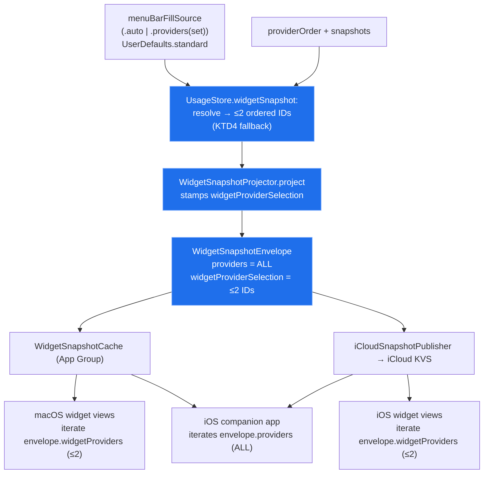

# feat: Widget two-provider cap, layout cleanup, and iOS parity

**Target repo:** headroom (this repo). **Working branch:** `kylezantos/widget-provider-picker` (per the workspace's resolved head; do not rename).

## Summary

Ahead of the four-provider release, make the widgets clean and bounded: fix two 2-provider layout defects, cap every widget size to **at most 2 providers** chosen by the existing "priority providers" selection (reused from the menu bar — configure once), fix a demo-fixture bug that renders Grok/Cursor as blank meters in all screenshot/QA paths, and lock in iOS companion parity (companion stays uncapped; billing sync is already correct). No new user-facing selection concept is introduced — the menu-bar provider selection is broadened to govern widgets too.

---

## Problem Frame

With Grok and Cursor added, widgets now try to render four providers. Three problems surface:

1. **Medium widget misalignment (regression).** `HeadroomMediumWidgetView.swift:118` stretches each provider column to full height with `alignment: .leading`, which pins only the horizontal axis — vertical defaults to **center**. A provider with one meter (Codex) floats below one with two (Claude), so headers no longer line up. Introduced Jul 14 by PR #69 ("make medium widget divider a full-height column rule"); before #69 the columns sized to content under `HStack(alignment: .top)` and read clean.
2. **Small widget spacing.** Each provider line takes `.frame(maxHeight: .infinity)`, spreading the two providers to the full tile height with large dead gaps. Present in **both** targets.
3. **Four providers do not fit legibly** at small/medium, and the product decision is to **show only 2** (the user's picks) uniformly across all sizes rather than degrade.

Separately, the `fourProviders` demo fixture omits `billingPeriodDuration`, so Grok/Cursor render as blank/dashed meters in every demo/screenshot path (macOS widgets, iOS widgets, iOS companion) — a release-screenshot hazard. Production data is unaffected.

---

## Requirements

- **R1** — The medium widget's provider headers are top-aligned (fix the #69 regression).
- **R2** — The small widget shows its providers as a vertically-centered group with reduced inter-provider spacing (tighter than full-height spread, still centered).
- **R3** — Widgets display **at most 2 providers**, uniformly across small, medium, and large.
- **R4** — The 2 displayed providers are determined by the shared "priority providers" selection (`menuBarFillSource`), resolved to ≤2 provider IDs. When that selection is `.auto` (the default) or otherwise unset, default to the first 2 by provider order (Claude, Codex, Grok, Cursor). When it is `.providers(set)`, show up to 2 of that set in provider order.
- **R5** — The iOS companion **app** continues to show **all** providers; the cap is widgets-only.
- **R6** — The widget selection reaches the iOS widgets through the existing envelope→iCloud-KVS sync; no separate iOS configuration exists.
- **R7** — Demo/screenshot fixtures render Grok/Cursor (billing-period) providers with real meters, not blank.
- **R8** — Settings presents the priority-providers control as governing **both** the menu-bar number and the widget tiles, with copy clarifying widgets show up to 2 (relevant when 3+ providers are connected).
- **R9** — Tests assert: billing-period fixtures render a value; the widget selection filter (cap-2, default, subset) behaves per R4; and the selection survives the sync round-trip.

---

## Key Technical Decisions

- **KTD1 — Uniform cap of 2 across all widget sizes.** *(session-settled: user-directed — chosen over "large shows all providers": one consistent mental model, and the selection would otherwise not apply on large.)* Governs R3.
- **KTD2 — Reuse `menuBarFillSource` as the shared "priority providers" selection; add no new preference key.** *(session-settled: user-directed — chosen over an independent widget-only selection: "configure priority providers once.")* Governs R4, R8.
- **KTD3 — Carry the resolved selection as an additive envelope field, filter in a shared computed property.** Add `widgetProviderSelection: [String]?` to `WidgetSnapshotEnvelope`, stamped at projection time (the Mac can read `menuBarFillSource` from `UserDefaults.standard`, which the widget process cannot). Add a computed `WidgetSnapshotEnvelope.widgetProviders` that applies the selection (cap 2, ordered, fallback). Widget views (both targets) iterate `widgetProviders`; the companion keeps iterating `providers`. This is the single filter source of truth, sidesteps the App-Group-read problem, and rides the existing envelope sync to iOS for free. Governs R3, R5, R6.
- **KTD4 — `.auto`/unset default = first 2 by provider order (stable); `.providers(set)` = up to 2 of the set in provider order.** Rationale: a persistent 2-tile widget favors stability over the menu bar's urgency-driven single-slot behavior; explicit picks are still honored. Easily changed to "2 most-urgent" later if desired. Governs R4.
- **KTD5 — Bump `WidgetSnapshotEnvelope.schemaVersion`.** The new field is additive (`decodeIfPresent`); an old cached envelope lacking it degrades gracefully to the first-2-by-order fallback. Bump forces a fresh export so the field populates and documents the semantic change. Governs R6.
- **KTD6 — Keep the widgets' `>2`-provider layout branches as unreachable defensive code for this release.** With KTD1/KTD3 guaranteeing ≤2 providers reach the views, the macOS medium dense-column `else` branch and the iOS N-column path stop firing. Removing them is deferred (Scope Boundaries) to keep the release diff small.

---

## High-Level Technical Design

The selection is resolved once on the Mac and travels inside the envelope; both widget targets read it through one computed property while the companion ignores it.

`widgetProviders` (the ≤2 filter) is the only place the selection is applied; `providers` (all) remains untouched for the companion.

---

## Implementation Units

### U1. Fix medium widget header top-alignment (macOS)

**Goal:** Provider headers in the medium widget line up at the top again.
**Requirements:** R1.
**Dependencies:** none.
**Files:** `Sources/HeadroomWidgets/Views/HeadroomMediumWidgetView.swift`.
**Approach:** In `MediumProviderColumn.body`, change the column frame (line ~118) from `alignment: .leading` to `alignment: .topLeading` so the full-height stretch that feeds the center-rule overlay no longer vertically centers content. Do not touch the `HStack(alignment: .top)` or the overlay rule. iOS medium already top-aligns via outer spacers (`HeadroomIOSWidgetView.swift:166-169,206`) — no change there.
**Patterns to follow:** the surrounding `count == 2` branch (the app's 2-provider invariant, now the live path under the cap).
**Test scenarios:** Test expectation: none — pure SwiftUI alignment change with no HeadroomCore-testable seam. Verify by headless render (see Verification): with a 1-meter + 2-meter provider pair, both headers share the same top baseline.
**Verification:** Rendered medium tile (dark + light) shows Claude and Codex headers aligned at the top edge.

### U2. Tighten small widget inter-provider spacing (both targets)

**Goal:** The two providers sit closer together as a vertically-centered group instead of spreading to the full height.
**Requirements:** R2.
**Dependencies:** none (independent of the cap, but the cap guarantees ≤2 lines so the centered-pair layout is always the target).
**Files:** `Sources/HeadroomWidgets/Views/HeadroomSmallWidgetView.swift`, `Sources/HeadroomIOSWidgets/Views/HeadroomIOSWidgetView.swift` (the `small(_:)` method).
**Approach:** Replace the per-line `.frame(maxHeight: .infinity, alignment: .center)` spread with a controlled layout: keep the quiet header pinned at the top, then center the provider group in the remaining space using top/bottom spacers around a `VStack` with a modest fixed inter-provider spacing (directional — tune the exact value in-render). Keep the macOS `WidgetProviderWeeklyLine` and the iOS `providerWeeklyLine` in step (the macOS file comment already notes this coupling). Apply the same structure in both files so parity holds.
**Patterns to follow:** existing small-widget header/line composition; keep the "Weekly left" / "Usage left" header logic unchanged.
**Test scenarios:** Test expectation: none — visual layout. Verify by headless render at 1 and 2 providers.
**Verification:** Rendered small tile (dark + light) shows the two providers grouped with a tighter gap, centered vertically below the header; single-provider case still reads balanced.

### U3. Fix the demo-fixture blank-meter bug

**Goal:** The `fourProviders` fixture (and any billing-period demo window) renders real meters for Grok/Cursor.
**Requirements:** R7.
**Dependencies:** none.
**Files:** `Sources/HeadroomCore/Widgets/DemoScreenshotData.swift`.
**Approach:** Give the fixture a billing-period-aware window builder that sets `billingPeriodDuration` (so `isBillingPeriod` is true), and use it for Grok's `.other("Weekly")` (7-day) and Cursor's `.other("Monthly")` (~30-day) windows in `fourProvidersEnvelope`. Mirror the durations the production projector would set (`WidgetSnapshotProjector.billingPeriodDuration`). Either add an optional `billingPeriodDuration:` parameter to the existing `window(...)` helper or add a dedicated `billingWindow(...)` helper — prefer the smallest change that keeps the other fixtures untouched.
**Patterns to follow:** `WidgetSnapshotProjector.swift:93-100` (how production sets the duration); `DemoFixture.grokSnapshot`/`cursorSnapshot` (canonical billing numbers).
**Test scenarios:** Covered by U7 (fixture assertions live there to keep this unit a focused data fix).
**Verification:** `--demo multi-4` widget/companion captures on macOS and iOS show Grok/Cursor with filled meters and percentages.

### U4. Add the widget provider selection to the envelope + resolve it

**Goal:** The envelope carries the resolved ≤2 selection, and a shared computed property applies it.
**Requirements:** R3, R4, R6; KTD3, KTD4, KTD5.
**Dependencies:** none.
**Files:** `Sources/HeadroomCore/Widgets/WidgetSnapshotModels.swift`, `Sources/HeadroomCore/Widgets/WidgetSnapshotProjector.swift`, `Sources/HeadroomCore/Engine/UsageStore.swift`, `Sources/HeadroomCore/Sync/SyncedWidgetSnapshotModels.swift` (verify round-trip only). Test file: `Tests/HeadroomCoreTests/WidgetSnapshotProjectorTests.swift` (extended in U7).
**Approach:**
1. Add `widgetProviderSelection: [String]?` to `WidgetSnapshotEnvelope` (public init param defaulted to nil; `encodeIfPresent`/`decodeIfPresent`). Bump `schemaVersion` (KTD5).
2. Add computed `var widgetProviders: [WidgetProviderSummary]` — returns `providers` filtered to `widgetProviderSelection` in the selection's order, capped at 2; when the selection is nil/empty, returns `providers.prefix(2)` in existing order (KTD4 fallback).
3. In `UsageStore.widgetSnapshot(...)`, resolve `menuBarFillSource` + `providerOrder` (+ snapshots if needed) into ≤2 ordered provider IDs and pass them into the projector. Reuse the existing menu-bar selection accessors (`menuBarFillProviders`, `MenuBarFillSource.filtered(to:)`); for `.auto`, use the first-2-by-order fallback.
4. `WidgetSnapshotProjector.project(...)` stamps `widgetProviderSelection` onto the envelope.
5. Confirm `SyncedWidgetSnapshotModels`/`SyncedWidgetSnapshotCodec` pass the field through (it wraps the whole envelope, so additive-flows-through; no change expected — assert in U7).
**Patterns to follow:** `MenuBarFillSource` (`UsageModels.swift:401-433`) and its `filtered(to:)`; the additive-field pattern already used for `billingPeriodDuration` (`decodeIfPresent`).
**Test scenarios:** (implemented in U7) — see U7.
**Verification:** `swift build` clean under strict concurrency; a projected envelope with `.providers([grok,cursor])` selection exposes exactly those two via `widgetProviders`, in order.

### U5. Cap widget views to the selection (both targets)

**Goal:** Every widget size renders `widgetProviders` (≤2) instead of the full `providers` list.
**Requirements:** R3, R5.
**Dependencies:** U4.
**Files:** `Sources/HeadroomWidgets/Views/HeadroomSmallWidgetView.swift`, `HeadroomMediumWidgetView.swift`, `HeadroomLargeWidgetView.swift`; `Sources/HeadroomIOSWidgets/Views/HeadroomIOSWidgetView.swift` (small/medium/large methods).
**Approach:** Replace `envelope.providers` iteration in the widget size views with `envelope.widgetProviders`. Leave the companion (`Sources/HeadroomIOS/Views/MirrorView.swift`) untouched so it keeps showing all providers (R5). The small widget's "Weekly left"/"Usage left" header check should read from `widgetProviders` too (so a billing-only pair still says "Usage left"). Do not delete the `>2` layout branches (KTD6).
**Patterns to follow:** existing `ForEach(envelope.providers)` sites; keep every other layout detail identical.
**Test scenarios:** Test expectation: none at the view layer — the filter logic is tested on `widgetProviders` in U7. Verify visually by render.
**Verification:** With 4 providers in the envelope and a 2-ID selection, all three sizes on both platforms render exactly the 2 selected providers; companion still renders all 4.

### U6. Reframe the priority-providers control in Settings

**Goal:** The existing menu-bar provider selection reads as governing both the menu bar and widgets.
**Requirements:** R8; KTD2.
**Dependencies:** U4 (semantics exist).
**Files:** `Sources/HeadroomApp/UI/SettingsView.swift` (the `menuBarProviderSelectionMenu`, ~297-323), `Sources/HeadroomApp/UI/WidgetSettingsSection.swift`.
**Approach:** Relabel the selection to "Priority providers" (or equivalent) and add a one-line subtitle that it drives the menu-bar number and the widget tiles. In `WidgetSettingsSection`, add a short read-only pointer: widgets show up to 2 of your priority providers (matters when 3+ are connected). Do not move the control or add a second picker (KTD2). Keep `.auto` + per-provider toggles as-is.
**Patterns to follow:** the existing `menuBarProviderSelectionMenu` and `widgetsTile` wiring (`SettingsView.swift:355-371`).
**Test scenarios:** Test expectation: none — copy/label change with no logic. Manual check that the label and pointer render and the toggle still writes `menuBarFillSource`.
**Verification:** Settings shows the relabeled control and the widget-section pointer; changing the selection updates both the menu bar and (after refresh) the widget tiles.

### U7. Test coverage for fixtures, selection filter, and sync

**Goal:** Lock the billing-fixture fix and the selection behavior so neither regresses.
**Requirements:** R9; also closes the gap that let the blank-meter bug ship.
**Dependencies:** U3, U4.
**Files:** `Tests/HeadroomCoreTests/DemoScenarioParityTests.swift`, `Tests/HeadroomCoreTests/DemoScreenshotDataVariantsTests.swift`, `Tests/HeadroomCoreTests/WidgetSnapshotProjectorTests.swift`, `Tests/HeadroomCoreTests/SyncedWidgetSnapshotModelsTests.swift`.
**Approach:** Extend existing suites rather than add new files where natural.
**Test scenarios:**
- Fixture: `fourProviders` Grok window `isBillingPeriod == true` and `displayPercentRemaining == 56` (Cursor `Monthly` billing, value 69) — would have failed before U3.
- Fixture: `primarySubscriptionWindow` is non-nil for Grok and Cursor in `fourProviders` (small-widget line renders a value, not `--`).
- Variant sweep: include `"fourProviders"` in `DemoScreenshotDataVariantsTests` validity lists so every provider in it has a renderable subscription/billing window.
- Selection filter: `widgetProviders` returns exactly the selected ≤2 in order for `.providers([grok, cursor])`; returns first-2-by-order when selection is nil; caps to 2 when a 3-ID selection is passed.
- Selection resolution: `.auto` menu-bar source resolves to first-2-by-order; `.providers(set)` resolves to that set capped at 2 in provider order (via the `UsageStore.widgetSnapshot` seam or the resolver helper).
- Sync round-trip: an envelope with `widgetProviderSelection` encodes and decodes through `SyncedWidgetSnapshotCodec` with the field intact; a legacy payload without the field decodes to nil and `widgetProviders` falls back to first-2.
**Verification:** `swift test` passes; the new fixture assertions fail if U3 is reverted.

### U8. iOS companion + demo re-verification

**Goal:** Confirm the companion stays uncapped and demo captures render Grok/Cursor correctly on both platforms.
**Requirements:** R5, R7 (verification).
**Dependencies:** U3, U5.
**Files:** none (verification unit); note findings in the PR.
**Approach:** With `companionDemoVariant = fourProviders`, confirm: (a) iOS companion app shows all 4 providers; (b) iOS + macOS widgets show only the 2 selected; (c) Grok/Cursor meters are filled everywhere they appear. Use the sim posing recipe for iOS widgets (reinstall to rebuild the timeline) and the headless render for macOS layout.
**Test scenarios:** Test expectation: none — manual/visual acceptance. Billing sync correctness is already unit-covered (`IOSWidgetTimelineMappingTests.swift:94-132`).
**Verification:** Screenshot set (macOS small/medium/large + iOS widget + iOS companion) with Grok/Cursor rendering values; companion uncapped; widgets capped to 2.

---

## Scope Boundaries

**In scope:** the two layout fixes (U1, U2), the uniform 2-provider cap driven by the shared selection (U4, U5), the demo-fixture billing fix (U3), the Settings reframe (U6), tests (U7), and cross-surface verification (U8).

**Non-goals:**
- New widget visual design or density changes beyond the two targeted fixes.
- A separate, widget-only provider picker (explicitly rejected — KTD2).
- Capping or otherwise changing the iOS companion app's provider list (R5).
- Changing the menu-bar fill/urgency logic itself.

### Deferred to Follow-Up Work
- Remove the now-unreachable `>2`-provider layout branches (macOS medium dense-column `else`; iOS N-column dense path) once the cap has shipped and settled (KTD6).
- Optional: switch the `.auto` widget default to "2 most-urgent" if stable-order proves less useful in practice (KTD4).
- Optional: decouple widget selection from the menu bar if users ask for independent control (accepted coupling per KTD2).

---

## Open Questions

- **Which 2 when the priority set has 3+?** Defaulted to provider order among the set (KTD4). Alternative: the 2 most-urgent among the set. Low-risk to change; not blocking.
- **Schema-version coordination.** Confirm no other consumer pins the current `WidgetSnapshotEnvelope.schemaVersion` in a way the bump breaks (grep for the constant); expected additive-only, but verify during U4.

---

## System-Wide Impact

- **iOS parity:** billing-period sync is already correct and round-trip tested — real Grok/Cursor render on iOS widgets and companion today. The only iOS-visible changes here are the shared cap (widgets show 2) and the demo-fixture fix; the companion app is deliberately unchanged.
- **Both widget targets** consume the shared `widgetProviders` filter, so the cap and selection behavior cannot drift between macOS and iOS.
- **Settings copy** now spans two features (menu bar + widgets); keep the label accurate to avoid implying a widget-only control.

---

## Risks & Dependencies

- **Schema bump compatibility (low).** Additive field + `decodeIfPresent` + graceful fallback; old cached envelopes degrade to first-2-by-order. Mitigated by U7's legacy-payload test.
- **Layout regressions from the alignment change (low).** `.topLeading` only affects vertical positioning inside the medium columns; verified by render before/after.
- **Selection/menu-bar coupling surprise (medium-UX).** A user selecting 3+ "priority" providers gets 2 in the widget; U6 copy must set that expectation.
- **Dependency:** U5 depends on U4; U7 depends on U3+U4; U8 depends on U3+U5. U1/U2/U3 are independent and can land first.

---

## Verification Contract & Definition of Done

- `swift build` and `swift test` pass (strict concurrency clean).
- New U7 tests pass and fail when their target fix is reverted (fixture billing assertions, selection filter, sync round-trip).
- Headless render (all three macOS sizes, dark + light) shows: medium headers top-aligned; small providers tightened + centered; every size capped to the 2 selected providers.
- `--demo multi-4` / `companionDemoVariant=fourProviders`: Grok/Cursor render filled meters on macOS widgets, iOS widgets, and iOS companion; companion shows all 4; widgets show 2.
- Settings shows the relabeled "priority providers" control and the widget-section pointer; changing it updates both surfaces.

---

## Sources & Research

- Repo investigation (this session): widget view structure, iOS parity, sync wire model, selection plumbing, and demo-fixture bug — grounded in `Sources/HeadroomWidgets/Views/*`, `Sources/HeadroomIOSWidgets/Views/HeadroomIOSWidgetView.swift`, `Sources/HeadroomCore/Widgets/*`, `Sources/HeadroomCore/Sync/*`, `Sources/HeadroomCore/Settings/Preferences.swift`, `Sources/HeadroomApp/UI/SettingsView.swift`.
- Git: PR #69 (`3c551442`) introduced the medium centering regression; `380371f5` added billing-period widget rendering; `d5231053` added Grok/Cursor brand marks + demo scenarios.
- Existing tests confirming iOS billing sync: `Tests/HeadroomCoreTests/IOSWidgetTimelineMappingTests.swift:94-132`, `SyncedWidgetSnapshotModelsTests.swift:67-94`.
- Headless widget render harness used to produce the before/after evidence: `.context/widget-preview/`.
