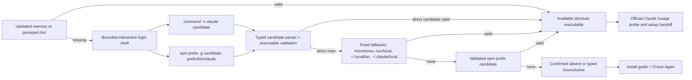

# Claude npm-prefix executable discovery - Plan

## Goal Capsule

- **Objective:** Make Headroom automatically find and use an installed Claude Code CLI when npm placed its launcher under a configured global prefix that is absent from `PATH`, including after an upstream installer or updater moves the launcher.
- **Authority:** This plan's Requirements and Key Technical Decisions govern. Headroom continues to drive the official `claude` CLI and never reads or reuses Claude subscription OAuth credentials.
- **Stop conditions:** Stop and surface if implementation would execute an unvalidated path, modify a user's shell profile or npm configuration, use Claude Desktop's private copy, broaden discovery to other providers without characterization, or bypass the official CLI boundary.
- **Tail ownership:** Implementation ends when automated tests, builds, live local discovery checks, and the documented signed-candidate acceptance scenario pass. Publication remains a separate release operation.

---

## Product Contract

### Summary

Headroom currently treats a custom npm-global installation as missing whenever the user's login shell cannot resolve `claude`, even though npm can report the prefix where global launchers belong. The reported reproduction proves `@anthropic-ai/claude-code@2.1.221` is under `~/.npm-global/lib`; npm's documented layout makes `~/.npm-global/bin/claude` the expected launcher, but Headroom must verify that it actually exists and is executable. Headroom must recover automatically when that usable launcher is present, preserve its existing path validation and refresh lifecycle, and stop offering a copied command that repeats the failed bare-name lookup.

### Problem Frame

The shared `CLIExecutableLocator` already revalidates cached paths, refreshes after invalidation, and bounds login-shell discovery. Its Claude factory, however, receives only `command -v claude` candidates plus three fixed fallback paths: Homebrew, `/usr/local`, and `~/.local/bin`. A custom npm prefix is configured data, not a universal filesystem location, so adding `~/.npm-global/bin/claude` as one more hard-coded fallback would solve only one convention and miss version-manager or user-selected prefixes.

The recovery UI compounds the miss. In a confirmed-absent state it offers **Copy Manual Command**, while `ClaudeSetupCommand.manualCommand` substitutes bare `claude` when no executable was resolved. For the reported failure, that copied command repeated the same unresolved bare-name lookup and failed. The install action also points at an obsolete Anthropic documentation URL instead of the current installation guide.

### Requirements

**Discovery correctness**

- R1. Claude discovery preserves this priority: validated memory/persisted hint, direct login-shell `command -v`, the fixed fallback paths (Homebrew, `/usr/local`, native `~/.local/bin`, and the legacy `~/.claude/local/claude` migrate-installer location), then the executable derived from npm's configured global prefix when npm is available to the same bounded login shell. Fixed fallbacks outrank the npm-derived candidate so a fresh native install always beats a stale-but-executable npm shim left behind by an npm-to-native migration.
- R1a. `~/.claude/local/claude` joins the fixed fallback list. Legacy `claude migrate-installer` layouts reach the CLI through a shell *alias*, and `command -v` on an alias emits an alias definition rather than an executable path, so those installs fail direct login-shell resolution; only the fixed path recovers them. Alias-definition output must continue to fail executable validation safely (it is never parsed or evaluated for a path).
- R2. A derived npm candidate is accepted only when the prefix response is structurally valid, the resulting path is absolute and normalized, and the launcher is executable. Package-list output alone is never proof that a launchable CLI exists.
- R3. npm absence, nonzero/empty/noisy output, malformed or relative prefixes, inaccessible candidates, shell spawn failure, and timeout remain typed, bounded outcomes. A completed shell where npm is unavailable may confirm absence after fixed fallbacks miss; a discovered npm whose prefix query fails or violates the marker protocol is inconclusive because Headroom could not finish searching that supported source. Direct lookup and npm-prefix lookup share the existing five-second whole-operation deadline; npm receives only the remaining budget after a direct miss. Discovery must not hang app launch, interpolate raw errors, or expose resolved paths in diagnostics.
- R4. A path found through npm participates in the locator's existing lifecycle: it is cached as a revalidated hint, invalidated after non-executable or launch-not-found failures, and rediscovered on a later refresh or forced **Check Again** without relaunching Headroom.
- R5. The new npm-prefix strategy is Claude-specific. Codex, Grok, and Cursor discovery behavior does not change.

**Recovery behavior**

- R6. Every production Claude setup/probe path uses the validated absolute executable when discovery succeeds, including an npm-prefix path and every account-specific `CLAUDE_CONFIG_DIR` handoff. Every staged-script interpolation shell-quotes the path as one token; discovery output is never evaluated or concatenated into executable shell syntax.
- R7. A confirmed-absent state does not offer a circular manual action that copies bare `claude`; it offers installation guidance plus a fresh discovery check. An inconclusive state preserves the existing retry-oriented message with **Check Again** and **Open Guided Setup**, never claims the CLI is absent, and retries on the next eligible refresh. Manual command generation requires a resolved absolute executable.
- R8. The Claude installation action and README link to Anthropic's current official installation guide at `https://code.claude.com/docs/en/installation` and explain that Headroom supports existing npm-global installs even though Anthropic now recommends native or Homebrew installation.

### Acceptance Examples

- AE1. **Covers R1, R2, R6.** Given `command -v claude` returns nothing, npm is resolvable, `npm prefix -g` returns `/Users/Neil/.npm-global`, and `/Users/Neil/.npm-global/bin/claude` is executable, a Finder-launched Headroom refresh resolves that absolute launcher and the official `/usage` probe proceeds instead of showing **Install Claude Code**.
- AE2. **Covers R1, R5.** Given `claude` is already found through a validated memory/persisted hint or directly through the login shell, npm discovery is skipped and cannot replace that result; other provider resolvers are unchanged. Given direct lookup misses and both a fixed fallback launcher and an npm-prefix launcher are valid, the fixed fallback launcher wins per R1 (the npm-derived candidate is selected only when every fixed fallback misses).
- AE2a. **Covers R1a.** Given a legacy migrate-installer layout where `command -v claude` emits an alias definition and the only executable lives at `~/.claude/local/claude`, discovery resolves that fixed path, never treats the alias text as a candidate path, and the official `/usage` probe proceeds.
- AE3. **Covers R2, R3.** Given npm returns a relative prefix, multiple unmarked/noisy lines, an empty value, a missing launcher, or an inaccessible launcher, Headroom never executes the derived value; it returns the appropriate absent or inconclusive outcome without recording the path.
- AE4. **Covers R4.** Given Headroom cached an npm-prefix launcher and an upstream update moves Claude to `~/.local/bin/claude`, the old hint fails validation, the next eligible refresh discovers the new executable, and usage recovers without relaunching or re-authenticating.
- AE5. **Covers R7.** Given no valid Claude launcher is found, the capability recovery card offers the current install guide and **Check Again**; it does not copy or display a command ending in unresolved bare `claude`.
- AE6. **Covers R6.** Given an extra Claude account and an npm-prefix launcher, the staged setup script invokes that exact executable while preserving the account's isolated `CLAUDE_CONFIG_DIR`, workspace, completion marker, and shell quoting.
- AE7. **Covers R3, R7.** Given npm is found but its prefix query times out, fails, or breaks the marker protocol and no fixed fallback succeeds, Headroom keeps the result inconclusive, shows the retry-oriented recovery actions, and never changes the state to **Install Claude Code** from incomplete evidence.

### Scope Boundaries

**Included**

- Claude-specific npm global-prefix candidate discovery within the existing bounded login-shell resolver.
- Typed source/diagnostic coverage that identifies an npm resolution category without retaining or displaying the resolved path.
- Removal of the misleading unresolved manual-command recovery path across current production and legacy/render-harness surfaces.
- Current Anthropic installation documentation URLs and troubleshooting text.
- Unit, app-boundary, live local, and signed-candidate acceptance coverage.

**Excluded**

- Editing `.zshrc`, `.bashrc`, `.npmrc`, npm prefix configuration, symlinks, or installation state.
- Automatically migrating, reinstalling, updating, or uninstalling Claude Code.
- Searching the whole home directory or executing Claude Desktop/IDE-extension private binaries.
- Generalizing npm-prefix discovery to Codex, Grok, or Cursor.
- Any Claude OAuth, Keychain-token, private endpoint, or credential-path change.

---

## Planning Contract

### Key Technical Decisions

- KTD1. **Query npm's configured prefix instead of adding `~/.npm-global` as a fixed fallback.** npm documents `npm prefix -g` as the global prefix and links Unix global executables into `{prefix}/bin`; deriving one candidate from that configured value covers user-selected prefixes without filesystem scanning. Fixed fallback paths stay in place for native and Homebrew installs and gain the legacy `~/.claude/local/claude` migrate-installer location, whose alias-based shell integration is invisible to `command -v` path resolution (R1a). Governs R1-R3.
- KTD1a. **Fixed fallbacks outrank the npm-derived candidate at selection time; the npm query itself still runs in the same bounded shell operation after a direct `command -v` miss.** The shell cannot condition the npm query on fixed-fallback filesystem checks (those happen in the locator after the shell returns), so gathering stays as one operation — but selection prefers a validated fixed-path launcher over the npm derivation. Rationale: Anthropic's migration direction is npm → native, so when both exist the native launcher is the current one and a leftover npm shim is the stale one; the reported npm-prefix users have no native install, so they still resolve through npm. Governs R1.
- KTD2. **Keep discovery inside the existing bounded login-shell operation and return marked candidate records.** The same interactive login shell that loads NVM/asdf/mise first tries `command -v claude`; only after a direct miss, if npm is available, it obtains the global prefix and emits the derived Claude candidate through a distinct marker/source. Prefix output is handled only as quoted data—never sourced, evaluated, or interpolated as shell syntax. The parser accepts one marker-delimited record per source, rejects control-character/relative prefix data, and ignores unrelated startup noise. `CLIExecutableLocator` remains the only authority that normalizes the derived path and validates executability before caching or launch. The complete shell operation retains its existing five-second deadline, so the npm branch consumes only the time remaining after direct lookup. This preserves the current timeout and trust boundary while making candidate provenance testable. Governs R1-R4.
- KTD3. **Preserve discovery priority and lifecycle.** Revalidated memory/persisted hints remain first; a directly resolved login-shell executable wins over everything else; fixed fallbacks (including legacy `~/.claude/local/claude`) come next; the npm-prefix derivation is last (KTD1a). An npm result uses the same hint invalidation, refresh-generation negative memoization, launch-race protection, and forced-refresh recovery as every other discovered path. Governs R1, R4, R5.
- KTD4. **Make npm discovery Claude-specific at the locator factory boundary.** The shared resolver may gain a typed supplemental-candidate seam, but only `CLIExecutableLocator.claude()` supplies the npm-prefix strategy. This avoids silently changing providers whose installation and updater behavior has not been characterized. Governs R5.
- KTD5. **A missing executable has no valid manual launch command.** `ClaudeSetupCommand.manualCommand` must require a resolved absolute executable (or return no command), and confirmed-absent presentation replaces **Copy Manual Command** with **Check Again**. The configured setup coordinator already force-refreshes discovery for that action. This is session-settled: user-directed — chosen over asking affected users to repair `PATH` or run diagnostics because multiple users need Headroom to recover automatically. Governs R6, R7.
- KTD6. **Do not treat Claude Desktop as Claude Code CLI installation evidence.** Anthropic documents Desktop as a separate graphical path; Headroom requires the official terminal CLI because it drives `/usage`. Private app-bundle and IDE-extension launchers are excluded even if found. Governs R2, R6.

### Assumptions

- macOS/Unix npm global executable layout remains `{prefix}/bin`, as documented by npm. A future npm layout change requires updated official grounding and fixtures rather than guessing.
- The affected users' global npm package created an executable launcher under their configured prefix. If the package metadata exists but the launcher is absent or not executable, Headroom correctly treats that as no usable CLI.
- Production setup is coordinator-backed; legacy `ClaudeSetupSession` remains for render harnesses and must not retain contradictory bare-command behavior.

### High-Level Technical Design

The diagram shows ordering and ownership, not an exact API or shell-script specification. KTD1-KTD5 are authoritative.

### Context & Research

- `Sources/HeadroomCore/Providers/CLIExecutableResolver.swift` currently emits only `command -v` output after a marker and enforces a five-second deadline around user-controlled shell startup.
- `Sources/HeadroomCore/Providers/CLIExecutableLocator.swift` owns validation, persisted hints, negative-result generation scoping, forced refresh, launch-race invalidation, and redacted diagnostics. Extending this lifecycle is safer than adding a second independent cache.
- `Sources/HeadroomCore/Providers/ClaudeSetupCommand.swift` currently falls back to bare `claude`; `Sources/HeadroomCore/Models/ProviderSetup.swift` and `ProviderCapabilityPresentation.swift` expose that circular command as recovery.
- `Sources/HeadroomApp/UI/SetupSessions.swift` already force-refreshes the shared Claude locator for **Check Again** and uses an absolute resolved executable when staging production setup.
- Anthropic's current docs recommend native or Homebrew installation, identify `~/.local/bin/claude` as the native launcher, and still document npm-global installations in troubleshooting. This means Headroom should support an existing usable npm installation without presenting it as the recommended new installation method.
- npm's official docs define `npm prefix -g` and the Unix global executable location `{prefix}/bin`, providing a stable derivation mechanism for custom prefixes.

### System-Wide Impact

- **Probe path:** `ClaudeUsageCLIProbe` receives the same `CLIExecutableLocating` contract and should require no provider/API change; successful discovery changes only the absolute executable value it launches.
- **Setup path:** built-in and extra accounts reuse the same shared locator and existing config-home/workspace isolation. Manual-command availability becomes optional instead of fabricated.
- **Caching/state:** no new durable negative state. A valid npm path may be persisted as the existing executable hint and must be revalidated on every reuse.
- **Diagnostics/privacy:** add only a categorical npm-resolution event if needed. Never record npm prefix output, home paths, package-list output, usernames, shell output, credentials, or raw errors.
- **Performance:** npm is consulted only after direct shell resolution misses and within the existing bounded discovery operation; normal cached and directly resolvable installations do not pay repeated npm-process cost.
- **Failure propagation:** a malformed or failed npm-prefix query is not allowed to turn incomplete discovery into confirmed absence. Candidate-level missing launchers may still fall through to fixed paths; inaccessible launchers and discovery-level uncertainty stay inconclusive. A completed search may confirm absence only after every successfully enumerable source and fixed fallback misses.
- **Release:** because executable discovery and account setup change, the signed-candidate Track A matrix remains mandatory before publication.

### Risks & Dependencies

- **Noisy shell/npm output:** user startup files and npm warnings can write unexpected text. Mitigation: separate markers, strict record parsing, absolute-path normalization, and executable validation; tests inject warnings before, between, and after records.
- **Timeout budget:** running npm after a direct miss adds work inside a five-second boundary. Mitigation: do not run npm when `command -v claude` succeeds; retain a hard deadline for the whole operation and classify timeout as inconclusive.
- **Multiple npm/version-manager installations:** the login shell's active npm prefix may differ from a dormant global package. Mitigation: use only the active configured npm discovered in that shell, preserve direct executable priority, and do not scan version-manager directories.
- **Updater path churn:** cached paths can disappear between validation and launch. Mitigation: retain the existing launch-not-found invalidation and rediscovery contract; add the npm-to-native move acceptance scenario.
- **UI regression from removing the copied fallback:** previews or tests may assume a string is always available. Mitigation: make absence explicit in the command/presentation model and update both coordinator-backed and legacy/render-harness paths together.

### Open Questions

#### Resolved During Planning

- **Should Headroom add `~/.npm-global/bin/claude` as a fixed path?** No. The prefix is configurable; query npm and derive its documented executable directory (KTD1).
- **Should Headroom repair users' PATH?** No. Discovery is app-owned; shell configuration is user-owned and out of scope (KTD5).
- **Should package-list presence count as installed?** No. Only an executable launcher is usable (R2).
- **Should the strategy apply to every provider?** No. Claude-specific until other providers are characterized (KTD4).
- **What replaces the missing-state manual command?** **Check Again**, which already forces a new locator search (KTD5).
- **When both a fixed fallback launcher and an npm-prefix launcher are valid, which wins?** The fixed fallback (KTD1a). Anthropic's migration direction is npm → native; the native launcher is current and a leftover npm shim is stale.
- **Are legacy `claude migrate-installer` layouts covered?** Yes — `~/.claude/local/claude` becomes a fixed fallback (R1a) because their alias-based shell integration is invisible to `command -v` path resolution.

#### Deferred to Implementation

- None. Exact internal type names and parser structure are implementation details as long as the typed ordering, validation, timeout, and diagnostic contracts above hold.

---

## Implementation Units

### U1. Typed Claude npm-prefix candidate discovery

- **Goal:** Extend bounded Claude discovery so an executable under the active npm global prefix is found without relying on `PATH`.
- **Requirements:** R1-R5. KTD1-KTD4, KTD6.
- **Dependencies:** none.
- **Files:** `Sources/HeadroomCore/Providers/CLIExecutableResolver.swift`, `Sources/HeadroomCore/Providers/CLIExecutableLocator.swift`, `Tests/HeadroomCoreTests/CLIExecutableLocatorTests.swift`, and a focused resolver test file if separating shell-output parsing improves clarity.
- **Approach:**
  1. Represent shell-derived candidates with enough typed provenance to distinguish direct `command -v` from Claude npm-prefix discovery without leaking paths into diagnostics.
  2. Extend the bounded login-shell search with a Claude-only supplemental strategy: skip npm when direct resolution succeeds; otherwise ask the active npm for its global prefix and derive the documented Unix launcher location. Add `~/.claude/local/claude` to the Claude factory's fixed fallback list (R1a) and rank the npm-derived candidate after fixed fallbacks at selection time (KTD1a).
  3. Parse only marker-delimited output, normalize and require an absolute derived path, then feed it through the locator's existing candidate-status validator.
  4. Preserve priority, fixed fallbacks, timeout/spawn/invalid-output semantics, hint persistence, negative memoization, invalidation, and stale-completion guards.
- **Patterns to follow:** existing marker parsing and `ShellSearchRecorder`/`CandidateValidationRecorder` seams; generation/epoch contract in `CLIExecutableLocator`; categorical allowlisted diagnostics.
- **Test scenarios:**
  - Covers AE1: direct miss + valid custom prefix + executable derived launcher resolves with npm provenance and persists the validated hint.
  - Covers AE2: a valid memory/persisted hint or direct shell candidate short-circuits npm; when direct lookup misses, fixed fallback candidates precede the npm-prefix candidate, and a valid fixed fallback beats a simultaneously valid npm launcher.
  - Covers AE2a: alias-definition `command -v` output is rejected as a candidate path while the legacy `~/.claude/local/claude` fixed fallback resolves.
  - Covers AE3: empty, relative, whitespace-only, warning-contaminated, duplicated, missing, and inaccessible npm candidates never launch.
  - Direct search completed and npm is unavailable; fixed fallback succeeds, or a full fixed-fallback miss confirms absence.
  - npm is found but its prefix query fails or breaks the marker protocol; a fixed fallback may still win, otherwise the result is inconclusive rather than false confirmed absence.
  - Whole-shell timeout/spawn failure remains inconclusive even when fallback candidates miss; no false confirmed absence.
  - Covers AE7: npm consumes the remaining whole-operation deadline after direct lookup; a cold/blocked npm cannot extend discovery past five seconds and times out as inconclusive.
  - Covers AE4: npm hint invalidates, later native candidate wins, and a stale earlier discovery cannot republish the old path.
  - Diagnostic history identifies the category only and contains no path-bearing payload.
- **Verification outcome:** Core tests demonstrate every candidate source and failure class with no real npm, filesystem, or shell-profile dependency.

### U2. Remove the circular manual-command recovery path

- **Goal:** Never give a user a command that repeats Headroom's already-failed bare-name lookup.
- **Requirements:** R6, R7. KTD5.
- **Dependencies:** U1.
- **Files:** `Sources/HeadroomCore/Providers/ClaudeSetupCommand.swift`, `Sources/HeadroomCore/Models/ProviderSetup.swift`, `Sources/HeadroomCore/Models/ProviderCapabilityPresentation.swift`, `Sources/HeadroomApp/UI/SetupSessions.swift`, `Sources/HeadroomApp/UI/ClaudeSetupViews.swift`, `Tests/HeadroomCoreTests/ClaudeSetupCommandTests.swift`, `Tests/HeadroomCoreTests/ProviderSetupOutcomeTests.swift`, `Tests/HeadroomAppTests/AccountsSettingsInteractionTests.swift`.
- **Approach:**
  1. Make manual command construction contingent on an already validated absolute executable instead of substituting bare `claude`.
  2. Replace confirmed-absent secondary presentation with **Check Again** and route it through the existing forced locator refresh.
  3. Keep Terminal-open failure clipboard fallback only when setup preparation already captured a validated executable; otherwise surface the typed install/discovery recovery state.
  4. Align legacy/render-harness setup helpers so previews and fallback surfaces do not display or copy the obsolete bare command.
- **Patterns to follow:** typed `ProviderRecoveryPresentation`, pure `recoveryRoute` coverage, coordinator staging through `PreparedScript`, existing shell-quoting tests.
- **Test scenarios:**
  - Covers AE5: confirmed absence has install + Check Again and no copy-manual action.
  - Covers AE7: inconclusive discovery retains the retry message, Check Again, and Open Guided Setup without presenting confirmed-absence installation copy.
  - `manualCommand` with a validated path quotes spaces/apostrophes and preserves built-in vs additional account config routing.
  - Missing executable returns no manual command and never produces a string ending in bare `claude`.
  - Covers AE6: production handoff uses the npm-derived absolute launcher with the correct extra-account `CLAUDE_CONFIG_DIR` and completion marker.
  - Terminal rejects a prepared handoff after successful resolution: the clipboard receives the absolute-path command; unresolved preparation cannot reach this branch.
  - Recovery-route table and accessibility labels remain exhaustive after the presentation change.
- **Verification outcome:** Core and app tests prove the recovery surface cannot generate the reported reproduction's failing command while valid absolute-path clipboard fallback still works.

### U3. Current guidance and release acceptance coverage

- **Goal:** Document the supported behavior and prove it in an installed, Finder-launched candidate.
- **Requirements:** R4, R8. AE1, AE4.
- **Dependencies:** U1, U2.
- **Files:** `README.md`, `docs/release/website-dmg-release.md`, `Sources/HeadroomApp/UI/SetupSessions.swift`, `Tests/HeadroomAppTests/AccountsSettingsInteractionTests.swift`.
- **Approach:**
  1. Point the app-boundary install action and README at `https://code.claude.com/docs/en/installation`; recommend native/Homebrew for new installs while stating that Headroom detects an existing usable npm-global launcher.
  2. Extend Track A with a custom npm prefix intentionally absent from the Finder-launched app's inherited `PATH`.
  3. Add the updater-churn transition from custom npm prefix to native `~/.local/bin` and require rediscovery without app relaunch or account login/trust reset.
  4. Keep recorded diagnostics allowlisted and path-free.
- **Patterns to follow:** existing CLI discovery Track A steps and README provider troubleshooting matrix.
- **Test scenarios:**
  - Documentation route equals the current official Anthropic installation URL.
  - Signed candidate launched from Finder finds a custom npm-prefix launcher absent from inherited `PATH`, then produces live Claude usage.
  - Moving the launcher to the native location and choosing Check Again restores usage without Headroom relaunch, re-login, or workspace trust.
  - Truly absent launcher shows install + Check Again and no misleading copied command.
- **Verification outcome:** Documentation and the release runbook describe the behavior users and release testers will actually observe.

---

## Verification Contract

### Automated Gates

1. `swift test`
   - All HeadroomCore tests pass, including candidate parsing, precedence, validation, invalidation, shell failure, and manual-command absence.
2. `xcodebuild -project Headroom.xcodeproj -scheme HeadroomAppTests -destination 'platform=macOS' test`
   - App-boundary recovery routing and setup-handoff interaction tests pass.
3. `swift build`
   - Swift 6 complete-concurrency build remains clean.

### Live Local Gates

1. In an isolated test account or reversible test environment, configure a temporary npm global prefix containing an executable test launcher while keeping that prefix out of the environment inherited by a Finder-launched development build. The app must not perform this configuration.
2. Confirm Headroom's diagnostic/probe path resolves the launcher and invokes only the allowlisted test behavior; no raw prefix or home path appears in diagnostic output.
3. Replace that launcher with a valid native-location launcher, invalidate or force-refresh through **Check Again**, and confirm rediscovery without restarting Headroom.
4. Run `swift run Headroom --probe-claude` against the developer's real logged-in official CLI and confirm current `/usage` windows parse. Do not record raw panel output, account identity, credentials, or resolved paths.

### Signed-Candidate Release Gate

Run the updated Track A matrix in `docs/release/website-dmg-release.md`, including the Finder-launch custom-prefix scenario and npm-to-native move. Record the result as **candidate tested** only; signing, notarization, publication, and Sparkle acceptance remain separate states.

### Safety Checks

- No source or test calls Anthropic subscription OAuth/private usage endpoints or reads Claude credentials.
- No command writes to shell profiles, npm configuration, install directories, or symlinks.
- No diagnostic/event type carries a path, username, shell output, package output, credential, or raw error.
- No real npm/network/Keychain dependency enters the unit suite.
- No discovery candidate originates from a Claude Desktop app bundle or IDE-extension private launcher.

---

## Definition of Done

- [ ] A Finder-launched Headroom build automatically finds an executable Claude launcher under a custom active npm global prefix that is absent from `PATH`.
- [ ] Direct login-shell, persisted-hint, native, Homebrew, and version-manager discovery continue to work with their existing priority and refresh semantics; the legacy `~/.claude/local/claude` fixed fallback resolves alias-based migrate-installer layouts.
- [ ] Malformed, missing, inaccessible, timed-out, and moved candidates fail safely through typed outcomes and are never executed.
- [ ] Built-in and extra-account probes/setup handoffs use the validated absolute launcher and preserve `CLAUDE_CONFIG_DIR` isolation.
- [ ] Confirmed absence offers current install guidance plus **Check Again**, while inconclusive discovery retains retry-oriented recovery; neither state copies unresolved bare `claude`.
- [ ] Anthropic documentation URLs and README troubleshooting are current.
- [ ] Automated gates pass with captured output.
- [ ] Live local custom-prefix and path-move checks pass without exposing sensitive/path-bearing diagnostics.
- [ ] Updated signed-candidate Track A steps are documented for the next release and pass before publication.
- [ ] The official-CLI boundary and prohibition on Claude subscription OAuth remain intact.

---

## Appendix: Sources & References

### Repository

- `Sources/HeadroomCore/Providers/CLIExecutableResolver.swift`
- `Sources/HeadroomCore/Providers/CLIExecutableLocator.swift`
- `Sources/HeadroomCore/Providers/ClaudeUsageCLIProbe.swift`
- `Sources/HeadroomCore/Providers/ClaudeSetupCommand.swift`
- `Sources/HeadroomCore/Models/ProviderSetup.swift`
- `Sources/HeadroomCore/Models/ProviderCapabilityPresentation.swift`
- `Sources/HeadroomApp/UI/SetupSessions.swift`
- `Sources/HeadroomApp/UI/ClaudeSetupViews.swift`
- `Tests/HeadroomCoreTests/CLIExecutableLocatorTests.swift`
- `Tests/HeadroomCoreTests/ClaudeSetupCommandTests.swift`
- `Tests/HeadroomCoreTests/ProviderSetupOutcomeTests.swift`
- `Tests/HeadroomAppTests/AccountsSettingsInteractionTests.swift`
- `docs/release/website-dmg-release.md`
- `docs/plans/2026-08-07-001-fix-account-setup-recovery-hardening-plan.md`

### External

- Anthropic, “Advanced setup”: https://code.claude.com/docs/en/installation
- Anthropic, “Troubleshoot installation and login”: https://code.claude.com/docs/en/troubleshoot-install
- npm CLI, “npm-prefix”: https://docs.npmjs.com/cli/v11/commands/npm-prefix/
- npm CLI, “Folders”: https://docs.npmjs.com/cli/v11/configuring-npm/folders/

### Reported Reproduction

- Login-shell `type -a claude` and `command -v claude`: no result.
- `~/.local/bin/claude` and legacy `~/.claude/local`: absent.
- npm global root: `/Users/neil/.npm-global/lib`.
- Installed package: `@anthropic-ai/claude-code@2.1.221`.
- Headroom's copied manual command failed with `env: claude: No such file or directory`.
