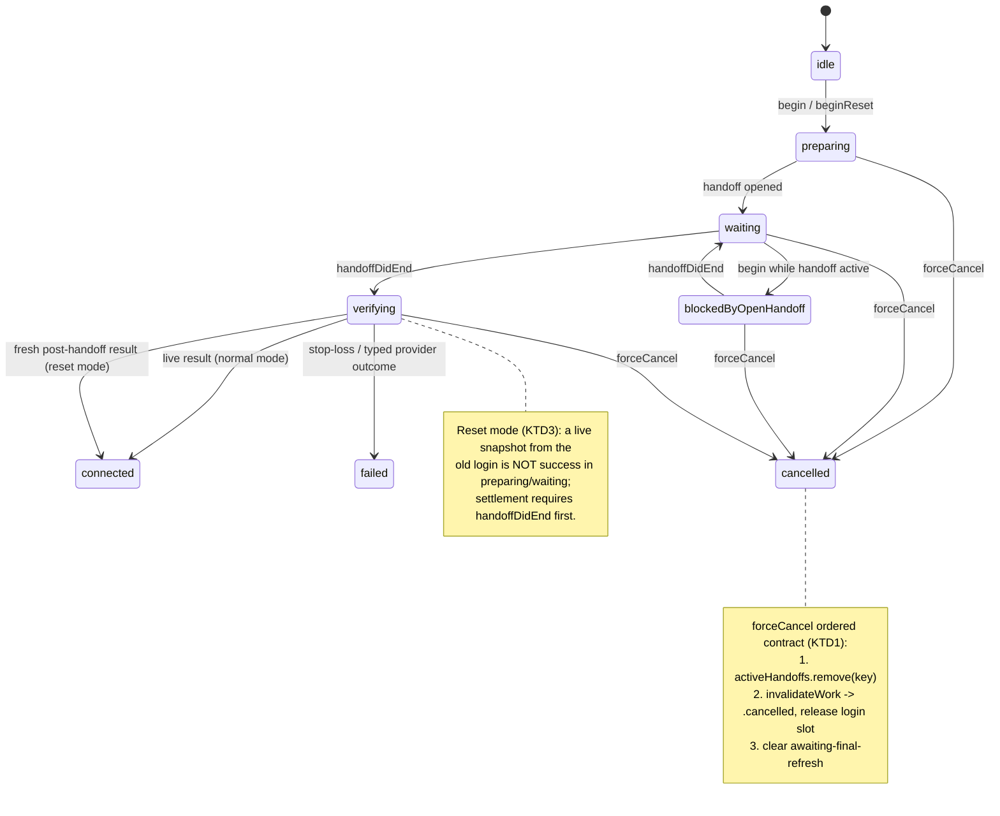

# Accounts Lifecycle Overhaul - Plan

## Goal Capsule

- **Objective:** A Headroom user can always get an account out of a bad state without reinstalling: a stuck setup can be cancelled, any account (including a lone built-in) can be signed out and set up again, the user chooses which account the menu bar and widgets follow, and extra Codex sign-ins stay valid without manual re-login.
- **Means:** Four workstreams over the existing setup coordinator / account registry / usage store machinery — force-cancel (KTD1–KTD2), reset mode (KTD3), persisted primary pointer (KTD4), and an official-CLI keep-alive lane (KTD6).
- **Authority:** This plan's Requirements govern product behavior; AGENTS.md hard constraints (official-CLI handoff only, never delete the CLI's own default login, no OAuth/token reuse, typed FailureReason, Swift 6 strict concurrency) override anything here that conflicts.
- **Stop conditions:** Stop and surface if any unit would require Headroom to read, use, or write a `refresh_token` itself. If the live keep-alive verification in U9 fails (token does not refresh), stop only the Codex-persistence workstream (U8–U9) and surface it — the other three workstreams ship independently. Stop if preserving the never-zero-rows invariant proves incompatible with the reset flow.

---

## Product Contract

### Summary

Add an always-available escape hatch for wedged setup sessions, a non-destructive "Sign out & set up again" reset for lone built-in accounts, an explicit per-provider "Make Main" choice that every surface follows, and a two-part fix for extra Codex accounts silently losing their sign-in (pre-expiry surfacing plus an official-CLI keep-alive).

### Problem Frame

Two real users hit four related walls. Kyle's main Claude account wedged in "Close setup, then retry" with no way out short of relaunching. A colleague could not remove or swap a lone Codex "Main" account (the remove control is hidden when no other account exists), and could not make their preferred account the one the menu bar shows. Kyle's isolated work-account Codex login keeps dying: research confirmed the Codex CLI refreshes tokens only when it runs, Headroom only ever reads the isolated `CODEX_HOME/auth.json`, so those tokens expire in ~10 days while the daily-used default `~/.codex` self-heals. All four are lifecycle gaps in the multi-account system shipped through PR #100.

### Key Decisions

- KD1. **A lone built-in resets in place; a provider never reaches zero visible rows.** (session-settled: user-approved — chosen over allowing zero rows with an "Add account" empty state: five code sites depend on the invariant, and a zero-row provider vanishes from Settings entirely, taking its own undo with it.) Governs R4, R5.
- KD2. **Force-cancel takes effect immediately, even while the Terminal window is still open.** (session-settled: user-approved — chosen over blocking until the window closes: the never-exits wrapper is exactly the wedge being fixed.) Governs R1, R2.
- KD3. **Main selection is an explicit "Make Main" action, not drag-to-reorder.** (session-settled: user-approved — chosen over reordering: one deliberate action with one visible consequence.) Governs R8.
- KD4. **Headroom never refreshes Codex tokens itself; the official CLI does, by being run against the account's home.** (session-settled: user-approved — investigation-first approach chosen over speculative fixes; the investigation landed during planning and pre-constrained the remedy.) Governs R11, R12.

### Requirements

**Stuck-setup escape hatch**

- R1. The user can force-cancel a setup session for any account whenever Headroom is waiting on an external handoff — from the Settings account row and from the popover surface that today shows only the "Close setup, then retry" refusal text.
- R2. Force-cancel is immediate; the confirmation states that Headroom stops waiting and that the Terminal window, if still open, can be closed by hand.
- R3. After force-cancel: a new setup can start at once, account removal is no longer refused as setup-active, the provider capability notice's refusal lifts, and neither the abandoned wrapper's eventual exit nor an app relaunch resurrects the cancelled session or reports a failure for it.

**Remove or reset any account**

- R4. Every built-in account row offers "Sign out & set up again" — with or without extra accounts present — which re-runs the official CLI login handoff against the CLI's default config; Headroom deletes nothing on disk (per KD1; the never-zero-rows invariant is only load-bearing when the built-in is the lone row).
- R5. The existing never-zero-visible-rows invariant is preserved unchanged (per KD1).
- R6. Reset confirmation copy states that logging in again switches that CLI's login machine-wide (their terminal sessions swap accounts too), and points at the lighter alternative when the goal is display only: add the other login as a separate account and use Make Main.
- R7. Reset settlement never mistakes the old login for success: a live snapshot from the pre-reset login neither completes nor kills the flow, and the old login's cached usage windows never merge into the new login's first capture.

**Main-account selection**

- R8. Any visible account can be promoted to the provider's main account; the menu bar, macOS widgets, iPhone sync, popover primary card, and capability recovery all follow the choice, and widgets/phone re-export at the moment of promotion (per KD3).
- R9. The choice persists across relaunch, survives torn or manually edited defaults by falling back to canonical order (built-in first, then extras) while the chosen account is not visible, and never lets a provider exceed the 5-account cap. The pointer itself is retained through fallback, so the choice restores on its own when the account is visible again.

**Codex sign-in persistence**

- R10. An extra Codex account whose sign-in is approaching expiry surfaces a reconnect prompt before the first 401, reusing the existing per-row Reconnect recovery surface.
- R11. A keep-alive lane runs the official `codex` CLI against each extra account's `CODEX_HOME` once that account's `last_refresh` age exceeds the CLI's 8-day refresh threshold, so the CLI refreshes and rewrites its own tokens (per KD4); eligibility is checked at least daily, catches up on app launch and wake, and re-attempts until the refresh is observed — landing comfortably before the ~10-day expiry. It is on by default with a visible setting; the behavior and its minimal usage cost are disclosed both in that setting's copy and at the moment an extra Codex account is added. The guarantee holds while Headroom runs at least once inside each refresh window.
- R12. Keep-alive never runs for the built-in account and never runs while the Codex exclusive login slot is held. When an account's auth has failed, keep-alive makes exactly one attempt for that failure episode — a 401 from an expired access token atop a live refresh chain is healed by one official-CLI run — and if `last_refresh` does not advance, marks the chain dead and skips until the user reconnects.

### Success Criteria

- A wedged "Close setup, then retry" account is recoverable in-app in under a minute, without relaunching or reinstalling.
- The colleague's two scenarios work end-to-end: swap the login of a lone Codex Main, and put Account 2 on the menu bar.
- An extra Codex account left untouched for 30 days still reports usage from a fresh authenticated poll — not retained stale windows — given Headroom ran within each refresh window (keep-alive on), or has visibly prompted for reconnect before failing (keep-alive off).

### Scope Boundaries

- **Out of scope:** auto-merging duplicate-login rows (detection-only per AGENTS.md); Cursor multi-account; any Headroom-owned token refresh or OAuth reuse (prohibited); drag-to-reorder account UI.
- **Deferred to Follow-Up Work:**
  - Garbage collection of orphaned account config homes (ledgered in BUGS.md; force-cancel narrows but does not close the late-CLI-write window).
  - Grok keep-alive / storage-mismatch analogs (BUGS.md has the Grok typed-outcome gap; same shape, separate work).
  - A cheaper keep-alive trigger via `codex app-server` JSON-RPC (unverified; U9 may note findings).

---

## Planning Contract

### Key Technical Decisions

- KTD1. **Force-cancel is a new coordinator operation, not a reuse of `cancel()` or `handoffDidEnd`.** `cancel()` deliberately leaves `activeHandoffs` intact, and `handoffDidEnd` transitions into `.verifying` and starts the stop-loss — both wrong here. The new operation follows an ordered contract: remove the key from `activeHandoffs` **first**, then `invalidateWork` to a terminal state with the login slot released (the release guard skips while `activeHandoffs` still contains the key), and clear `handoffsAwaitingFinalRefresh` so no verification begins.
- KTD2. **Force-cancel deletes both on-disk marker files (pending and completed), tears down the app-side session, and the wrapper's exit trap is PID-guarded so an abandoned wrapper cannot undo that.** Without the guard, the abandoned wrapper rewrites the completion marker on its eventual exit — including the HUP exit from closing the Terminal window — and `SetupSessions.configure()` resurrects the session at next launch as a `.verifying` → stop-loss failure; a successor session sharing the same per-account marker paths could also be clobbered. The wrapper therefore writes its completion marker, removes the pending marker, and deletes its script only when the pending marker still exists and contains its own PID; a force-cancelled or superseded wrapper exits silently. App-side teardown: cancel the monitor task, discard the prepared script. Marker paths resolve only through `AccountStorage.setupCompletionMarker(for:)` (divergent resolvers caused a mid-handoff detach bug once).
- KTD3. **Reset runs in a coordinator mode where a live snapshot is not success.** Today `receive` treats any live snapshot as setup payoff — a signed-in built-in is already live, so a reset would self-complete (or self-kill mid-preparation) instantly. In reset mode, settlement gates on `handoffDidEnd` plus a fresh post-handoff result. The account's continuity-cache record is cleared and its attachment generation bumped at reset start **and again at `handoffDidEnd`** — a timer poll landing mid-handoff carries the new generation and would otherwise re-fill the cache with old-login windows — so the old login's windows cannot merge into the new login's first capture.
- KTD4. **The primary choice is a persisted per-provider pointer in `AccountRegistry`, applied as ordering inside `accounts(for:)`.** Every consumer already treats first-as-primary (menu bar, widget export, popover primary card, capability recovery), so ordering at the source propagates without touching consumers. Self-heal is read-time and write-free (unlike the tombstone heal): a pointer not matching a visible account falls back to canonical order. Promotion triggers `refreshAccountNow` plus widget and phone exports — ordering alone does not re-export. No widget schema bump: the envelope is keyed by provider, and which account backs it is invisible to the schema.
- KTD5. **The never-signed-in poll backoff keys on primary position, not the `.primary` account ID.** `shouldSkipOnTimer` currently exempts the built-in by ID; after promotion the exempted account should be whichever is primary.
- KTD6. **Keep-alive is a scheduled minimal official-CLI run (`codex exec` with a one-word prompt) per extra Codex account, `CODEX_HOME` exported.** This is OpenAI's documented CI/CD keep-alive pattern. The CLI refreshes only when `last_refresh` is older than 8 days, so a run below that age is refused and wasted — the lane checks eligibility at least daily (with catch-up on launch/wake) but invokes the CLI only once an account is past the 8-day threshold, re-attempting on later passes until `last_refresh` advances, which lands the refresh before the ~10-day access-token expiry. The CLI owns rotation and writes; Headroom never reads or uses the `refresh_token` (an external consumer strands the file with a used token — a documented failure mode in third-party tools). Default-on with a settings toggle; cost disclosure lives in the toggle copy and at extra-account add (R11). `codex login status` verifiably does **not** refresh — do not substitute it.
- KTD7. **Pre-expiry surfacing is computed locally from the auth file's `last_refresh` age — no network, no new failure kind.** `CodexAuthReader` already parses the blob. An extra account whose `last_refresh` age approaches the expiry window (and whose keep-alive hasn't recently succeeded) surfaces the existing Reconnect affordance as a warning; the snapshot itself stays live until the real 401 maps to `.codexRejectedAuth` exactly as today.
- KTD8. **Account lifecycle splits out of `UsageStore` before the new growth lands.** BUGS.md records the directive ("`UsageStore` is ~1,100 lines; next growth in account lifecycle should split add/remove/stop-track/resume into their own file"). The split is a behavior-preserving refactor unit that precedes the reset and promotion units.

### High-Level Technical Design

Coordinator state machine with the two new paths (force-cancel from any handoff-active state; reset mode's changed settlement rule):



Force-cancel teardown across components (KTD1 + KTD2):

```mermaid
sequenceDiagram
    participant UI as Settings row / popover
    participant SS as SetupSessions (app)
    participant CO as SetupSessionCoordinator
    participant AS as AccountStorage (disk)
    participant US as UsageStore
    UI->>SS: forceCancel(account) after confirm
    SS->>SS: cancel monitor task, discard prepared script
    SS->>AS: delete pending marker
    SS->>AS: delete completed marker
    SS->>CO: forceCancel(key)
    CO->>CO: activeHandoffs.remove, invalidate -> .cancelled, release slot
    SS->>US: clear removal state if .setupActive
    Note over AS: abandoned wrapper may still exit later;<br/>its PID-guarded exit trap (KTD2) writes nothing,<br/>so configure() finds nothing to restore
```

### Sequencing

U1 → U2 (force-cancel unblocks the removal gates the later units rely on) → U3 (refactor). After U3, Phase B (U4 → U5), Phase C (U6 → U7), and Phase D (U8 → U9) can proceed in parallel or in any order — each chain depends only on U3. U10 (closeout) lands last.

---

## Implementation Units

### Phase A — Unwedge

### U1. Coordinator force-cancel operation

- **Goal:** A `forceCancel(_:)` coordinator operation that settles a session with an active external handoff to `.cancelled` without waiting for the wrapper.
- **Requirements:** R1, R3 (KTD1)
- **Dependencies:** none
- **Files:** `Sources/HeadroomCore/Engine/SetupSessionCoordinator.swift`, `Tests/HeadroomCoreTests/SetupSessionCoordinatorTests.swift`
- **Approach:**
  1. Add the operation with KTD1's ordered contract; terminal state `.cancelled`.
  2. Ensure a subsequent `begin` starts a fresh generation and does not re-block.
  3. Ensure `receiveCapabilityFailure` and late scheduler firings for the cancelled generation are inert.
- **Patterns to follow:** generation-guard discipline and `invalidateWork` fan-out already in the coordinator; `SetupCoordinatorHarness` + manual scheduler for tests.
- **Test scenarios:**
  - Force-cancel from `.blockedByOpenHandoff` → state `.cancelled`, `hasActiveHandoff` false, Codex exclusive slot released.
  - Force-cancel from `.waiting` with an active handoff → same result; pending retry tasks fire inert.
  - Force-cancel then immediate `begin` → session starts (no re-block), reaches `.waiting`.
  - Force-cancel during `.verifying` with `handoffsAwaitingFinalRefresh` set → no failure surfaces; later stale snapshot for the old generation is ignored.
  - Late `handoffDidEnd` for a force-cancelled key → no `.verifying` transition, no stop-loss scheduled.
  - Codex: force-cancel of the slot-holder unblocks a second account's `.blockedByProviderLogin` continue path.
- **Verification:** coordinator suite green; no other coordinator behavior changes (existing tests untouched).

### U2. Force-cancel surface and on-disk cleanup

- **Goal:** The user-facing affordance and the disk/app teardown that make force-cancel real end to end.
- **Requirements:** R1, R2, R3 (KTD2)
- **Dependencies:** U1
- **Files:** `Sources/HeadroomApp/UI/SetupSessions.swift`, `Sources/HeadroomApp/UI/AccountsSettingsTile.swift`, `Sources/HeadroomApp/UI/AccountsSettingsInteractions.swift`, `Sources/HeadroomApp/UI/ProviderCardView.swift`, `Sources/HeadroomCore/Providers/AccountStorage.swift`, `Sources/HeadroomCore/Providers/SetupCompletionCommand.swift`, `Tests/HeadroomCoreTests/AccountStorageLifecycleTests.swift`, `Tests/HeadroomAppTests/AccountsSettingsInteractionTests.swift`
- **Approach:**
  1. Add a marker-clearing helper in `AccountStorage` that removes both pending and completed markers, resolved via `setupCompletionMarker(for:)`.
  2. PID-guard the wrapper's exit trap in `SetupCompletionCommand` per KTD2: write the completion marker, remove the pending marker, and delete the script only when the pending marker still contains this wrapper's own PID.
  3. `SetupSessions.forceCancel(for:)`: cancel monitor task, discard prepared script, clear both markers, call the U1 coordinator operation, clear a `.setupActive` removal state.
  4. Replace the passive "Close setup, then retry" texts with the same text plus a "Stop waiting" action (Settings row and popover refusal row); confirm dialog carries the R2 copy; reuse the removal-confirm focus pattern (initial focus on confirm, restore to originating row).
  5. Capability-recovery refusal (`CapabilityRecoveryPresentation`) lifts once `hasActiveSetupSession` is false.
- **Patterns to follow:** existing removal confirm dialog and `removalOrigin`/`restoreRemovalFocus` accessibility pattern in `AccountsSettingsTile`; decidable logic in `AccountsSettingsInteractions`, views stay dumb.
- **Test scenarios:**
  - Marker helper removes both files; missing files are a no-op.
  - After force-cancel, `setupHandoffIsActive` is false and `removeDirectories` no longer throws `.setupActive`.
  - Relaunch simulation: `configure()` over a force-cancelled account's directories restores nothing and calls no `handoffDidEnd`.
  - Wrapper exit after force-cancel (pending marker gone): the guarded exit trap writes no completed marker; relaunch restores nothing.
  - Old wrapper exits during a successor session for the same account: the successor's pending marker and monitor stay untouched.
  - Interactions: force-cancel clears a `.setupActive` removal refusal; capability recovery action state returns `.enabled`.
  - Presentation: `.blockedByOpenHandoff` row exposes the new action with a correct accessibility label.
- **Verification:** manual QA — wedge a setup (open setup, leave Terminal open), force-cancel, immediately re-open setup and remove the account; relaunch shows no ghost session.

### Phase B — Reset any account

### U3. Extract account lifecycle from UsageStore

- **Goal:** Move add/remove/stop-track/resume/detach/reinstate into a dedicated file so Phase B/C growth lands outside the 1,100-line store (KTD8).
- **Requirements:** supports R4–R9 (no behavior change)
- **Dependencies:** U2
- **Files:** `Sources/HeadroomCore/Engine/UsageStore.swift`, new `Sources/HeadroomCore/Engine/UsageStoreAccountLifecycle.swift` (extension file; final name at implementer's discretion), `Tests/HeadroomCoreTests/MultiAccountTests.swift`
- **Approach:** behavior-preserving extraction; keep `@MainActor` isolation and existing method signatures so call sites and tests stay untouched.
- **Execution note:** pure refactor — the proof is the existing suite passing unchanged; add no new behavior in this unit.
- **Test scenarios:** Test expectation: none — behavior-preserving refactor covered by the existing MultiAccountTests suite passing unchanged.
- **Verification:** `swift test` green with zero test edits.

### U4. Coordinator reset mode

- **Goal:** A reset session variant where pre-existing live data neither completes nor kills the flow (KTD3).
- **Requirements:** R4, R7
- **Dependencies:** U3
- **Files:** `Sources/HeadroomCore/Engine/SetupSessionCoordinator.swift`, `Sources/HeadroomCore/Engine/UsageStore.swift` (or the U3 lifecycle file), `Tests/HeadroomCoreTests/SetupSessionCoordinatorTests.swift`, `Tests/HeadroomCoreTests/MultiAccountTests.swift`
- **Approach:**
  1. Add a reset entry point (mode or parallel begin) under which `receive`'s live-snapshot payoff is suppressed until `handoffDidEnd` has occurred.
  2. The store clears the account's continuity-cache record and bumps its attachment generation at reset start and again at `handoffDidEnd` (before the final refresh), so in-flight and mid-handoff old-login results are both rejected (per KTD3).
  3. Success = handoff ended + next fresh result live; failure paths unchanged (typed outcomes, stop-loss).
  4. A user who cancels the CLI login and keeps the old account still ends `.connected` — same-login is a legitimate outcome, not an error.
- **Patterns to follow:** `sessionModes` storage for per-key mode; generation bump pattern in `detachAccount`.
- **Test scenarios:**
  - Live snapshot arriving during `.preparing` in reset mode → preparation continues, Terminal still opens.
  - Live snapshot during `.waiting` (pre-handoff-end) → not `.connected`.
  - `handoffDidEnd` then live snapshot → `.connected`.
  - Old-login in-flight result after reset start → rejected by attachment generation; continuity record absent from the next merge.
  - Timer poll of the old login completing during `.waiting` in reset mode → its windows absent from the continuity merge of the post-handoff first capture.
  - Force-cancel during a reset session → `.cancelled`, account still visible and pollable.
  - Reset completing with the same login (user cancelled in Terminal, wrapper exited) → `.connected`, no failure.
- **Verification:** coordinator + store suites green.

### U5. Reset UI for built-in accounts

- **Goal:** The lone built-in row's hidden/inert control becomes "Sign out & set up again," running U4's reset against the CLI's default config.
- **Requirements:** R4, R5, R6
- **Dependencies:** U4
- **Files:** `Sources/HeadroomApp/UI/AccountsSettingsTile.swift`, `Sources/HeadroomApp/UI/AccountsSettingsInteractions.swift`, `Tests/HeadroomAppTests/AccountsSettingsInteractionTests.swift`
- **Approach:**
  1. Every built-in row offers the reset affordance (per broadened R4): a lone built-in renders it in place of the inert hidden slot; a built-in with extras carries it in the row's overflow (⋯) menu alongside stop-tracking, keeping the shared right-anchor layout intact.
  2. Confirm dialog carries the R6 machine-wide copy (current stop-tracking copy says the opposite — "Your CLI stays signed in" must not appear here).
  3. Row stays visible through the flow in normal setup states (`.waiting` etc.); Headroom performs no disk deletion.
  4. Guard for `providerFactory == nil` (demo mode) exactly like existing lifecycle actions — BUGS.md flags this guard family as untested; add the tests here.
- **Patterns to follow:** existing removal confirm structure and focus restoration; `CLI login` pill and row action layout.
- **Test scenarios:**
  - Lone built-in exposes reset (not stop-track); built-in with extras exposes both stop-track and reset (reset via the overflow menu).
  - Reset action routes to the coordinator reset entry point with the built-in's key.
  - Demo mode (`providerFactory == nil`): reset affordance absent or inert, no crash.
  - Accessibility labels name the account and action.
- **Verification:** manual QA on both providers — with a lone Claude account, run the reset, complete `/login` with a different account in Terminal, row converges on the new login's email; repeat with a lone Codex "Main" via `codex login` (the colleague's exact scenario). Zero-rows state unreachable throughout.

### Phase C — Make main

### U6. Registry primary pointer

- **Goal:** A persisted per-provider primary choice applied as ordering in `accounts(for:)`, with write-free self-heal (KTD4).
- **Requirements:** R8, R9
- **Dependencies:** U3
- **Files:** `Sources/HeadroomCore/Settings/AccountRegistry.swift`, `Tests/HeadroomCoreTests/MultiAccountTests.swift`
- **Approach:**
  1. New defaults key (pattern: the tombstone's `hiddenBuiltInAccounts.v1`) mapping provider → account ID.
  2. `accounts(for:)` moves the chosen account to index 0 when visible; otherwise canonical order, no write (read paths stay write-free except the existing torn-tombstone heal).
  3. Promote API only (no separate clear — self-heal covers removal and stop-tracking of the chosen account, and the retained pointer restores per R9); cap logic (`countIncludingHidden`) unaffected.
- **Patterns to follow:** untrusted-persisted-state rebuild in `accounts(for:)`; UserDefaults suite-per-test in `AccountRegistryTests`.
- **Test scenarios:**
  - Promote extra → it is first; built-in second; persists across registry re-instantiation.
  - Dangling pointer (account removed, or manual defaults edit) → canonical order, and the read performs no defaults write.
  - Promote then stop-track the promoted extra's built-in sibling / remove the promoted extra → surviving rows keep a stable, sane order.
  - Pointer interacts with tombstone: hidden built-in + promoted extra → extra first among extras-only list.
  - Cap: pointer never changes `canAddAccount` results.
- **Verification:** registry suite green.

### U7. Promotion end to end

- **Goal:** A "Make Main" row action whose consequences propagate immediately to every primary consumer.
- **Requirements:** R8, R9
- **Dependencies:** U6
- **Files:** `Sources/HeadroomCore/Engine/UsageStore.swift` (or U3 lifecycle file), `Sources/HeadroomApp/UI/AccountsSettingsTile.swift`, `Sources/HeadroomApp/UI/AccountsSettingsInteractions.swift`, `Tests/HeadroomCoreTests/MultiAccountTests.swift`, `Tests/HeadroomAppTests/AccountsSettingsInteractionTests.swift`
- **Approach:**
  1. Store-level promote: registry promote + `refreshAccountNow` + widget and phone exports (mirror `resumeTrackingBuiltInAccount`'s export pattern).
  2. "Make Main" lives in the per-row overflow (⋯) menu on non-primary rows — a fifth persistent inline control would break the row's shared right-anchor layout; hidden/inert in demo mode.
  3. Animate the promoted row's move to the top, preserve scroll position, and restore focus with a VoiceOver announcement on the moved row — the reorder must never relocate the row silently under the user's cursor.
  4. Re-key `shouldSkipOnTimer`'s exemption to primary position (KTD5).
  5. Known consequence to preserve, not fix: capability recovery and popover setup notices bind to the new primary; duplicate-badge direction follows registry order ("Same login as X" may swap rows after promotion).
- **Patterns to follow:** `SpyWidgetExporter` for export assertions; interactions-first UI logic.
- **Test scenarios:**
  - Promote → widget exporter and phone sync called once each; `refreshAccountNow` targeted at the promoted key.
  - Menu bar / `snapshot(for: ProviderID)` reflects the promoted account's snapshot.
  - Never-signed-in promoted primary is exempt from the timer backoff; demoted built-in is not.
  - Capability recovery routes actions through the promoted account.
  - Promote while the row is keyboard-focused: focus and VoiceOver context land on the moved row; scroll position preserved.
  - Demo mode: promote affordance inert, no crash.
- **Verification:** manual QA — promote Account 2, menu bar and Mac widget flip without waiting for the next poll (`--demo multi-2` for the surface check, live for the export path).

### Phase D — Codex sign-in persistence

### U8. Pre-expiry surfacing from auth metadata

- **Goal:** Extra Codex accounts warn and offer Reconnect before the first 401 (KTD7).
- **Requirements:** R10
- **Dependencies:** U3
- **Files:** `Sources/HeadroomCore/Credentials/CodexAuthReader.swift`, `Sources/HeadroomCore/Providers/CodexConnection.swift`, `Sources/HeadroomApp/UI/ProviderCardView.swift` (popover per-account state area), `Sources/HeadroomApp/UI/AccountsSettingsTile.swift` (Settings row), `Tests/HeadroomCoreTests/CodexProviderTests.swift` (or sibling), `Tests/HeadroomAppTests/AccountsSettingsInteractionTests.swift`
- **Approach:**
  1. Expose `last_refresh` age from the auth blob (already parsed) through the provider/connection seam.
  2. Threshold ≈ 9 days (between the CLI's 8-day proactive refresh and the ~10-day expiry): extra accounts past it surface the existing Reconnect affordance as a warning while the snapshot stays live — in the popover's per-account state area (where users actually look) and on the Settings row.
  3. No new `FailureReason`; the 401 → `.codexRejectedAuth` path is unchanged.
  4. Built-in accounts never warn (their freshness is owned by the user's own CLI usage).
- **Patterns to follow:** injectable `now` seam for age computation; fixture-driven provider tests.
- **Test scenarios:**
  - `last_refresh` 9+ days old on an extra account → warning surfaced, snapshot freshness unchanged.
  - Fresh `last_refresh` → no warning. Missing/malformed `last_refresh` → no warning (fail quiet), no crash.
  - Built-in with stale `last_refresh` → no warning.
  - Real 401 still maps to `.codexRejectedAuth` with the existing recovery presentation.
- **Verification:** unit suites green; fixture with an aged `last_refresh` drives the warning in `--demo`-style review or a presentation test.

### U9. Official-CLI keep-alive lane

- **Goal:** Extra Codex tokens stay fresh because the official CLI runs against their homes weekly (KTD6).
- **Requirements:** R11, R12
- **Dependencies:** U8
- **Files:** new `Sources/HeadroomCore/Engine/CodexKeepAlive.swift` (name at implementer's discretion), `Sources/HeadroomCore/Providers/CodexConnection.swift` (command builder), `Sources/HeadroomCore/Settings/Preferences.swift`, `Sources/HeadroomApp/UI/SettingsView.swift`, `Tests/HeadroomCoreTests/` new keep-alive tests
- **Approach:**
  1. Scheduler component with injected runner and clock: eligibility checked at least daily plus on launch/wake (catch-up); for each extra Codex account whose `last_refresh` age exceeds the CLI's 8-day refresh threshold (e.g. 8.25 days — a younger run is refused by the CLI and wasted, per KTD6), run the minimal `codex exec` prompt with `CODEX_HOME` exported, resolved through `CLIExecutableResolver`, non-interactive flags, a pinned least-privilege sandbox (`--sandbox read-only`) from a dedicated empty working directory (never the app's inherited cwd), hard deadline, process-group kill (mirror the Claude probe's robustness rules). Re-attempt on later passes with per-account backoff until `last_refresh` advances.
  2. Serialize with the exclusive Codex login slot. Failed-auth accounts get exactly one attempt per failure episode (per R12) — an expired access token atop a live refresh chain is healed by one run; if `last_refresh` does not advance, mark the chain dead and leave Reconnect as the surface.
  3. Success = `last_refresh` advanced in the auth file afterwards; failure logs nothing sensitive and leaves U8's warning to carry the UX.
  4. Preference default-on; the setting's copy and the extra-Codex-account add flow both disclose the keep-alive behavior and its tiny usage cost (R11).
  5. Never construct or send tokens; never target the built-in home.
- **Execution note:** acceptance is gated on a live verification against a real isolated `CODEX_HOME` whose `last_refresh` is older than 8 days (a younger fixture makes the CLI refuse the refresh and the gate fail spuriously): run the keep-alive command once with the pinned sandbox flag and confirm `last_refresh` advances and the account continues polling past its old expiry; verify any headless flags the current CLI needs (e.g. `--skip-git-repo-check`), and record observed 401/expiry timing to recalibrate U8's threshold. If the live check fails, stop and report the Codex-persistence workstream rather than shipping a placebo (Goal Capsule stop condition).
- **Patterns to follow:** `ClaudeUsageCLIProbe`'s deadline/kill/off-main discipline; injectable runner seam like `SetupRetryScheduling`; typed outcomes, no interpolated errors.
- **Test scenarios:**
  - Account with `last_refresh` age past the 8-day threshold → runner invoked with that account's `CODEX_HOME`, the pinned sandbox flag, and a dedicated empty working directory; account below the threshold → not invoked.
  - Built-in account → never invoked regardless of age.
  - Exclusive login slot held → run deferred, not dropped.
  - Runner failure → no retry storm (one attempt per eligibility pass with per-account backoff), no failure surfaced beyond logging; U8 warning remains the surface.
  - 401-failed account with a live refresh chain → exactly one revival attempt for the episode; success resumes polling, failure marks the chain dead until Reconnect.
  - Launch after a long sleep with an over-threshold account → catch-up runs promptly.
  - Preference off → lane fully inert.
  - Runner success updates nothing in Headroom state directly (the CLI wrote the file; next poll reads it) — assert no snapshot mutation from the lane itself.
- **Verification:** unit suite green plus the live acceptance gate in the execution note; `--probe-codex` against the refreshed home returns usage.

### Phase E — Closeout

### U10. Documentation and ledger closeout

- **Goal:** The AGENTS.md and BUGS.md obligations in the Definition of Done get an owning unit, so the execution contract is completable.
- **Requirements:** supports all (auth-adjacent behavior — docs update is required, not optional)
- **Dependencies:** U2, U5, U7, U9
- **Files:** `AGENTS.md`, `BUGS.md`
- **Approach:**
  1. AGENTS.md multi-account section: force-cancel, built-in reset (any built-in row), primary selection, and the Codex keep-alive lane.
  2. BUGS.md: re-scope the orphaned-home GC deferral against force-cancel's narrowed window; close or explicitly re-ledger the `providerFactory == nil` and `resumeTrackingBuiltIn` residuals against the new tests.
- **Test scenarios:** Test expectation: none — documentation unit, verified by diff review.
- **Verification:** both files' diffs reviewed against the shipped behavior.

---

## Risks & Dependencies

- **Late CLI write after force-cancel.** An abandoned `codex login` / `claude /login` can complete after the user force-cancels and write credentials into a config home — including one about to be removed (the orphaned-homes bug in BUGS.md). Mitigation: R2's confirm copy nudges closing the Terminal window; marker deletion plus the PID-guarded wrapper trap prevent any in-app resurrection (KTD2). Credential writes by the abandoned CLI remain possible until it exits — residual risk consciously re-accepted after review (hard process containment rejected as hostile to a visible Terminal window); directory GC stays deferred (Scope Boundaries).
- **Server-side refresh-token invalidation.** Community evidence shows a Codex refresh chain can be invalidated server-side (logout or re-login elsewhere on the same ChatGPT account). Keep-alive cannot revive an invalidated chain. Mitigation: one attempt per failure episode distinguishes a revivable expired access token from a dead chain empirically (R12); U8's warning plus the existing Reconnect row remain the recovery surface.
- **Executable trust.** Keep-alive runs whatever `codex` binary `CLIExecutableResolver` finds; Homebrew/NVM install paths are user-writable by design, so binary-identity validation is impractical and not attempted — the same trust posture as every existing probe. Accepted after review; the pinned sandbox and empty working directory (U9) bound what a run can touch.
- **Codex CLI behavior drift.** The 8-day threshold, `codex exec` shape, and file-store flag come from current docs and source; a CLI update can change any of them. Mitigation: U9's live acceptance gate before shipping; on keep-alive failure the lane degrades to U8's warning and never blocks polling.
- **Keep-alive process hang.** A wedged CLI invocation inside a scheduled lane must not accumulate. Mitigation: hard deadline and process-group kill per the Claude probe discipline (U9 Approach).
- **Promotion reroutes capability recovery.** After promoting an extra, "Check Again" / "Open Setup" run against the promoted account's config home — intended per KTD4, but QA must cover it (U7 test scenarios).
- **Dependencies:** the official `codex` CLI resolved through `CLIExecutableResolver` (already a runtime dependency); no new third-party dependencies.

---

## Verification Contract

| Check | Command / gate | Applies to |
|---|---|---|
| Core + app build | `swift build` | all units |
| Unit suite | `swift test` | all units |
| App-target tests | `xcodebuild -project Headroom.xcodeproj -scheme HeadroomAppTests -destination 'platform=macOS' test` | U2, U5, U7, U8, U9 |
| Wedge recovery QA | manual: wedge setup → force-cancel → re-setup → remove; relaunch clean (including after the abandoned Terminal window closes) | U1–U2 |
| Reset QA | manual: lone-account reset to a different login on Claude **and** Codex; email converges; no zero-rows state | U4–U5 |
| Promotion QA | manual + `--demo multi-2`: menu bar/widget flip on promote without waiting for a poll; row move animated with focus preserved | U6–U7 |
| Keep-alive live gate | real isolated `CODEX_HOME` with `last_refresh` older than 8 days: `last_refresh` advances after one sandboxed keep-alive run; polling survives past old expiry | U9 |
| Demo-mode smoke | `swift run Headroom --demo multi-3`: no crash, new affordances inert | U2, U5, U7 |
| Release gate | Track A signed-candidate matrix (`docs/release/website-dmg-release.md`) before the DMG that ships this | release only |

## Definition of Done

- All ten units landed with their test scenarios implemented and green; no weakened or narrowed existing assertions.
- The three Success Criteria scenarios pass manual QA.
- U10's documentation closeout landed (AGENTS.md multi-account section and BUGS.md ledger).
- No abandoned experimental code from dead-end approaches left in the diff.

---

## Sources & Research

- Coordinator/registry/store anatomy and consumer inventory: `Sources/HeadroomCore/Engine/SetupSessionCoordinator.swift`, `Sources/HeadroomCore/Settings/AccountRegistry.swift`, `Sources/HeadroomCore/Engine/UsageStore.swift`, `Sources/HeadroomCore/Providers/AccountStorage.swift` (repo research pass, 2026-08-19).
- Prior decisions this plan supersedes or extends: `docs/plans/2026-08-07-001-fix-account-setup-recovery-hardening-plan.md` (visible refusal R7/KTD5 — superseded by force-cancel), `docs/plans/2026-07-20-001-fix-provider-setup-multi-account-release-stabilization-plan.md` (removal honesty contract, wrapper-liveness rule), AGENTS.md stop-tracking constraint (extended by lone-built-in reset).
- Codex token mechanics (load-bearing for KTD6/KTD7): OpenAI Codex auth docs and CI/CD auth runbook (8-day staleness, weekly `codex exec` keep-alive); `openai/codex` source `codex-rs/login/src/auth/manager.rs` (`TOKEN_REFRESH_INTERVAL = 8` days, 5-minute JWT window, rotation error codes) and `codex-rs/cli/src/login.rs` (`login status` does not refresh); community reports of ~10-day access-token expiry and refresh-token rotation desync in external stores.
- Continuity/freshness rules constraining U4: `docs/solutions/logic-errors/claude-partial-usage-window-freshness.md`.
- Deferred-item ledger: `BUGS.md` (orphaned config homes, UsageStore split directive, untested guard families).
