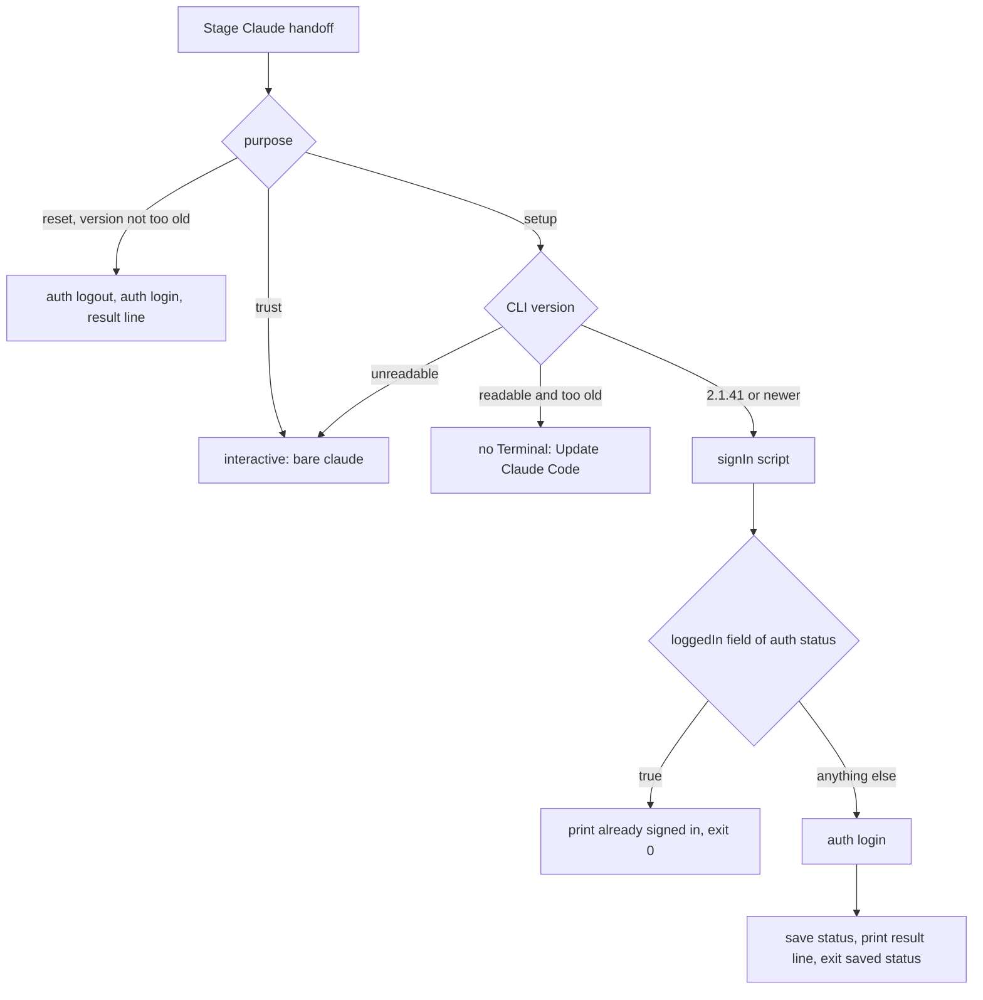
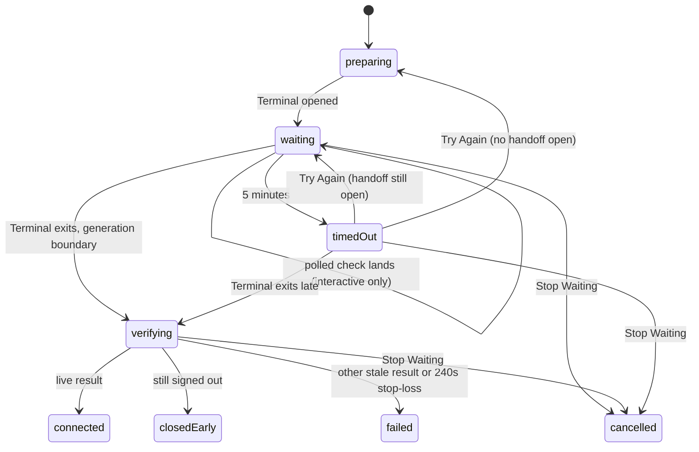

# Claude Sign-In Handoff - Plan

## Goal Capsule

- **Objective:** A person whose Claude account is signed out can click Sign In in Headroom and finish signing in without typing a command, and Headroom tells them truthfully what it is waiting for until usage appears.
- **Means:** Launch the official CLI's own sign-in command from the Terminal handoff and treat that process's exit as the completion signal (KTD1, KTD6).
- **Authority:** `AGENTS.md` hard constraint (official CLI only, no subscription OAuth or Keychain reuse) outranks everything here. Then this plan's Requirements, then its Key Technical Decisions, then unit Approach notes.
- **Stop conditions:** Stop and report if `claude auth login` cannot be driven without Headroom handling credentials, or if any existing test must be weakened to pass.
- **Execution profile:** Single implementation stream. Units land in order U1 to U7.
- **Finishes and ships:** `ce-work` implements and verifies locally. The manual live-Terminal QA, including the concurrency check that decides KTD6's fallback, and the signed-candidate release matrix are Kyle's, because only a person can approve a browser sign-in.

---

## Product Contract

### Summary

Sign In for a signed-out Claude account opens Terminal straight into the CLI's sign-in step. The waiting card names what Headroom is waiting for, times out at 5 minutes with Try Again, and connects on its own when sign-in finishes. The waiting state loses Check Now on every surface. Headroom keeps a private record of each signed-in to signed-out change per account.

### Problem Frame

The Terminal handoff launches bare `claude`. That was deliberate: one script was meant to cover both first sign-in and the workspace-approval prompt (`docs/plans/2026-07-20-001-fix-provider-setup-multi-account-release-stabilization-plan.md`, unit U4). It works only for a config that has never been onboarded, because only then does the CLI show its login selector. A returning user's built-in config has been onboarded, so a signed-out CLI opens to a normal prompt with a small "Not logged in · Run /login" footer. The script's printed guidance is erased when the CLI's full-screen UI clears the window.

Headroom then waits with a card that says "Waiting for sign-in…". Every automatic check learns the account is still signed out and the coordinator discards that result. At 55 seconds the retry ladder gives up with "Sign-in wasn’t confirmed", even when the user is mid-login in a browser. A built-in account dropping its login is the most common reason anyone signs in again, so this is the path most users hit.

Two facts verified on CLI 2.1.278 make the fix safe. `claude auth login`, `auth status` and `auth logout` shipped together in 2.1.41, and `auth status --json` reports a `loggedIn` field, which the usage probe already reads on every poll. The print-mode usage read (CLI 2.1.217 and newer) returned a full report from a folder the CLI had never seen, with no approval prompt.

### Key Decisions

- **Launch the CLI's sign-in command instead of documenting `/login`.** Removing the step beats explaining it. (session-settled: user-approved — chosen over keeping the bare launch and adding "/login" instructions: the instructions would be erased by the CLI's screen clear.) Governs R1, R2, R3.
- **Waiting times out at 5 minutes, then Try Again.** (session-settled: user-directed — chosen over no timeout with slowing checks: the user wants a bounded wait.) Governs R8, R9, R10.
- **Check Now leaves the waiting state on every provider's surfaces.** (session-settled: user-approved — chosen over branching the shared row for Claude only: the row view is shared and the button duplicates automatic checking.) Governs R13.
- **Show Terminal brings the app forward, not a specific window.** (session-settled: user-approved — chosen over raising the exact window: that needs an automation permission prompt.) Governs R14.
- **A readable CLI version below 2.1.41 gets “Update Claude Code”, not a fallback launch.** Every usage check already depends on `auth status`, so those CLIs could sign in and still never be confirmed. (session-settled: user-directed — chosen over keeping the interactive launch with a `/login` hint for every old CLI: that flow cannot finish.) An unreadable version keeps the interactive launch, so a change to the CLI's version format cannot lock every user out of sign-in. Governs R6.
- **The sign-out record has no UI.** (session-settled: user-approved — chosen over a Settings count: held for a later change.) Governs R16, R17.

### Requirements

**Sign-in launch**

- R1. Sign In for a signed-out Claude account opens Terminal directly into the official CLI's sign-in step, with no command for the user to type.
- R2. When the account is already signed in at the moment the script runs, the script says so and ends without starting a sign-in.
- R3. When sign-in ends, Terminal shows one line saying whether sign-in finished, and nothing clears it.
- R4. The manual command ("Rather run it yourself?" and the clipboard fallback) signs in the same account the Sign In button would, for built-in and extra accounts alike.
- R5. Workspace-approval recovery still opens the interactive CLI so the approval prompt can appear, including for an account that is already signed in.
- R6. When the CLI version can be read and is below 2.1.41, Sign In opens no Terminal and the surface tells the user to update Claude Code. When the version cannot be read, the handoff keeps today's interactive launch and the waiting copy tells the user to type `/login`.

**Waiting and recovery**

- R7. A waiting surface states its phase: opening Terminal, waiting for the user in Terminal, or confirming after Terminal closed.
- R8. For Claude, waiting ends in failure only after 5 minutes, with a Try Again action and the message "Sign-in wasn’t confirmed", or "Approval wasn’t confirmed" for a workspace-approval handoff. It never fails at 55 seconds.
- R9. A sign-in that finishes after the timeout still connects without any user action.
- R10. Try Again brings the still-open Terminal forward and resumes waiting for another 5 minutes. When no handoff is open it starts a new one.
- R11. When Terminal closes while the account is still signed out, the surface says "Terminal closed before sign-in finished" and offers Sign In.
- R12. Once Terminal has closed after a successful sign-in, no failure is shown or announced while Headroom confirms it. A sign-in that finishes after the 5-minute timeout has already shown that timeout, and then connects per R9.
- R13. No waiting surface on any provider shows Check Now, and every waiting or confirming state offers at least one control that works.
- R14. Show Terminal appears only while a handoff is open, brings forward the app that opened it, and triggers no macOS permission prompt.
- R15. A handoff restored after relaunch follows R7 to R14, with the timeout measured from the handoff's original start.

**Diagnostics**

- R16. Headroom records each signed-in to signed-out change it observes per account, as the time Headroom detected it and the account key only. A change that happened while Headroom was closed is recorded once at the next launch, with that launch's detection time. A deliberate sign-out during Sign Out & Set Up Again, an account being removed or stop-tracked, a missing CLI, and a transient read failure are not recorded.
- R17. The record is readable through `--probe-claude` and appears nowhere in the app's interface.

**Constraints**

- R18. Every sign-in stays a handoff to the official CLI. Headroom reads no token, touches no Keychain item, types into no CLI screen, and writes no account identity, provider response or caught error into a generated script (`AGENTS.md`; R2, R4 and R11 of the 2026-07-20 plan).

### Acceptance Examples

- AE1. **Covers R1, R3, R9.** Given a built-in account that is signed out and already onboarded, when the user clicks Sign In and approves in the browser, Terminal prints the finished line, the process exits, and the card moves from waiting to confirming to usage with no further click.
- AE2. **Covers R2.** Given the user signed in from their own Terminal between clicking Sign In and the script starting, the script prints that the account is already signed in and exits 0, and the card connects.
- AE3. **Covers R5.** Given a signed-in account on CLI 2.1.100 that needs workspace approval, when the user clicks Open Claude Workspace, the interactive CLI opens and shows the approval prompt. It does not print "already signed in" and exit.
- AE4. **Covers R8, R10.** Given the user leaves Terminal open for 5 minutes without signing in, the card shows "Sign-in wasn’t confirmed" with Try Again and Stop Waiting. Try Again fronts the terminal app and the card returns to waiting.
- AE5. **Covers R11.** Given the user presses Ctrl-C during sign-in, the card says "Terminal closed before sign-in finished" with Sign In.
- AE6. **Covers R4.** Given an extra account on a current CLI, the copied manual command runs both `auth status` and `auth login` against that account's Headroom-owned config folder, never the default login.
- AE7. **Covers R1, R5.** Given a new extra account on CLI 2.1.100, one Terminal trip shows the CLI's login selector and then its approval prompt, and the card reaches usage without a second handoff.

### Success Criteria

- A returning user with a dropped built-in login reaches live usage from one click plus the browser approval.
- No surface in the flow names a button that is not on screen.

### Scope Boundaries

- Codex, Grok and Cursor sign-in scripts and their 55-second ladder stay as they are. Their waiting-state Check Now button is removed and Stop Waiting becomes reachable during confirming (R13), because both surfaces are shared with Claude.
- `SetupRecoveryAction.checkNow`, its "Check Now" label rule (PA11) and the Check Now shown on failed and ordinary recovery rows stay as they are.
- The 240-second verification stop-loss and its serial-lane derivation stay as they are.
- The legacy render-harness script in `ClaudeSetupSession` stays as it is. It runs only when no coordinator exists.
- The user's `_claude_oauth` shell wrapper and tracking Personal as an extra account are personal setup.

#### Deferred to Follow-Up Work

- **Reset leaks old-login usage through the store.** The coordinator ignores live results during a reset, but `UsageStore.merge` still publishes a timer poll that lands between Terminal opening and `auth logout` finishing. KTD6 removes this plan's contribution to it. The store-level gate is separate work.
- **Console (API billing) sign-in reads as a transient failure forever.** `auth status` reports signed in, `/usage` has no windows, and the outcome is "Couldn’t read Claude usage — will retry". Detecting it from the `auth status` JSON is separate work.
- **The usage probe runs `auth status` on every poll with no version gate.** It predates this plan. R6 now gates the two handoffs, and the probe is separate work.
- **Marker liveness trusts a bare PID.** A recycled PID can pin a handoff as open. Pre-existing.
- **Unregistered account homes are never swept** (already in `BUGS.md`, 2026-09-19).
- **Header waiting clock follows built-in accounts only.** Pre-existing.

---

## Planning Contract

### Key Technical Decisions

- KTD1. **Two script kinds, chosen at staging.** `signIn` runs the status guard, then `auth login`, then the result line. `interactive` is today's bare launch. Staging refuses with a typed update-required failure when the version is readable and below 2.1.41 (KTD4), for `.setup` and `.reset` alike. It picks `interactive` when the handoff purpose is `.trust`, when the version cannot be read, or when the account is an extra account and the CLI is below the print-mode floor (2.1.217). That last case is a never-onboarded config on the PTY path, where the bare launch already shows the login selector and then the approval prompt in one Terminal trip. Otherwise `.setup` gets `signIn`. `.reset` keeps `auth logout && auth login` and gains the result line. The manual command follows the same kind, so an `interactive` handoff never hands the user an `auth` subcommand to paste. Governs R1, R2, R4, R5, R6.
- KTD2. **The script exits with sign-in's status, not the echo's.** `SetupCompletionCommand.wrap` records the status of the last command before `exit $?`. The `signIn` invocation saves the login status, prints the result line, and returns the saved status, so a failed sign-in is never recorded as `.succeeded`. The status guard's own output is discarded, because `auth status` prints the signed-in email and organization, and the window Headroom opened should show only the result line. Governs R3, R11, R18.
- KTD3. **One routing construction for script and manual command.** Both use the exported form the reset branch already uses (`export CLAUDE_CONFIG_DIR=…` or `unset CLAUDE_CONFIG_DIR` inside a subshell). A one-command env prefix binds only to the first command, so with two commands the extra account's `auth login` would overwrite the default login. Governs R4.
- KTD4. **A separate version predicate for the 2.1.41 floor.** Add a predicate beside `printUsageSupported` and leave `ClaudeCLIVersionBand` alone, because that enum is printed by the redaction-safe diagnostic. The predicate has three answers: supported, too old, and unreadable. Too old blocks the handoff per R6, and unreadable selects the interactive launch. The gate reads the parsed `--version` at staging and never probes by running the subcommand, because an older CLI could take `auth login` as a model prompt (`docs/solutions/claude-print-mode-usage-probe.md`). Governs R6.
- KTD5. **Claude workspace-approval recovery routes to purpose `.trust`.** Today `.claudeTrustRequired` routes through `.openClaudeSetup` to `.setup`, the same script as Sign In. With KTD1 that would print "already signed in", exit 0, re-detect the approval need and loop. `beginWorkspaceTrust` and the wrapper's `trust` purpose already exist and are wired only for Cursor. Governs R5.
- KTD6. **Waiting policy per handoff: exit-signalled or polled.** A `signIn` or `.reset` handoff schedules no checks while Terminal is open, because every check would return signed-out until the process exits, and the marker monitor already reports the exit within 500 ms. An `interactive` handoff is polled, with each check scheduled a fixed delay after the previous result lands, never on a fixed interval. A capability failure reaches the coordinator through `receiveCapabilityFailure` and not through `receive`, so the polled chain re-arms from both channels, or one inconclusive locator result would end polling until the timeout. `UsageStore.refreshAccount` holds the global `isRefreshing` flag, so an interval shorter than a Claude probe would stall every other provider for the whole wait. Other providers keep the existing ladder. If the U3 port check finds `auth login` binds a fixed local port, add `.claude` to `requiresExclusiveLoginSlot`. Governs R8, R9, R12.
- KTD7. **The 5-minute timeout is its own timer and its own failure case.** Other providers reach `.failed(.retryExhausted)` at 55 seconds with their handoff still open, so reusing that case would hand them Try Again and take away their Sign In and Check Now. The new case joins `.failed(.retryExhausted)` in `handoffDidEnd`'s accepted states, so a late Terminal exit still verifies. Its message follows the handoff purpose: sign-in for `.setup` and `.reset`, approval for `.trust`. The timer registers in `invalidateWork` and checks `isCurrent(key, generation:)`, so it cannot fire during `.verifying`. It is independent of the 240-second stop-loss, which still bounds verification after Terminal closes (KTD2 of the 2026-08-07 plan). It equals `AccountStorage.preparedMarkerGracePeriod`, which only matters when the wrapper never claims its marker, and both orders converge on R11's message. Governs R8, R9, R15.
- KTD8. **`resumeWaiting(for:)` is a new coordinator entry point that never calls `start`.** `start` answers an open handoff with `.blockedByOpenHandoff` and cancels scheduled work. Resume keeps `activeHandoffs`, returns to `.waiting`, re-arms the timeout and applies the handoff's waiting policy. The header clock keeps counting from the original start, because the wrapper pins the whole generation-state line and compares it at exit, so that line is never rewritten. The staged script kind and the terminal app that opened the handoff are saved with the handoff, keyed by its marker generation and kept outside the marker lines the wrapper validates. Restore reads the waiting policy from that record and never re-derives it from the current CLI version, which can change while the original Terminal is still open. After a relaunch the timeout is measured from the persisted start, and an expired handoff lands in the timeout state. `AccountStorage.setupHandoffStartedAt` returns nil for a legacy, unparseable or future-dated start while the handoff still reads as open. In that case restore arms a fresh 5-minute timeout, which keeps the wait bounded. Governs R10, R15.
- KTD9. **A generation boundary at handoff end.** `handoffDidEnd` bumps the store's attachment generation for the account through a boundary callback, so a check already in flight when Terminal exits is rejected and cannot settle verification. This follows KTD3 of `docs/plans/2026-08-19-0950-feat-accounts-lifecycle-overhaul-plan.md`, which bumps the generation at reset start and at handoff end. Governs R12.
- KTD10. **Closed-before-sign-in is its own session failure.** When the final check after a Claude handoff ends reports `.claudeLoginRequired`, the failure is a new `SetupSessionFailure` case with R11's message, whatever completion status the wrapper recorded. `auth login`'s exit status on an abandoned sign-in is unobserved, so the message cannot depend on it. Governs R11.
- KTD11. **The waiting phase is a pure Core value.** It derives from `SetupSessionState`, `hasActiveHandoff` and the handoff's purpose and script kind, following `recoveryPresentation` and `PopoverHeaderStatusText`. Views repaint because every phase change coincides with a change to the observed `states` dictionary. It is not carried inside `.waiting(attempt:)`, which `providerCardSessionKey` flattens. Governs R7.
- KTD12. **Try Again is a distinct action, not a rename.** PA11 pins `.checkNow` to the label "Check Now" and `checkNowCarriesOneLabelInEverySlot` enforces it. Try Again is one handler with two branches: with a handoff open it activates the terminal app (KTD13) and calls resume, and with none open it starts a new sign-in handoff. The timeout state shows Try Again and Stop Waiting only, on the popover card, the account rows and the Settings row alike, and it is keyed on KTD7's failure case, so `.failed(.retryExhausted)` keeps its Sign In and Check Now for every provider. This reverses the B3A placement note in `ClaudeWaitingCard` ("'Check Now' — the action the waiting state is really about — first"), and the code comment that replaces it cites this plan. Governs R10, R13.
- KTD13. **Show Terminal resolves the handler from LaunchServices.** Headroom opens the script with `NSWorkspace.shared.open` and never records the handler. Resolve the default app for the `.command` type when the handoff opens, save its bundle identifier with the handoff (KTD8), and activate that app's running instance, behind an injected seam so tests never touch AppKit. App-level activation needs no automation permission. Minimized windows stay minimized. Governs R14.
- KTD14. **The sign-out record lives in UserDefaults under a versioned key.** It follows `AccountRegistry`'s `.v1` JSON convention and holds a bounded event list, each entry carrying a `detectedAt` time, plus each account's last-known signed-in flag. The flag is what lets a sign-out that happened while Headroom was closed be recorded once at next launch instead of on every launch. The hook is `UsageStore.merge`, where the prior and merged snapshots are both in scope and capability failures have already short-circuited. Staging a `.reset` handoff clears the account's flag, so the exclusion holds however that session ends. The coordinator's session purpose cannot carry it, because Stop Waiting and a settled failure both erase it. Removing an account purges its events along with its config folder. An unbundled `swift run Headroom` resolves `UserDefaults.standard` to a different domain than the app bundle, so the record is read from the built app's binary. Governs R16, R17.

### High-Level Technical Design

Script selection at staging and the `signIn` script's branches:

Waiting lifecycle for a Claude handoff:

`timedOut` is the failure case from KTD7 and `closedEarly` is the failure case from KTD10.

### Sequencing

U1 and U2 deliver the working sign-in. U3 depends on the script kind from U2. U4 depends on the states from U3. U5 is independent of U3 and U4 but is consumed by U4's Show Terminal button, so it lands before U4. U6 is independent. U7 is last.

---

## Implementation Units

### U1. Sign-in script, shared routing and the version predicate

- **Goal:** Generate the `signIn` script and a manual command that route both commands to the right account, and expose the 2.1.41 predicate.
- **Requirements:** R1, R2, R3, R4, R6, R18
- **Dependencies:** none
- **Files:** `Sources/HeadroomCore/Providers/ClaudeSetupCommand.swift`, `Sources/HeadroomCore/Providers/ClaudeUsageCLIProbe.swift`, `Tests/HeadroomCoreTests/ClaudeSetupCommandTests.swift`, `Tests/HeadroomCoreTests/ClaudeProviderTests.swift`
- **Approach:**
  1. Add the script kind to `ClaudeSetupDescriptor` with `interactive` as the default so existing callers and the render harness are unchanged.
  2. Build the `signIn` invocation per KTD1 and KTD2. The guard reads the `loggedIn` field of `auth status --json`, the one field every Headroom usage check has always depended on, and treats only a literal true as signed in. It shows none of that output, and anything else continues to `auth login`. The status command's exit code is not used, because it was verified on one CLI version only.
  3. Add the result line to the `.reset` invocation under the same status-preserving shape.
  4. Move the non-reset manual command to the exported subshell form per KTD3, make script and manual command share the one routing helper, and have the manual command follow the descriptor's script kind per KTD1.
  5. Replace the introduction's "Sign in or approve the Headroom workspace when Claude asks." with copy per kind. The `signIn` result line says sign-in finished and that Headroom is checking usage. It does not promise usage, because a Console login has none.
  6. Add the predicate per KTD4.
- **Patterns to follow:** `resetUsesOfficialLogoutThenLoginWithTheSameSafeAccountRouting`, `generatedScriptContainsNoProviderPayloadOrIdentity`, `completionMarkerWrapperIsRedactedAndZshValid`, and the `/bin/zsh -n` parse check in `ClaudeSetupCommandTests`. `printUsageSupported` for the predicate.
- **Test scenarios:**
  - Built-in `signIn` script contains the `loggedIn` field guard, `auth login`, and `unset CLAUDE_CONFIG_DIR`, and parses under `zsh -n`.
  - Extra-account `signIn` script exports that account's config folder before both commands.
  - Covers AE6. Extra-account manual command uses the exported subshell form, and the exact string is asserted with `==`.
  - Built-in manual command uses the `unset` subshell form, exact string.
  - The invocation returns the saved login status: a fragment test asserts the result line sits between the status capture and the final status return.
  - `.reset` script keeps `auth logout && auth login` and gains the result line without changing its recorded status.
  - `interactive` kind produces today's script byte-for-byte, and its manual command contains no `auth` subcommand.
  - The `signIn` script sends the status guard's output to the null device, so no email or organization can reach the window.
  - No script kind contains an account ID, email, `api.anthropic.com`, or any forbidden term from the existing redaction list.
  - Paths containing a single quote stay one shell token in the `signIn` script.
  - Predicate: `2.1.41` and `2.1.278` are supported, `2.1.40` is too old, and an empty string and `garbage` are unreadable.
- **Verification:** `swift test` passes with the new cases and no existing assertion narrowed.

### U2. Staging picks the script kind and approval recovery gets its own route

- **Goal:** `prepareHandoff` chooses the kind per KTD1, and Open Claude Workspace stops sharing the Sign In script.
- **Requirements:** R5, R6, R18
- **Dependencies:** U1
- **Files:** `Sources/HeadroomApp/UI/SetupSessions.swift`, `Sources/HeadroomCore/Models/ProviderSetup.swift`, `Tests/HeadroomAppTests/ClaudeExecutableDiscoveryInteractionTests.swift`, `Tests/HeadroomCoreTests/ProviderSetupOutcomeTests.swift`
- **Approach:**
  1. In the Claude branch of `prepareHandoff`, read the version through an injected seam whose production value calls `ClaudeUsageCLIProbe` with the account's environment, then apply KTD1's rule. `prepareHandoff`'s only seam today is the executable locator, so without this the staging tests would spawn the real CLI. Keep the read off the main actor, as `versionBand` already is.
  2. Give `.claudeTrustRequired` a recovery route that reaches `beginWorkspaceTrust` per KTD5. Its label stays "Open Claude Workspace".
  3. Make the staged script kind and purpose available to the coordinator so U3 can pick the waiting policy.
- **Execution note:** Add the failing route test for `.claudeTrustRequired` first. The loop in AE3 is invisible to unit tests of either half.
- **Patterns to follow:** `recoveryRoute(for:)` and its pure tests. The Cursor `.trust` wiring in `performRecovery`.
- **Test scenarios:**
  - Covers AE3. `.claudeTrustRequired`'s primary action routes to the trust purpose, not `.setup(.standard)`.
  - `.claudeLoginRequired`'s primary action still routes to `.setup(.standard)`.
  - The 28-row table in `everyProviderOutcomeHasOneTypedRecoveryPresentation` changes only in the `.claudeTrustRequired` row.
  - Staging `.setup` or `.reset` with version `2.1.40` returns the update-required failure, writes no script and opens nothing. An unreadable version selects `interactive`.
  - Staging with purpose `.trust` selects `interactive` regardless of version.
  - Covers AE7. An extra account on a version below 2.1.217 selects `interactive`. The same account on 2.1.217 selects `signIn`. A built-in account on 2.1.100 selects `signIn`.
  - A missing executable still returns the existing capability failures, and no manual command is produced (KTD5 of the 2026-08-12 plan).
- **Verification:** Route and staging tests pass. `swift run Headroom --probe-claude` still prints its diagnostic unchanged.

### U3. Coordinator waiting policy, timeout, resume, boundary and the closed-early failure

- **Goal:** Replace the 55-second cliff for Claude with the policy in KTD6 to KTD10.
- **Requirements:** R8, R9, R10, R11, R12, R15
- **Dependencies:** U2
- **Files:** `Sources/HeadroomCore/Engine/SetupSessionCoordinator.swift`, `Sources/HeadroomCore/Engine/UsageStore.swift`, `Sources/HeadroomApp/UI/SetupSessions.swift`, `Tests/HeadroomCoreTests/SetupSessionCoordinatorTests.swift`, `Tests/HeadroomCoreTests/UsageStoreTests.swift`
- **Approach:**
  1. Add the waiting policy and the waiting timeout as injected values, defaulting other providers to today's ladder. Add KTD7's failure case and list it in `handoffDidEnd`'s accepted states.
  2. Register the timeout task and any polled-check task in `invalidateWork`, each guarded by `isCurrent(key, generation:)`.
  3. For the polled policy, schedule the next check when a result lands during `.waiting`, from `receive` and from `receiveCapabilityFailure` alike (KTD6).
  4. Add `resumeWaiting(for:)` per KTD8. Save the script kind with the handoff, and have `restoreActiveHandoff` read the policy from that record and compute the timeout from the persisted start.
  5. Add the boundary callback per KTD9 and call it from `handoffDidEnd` for every purpose. Reset keeps its existing `resetBoundary` call.
  6. Add the failure case per KTD10 in the final-refresh mapping.
  7. Expose the final-verification completion so U4's phase can distinguish "sign-in reported finished" from unknown.
  8. Drive every timer through `SetupRetryScheduling`. No `Task.sleep`.
  9. Leave the fixed-port question to the Concurrency check in the Verification Contract. It needs a browser approval, so it is not part of this unit's completion, and the KTD6 fallback is a follow-up change if the check calls for it.
- **Patterns to follow:** `scheduleVerificationStopLoss` for a guarded, invalidated timer. `ManualSetupScheduler` and `SetupCoordinatorHarness` in the test file. The Codex completion split in `receive`.
- **Test scenarios:**
  - Exit-signalled Claude handoff: after open, `pendingDelays` holds only the 300-second timeout and no ladder entries.
  - Polled Claude handoff: a stale result during `.waiting` schedules exactly one next check, and a second result before it fires does not double-schedule.
  - Codex handoff: `pendingDelays` still holds the first ladder entry, and exhaustion still yields `.failed(.retryExhausted)`.
  - Firing the timeout yields KTD7's failure case, not `.failed(.retryExhausted)`, and leaves `hasActiveHandoff` true.
  - A Codex handoff whose ladder exhausts with Terminal still open stays `.failed(.retryExhausted)` and is unaffected by the Claude timeout.
  - A polled handoff that receives one capability failure during `.waiting` still schedules its next check.
  - Covers R9. `handoffDidEnd` after the timeout moves to `.verifying`, and a live result yields `.connected`.
  - The timeout does not fire while `.verifying`: end the handoff, then fire the cancelled timeout entry, and the state is unchanged.
  - `resumeWaiting` from the timeout state returns `.waiting`, re-arms one timeout, and never enters `.blockedByOpenHandoff`.
  - `resumeWaiting` with no active handoff is a no-op.
  - A second `begin` while waiting still yields `.blockedByOpenHandoff` and opens nothing.
  - Covers R12. A stale signed-out result produced before `handoffDidEnd` does not settle verification. The store test asserts a result carrying the pre-boundary generation is rejected.
  - Covers AE5. Final check signed out yields the closed-early failure with completion `.failed`, `.succeeded` and `.unknown` alike.
  - Restored handoff whose persisted start is older than 5 minutes lands in the timeout state. One that is 2 minutes old arms a 3-minute timeout. One with no readable start arms a fresh 5-minute timeout.
  - `forceCancel` during `.verifying` yields `.cancelled` and clears the pending final refresh.
  - A restored `interactive` handoff resumes polling and a restored `signIn` handoff schedules no checks, each read from the saved record with the current CLI version stubbed to the opposite answer.
  - Reset purpose: no checks are scheduled while open, and live results are still ignored until the handoff ends.
  - `finalVerificationUsesSerialLaneBoundNotRetryLadderScale` still passes unchanged.
- **Verification:** The coordinator suite passes on the virtual scheduler with no wall-clock waits.

### U5. Show Terminal activation seam

- **Goal:** Bring the handler app forward without a permission prompt, behind a testable seam.
- **Requirements:** R14
- **Dependencies:** none
- **Files:** `Sources/HeadroomApp/UI/SetupSessions.swift`, `Tests/HeadroomAppTests/AccountsSettingsInteractionTests.swift`
- **Approach:** Per KTD13. Activation uses the bundle identifier saved when the handoff opened, so a restored handoff fronts the app that actually holds it. The seam returns whether an app was activated so the caller can stay silent when none is running. No AppleScript, no System Events, no window enumeration.
- **Patterns to follow:** The injected `open` and `prepare` closures on `SetupSessionCoordinator`. `copyCommand` for a small AppKit boundary function.
- **Test scenarios:**
  - With a stub seam, Show Terminal calls activate once and starts no handoff.
  - With a stub reporting no running handler, the call is a no-op and the session state is unchanged.
  - After the default `.command` handler changes mid-handoff, Show Terminal still activates the saved app.
- **Verification:** On a Mac whose `.command` handler is Terminal, the button fronts Terminal with no permission dialog. Repeat with iTerm as the handler if available.

### U4. Waiting surfaces, copy and announcements

- **Goal:** Every surface states the phase, drops Check Now while waiting, and offers a working control in each state.
- **Requirements:** R6, R7, R10, R11, R13, R14
- **Dependencies:** U3, U5
- **Files:** `Sources/HeadroomCore/Models/ProviderSetup.swift`, `Sources/HeadroomApp/UI/ClaudeSetupViews.swift`, `Sources/HeadroomApp/UI/CodexSetupViews.swift`, `Sources/HeadroomApp/UI/ProviderCardIdentityRows.swift`, `Sources/HeadroomApp/UI/ProviderCardView.swift`, `Sources/HeadroomApp/UI/AccountsSettingsTile.swift`, `Sources/HeadroomApp/UI/SetupSessions.swift`, `Tests/HeadroomCoreTests/ProviderSetupOutcomeTests.swift`, `Tests/HeadroomAppTests/ProviderCardIdentityRowTests.swift`, `Tests/HeadroomAppTests/AccountsSettingsInteractionTests.swift`, `Tests/HeadroomAppTests/PopoverHeaderStatusTests.swift`
- **Approach:**
  1. Add the phase value and its copy table in Core per KTD11. The `/login` variant of the waiting-for-user copy applies only to a `.setup` handoff that is `interactive` because the version was unreadable (R6). An extra account below the print-mode floor is a never-onboarded config whose CLI shows its own login selector, so it keeps the plain sign-in copy. A `.trust` handoff is always `interactive` and keeps today's approval guidance and its “Yes, I trust this folder” token.
  2. Remove Check Now from the four waiting surfaces: `ClaudeWaitingCard`, `CodexWaitingCard`, the shared waiting branch of `AccountSectionView.signInContent`, and the Settings row, which today renders Sign In and Check Now while waiting because `recoveryButtons` is gated on `recoveryActions != nil`. Suppress the whole recovery pair there while waiting, as `.blockedByOpenHandoff` already does.
  3. Rename Reopen Terminal to Show Terminal on the Claude card, wire it to U5, and render it only while a handoff is open.
  4. Key the Stop Waiting affordances on the session being in a waiting or confirming phase, not on `hasActiveHandoff`, so the confirming phase has a control.
  5. Render the timeout state per KTD12 on all three surfaces. On the popover card it keeps `ClaudeWaitingCard`'s compact shell with the timeout message, and it never falls through to `setupFailureNotice` plus `ClaudeConnectCard`, whose first-run walkthrough is wrong for a returning user. The account row and the Settings row swap their primary to Try Again for this state.
  6. Add the timeout, closed-early and update-required messages to `failureMessage`. The update-required state offers Check Now as its one action, so the user can re-check after updating. The `retryExhausted` sentence stays, because the providers that still reach it keep the Sign In and Check Now it names.
  7. Bring `SetupSessions.failureMessage` strings under the copy-rule tests, which today cover only `ProviderSetupOutcome` and capability strings.
  8. Keep `announceFailureIfNeeded` to one announcement per distinct failure per handoff, so a Try Again loop does not repeat the same sentence at high priority.
  9. Replace the B3A comment on `ClaudeWaitingCard` with a WHY note citing KTD12.
- **Patterns to follow:** The quiet bordered token on the approval variant for the `/login` hint. `CapabilityRecoveryPresentation.state(for:)` for per-phase control availability. `SetupChipButtonStyle(size: .small)` and `CardActionRow` for every chip. The mirrored branch order note on `singleAccountLabelInset`.
- **Test scenarios:**
  - Phase table: `.preparing` maps to opening, `.waiting` with a handoff maps to waiting-for-user, `.verifying` with no handoff maps to confirming, and an `interactive` setup handoff selects the `/login` variant.
  - An `interactive` handoff with purpose `.trust` selects the approval copy, never the `/login` variant.
  - No phase string and no `failureMessage` string contains a straight apostrophe, an unspaced em dash, "connect", "Check Again" or "Refresh".
  - The timeout message names no button absent from the timeout state.
  - The waiting branch of the account row renders no Check Now for Claude, Codex, Grok or Cursor accounts.
  - The Settings row in `.waiting` returns no recovery actions. In the timeout state with a handoff open its primary is Try Again calling resume. In every other failed state it returns its actions as today.
  - The popover card in the timeout state renders the compact waiting shell and not the first-run connect card.
  - Try Again with a handoff open activates the terminal app and resumes. With none open it starts a new sign-in handoff.
  - The Stop Waiting account resolvers return the account during `.verifying` with no active handoff.
  - The timeout state presents Try Again and Stop Waiting and no Check Now or Sign In. `.failed(.retryExhausted)` on a Codex row still presents Sign In and Check Now.
  - `checkNowCarriesOneLabelInEverySlot` passes unchanged.
  - Header status tests pass unchanged, and the clock still outranks the setup line.
  - A timeout, Try Again, timeout sequence announces the failure once.
- **Verification:** Live `MenuBarExtra` popover in both appearances shows each phase with no clipped chip row, per the meter-acceptance gotcha in `AGENTS.md`. `--render-popover` output is not accepted as evidence.

### U6. Sign-out record

- **Goal:** Record signed-in to signed-out changes and print them from the diagnostic.
- **Requirements:** R16, R17, R18
- **Dependencies:** none
- **Files:** `Sources/HeadroomCore/Settings/SignOutRecord.swift` (new), `Sources/HeadroomCore/Engine/UsageStore.swift`, `Sources/HeadroomCore/Engine/UsageStoreAccountLifecycle.swift`, `Sources/HeadroomCore/Providers/ClaudeCapabilityDiagnostic.swift`, `Sources/HeadroomApp/HeadroomApp.swift`, `Tests/HeadroomCoreTests/SignOutRecordTests.swift` (new), `Tests/HeadroomCoreTests/UsageStoreTests.swift`
- **Approach:** Per KTD14. Staging a `.reset` handoff clears the account's last-known flag. Detach and stop-track clear it too, because the built-in row reuses `AccountID.primary` across stop and resume. `UsageStore.removeAccount` also purges the account's events. The list is bounded. The diagnostic prints a count and the timestamps per account key.
- **Patterns to follow:** `AccountRegistry`'s `loadJSON`/`saveJSON` and versioned keys. `ClaudeCapabilityDiagnostic.lines` for redaction-safe output. The injected `now` seam.
- **Test scenarios:**
  - Live then `.claudeLoginRequired` records one event. Repeated signed-out polls record nothing more.
  - Signed-out at first observation with no persisted flag records nothing.
  - A persisted signed-in flag plus a signed-out first observation after relaunch records exactly one event, stamped with the detection time.
  - A transient capture failure and an unknown-UI outcome change neither the flag nor the list.
  - A sign-out during a reset handoff records nothing.
  - A reset that is force-cancelled, or that settles as failed, and then polls signed out records nothing.
  - Removing an extra account leaves no event for it in the persisted record.
  - Detach clears the flag, and re-attaching a signed-out built-in account records nothing.
  - The list drops its oldest entry past the bound.
  - Encoded storage and the diagnostic output contain no email, org name, account UUID or CLI output.
- **Verification:** The built app's binary, `Headroom.app/Contents/MacOS/Headroom --probe-claude`, prints the events the running app recorded. `swift run Headroom` reads a different defaults domain and would print an empty section.

### U7. Documentation and ledger

- **Goal:** Keep `AGENTS.md`, `BUGS.md` and the learnings library true.
- **Requirements:** R18
- **Dependencies:** U1 to U6
- **Files:** `AGENTS.md`, `BUGS.md`, `docs/solutions/claude-sign-in-handoff.md` (new)
- **Approach:** In `AGENTS.md`, update the multi-account paragraph and add a gotcha covering the two script kinds, why approval recovery keeps the interactive launch, and the exit-status rule. In `BUGS.md`, add the Deferred to Follow-Up Work items, remove the stale `ProviderSetupRecoveryCard` button-style entry if still stale, and close the "connect" prose item if U4's copy resolves it. Write the learning through `ce-compound` after live QA.
- **Test expectation:** none -- documentation only.
- **Verification:** A reader of `AGENTS.md` alone can tell why `.trust` and `.setup` run different scripts.

---

## System-Wide Impact

- **All four providers' waiting rows change.** `AccountSectionView.signInContent` is shared, so Codex, Grok and Cursor lose the waiting-state Check Now. Their process exit still triggers verification, and their 55-second ladder still ends in the failed state, where Check Now remains.
- **Stop Waiting becomes reachable during confirming for every provider**, because the resolvers are shared. `forceCancel` already clears the pending final refresh, so this adds a control and changes no settlement rule.
- **The generation boundary at handoff end applies to every provider.** It rejects only results launched before the exit. The refresh that `handoffDidEnd` requests carries the new generation.
- **The menu bar, widgets and phone projection are untouched.** They read snapshots, and this plan changes no snapshot shape and no widget schema.
- **One new UserDefaults key.** Nothing migrates, and removing the key loses only diagnostics.

---

## Risks & Dependencies

- **`auth login` exit status on abandonment is unobserved.** If closing the browser tab leaves the process running, the user sees waiting until the 5-minute timeout, which is the designed fallback. Observe it in live QA and record the result in the learning.
- **A fixed local callback port** would break two concurrent Claude sign-ins. KTD6 names the fallback.
- **The CLI may change the `auth status` JSON shape.** The guard treats only a literal `loggedIn` true as signed in, so a change fails toward running `auth login`, which is safe. The usage probe would break on the same change and surface it first.
- **Any handoff change trips the signed-candidate matrix** in `docs/release/website-dmg-release.md` before the next DMG.
- **Running `auth status` against a new extra account's config folder writes a `.claude.json` stub there** (`BUGS.md`, 2026-09-19). Harmless for setup. A future orphan sweep must not read an empty folder as unused.

---

## Verification Contract

| Gate | Command | Applies to |
|---|---|---|
| Build | `swift build` | all units |
| Core and unit suite | `swift test` | U1, U2, U3, U4, U6 |
| App target suite | `./Scripts/build-app.sh --deps-only && xcodebuild -project Headroom.xcodeproj -scheme HeadroomAppTests -destination 'platform=macOS' -derivedDataPath ./.xcode-derived test` | U2, U4, U5 |
| Live probe smoke | `swift run Headroom --probe-claude` | U2 |
| Sign-out record read | `./Scripts/build-app.sh`, then `Headroom.app/Contents/MacOS/Headroom --probe-claude` | U6 |
| Demo smoke | `swift run Headroom --demo multi-3` opens with no crash | U4 |
| Sign-in QA | manual: built-in account signed out and already onboarded, click Sign In, approve in browser, card reaches usage with no typing | U1, U2, U3 |
| Extra-account QA | manual: add an extra Claude account, confirm the default login in a separate Terminal is unchanged afterwards | U1 |
| Manual-command QA | manual: run the copied command for an extra account, confirm it signs in that account | U1 |
| Interrupt QA | manual: Ctrl-C during sign-in shows the closed-early message, and closing the window does the same | U3, U4 |
| Timeout QA | manual: leave Terminal open 5 minutes, Try Again fronts the terminal app and resumes, then finish sign-in and confirm it connects. Repeat from Settings → Accounts | U3, U4, U5 |
| Older-CLI extra account QA | manual, if a CLI below 2.1.217 is available: add an extra account and reach usage in one Terminal trip | U2 |
| Relaunch QA | manual: quit and reopen Headroom mid-handoff, confirm the clock and the timeout continue from the original start | U3 |
| Concurrency check | manual: start two Claude sign-ins at once. If both complete, no change. If the second cannot bind its callback, add `.claude` to the exclusive login slot, then confirm the second sign-in is held until the first ends and then completes | KTD6 |
| Visual acceptance | live `MenuBarExtra` popover, light and dark, each phase | U4 |
| Release gate, not implementation | signed-candidate matrix in `docs/release/website-dmg-release.md` | before the next DMG |

Record the passing test count before starting so the final count can be compared.

---

## Definition of Done

- Every gate above has run and its output is shown, including the manual QA rows.
- No existing assertion is weakened or narrowed, and no safety mechanism is bypassed.
- Failures stay typed. No interpolated error, account identity, token or provider response reaches a script, a log line, the sign-out record or the diagnostic.
- Swift 6 strict concurrency compiles clean.
- Code abandoned during implementation is removed from the diff.
- `AGENTS.md`, `BUGS.md` and the new learning are updated per U7.
- `ce-code-review` has run on the finished tree before any commit.

Per unit: U1 done when the script and manual-command tests pass. U2 done when AE3's route test passes. U3 done when the coordinator suite passes on the virtual scheduler. U5 done when the seam tests pass and the live activation check shows no permission dialog. U4 done when the surface tests pass and visual acceptance is recorded. U6 done when the record tests pass and the diagnostic prints. U7 done when the three documents are updated.

---

## Sources & Research

- `Sources/HeadroomCore/Providers/ClaudeSetupCommand.swift`: `script(for:)` and `manualCommand(for:)`. The reset branch already emits `auth logout && auth login` and the exported subshell form.
- `Sources/HeadroomCore/Providers/SetupCompletionCommand.swift`: `wrap` records the last command's status through its EXIT trap, and pins the generation-state line.
- `Sources/HeadroomCore/Engine/SetupSessionCoordinator.swift`: `start`, `scheduleRetry`, `handoffDidEnd` and its accepted states, `receive`, `invalidateWork`, `restoreActiveHandoff`, `requiresExclusiveLoginSlot` (Codex only).
- `Sources/HeadroomApp/UI/SetupSessions.swift`: `prepareHandoff`, `monitorCompletion`, `recoveryRoute`, `failureMessage`, `announceFailureIfNeeded`, `SetupSessionActivity`.
- `Sources/HeadroomCore/Providers/ClaudeUsageCLIProbe.swift`: `runAuthCheck` runs `auth status --json` on every poll with no version gate, so a CLI below 2.1.41 already reads as `.claudeUnknownUI`. `versionBand`, `printUsageSupported`, `parsedVersion`.
- `Sources/HeadroomCore/Engine/UsageStore.swift`: `merge`, `refreshAccount` and the global `isRefreshing`, attachment generations.
- `Sources/HeadroomApp/UI/AccountsSettingsTile.swift`: `recoveryButtons` gating and `settingsStopWaitingAccount`.
- `docs/plans/2026-07-20-001-fix-provider-setup-multi-account-release-stabilization-plan.md`: U4 (one script for sign-in and approval), R2, R4, R11.
- `docs/plans/2026-08-07-001-fix-account-setup-recovery-hardening-plan.md`: KTD2, the stop-loss derivation and the virtual-clock rule.
- `docs/plans/2026-08-19-0950-feat-accounts-lifecycle-overhaul-plan.md`: KTD1 and KTD2 (force-cancel order, single marker resolver), KTD3 (generation bumps).
- `docs/plans/2026-08-12-001-fix-claude-npm-prefix-discovery-plan.md`: KTD5, no manual command without a resolved executable.
- `docs/solutions/claude-print-mode-usage-probe.md`: print mode skips workspace approval, and new CLI surfaces are gated on the oldest verified version.
- Claude Code public changelog: `auth login`, `auth status` and `auth logout` added in 2.1.41.
- Live checks on CLI 2.1.278, 2026-09-19: `auth status --json` output for a signed-in and a signed-out config, and the print-mode usage read from an unseen folder.
