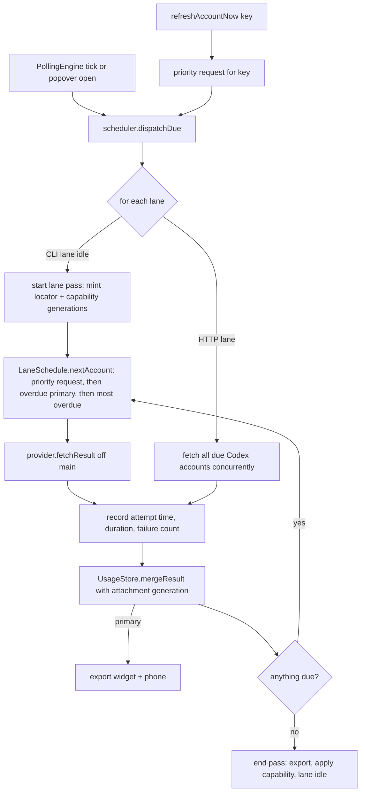
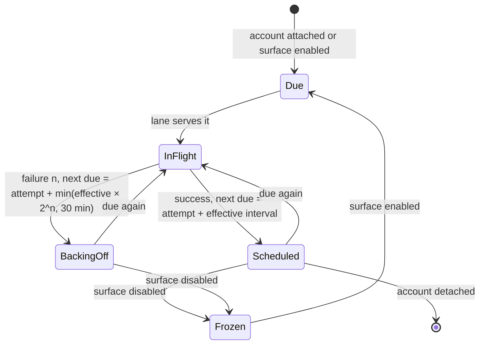

# Per-Account Polling Beyond the Five-Account Cap - Plan

## Goal Capsule

- **Objective:** A user tracking any number of Claude, Codex, or Grok accounts sees every account refreshed at a cadence Headroom actually keeps, can read that cadence in Settings, and never has one broken account or a large account count turn Headroom into a machine-wide load.
- **Means:** A scheduler of pure, clock-injected decisions plus a main-actor engine type owned by the store (KTD1), driven through the existing wake timer (KTD6), replacing the sweep-per-tick refresh; the poll interval becomes a per-account promise that stretches visibly under load, and the fixed five-account cap becomes a tested envelope (KTD10).
- **Execution profile:** Authored without a Swift toolchain; every build and test gate in the Verification Contract runs on a macOS host with Xcode 26 before merge.
- **Stop conditions:** A settled decision proves infeasible; the suite cannot be made green on macOS within the unit's scope; a change would require touching the probe transport or the OAuth boundary.
- **Product authority:** This document's Product Contract. The conventions in `AGENTS.md` stay binding, in particular the official-CLI-only rule for Claude usage, the serial CLI lanes, and the probe robustness properties.
- **Active scope:** Scheduling, load guardrails, cap removal, and the Settings cadence display. The side-by-side provider column layout raised in the same feedback is a separate area and not active scope.
- **Open blockers:** None.

---

## Product Contract

### Summary

Every account of every provider is refreshed from its own due time instead of all together on every timer tick. CLI-probed providers (Claude, Grok, Cursor) drain a per-provider queue one probe at a time, ordered by how overdue each account is; Codex, fetched over HTTP, refreshes its due accounts concurrently.
The poll interval becomes a promise made to each account; when the lane cannot keep it, Headroom stretches the effective interval and shows both values in Settings.
The five-per-provider cap goes away as a product limit and is replaced by a generous, tested envelope with load guardrails that keep the core app calm at any count.

### Problem Frame

A user wrote in asking to manage more than five accounts per service, saying many people now run more than a dozen at once.
Today the limit is a single constant, and the popover and Settings were designed to it.
Behind that constant sits a real cost: every refresh probes every configured account in a provider's lane back to back, and each Claude probe spawns a full `claude` process with hard deadlines that reach about 80 seconds on the fallback path.
So a larger cap under the current sweep would make one slow account delay every other account on every tick, and would let the total sweep outgrow the poll interval with nothing telling the user.
The interval setting already reads as a promise about freshness; past a handful of accounts it is a promise the sweep cannot keep.

### Key Decisions

- **No fixed product cap; a tested envelope instead.** Users can add accounts up to a bound the code, fixtures, and tests are proven at, presented as "tested up to", not as a limit. (session-settled: user-directed — no fixed cap chosen over 10 per provider, 20 per provider, and keeping 5: the request is for open-ended counts. session-settled: user-approved — tested envelope chosen over a truly unbounded constant: an untestable "unlimited" is how the core gets fragile.) Governs R14, R15.
- **Provider parity.** Every scheduling, guardrail, envelope, and Settings behavior in this plan applies to all providers; where a provider's transport makes a behavior moot, the requirement says so rather than silently skipping that provider. (session-settled: user-directed — chosen over a CLI-only scheduler that left Codex on the old sweep: the product goal is uniform real-time data for all providers and all accounts.) Governs R1, R2, R8, R11.
- **The interval is a per-account promise.** Each account is due its own refresh every interval; the lane's real cadence is derived from that. (session-settled: user-directed — chosen over keeping the primary on interval while extras share the remainder, over widening to parallel probes to hold every account on interval, and over on-demand refresh past a threshold: a single, honest per-account meaning is easier to reason about than three tiers of freshness.) Governs R1, R7, R20.
- **Stretch and say so on overload.** When the lane cannot keep the promise, the effective interval grows and Settings shows it; nothing is blocked and nothing drifts silently. (session-settled: user-directed — chosen over warning before adding an account, over letting ages drift, and over a user-curated polled set: explicit degradation without gating.) Governs R7, R9, R10.
- **Due-queue ordering.** The lane always probes the most overdue account next. (session-settled: user-directed — chosen over fixed round-robin slots and over attention-weighted ordering: self-healing after sleep, Check Now, and slow probes, with weighting available later as a refinement.) Governs R1, R3.
- **Load guardrails.** The lane is busy no more than about half of wall-clock time, and a failing account backs off on its own so it cannot starve the queue. (session-settled: user-approved — chosen over letting the lane run continuously: a laptop should never have a Headroom-spawned CLI process running all day.) Governs R8, R11, R12.
- **Primary first; user actions jump the queue.** The account driving the menu bar and widgets is never displaced by extras, and Check Now, Check Again, Make Main, and setup verification run immediately. Governs R3, R4, R5.
- **Probe transport is unchanged.** The compliant per-account spawn of the official CLI stays the unit of work; the 2.1.278 CLI exposes no cheaper usage surface. Per-account spawn trimming is allowed in planning but is not a requirement. Governs R6.

### Requirements

**Scheduling**

- R1. Every account of every provider carries its own due time, the last capture attempt plus the effective interval, and its lane always serves the most overdue account next.
- R2. A CLI lane (Claude, Grok, Cursor) runs one probe at a time; the Codex HTTP lane fetches all of its due accounts concurrently; lanes for different providers overlap with each other.
- R3. When the provider's primary account and any extra are both overdue, the primary is probed first.
- R4. Every user or setup action that requests a refresh of one account (Check Now, Check Again, Try Again, Make Main, and setup verification through the coordinator) probes that account at the front of its lane's queue without waiting for other due accounts, and resets its due time on completion.
- R5. Manual actions in R4 keep their current semantics for locator epochs, capability recovery, and setup session completion.
- R6. Each probe continues to run the official CLI once per account with the account's isolated config home; no shared credential, endpoint, or token path is introduced.

**Promise and stretching**

- R7. The effective interval for a lane is the chosen interval or, when larger, the shortest interval at which every account in the lane can be probed at its recently observed probe duration within the duty-cycle ceiling in R8.
- R8. A CLI lane is busy for no more than about half of wall-clock time over a recent window; the effective interval stretches rather than the lane exceeding that ceiling. The HTTP lane is not duty-cycled because its cost is a network request rather than a process, so its effective interval is the chosen interval.
- R9. Settings shows, per provider, the chosen interval and the effective interval whenever they differ, with the account count as the stated reason.
- R10. When the effective interval equals the chosen interval, no additional cadence UI appears.

**Failure isolation**

- R11. An account of any provider whose probe or fetch fails is retried with growing spacing up to a bound, and returns to the effective interval on its next successful capture.
- R12. A failing account delays a healthy account by at most one probe's worth of time.
- R13. Never-signed-in extra accounts keep an exemption equivalent to today's every-fourth-cycle timer behavior, expressed in due-time terms.

**Cap and envelope**

- R14. The fixed five-per-provider cap is removed as a product limit; the add-account affordance stays enabled until the tested envelope is reached.
- R15. The tested envelope is one constant, initially 20 per provider with Cursor staying at 1, that unit tests, demo scenarios, and Settings interaction tests exercise; Settings says "tested up to N" only when a provider reaches it.
- R16. Every existing per-account behavior works unchanged at the envelope: Make Main, stop-tracking the built-in account, the same-login badge, and removing an extra account deleting its config home.

**Surfaces**

- R17. The Settings Accounts list remains usable at the envelope inside the fixed-frame Settings window.
- R18. The popover card list continues to scroll past its existing height cap at the envelope; the header freshness label keeps its current meaning.
- R19. Widget and phone snapshots update within one probe of the primary account's capture rather than waiting for every account in the lane.

**Timing bounds**

- R20. The two-minute interval floor is unchanged and applies to the effective interval.
- R21. Setup verification's fixed 240 second stop-loss is sufficient because verification jumps the queue under R4; planning confirms rather than re-deriving it from account count.

### Key Flows

- F1. Timer refresh with twelve Claude accounts
  - **Trigger:** The polling timer fires with a 5 minute interval and twelve Claude accounts configured.
  - **Steps:** The Claude lane takes the most overdue account, probes it, records its attempt time, then takes the next. Codex accounts that are due fetch concurrently and record their own attempt times. Each Claude account is probed roughly every 5 minutes, about 25 seconds apart on the print path.
  - **Outcome:** Every account's age stays within the chosen interval plus one probe. Settings shows only the chosen interval.
  - **Covers:** R1, R2, R7, R10.
- F2. Overload on a short interval
  - **Trigger:** The user sets a 2 minute interval with forty Claude accounts averaging 3 seconds per probe.
  - **Steps:** Probing every account takes 120 seconds, which is the whole interval. The duty-cycle ceiling stretches the effective interval to about 4 minutes. Settings shows "2 min chosen, about 4 min effective, 40 Claude accounts".
  - **Outcome:** The lane stays idle about half the time; nothing is blocked; the user can see why.
  - **Covers:** R7, R8, R9, R20.
- F3. Check Now on an extra account while the lane is busy
  - **Trigger:** The user presses Check Now on account 7 while account 3's probe is running.
  - **Steps:** Account 7 becomes the next probe after account 3 finishes, ahead of any other overdue account. Its due time resets on completion.
  - **Outcome:** The user's requested account refreshes within one probe.
  - **Covers:** R4, R5, R12.
- F4. One account hangs
  - **Trigger:** Account 5's print probe times out and its fallback also fails, costing about 80 seconds.
  - **Steps:** Account 5 is marked failed and its next due time moves out with growing spacing. The queue continues with the next overdue account.
  - **Outcome:** Other accounts lose at most one probe's worth of time this pass; account 5 returns to normal cadence on its next success.
  - **Covers:** R11, R12.
- F5. Adding a sixth account
  - **Trigger:** The user adds a Claude account with five already configured.
  - **Steps:** The add flow proceeds as today through the Terminal handoff. Once verified, the account enters the queue as overdue and is probed at the next opportunity behind the primary.
  - **Outcome:** Six accounts show in the popover; the Settings add affordance remains enabled.
  - **Covers:** R3, R14, R16.

### Acceptance Examples

- AE1. **Covers R1, R3.** Given four Claude accounts where the primary and account 3 are both overdue, when the lane picks its next probe, then it probes the primary first and account 3 next.
- AE2. **Covers R7, R8, R9.** Given a 2 minute chosen interval, 40 Claude accounts, and a recent probe duration of 3 seconds, when the effective interval is computed, then it is about 4 minutes and Settings shows both values with the account count.
- AE3. **Covers R10.** Given a 5 minute chosen interval and three Claude accounts, when the effective interval is computed, then it equals 5 minutes and Settings shows no effective-interval row.
- AE4. **Covers R4, R12.** Given a busy lane with six overdue accounts, when the user presses Check Now on one of them, then it is the next account probed after the in-flight probe finishes.
- AE5. **Covers R11.** Given an account whose last three probes failed, when its next due time is computed, then it is later than the effective interval and it returns to the effective interval after one successful capture.
- AE6. **Covers R14, R15.** Given 20 Claude accounts configured, when the user opens Settings, then the add-account affordance is disabled and the provider header reads "tested up to 20".
- AE7. **Covers R19.** Given the primary Claude account's probe completes while five extras are still queued, when the widget snapshot is next read, then it already reflects the primary's new capture.
- AE8. **Covers R1, R2, R11.** Given three Codex accounts due at the same moment and one of them failing, when the HTTP lane runs, then all three fetch concurrently, each records its own attempt time, and only the failing one moves its next due time out.

### Success Criteria

- With 20 Claude accounts on the print path and a 5 minute interval, no account's age exceeds the interval plus one probe during a one hour run.
- No Headroom-spawned CLI process is running for more than about half of any ten minute window at any account count.
- The scheduler's ordering, stretching, and backoff decisions are covered by unit tests with an injected clock and no CLI, network, or Keychain access.

### Scope Boundaries

- The side-by-side provider column layout for the popover is separate work.
- Attention-weighted ordering (probing accounts near a limit or reset sooner) is a later refinement on top of the due-queue.
- Cursor stays single-account; no config-home isolation exists for it.
- Running more than one probe at a time within a CLI lane is out of scope; the duty-cycle ceiling makes it unnecessary and the process-storm concern from the July stabilization work stands. Codex's concurrent HTTP fetches are unchanged.
- Changing the per-probe sequence (auth status, version check, print, PTY fallback) is not required; planning may trim it where it is safe.

<!-- ce-section: work-relationships -->
### How This Work Fits Together

This plan covers scheduling, guardrails, and the cap. The breakdown below is the current understanding, not a committed roadmap.

- Popover column layout
  - Can proceed independently of this plan.
  - Shares the many-accounts motivation and will benefit from R17 and R18 holding at the envelope.
- Attention-weighted ordering
  - Depends on this plan's due-queue.
  - Still to decide whether users want it at all.

### Dependencies / Assumptions

- Probe durations were measured on a Linux container with Claude Code 2.1.278 as a native binary and a logged-out config: about 0.4 seconds for the auth check, 1.9 seconds for print mode without the network fetch. Planning validates macOS timings with the existing `--probe-claude` diagnostic before fixing the duty-cycle window.
- Claude Code 2.1.278 exposes no usage subcommand and its JSON output mode wraps the same report text, so one CLI spawn per account per probe remains the floor.
- Other development is landing on the default branch concurrently; implementation merges the default branch before building and before pushing.
- The Claude sign-in handoff work merged on 2026-09-21 (`docs/plans/2026-09-19-1236-fix-claude-sign-in-handoff-plan.md`) keeps all setup verification on the single-account refresh path, polls an `interactive` handoff 10 seconds after each result lands, and records in its KTD6 that the store-wide refreshing flag stalls every other provider during a wait. This plan's per-lane busy state is the fix that decision anticipated; the coordinator's own timers and the 5-minute waiting timeout are unchanged by it.
- Exporting the widget snapshot after each primary capture multiplies exposure to the known main-thread block in the app-group container read (BUGS.md, sign-in residuals). Planning bounds export frequency to primary captures and the end of a lane pass rather than every probe.

### Outstanding Questions

**Resolve Before Planning**

- None.

**Deferred to Planning**

- Whether a print-mode timeout on a print-capable CLI should skip the PTY fallback for that probe, bounding the per-account worst case to about 25 seconds.
- Whether to cache the CLI version band per executable per refresh generation and to run the auth check only after an unparseable print result.
- The exact backoff curve and bound for R11.
- The measurement window for the duty-cycle ceiling in R8.
- Whether the effective-interval display in R9 lives on the Accounts pane, the General pane, or both.
- How the due-queue interacts with the existing reset-deadline phasing of the timer, which today shifts a single tick toward the nearest reset.
- Whether the scheduler's per-account gate should also suppress timer captures for an account with an open reset handoff, which BUGS.md lists as a store-level gap ("Reset leaks old-login usage through the store"); it is adjacent to this work, not required by it.

### Sources / Research

- `Sources/HeadroomCore/Engine/UsageStore.swift` — `refreshSubscriptions` partitions providers into keyed serial lanes and probes each lane sequentially per refresh; `refreshAccountNow` and `drainPendingAccountRefreshes` are the existing single-account path; `shouldSkipOnTimer` holds the never-signed-in exemption.
- `Sources/HeadroomCore/Engine/PollingEngine.swift` — single sleep-then-tick loop with reset-deadline phasing; no per-account scheduling.
- `Sources/HeadroomCore/Settings/AccountRegistry.swift` — `maxPerProvider = 5`, consumed by `accounts(for:)`, `canAddAccount`, `addAccount`, and the `accountCapacity` default on `UsageProvider`.
- `Sources/HeadroomCore/Providers/ClaudeUsageCLIProbe.swift` — per-account sequence of auth status (5s), version (5s), print (20s), PTY fallback (30s boot, 26s panel); version result is not cached across accounts.
- `Sources/HeadroomCore/Engine/SetupSessionCoordinator.swift` — `verificationStopLoss` is a fixed 240 seconds, not derived from account count.
- `Sources/HeadroomApp/UI/AccountsSettingsTile.swift` — add-account gating on `accountCapacity` and `canAddAccount`; no scroll or height handling for large lists.
- `Sources/HeadroomApp/UI/PopoverView.swift` — 640pt card list cap; header "Updated" label aggregates the oldest live capture.
- `BUGS.md` — "No backoff on repeated failures" listed as deferred.
- `docs/plans/2026-07-20-001-fix-provider-setup-multi-account-release-stabilization-plan.md` — R8: Claude probes serialized to avoid a process storm.
- `docs/solutions/claude-print-mode-usage-probe.md` — print-first capture, version floor 2.1.217, why the PTY path stays.

| Measurement (Linux, Claude Code 2.1.278 native, logged out) | Time |
|---|---|
| `claude --version` | 0.01s |
| `claude auth status --json` | 0.37s |
| `claude -p "/usage" --no-session-persistence` with stdin closed | 1.9s |
| Same command with stdin inherited | 4.8s (3s stdin wait) |
| Five `auth status` in parallel | 0.9s total |

---

## Planning Contract

**Product Contract preservation:** changed: R4 — names Try Again alongside the other single-account refresh triggers after the sign-in handoff work merged; Provider parity Key Decision added and R1, R2, R8, R11, F1, AE8 widened to cover Codex at the user's direction. No R-ID was split or renumbered.

### Key Technical Decisions

- KTD1. **The scheduler is a pure decision enum plus a main-actor engine type owned by the store.** `LaneSchedule` holds static, clock-injected functions (next account to serve, due time, effective interval, backoff spacing); `AccountProbeScheduler` holds per-account state and drains lanes. This mirrors how `PollPhasing` and `SetupSessionCoordinator` already separate cadence decisions from lifecycle. (session-settled: user-approved — chosen over adding the queue inside `UsageStore`: the store is already over 1,100 lines and the codebase tests cadence as pure functions.) Governs R1, R2, R3, R7, R8, R11, R13.
- KTD2. **Busy state is per lane; the store-wide flag becomes derived.** Each lane records whether a probe is in flight. `isRefreshing` stays as the popover's indicator and means "any lane is draining or API spend is fetching". A manual `refreshAll()` marks every enabled account due now and returns when the lanes that were busy have drained, which preserves the contract the existing store tests rely on. `refreshAPISpendOnly()` guards on its own API-spend in-flight flag rather than the derived `isRefreshing`, so Settings spend controls keep working while a CLI lane drains. Governs R2, R4, R12.
- KTD3. **The scheduler owns the attempt clock.** Per account it keeps the last attempt time, the last three probe durations, and the consecutive-failure count. `UsageSnapshot.capturedAt` is never used for scheduling because a failed probe deliberately preserves the prior capture time. A failure for backoff is a result whose snapshot is `.stale` with a non-permanent reason, or a provider capability failure; a permanent setup state (`isPermanent`, including never-signed-in and login or trust required) does not increment the count. Governs R1, R11.
- KTD4. **Effective interval per CLI lane is the chosen interval or twice the lane's summed probe cost, whichever is larger, never below the two-minute floor.** Each account contributes the mean of its recent durations, defaulting to 5 seconds until observed. Twice the summed cost keeps the lane idle at least half the time (R8). The HTTP lane's effective interval is the chosen interval. The value shown in Settings rounds up to whole minutes. Governs R7, R8, R20.
- KTD5. **Backoff doubles from the effective interval and caps at 30 minutes; never-signed-in extras wait four intervals.** After n consecutive failures the next due time is the last attempt plus the smaller of the effective interval times 2ⁿ and 30 minutes; one success resets n. Permanent setup states stay on the effective interval (KTD3), so a signed-out primary recovers within one interval after an outside sign-in. A non-primary account whose snapshot is stale for a never-signed-in reason is due every four effective intervals, replacing the timer-cycle modulo, and that rule alone governs it. Governs R11, R13.
- KTD6. **The existing wake timer stays and sleeps until the earliest due account.** `PollingEngine` keeps its loop; its sleep becomes the time until the earliest due account across all lanes, each account's due time phased toward its own tracked reset deadline with the existing `PollPhasing` arithmetic, clamped between one second and the chosen interval, and computed over accounts in idle lanes only, because a draining lane serves its own due accounts until nothing is due. A tick asks the scheduler to dispatch every due account; a CLI lane then drains one probe at a time in its own task until nothing is due, and the HTTP lane fetches all due accounts concurrently. Popover open keeps its age gate and then dispatches due accounts instead of forcing a full refresh. Governs R1, R2, R7.
- KTD7. **Manual actions are front-of-queue requests.** `refreshAccountNow` enqueues a priority request for one account; an idle lane starts it immediately and a busy lane serves it after the in-flight probe. The setup coordinator, Try Again, Check Now, Check Again, and Make Main all continue to call `refreshAccountNow`, so no caller changes. A lane's priority requests are a set keyed by account: a repeated request for an account already waiting is coalesced, which preserves the existing dedupe test. Governs R4, R5.
- KTD8. **Generation boundaries move from "refresh cycle" to "lane pass".** A lane pass begins when an idle lane starts draining and ends when nothing is due. One locator generation (`CLIExecutableRefreshContext`) and one capability generation per provider are minted per pass, so a negative CLI discovery is shared within a pass and re-searched on the next, matching the existing "one negative search per timer generation" rule. Attachment generations are captured at dispatch exactly as today. Governs R5, R6.
- KTD9. **Widget and phone snapshots export after a primary-account merge and at the end of a lane pass.** Extras' merges do not export. This meets R19 while bounding exposure to the app-group container read that BUGS.md records as a main-thread block. Governs R19.
- KTD10. **The registry becomes capacity-aware per provider.** `AccountRegistry.maxPerProvider` becomes `testedEnvelope = 20`, and `accounts(for:)`, `canAddAccount`, and `addAccount` take the provider's capacity (Cursor passes 1) instead of reading the constant. `UsageProvider.accountCapacity` defaults to the envelope. The `capacity` parameter defaults to the envelope for the registry's internal calls, and `SubscriptionProviderRegistration` gains a static `accountCapacity` (Cursor 1) that `HeadroomApp.providers(credentials:registry:)` passes at composition, before any provider instance exists. Governs R14, R15, R16.
- KTD11. **A disabled provider surface freezes its accounts' due state.** Its accounts leave the schedule; on re-enable each is due now once, not overdue by the elapsed time, so re-enabling never triggers a stretch. Governs R7.
- KTD12. **Settings reads cadence from the store.** `UsageStore.pollCadence(for:)` returns the chosen interval, the effective interval, and the account count for a provider; the General pane renders one read-only row per provider whose effective interval exceeds the chosen one, beneath the interval stepper, following the stateless-pane convention. The Accounts header reads "Tested up to N" when a provider is at the envelope. Governs R9, R10, R15.
- KTD13. **The 240 second verification stop-loss is kept and re-justified.** Its comment derives the bound from one worst-case probe of about 80 seconds plus the coordinator's own retry ladder, not from five serial accounts. Governs R21.
- KTD14. **Verification runs on macOS.** The authoring environment has no Swift toolchain, so every unit's tests are written to the existing pure-function and `SlowCountingProvider` patterns and executed by the user with `swift test` and the Xcode app-test scheme before merge. No unit is complete on authoring alone.

### High-Level Technical Design

### Assumptions

- The observed probe durations on macOS are within the same order as the Linux measurements in Dependencies; the duty-cycle arithmetic in KTD4 holds for any duration because it is derived from observations, not constants. A signed-in print probe includes the network fetch and may sit above the 5 second default, which makes the envelope stretch past the chosen interval sooner than F1 assumes; the Probe timing gate records the real figure.
- `SlowCountingProvider`'s continuation gate is sufficient to assert lane ordering deterministically; no new test infrastructure is needed beyond a small helper that fills a registry to the envelope.
- The Xcode app-test scheme's known app-group prompt (BUGS.md) may stall `HeadroomAppTests`; that is pre-existing and outside this plan.

### Sequencing

U1 first (pure decisions), then U2 (scheduler and store), then U3 (wake timer) which depends on U2's dispatch entry point. U4 (registry envelope) and U5 (Settings cadence) are independent of each other and depend only on U2's cadence accessor. U6 (demo, docs) last. Every unit is verified by the user on macOS before the next is treated as complete, because the authoring environment cannot compile.

---

## Implementation Units

### U1. Pure scheduling decisions

- **Goal:** All cadence decisions exist as static, clock-injected functions with no store dependency.
- **Requirements:** R1, R3, R7, R8, R11, R13, R20; KTD1, KTD3, KTD4, KTD5.
- **Dependencies:** None.
- **Files:** `Sources/HeadroomCore/Engine/LaneSchedule.swift` (new); `Tests/HeadroomCoreTests/LaneScheduleTests.swift` (new).
- **Approach:**
  1. Define a `Sendable` per-account record type: last attempt, recent durations, consecutive failures, never-signed-in flag, primary flag.
  2. `effectiveInterval(chosen:lane:accounts:)` per KTD4, with the HTTP lane returning the chosen interval.
  3. `nextDue(for:effective:)` per KTD5, including the four-interval never-signed-in rule.
  4. `nextAccount(lane:now:priority:)` per KTD6/KTD7 ordering: priority request, then an overdue primary, then the most overdue; nil when nothing is due.
  5. `wakeDelay(earliestDue:now:chosen:)` clamped to one second and the chosen interval, computed over idle lanes only, with per-account reset phasing reusing `PollPhasing`.
- **Patterns to follow:** `PollPhasing.secondsUntilNextPoll` and `UsageStore.shouldBackOffNeverSignedInAccount` (pure static functions with explicit `now`).
- **Test scenarios:**
  - Covers AE1. Primary and one extra both overdue: primary is selected first.
  - A priority request for an extra is selected before an overdue primary.
  - Covers AE2. Chosen 2 minutes, 40 accounts averaging 3 seconds: effective interval is 4 minutes.
  - Covers AE3. Chosen 5 minutes, three accounts at 3 seconds: effective interval equals the chosen interval.
  - HTTP lane with 20 accounts: effective interval equals the chosen interval.
  - Effective interval never drops below 2 minutes when the chosen interval is at the floor and the lane is near idle.
  - Covers AE5. Consecutive transient failures at a 5 minute effective interval: next due is 10, 20, then 30 minutes after the attempt (5 × 2³ = 40, capped at 30).
  - One success after failures: next due is one effective interval after the attempt.
  - A primary whose snapshot is permanently stale (login required) does not back off and stays on the effective interval.
  - Never-signed-in extra: due every four effective intervals and never doubled; a never-signed-in primary stays on the effective interval.
  - Wake delay clamps to one second when an account in an idle lane is already overdue and to the chosen interval when nothing is due within it.
  - Overdue accounts in a draining lane do not shorten the wake delay; the earliest due account in an idle lane does.
  - An account whose reset deadline falls before its due time is phased to the deadline plus grace.
- **Verification:** `LaneScheduleTests` passes with no store, no clock waits.

### U2. Scheduler engine and store integration

- **Goal:** Lanes drain due accounts one at a time with per-lane busy state, manual requests jump the queue, generations and exports follow lane passes, and the sweep-per-tick path is gone.
- **Requirements:** R1, R2, R4, R5, R6, R11, R12, R13, R19; KTD1, KTD2, KTD3, KTD7, KTD8, KTD9, KTD11.
- **Dependencies:** U1.
- **Files:** `Sources/HeadroomCore/Engine/AccountProbeScheduler.swift` (new); `Sources/HeadroomCore/Engine/UsageStore.swift`; `Sources/HeadroomCore/Engine/UsageStoreAccountLifecycle.swift`; `Tests/HeadroomCoreTests/UsageStoreTests.swift`; `Tests/HeadroomCoreTests/MultiAccountTests.swift`; `Tests/HeadroomCoreTests/Mocks.swift`.
- **Approach:**
  1. `AccountProbeScheduler` (`@MainActor`) keeps per-key records from U1, per-lane in-flight flags, per-lane priority queues, and lane membership from `provider.pollingLane`.
  2. `dispatchDue(now:)` starts a pass on each idle lane with due work; a CLI lane task loops `nextAccount` → fetch → record → merge until nil; the HTTP lane fetches all due accounts in a task group.
  3. `refreshSubscriptions` becomes "mark all enabled accounts due, dispatch, await draining"; `refreshAccountNow` becomes a priority request; `shouldSkipOnTimer` and `timerCycleCount` are removed in favor of KTD5's never-signed-in rule.
  4. Locator and capability generations are minted at pass start (KTD8); `mergeResult`, `acceptsResult`, and `SignOutRecord` calls are unchanged; export runs after a primary merge and at pass end (KTD9).
  5. Attach, detach, stop-track, resume, and surface enable/disable hooks add or remove records and reset due to now (KTD11).
  6. `isRefreshing` is computed from lane and API-spend state.
- **Execution note:** Extend the existing lane-order test with controllable providers before rewriting the refresh path, so the ordering contract is red first.
- **Patterns to follow:** `refreshSubscriptions`'s task-group and `AsyncStream` shape for off-main fetches; `SlowCountingProvider` and `MutableDateSource` in tests.
- **Test scenarios:**
  - Covers AE1. Two Claude accounts overdue with the primary second in registry order: the primary's fetch starts first.
  - Covers AE4. Six accounts due, one in flight, `refreshAccountNow` for account 7: account 7's fetch starts immediately after the in-flight probe completes and before the remaining due accounts.
  - Covers AE8. Three Codex accounts due, one failing: all three start concurrently, and only the failing one's next due time moves out.
  - Two Grok accounts and one Claude account due: the Grok fetches serialize and the Claude fetch overlaps (existing lane test preserved).
  - `refreshAll()` returns only after every account that was due has merged.
  - A never-signed-in extra is not dispatched again until four effective intervals have elapsed; the primary is.
  - A result arriving after `detachAccount` for that key is rejected (existing attachment-generation test preserved).
  - Disabling a provider surface removes its accounts from dispatch; re-enabling dispatches each once without stretching the effective interval.
  - The widget exporter is invoked after the primary's merge and not after an extra's merge in the same pass.
  - Capability failure results still route through `applyCapability` once per pass.
  - `isRefreshing` is true while any lane is draining and false once all lanes and API spend are idle.
  - A spend-only refresh runs to completion while a Claude lane probe is in flight.
  - Two `refreshAccountNow` calls for the same extra during a fleet refresh yield exactly one extra fetch (existing dedupe test preserved).
- **Verification:** `UsageStoreTests` and `MultiAccountTests` pass; no test calls `Task.sleep` for scheduling.

### U3. Wake timer, popover open, and reset phasing

- **Goal:** The timer wakes at the earliest due account, popover open wakes the queue without a full sweep, and reset phasing is per account.
- **Requirements:** R1, R7, R20; KTD6.
- **Dependencies:** U2.
- **Files:** `Sources/HeadroomCore/Engine/PollingEngine.swift`; `Sources/HeadroomCore/Engine/UsageStore.swift`; `Tests/HeadroomCoreTests/PollPhasingTests.swift`.
- **Approach:**
  1. `PollingEngine` takes a "seconds until next wake" closure from the store instead of computing from one interval and one deadline.
  2. `UsageStore.start()` does one full manual refresh as today, then arms the engine; each tick calls `dispatchDue`.
  3. `refreshOnPopoverOpen()` keeps the oldest-live-capture age gate, then calls `dispatchDue` and rephases.
  4. `nextTrackedResetDeadline` becomes per account and feeds each account's phased due time.
- **Patterns to follow:** `PollPhasingStoreTests` drives `MutableDateSource` and reads `engine.secondsUntilNextPoll` and `startCount`.
- **Test scenarios:**
  - With one account due in 90 seconds and another in 4 minutes, the engine's next wake is 90 seconds.
  - With an account overdue in an idle lane, the next wake is one second.
  - With the Claude lane draining and its remaining accounts overdue, the next wake is the earliest due time in an idle lane, not one second.
  - Popover open before the age gate elapses dispatches nothing; after it elapses it dispatches only due accounts and restarts the engine once.
  - An account whose tracked reset lands inside its interval wakes at the deadline plus grace; other accounts are unaffected.
- **Verification:** `PollPhasingTests` passes with clock jumps only.

### U4. Registry envelope, capacity-aware gating, and stop-loss rationale

- **Goal:** The fixed cap is gone, the envelope is one constant the provider capacity flows through, Cursor stays at one, and the stop-loss comment states the new basis.
- **Requirements:** R14, R15, R16, R21; KTD10, KTD13.
- **Dependencies:** U2 (the store passes provider capacity at every registry call, and the envelope tests run through the scheduler's dispatch).
- **Files:** `Sources/HeadroomCore/Settings/AccountRegistry.swift`; `Sources/HeadroomCore/Models/UsageProvider.swift`; `Sources/HeadroomCore/Engine/UsageStoreAccountLifecycle.swift`; `Sources/HeadroomCore/Providers/CursorProvider.swift`; `Sources/HeadroomApp/HeadroomApp.swift`; `Sources/HeadroomCore/Engine/SetupSessionCoordinator.swift` (comment only); `Sources/HeadroomApp/UI/AccountsSettingsInteractions.swift`; `Sources/HeadroomApp/UI/AccountsSettingsTile.swift`; `Tests/HeadroomCoreTests/MultiAccountTests.swift`; `Tests/HeadroomCoreTests/DemoFixtureWindowOrderTests.swift`; `Tests/HeadroomAppTests/AccountsSettingsInteractionTests.swift`.
- **Approach:**
  1. Rename the constant to `testedEnvelope = 20` and thread a `capacity` parameter through `accounts(for:capacity:)`, `canAddAccount(for:capacity:)`, `addAccount(for:capacity:label:)`, and `countIncludingHidden`.
  2. `UsageStore` passes `accountCapacity(for:)` at every registry call; Cursor's override stays 1.
  3. `providerGroupPresentation` produces "Tested up to N" for the disabled add affordance and the counter at capacity; below capacity the counter is unchanged.
  4. Re-derive the `verificationStopLoss` comment per KTD13 without changing the value.
- **Patterns to follow:** existing `for _ in 0..<4 { registry.addAccount(for: .claude) }` fill loops in `MultiAccountTests`.
- **Test scenarios:**
  - Covers AE6. Twenty Claude accounts: `canAddAccount` is false and the header presentation reads "Tested up to 20".
  - Nineteen Claude accounts: `canAddAccount` is true and the counter reads "19 of 20".
  - Cursor with one account: `canAddAccount` is false and no counter shows (single-account header unchanged).
  - A hidden built-in still occupies a slot at the envelope.
  - Make Main, stop-tracking the built-in, and removing an extra behave as today with 20 accounts (existing tests re-run at the envelope via the default capacity).
  - `DemoFixtureWindowOrderTests` asserts Claude capacity equals the envelope and Cursor equals 1.
- **Verification:** the three test files pass; `grep maxPerProvider` returns no source hits.

### U5. Effective cadence in Settings

- **Goal:** Settings shows the chosen and effective interval per provider whenever they differ, with the account count as the reason.
- **Requirements:** R9, R10; KTD12.
- **Dependencies:** U2.
- **Files:** `Sources/HeadroomCore/Engine/UsageStore.swift` (cadence accessor); `Sources/HeadroomCore/Engine/LaneSchedule.swift` (presentation value type); `Sources/HeadroomApp/UI/SettingsPanes.swift`; `Sources/HeadroomApp/UI/SettingsView.swift`; `Tests/HeadroomAppTests/AccountsSettingsInteractionTests.swift` or a new `PollCadencePresentationTests.swift` under `Tests/HeadroomCoreTests`.
- **Approach:**
  1. `UsageStore.pollCadence(for:)` returns chosen, effective, and account count from the scheduler.
  2. A pure presentation function formats "5 min chosen · about 7 min effective · 14 Claude accounts" and returns nil when they are equal.
  3. `GeneralSettingsPane` renders the non-nil rows beneath the stepper as read-only text, state owned by `SettingsView` per the stateless-pane convention.
- **Patterns to follow:** `GeneralSettingsPane`'s stepper binding and `onIntervalChange`; presentation helpers in `AccountsSettingsInteractions`.
- **Test scenarios:**
  - Covers AE2. Chosen 2, effective 4, 40 Claude accounts: the row text names both values and the count.
  - Covers AE3. Equal values: no row.
  - Codex with 20 accounts: no row (HTTP lane is never stretched).
  - Rounding: an effective interval of 6.2 minutes presents as "about 7 min".
- **Verification:** presentation tests pass; the live-window check runs under the Envelope demo gate after U6 lands, because only the envelope fixture simulates probe cost.

### U6. Envelope demo scenario, generator, and documentation

- **Goal:** The envelope is exercisable in the live app and the docs describe the new model.
- **Requirements:** R15, R17, R18; KTD10.
- **Dependencies:** U4, U5.
- **Files:** `Sources/HeadroomCore/DemoFixture.swift`; `Tests/HeadroomCoreTests/DemoFixtureTests.swift`; `AGENTS.md`; `README.md`; `BUGS.md`.
- **Approach:**
  1. Add a generator that synthesizes N demo accounts per provider from a seed, and a `multi-20` scenario with 20 Claude, 20 Codex, 20 Grok, and 1 Cursor account. Give `DemoUsageProvider` an optional `probeDuration` that `fetchResult()` awaits, set to about 3 seconds on the Claude and Grok rows of this scenario and nil elsewhere, so KTD4 yields a stretched interval at a 2 minute setting.
  2. Update AGENTS.md's multi-account paragraph, the Settings/Engine architecture lines, and the "probed serially in one Claude lane" gotcha to describe lanes, the per-account promise, the envelope, and the duty-cycle guardrail; update the commands line for `multi-20`.
  3. README: "up to five" becomes the envelope wording.
  4. BUGS.md: close "No backoff on repeated failures" and add the probe-trimming follow-ups from Scope Boundaries.
- **Patterns to follow:** existing `demoAccount(...)` tuples and `MultiAccountScenario` cases.
- **Test scenarios:**
  - `multi-20` builds 61 accounts with unique labels and keys.
  - The generator's output for N equals the hand-authored `multi-5` shape for N = 5 (same fields populated).
  - Test expectation for documentation: none — prose only, checked by the doc review.
- **Verification:** `DemoFixtureTests` passes; `swift run Headroom --demo multi-20` opens a popover that scrolls and a Settings Accounts pane that scrolls, checked in the live window per the popover-scrollview learning.

---

## Verification Contract

| Gate | Command or check | Units | Where it runs |
|---|---|---|---|
| Core build | `swift build` | all | macOS with Xcode 26 |
| Core suite | `swift test` | U1–U6 | macOS |
| App tests | `./Scripts/build-app.sh --deps-only && xcodebuild -project Headroom.xcodeproj -scheme HeadroomAppTests -destination 'platform=macOS' -derivedDataPath ./.xcode-derived test` | U4, U5 | macOS |
| Envelope demo | `swift run Headroom --demo multi-20`, then open the popover, Settings → Accounts, and Settings → General with a 2 minute interval; the General pane shows the effective-interval rows because the fixture's Claude and Grok rows simulate a 3 second probe | U5, U6 | macOS, live window |
| Probe timing | `swift run Headroom --probe-claude` three times; note durations against KTD4's 5 second default | U1 | macOS with `claude` signed in |
| Lane ordering | `keyedCLILanesSerializePerProviderAndOverlapEachOther` and the new ordering tests green | U2 | macOS |

None of these gates can run in the authoring environment; the branch is pushed with tests written and the user runs the gates before merge.

---

## Definition of Done

- Every gate in the Verification Contract has an observed result on macOS, recorded in the PR.
- `grep -rn maxPerProvider Sources Tests` returns nothing; `shouldSkipOnTimer` and `timerCycleCount` are gone.
- No test waits on real time for scheduling.
- Abandoned or experimental code from approaches that did not pan out is removed from the diff.
- AGENTS.md, README.md, and BUGS.md describe the shipped behavior.

Per unit: U1 done when `LaneScheduleTests` passes. U2 done when the store suites pass with the new ordering tests. U3 done when `PollPhasingTests` passes on clock jumps. U4 done when the capacity tests pass and no source references the old constant. U5 done when the presentation tests pass and the row shows in the live General pane. U6 done when the demo test passes and the live-window checks are recorded.
