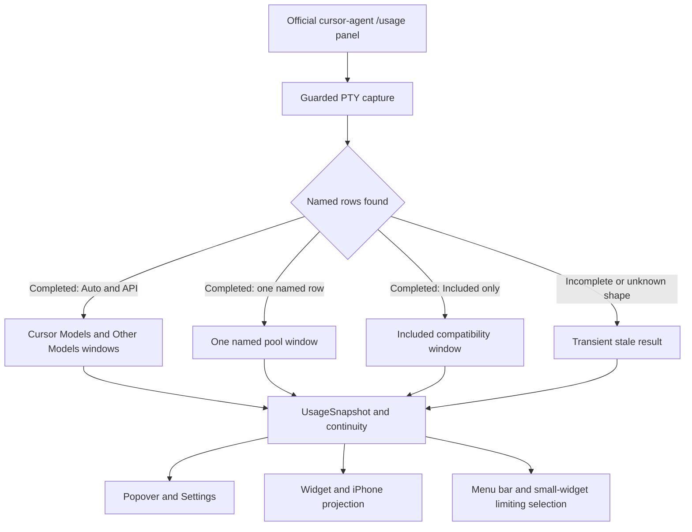

# Cursor Two-Pool Usage - Plan

## Goal Capsule

- **Objective:** Headroom reports Cursor Models and Other Models as separate monthly usage lanes so Cursor users can see the two allowances that govern their subscription.
- **Means:** Extend the official `cursor-agent /usage` parser to map its `Auto` and `API` rows to Cursor's current customer-facing pool names, preserve `Included` as a compatibility fallback, and let Headroom's existing multi-window pipeline carry both lanes to every applicable surface.
- **Execution profile:** Swift 6.4 code on macOS with Xcode 27. Parser and projection behavior stay deterministic and fully mocked; the final acceptance includes one live read from the official Cursor CLI.
- **Stop conditions:** The official CLI no longer exposes the two rows; a proposed change would require a private Cursor endpoint, local credential/database scraping, or submission of a model prompt; the live values cannot be reconciled with Cursor's own Plan & Usage screen.
- **Product authority:** This Product Contract and `AGENTS.md`. The official-client boundary and the PTY input-safety gates remain binding.
- **Active scope:** Cursor subscription usage parsing, two-pool presentation, compatibility behavior, fixture parity, constrained-surface selection, diagnostics, and provider documentation.
- **Open blockers:** None.

---

## Product Contract

### Summary

Headroom will show Cursor Models and Other Models as separate monthly lanes using the official Cursor CLI's `Auto` and `API` rows.
The parent Included percentage will remain a compatibility fallback instead of becoming a third visible lane.

### Problem Frame

Cursor's current Plan & Usage screen presents two monthly allowances: Cursor Models and Other Models.
The official `cursor-agent /usage` panel exposes the same account values under the source labels `Auto` and `API`, plus a parent `Included` row.
Headroom currently parses only Included and publishes one generic Monthly lane.

That single value is not a usable substitute for the two pools.
On the verified account, the official CLI reported Included at 1%, Auto at 1%, and API at 3%, while Cursor's desktop UI showed Cursor Models at 1% and Other Models at 3%.
A user who sees only Headroom's 1% value cannot tell that the allowance used by third-party models is more depleted.
Cursor Router can also draw from either pool according to the model selected for a request, so the two values describe distinct constraints rather than duplicate presentations of one total.

### Key Decisions

- **Use Cursor Models and Other Models as the visible names.** These names match Cursor's current product UI and documentation; `Auto` and `API` remain source labels inside the parser. (session-settled: user-approved — chosen over exposing Auto and API: the product names match Cursor users' mental model, while Auto is a routing mode and API suggests developer-key usage.) Governs R2, R3.
- **Do not render Included beside the two named pools.** Included is retained only for a one-lane compatibility fallback. (session-settled: user-approved — chosen over a third Included lane and over dropping older layouts: the parent value does not explain both named pools, but it is still better than no usage on a layout without subrows.) Governs R4, R5.
- **Keep the official-client boundary.** Headroom continues to drive the official CLI's free status panel and does not introduce Printing Press, a Headroom-owned Cursor CLI, dashboard scraping, local database reads, or private API calls. (session-settled: user-approved — chosen over building or generating another CLI: the official CLI already provides the required values.) Governs R1, R12.

### Requirements

**Source interpretation**

- R1. Headroom reads Cursor subscription usage only through the official `cursor-agent /usage` PTY path and preserves every existing pre-input safety gate.
- R2. A complete current panel maps the `Auto` percentage to a Cursor Models billing-period window and the `API` percentage to an Other Models billing-period window, in that order.
- R3. Both named windows carry their source percentages and the panel's genuine shared monthly reset evidence; Headroom does not infer usage from the parent Included value.
- R4. When both named rows are present, the parent Included row is not published as a visible window.

**Compatibility and failure honesty**

- R5. When neither named row exists but a valid Included row does, Headroom publishes one Included monthly window as a compatibility fallback only after a trailing table marker proves that the panel painted past the named-row position.
- R6. A completed panel may publish one recognized named row for a plan that exposes only one pool. A capture that ends before the trailing table marker, combines rows from different repaints, or contains an unrecognized sibling usage row is incomplete and does not publish a live subscription snapshot.
- R7. A transient or incomplete capture retains the last valid snapshot through the existing snapshot-level continuity policy until its genuine reset boundary.
- R8. Cursor on-demand parsing remains independent of subscription-pool completeness, and spend projection, authentication, account identity, reset-day handling, and single-account capacity remain unchanged.

**Surfaces**

- R9. The macOS popover, Settings retained-usage row, iPhone companion, and medium and large widgets show both named lanes through their existing multi-window renderers.
- R10. Single-meter surfaces show the more depleted named pool with its label, so the menu bar and small widget do not hide the tighter Cursor allowance behind the first pool. Equal percentages resolve to the first source-ordered pool, Cursor Models.
- R11. Demo and preview data use distinct non-equal values for the two pools so a collapsed, duplicated, reordered, or omitted lane is detectable.
- R12. The diagnostic prints both named percentages for a current panel and clearly identifies the Included fallback when that compatibility path is active.

**Documentation**

- R13. Provider documentation records the source-label mapping, the fallback matrix, the verified CLI version, and the current two-pool product semantics without claiming that Included is a sum, maximum, or authoritative aggregate.

### Key Flows

- F1. Current Cursor CLI panel
  - **Trigger:** The official panel contains Included, Auto, and API rows.
  - **Steps:** Headroom parses Auto and API, maps them to the current product names, and publishes two monthly windows with the same scheduled reset.
  - **Outcome:** Every multi-window surface shows Cursor Models and Other Models; Included is not visible.
  - **Covers:** R1, R2, R3, R4, R9.
- F2. Older one-row layout
  - **Trigger:** A completed panel contains Included but neither Auto nor API.
  - **Steps:** Headroom parses the parent percentage and publishes one compatibility window labelled Included.
  - **Outcome:** The user keeps an honest, explicitly generic reading without Headroom fabricating the two-pool split.
  - **Covers:** R5, R8, R12.
- F3. Partial TUI paint
  - **Trigger:** A captured candidate ends before the post-pool table marker or contains incompatible sibling labels.
  - **Steps:** The subscription provider returns a typed transient stale result; continuity retains the prior complete snapshot while it remains valid. Independently parsed on-demand state remains usable when its own fields are complete.
  - **Outcome:** Headroom does not present a partial table as if it were the complete Cursor allowance.
  - **Covers:** R6, R7.
- F4. Constrained projection
  - **Trigger:** A Cursor snapshot with two pools reaches the menu bar or small widget.
  - **Steps:** The surface selects the pool with the least remaining allowance and keeps its customer-facing label.
  - **Outcome:** A one-meter surface communicates the value most likely to constrain the user's next model choice.
  - **Covers:** R10.

### Acceptance Examples

- AE1. **Covers R2, R3, R4.** Given Included at 1%, Auto at 1%, and API at 3%, when the provider parses the panel, then it emits Cursor Models at 1% used followed by Other Models at 3% used with identical reset evidence and no Included window.
- AE2. **Covers R5.** Given a panel with Included at 42%, no Auto or API rows, and a valid On-Demand row after the subscription table, when the provider parses the panel, then it emits one Included window at 42% used.
- AE3. **Covers R6, R7.** Given a prior complete two-pool snapshot and a later capture that ends after Auto but before On-Demand, when the result is merged, then the new subscription capture is stale and the prior two lanes remain available until their reset boundary.
- AE4. **Covers R8.** Given the same current panel with fixed, unlimited, disabled, or unavailable on-demand state, when subscription parsing emits two lanes, then the spend snapshot remains byte-for-byte equivalent in meaning to today's result.
- AE5. **Covers R9, R11.** Given demo values of 31% and 63% used, when the macOS card, iPhone companion, and medium or large widget render Cursor, then both customer-facing labels and both different percentages appear in source order.
- AE6. **Covers R10.** Given Cursor Models at 31% used and Other Models at 63% used, when a single-meter projection is requested, then it selects Other Models at 37% remaining and names that pool.
- AE7. **Covers R12.** Given the verified current CLI panel, when `--probe-cursor` runs, then its redacted output lists Cursor Models and Other Models separately and contains no credential, token, account email, account identifier, or private endpoint data.
- AE8. **Covers R6, R8.** Given a completed panel with one recognized named pool and a valid On-Demand row, when both providers parse the shared capture, then the subscription provider publishes the one named pool and the spend provider preserves the independently decoded on-demand state.
- AE9. **Covers R6.** Given accumulated PTY output with Auto in one incomplete repaint and API in another incomplete repaint, when no single completed candidate contains both rows, then the subscription provider returns stale rather than synthesizing a pair.
- AE10. **Covers R10.** Given equal named-pool percentages, when a single-meter projection is requested, then it selects Cursor Models by source order.

### Success Criteria

- A live probe on the current official Cursor CLI reproduces the two percentages shown by the same account's Cursor Plan & Usage screen.
- Parser tests distinguish complete two-row, complete one-row, legacy fallback, truncated, cross-repaint, renamed-row, malformed, and on-demand variants without network, Keychain, or CLI access.
- Every projection test carries two distinct Cursor windows through without changing the widget schema.
- The existing PTY input-safety tests, full Swift suite, and Xcode app tests remain green.

### Scope Boundaries

- No generated or Headroom-owned Cursor CLI is introduced; Printing Press would only wrap a source that the official CLI already exposes.
- No private dashboard endpoint, browser-session token, IDE database, or `WorkosCursorSessionToken` path is used.
- The exact meaning or formula of the parent Included percentage is not reverse-engineered.
- Cursor on-demand spending is not redesigned.
- Cursor remains single-account because the CLI still exposes no supported config-home isolation mechanism.
- The generic meter design and card layout are not redesigned; existing multi-window components render the additional lane.
- Request-level history and model-by-model cost breakdowns remain outside this work.

### Dependencies and Sources

- Cursor's [Usage and limits documentation](https://prod.cursor.com/help/models-and-usage/usage-limits) defines the two monthly pools and states that Cursor Router requests can draw from either pool according to the routed model.
- Cursor's [Available models documentation](https://prod.cursor.com/help/models-and-usage/available-models) identifies Grok and Composer as Cursor Models and OpenAI, Anthropic, and Google models as third-party choices.
- `docs/solutions/cursor-agent-usage-feasibility.md` owns the official-client boundary, PTY safety details, and existing live-verification history.
- `Sources/HeadroomCore/Providers/CursorProvider.swift` currently parses only Included and emits one generic Monthly window.
- `Tests/HeadroomCoreTests/Fixtures/cursor-usage.txt` already contains Auto and API rows, which means the data loss occurs after capture rather than at the CLI boundary.
- A live 2026-09-21 run against Cursor Agent `2026.09.18-9a7762b` reported Included 1%, Auto 1%, and API 3%; those subrow values matched the same account's Cursor Models 1% and Other Models 3% desktop presentation.

---

## Planning Contract

### Key Technical Decisions

- KTD1. **Represent both pools as distinct billing-period windows.** Use the customer-facing label as part of each `WindowKind.billingPeriod` value and reuse the shared monthly duration and reset deadline. This gives continuity storage, popover rendering, widget projection, iPhone projection, severity, and accessibility distinct stable identities without a Cursor-only UI model. Governs R2, R3, R9.
- KTD2. **Decode coherent completed panel candidates.** Segment accumulated PTY output into usage-panel candidates and parse subscription rows only within one candidate. A trailing On-Demand row proves the candidate painted past the pool table. A completed candidate with both recognized rows produces two pools, one recognized row produces that one pool, and no recognized rows plus Included produces the compatibility result. A candidate without completion evidence, or with an unrecognized sibling usage row, returns the existing transient capture outcome. Governs R4, R5, R6, R7.
- KTD3. **Keep Included as evidence, not an aggregate model.** The parsed source may retain the parent percentage for diagnostics and fallback selection, but the provider never derives a named pool from it or renders it alongside a complete split. Cursor does not document its aggregate formula, and the verified values prove it cannot replace both subrows. Governs R3, R4, R5, R13.
- KTD4. **Extend the shared multi-window pipeline instead of adding Cursor-specific views.** The popover, Settings, widget projector, and phone already consume arrays of usage windows. Implementation updates provider output, deterministic fixtures, and tests; it changes a shared projection helper only where one-meter selection needs the more depleted pool. Governs R9, R10, R11.
- KTD5. **Use the tighter pool on one-meter surfaces.** Preserve the weekly preference for rolling-window providers; when a provider has multiple billing-period windows and no weekly window, choose the lowest remaining percentage. Break equal values by source order so Cursor Models wins deterministically. This aligns the small widget with the menu bar's existing limiting-window fallback. Governs R10.
- KTD6. **Keep the panel-recognition gate backward compatible.** Do not require Auto and API before the PTY recognizes a usage panel, because R5 supports a parent-only layout. The parser, not the keystroke gate, owns the complete/current/partial distinction after the existing quiet-period drain. Governs R1, R5, R6.
- KTD7. **Make diagnostics and fixtures expose the contract.** The permanent probe prints each parsed subscription window, and the sanitized fixture plus fake PTY use unequal current values. This prevents another diagnostic from reporting only the parent row while the source capture already contains more detail. Governs R11, R12, R13.

### High-Level Technical Design

The parser remains the translation boundary between Cursor's source terminology and Headroom's product model.
Downstream surfaces receive ordinary `UsageWindow` values and remain unaware of `Auto`, `API`, or the fallback decision.

### Implementation Constraints

- Preserve the OSC 11 response, ready-prompt allowlist, late trust/MCP classification, selected `/usage` autocomplete requirement, Kitty Enter encoding, hard deadlines, quiet-period drain, and bounded process-group teardown.
- Match Auto and API as complete row labels with numeric percentages; do not accept substring matches that could bind to descriptive prose or another command.
- Parse subscription rows from one completed panel candidate; never search independently across the full accumulated repaint transcript.
- Treat the On-Demand row as structural completion evidence after the subscription rows, while decoding its value independently for the spend provider.
- Clamp parsed percentages through the existing finite 0...100 rule.
- Keep reset evidence source-owned and identical across both named windows.
- Do not bump the widget schema because the existing representation supports multiple labelled billing-period windows.
- Keep test data sanitized and non-secret; live diagnostic output prints labels and percentages only.

### System-Wide Impact

- **Continuity:** Distinct window labels produce distinct stored identities. Snapshot-level stale retention already preserves both windows when the provider returns an empty stale result.
- **Menu bar:** Cursor has no five-hour or weekly window, so the existing limiting fallback already chooses the tighter pool. Tests pin that behavior by provider label.
- **Widgets:** Medium and large widgets and the iPhone companion already render every projected subscription window. The small widget's primary-period selection changes from first billing window to tightest billing window when more than one exists.
- **Settings:** The retained-usage row already displays two windows. The new Cursor result fills both slots without changing layout.
- **On-demand spend:** The shared capture cache still lets subscription and spend providers parse one panel capture independently. The panel decoder exposes subscription-pool state separately from the on-demand fields, so an incomplete subscription table does not invalidate a complete spend reading.

### Risks and Mitigations

- **CLI terminology may change again.** Keep exact source labels isolated in the parser and fail stale when a completed candidate contains unknown sibling usage rows. Update the fixture and mapping tests when Cursor changes the contract instead of silently treating a renamed layout as Included-only fallback.
- **The Auto/API mapping is empirically verified but not documented by Cursor.** Pin it with the live matching percentages, current product documentation, and a provider solution note that distinguishes observed source labels from documented product names.
- **A repeated TUI paint may contain more than one copy of a row.** Choose the last coherent completed candidate rather than the last independent match for each label. Use unequal values and split incomplete repaints in tests so synthetic cross-paint pairing is observable.
- **A second row increases compact-surface density.** Reuse the existing two-window paths and run live MenuBarExtra acceptance in both appearances; do not infer visual correctness from parser tests.

### Sequencing

1. Establish the parser/provider contract and diagnostic output with current, fallback, partial, repeated-paint, and on-demand tests.
2. Propagate two distinct fixture windows through demos, widgets, phone projection, Settings, menu bar, and small-widget selection.
3. Run the live official-CLI and native UI acceptance gates, then update the durable provider documentation with the verified result.

---

## Implementation Units

### U1. Parse and publish both official Cursor pools

- **Goal:** Convert one official panel capture into two named subscription windows without weakening PTY safety or changing on-demand behavior.
- **Requirements:** R1-R8, R12.
- **Dependencies:** None.
- **Files:** `Sources/HeadroomCore/Providers/CursorProvider.swift`; `Sources/HeadroomApp/HeadroomApp.swift`; `Tests/HeadroomCoreTests/Fixtures/cursor-usage.txt`; `Tests/HeadroomCoreTests/Fixtures/cursor-agent-ready.zsh`; `Tests/HeadroomCoreTests/CursorProviderTests.swift`; `Tests/HeadroomCoreTests/AccountEmailTests.swift`.
- **Approach:** Replace the single required Included percentage with a panel decoder that returns header/reset data, independently decoded on-demand data, and a typed subscription state from the last coherent completed candidate. Build provider windows from that subscription state in source order. Update the diagnostic to iterate the resulting named windows rather than synthesize one Monthly line.
- **Test scenarios:** Current 1%/3% split; arbitrary unequal values; parent value different from both subrows; repeated paints where the last coherent completed candidate wins; Auto and API split across incomplete repaints; completed parent-only fallback; truncated parent-only capture; completed one-named-pool layout; truncated one-named-pool capture; unknown or renamed sibling rows; malformed percentages; reset-day rollover; subscription-incomplete but on-demand-complete capture; all on-demand variants; live email and failed-email paths; fake PTY capture of both rows; every existing trust/MCP/no-input gate.
- **Verification:** `swift test --filter 'CursorProviderTests|CursorAccountEmailTests'`; inspect diagnostic output for two labels and no raw panel or credentials.

### U2. Carry two lanes through every applicable surface

- **Goal:** Make the two-pool snapshot visible and testable across macOS, widgets, and the iPhone companion while preserving constrained-surface honesty.
- **Requirements:** R9-R11.
- **Dependencies:** U1.
- **Files:** `Sources/HeadroomCore/DemoFixture.swift`; `Sources/HeadroomCore/Widgets/DemoScreenshotData.swift`; `Sources/HeadroomCore/Widgets/WidgetSnapshotModels.swift`; `Tests/HeadroomCoreTests/DemoFixtureTests.swift`; `Tests/HeadroomCoreTests/DemoScenarioParityTests.swift`; `Tests/HeadroomCoreTests/WidgetSnapshotProjectorTests.swift`; `Tests/HeadroomCoreTests/WidgetWindowLabelTests.swift`; `Tests/HeadroomCoreTests/MirrorPresentationTests.swift`; `Tests/HeadroomCoreTests/UsageStoreTests.swift`.
- **Approach:** Give Cursor demo data two unequal named billing-period windows with one shared reset. Extend projection and parity assertions to require both values in order. Change the generic primary billing-period selection to choose the lowest remaining value when no weekly window exists and to retain source order for equal values; leave weekly-first behavior unchanged for Claude and Codex.
- **Test scenarios:** Two Cursor windows survive widget projection with their labels, durations, reset schedules, and percentages; the iPhone mirror returns both; medium and large display order stays Cursor Models then Other Models; the small widget selects the tighter pool and chooses Cursor Models on a tie; the menu bar makes the same selections; one-pool Grok and weekly-first Claude/Codex behavior does not change; Settings retained usage receives both windows.
- **Verification:** `swift test --filter 'DemoFixtureTests|DemoScenarioParityTests|WidgetSnapshotProjectorTests|WidgetWindowLabelTests|MirrorPresentationTests|UsageStoreTests'`; run the four-provider demo and inspect the live macOS popover in light and dark appearances.

### U3. Reverify the official boundary and record the contract

- **Goal:** Prove the implementation against the current vendor client and leave durable guidance for the next Cursor layout change.
- **Requirements:** R12, R13.
- **Dependencies:** U1, U2.
- **Files:** `docs/solutions/cursor-agent-usage-feasibility.md`; `AGENTS.md`.
- **Approach:** Update the provider solution and project gotcha with the observed Auto/API-to-product-name mapping, the KTD2 fallback matrix, the current official two-pool semantics, and the latest successful live CLI version. Keep the prohibited private-source guidance unchanged.
- **Test scenarios:** A live signed-in probe prints both named percentages; the same account's Cursor Plan & Usage screen shows matching values; the current fixture and probe output contain no secret, account email, or account identifier; the native popover shows both rows without truncation in both appearances.
- **Verification:** `swift run Headroom --probe-cursor`; `swift run Headroom --demo multi-4`; `swift test`; `./Scripts/build-app.sh --deps-only && xcodebuild -project Headroom.xcodeproj -scheme HeadroomAppTests -destination 'platform=macOS' -derivedDataPath ./.xcode-derived test`.

---

## Verification Contract

| Gate | Command or evidence | Proves | Units |
|---|---|---|---|
| Cursor parser and PTY safety | `swift test --filter 'CursorProviderTests|CursorAccountEmailTests'` | Complete, fallback, partial, repeated-paint, on-demand, account-email, and no-unsafe-input behavior | U1 |
| Cross-surface model | `swift test --filter 'DemoFixtureTests|DemoScenarioParityTests|WidgetSnapshotProjectorTests|WidgetWindowLabelTests|MirrorPresentationTests|UsageStoreTests'` | Both pools survive projections and constrained surfaces select the tighter pool | U2 |
| Core regression | `swift test` | The full mocked provider, continuity, scheduler, projection, and settings suite remains green | U1, U2 |
| App integration | `./Scripts/build-app.sh --deps-only && xcodebuild -project Headroom.xcodeproj -scheme HeadroomAppTests -destination 'platform=macOS' -derivedDataPath ./.xcode-derived test` | SwiftUI/app composition and Xcode-only tests compile and pass | U1, U2 |
| Live provider acceptance | `swift run Headroom --probe-cursor` against the current official CLI | The shipping PTY path returns both values without a private source or model request | U1, U3 |
| Native visual acceptance | `swift run Headroom --demo multi-4`, then inspect the live MenuBarExtra in light and dark appearances | Two named lanes fit the real popover and retain meter hierarchy | U2, U3 |
| Documentation audit | Review `docs/solutions/cursor-agent-usage-feasibility.md` and `AGENTS.md` against the live result and official docs | Future changes retain the mapping, failure matrix, and compliance boundary | U3 |

The live visual gate uses the real `MenuBarExtra` window because offscreen rendering is not final visual evidence for this repository.
If visual capture is needed, ask before taking over the user's screen and batch the acceptance into one short run.

---

## Definition of Done

- The current official panel produces exactly two live subscription windows named Cursor Models and Other Models with their independent percentages.
- A completed parent-only layout produces one Included compatibility window; a completed one-pool layout produces that named pool; truncated, cross-repaint, or unknown layouts fail stale and preserve valid prior data.
- Included never appears as a third lane beside the complete two-pool result.
- The popover, Settings, iPhone companion, and medium and large widgets receive both lanes; the menu bar and small widget name and show the tighter lane.
- Cursor on-demand spend, reset timing, account email, single-account capacity, and PTY safety behavior remain unchanged.
- The permanent diagnostic reports both pools and a live run matches Cursor's own Plan & Usage values for the same account.
- Targeted tests, the full Swift suite, Xcode app tests, and live native visual acceptance pass with recorded output.
- Durable Cursor provider documentation reflects the verified source mapping and current official product semantics.
- No private Cursor data source, generated CLI, credential handling, new widget schema, abandoned experiment, or unrelated refactor remains in the diff.
